# Ağ Mimarileri, İletişim Modelleri ve Topolojiler

Modern bilgi toplumunun temelini oluşturan bilgisayar ağları, verinin küresel ölçekte anlık olarak paylaşılmasını sağlayan dinamik ve karmaşık sistemlerdir. Bu sistemler, yalnızca bağlantı sağlayan pasif altyapılar olmaktan çıkıp, iş süreçlerini ve siber güvenlik operasyonlarını şekillendiren programlanabilir varlıklara dönüşmüştür.

Bu bölümde, ağ iletişimini yöneten evrensel ilkeleri, standartları, fiziksel kablolama normlarını, topolojileri, omurga ağ donanımlarını, Spine-Leaf veri merkezi mimarisini ve OSI/TCP-IP katmanlı referans modellerini derinlemesine inceleyeceğiz.

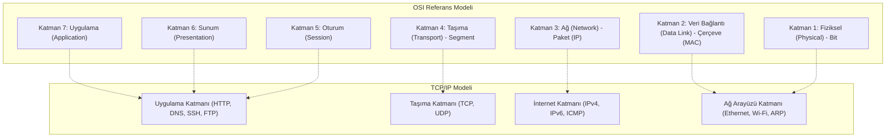

---

## §1.1.1. Ağların Sınıflandırılması: Kapsama Alanına Göre

Bilgisayar ağları, kapsadıkları coğrafi alana ve sundukları hizmet ölçeğine göre dört temel kategoriye ayrılır:

| Ağ Türü | Kapsama Alanı | Temel Teknolojiler | Tipik Kullanım & Güvenlik Perspektifi |
| :--- | :--- | :--- | :--- |
| **PAN** *(Personal Area Network)* | Birkaç metre | Bluetooth, BLE, Zigbee | Kişisel cihazlar, giyilebilir teknoloji, IoT eşleşme zafiyetleri |
| **LAN** *(Local Area Network)* | Tek bina, ofis, kampüs | Ethernet (802.3), Wi-Fi (802.11) | Yüksek bant genişliği, düşük gecikme, 802.1X ve VLAN segmentasyonu |
| **MAN** *(Metropolitan Area Network)* | Şehir veya geniş yerleşke | Metro Ethernet, Kiralık Fiber | Şubeler ve kampüsler arası güvenli omurga bağlantısı |
| **WAN** *(Wide Area Network)* | Ülkeler, kıtalar arası | MPLS, IPsec VPN, SD-WAN, BGP | İnternet omurgası, coğrafi yedeklilik, şifrelenmiş tüneller |

:::note
Ağ türü genişledikçe fiziksel denetim azalır ve mantıksal şifreleme (IPsec, MACsec, TLS) gereksinimi katlanarak artar. LAN seviyesinde fiziksel port güvenliği ve 802.1X öne çıkarken, WAN seviyesinde uçtan uca kriptografik tünelleme zorunludur.
:::
---

## §1.1.2. Fiziksel Altyapı ve Kablolama Standartları

Ağ güvenliği ve performansının ilk halkası fiziksel ortamdır. Veri iletim ortamları; bakır kablolar, fiber optik kılcal hatlar ve elektromanyetik dalgalardan oluşur.

### 1. Bakır Kablolama: UTP vs. STP

Bakır kablolarda elektriksel sinyaller çiftler halinde bükülerek (twisted pair) taşınır. Bu büküm, harici elektromanyetik parazitlerin (EMI) ve çapraz konuşmanın (crosstalk) birbirini sönümlemesini sağlar.

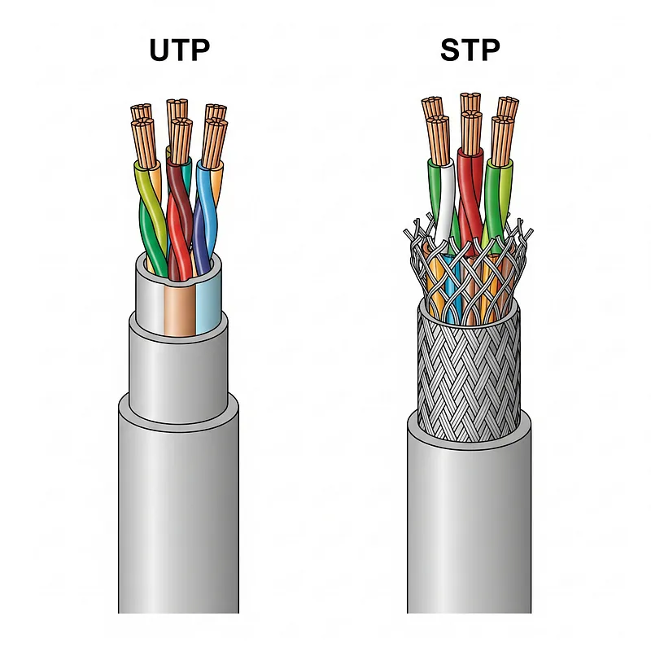

- **UTP (Unshielded Twisted Pair):** İlave metal koruyucu folyo içermez. Esnektir, maliyeti düşüktür ve standart ofis ortamlarının fiili standardıdır (Cat5e, Cat6, Cat6a).
- **STP (Shielded Twisted Pair):** Her bükümlü çift veya tüm kablo gövdesi metalik folyo/örgü kalkanla sarılmıştır. Ağır endüstriyel ortamlarda, yüksek gerilim hatlarının yakınında ve parazite duyarlı veri merkezi omurgalarında tercih edilir. Topraklama hatası durumunda kalkanın kendisi anten görevi görebilir.

### 2. Koaksiyel ve Fiber Optik Kablolar

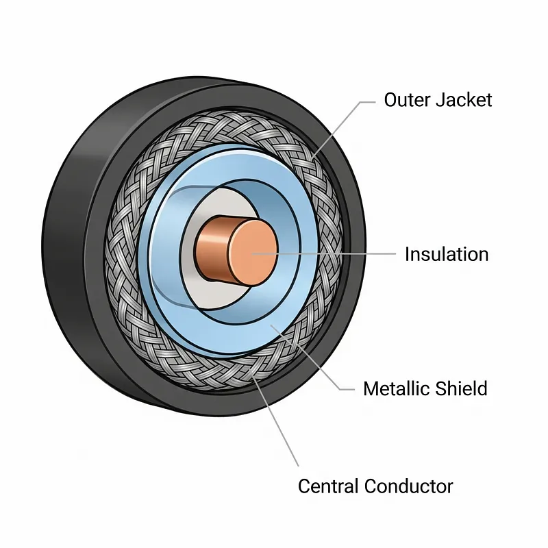

- **Koaksiyel Kablo:** Merkezi bakır iletken, dielektrik yalıtkan, metalik örgü zırh ve dış kılıftan oluşur. Günümüzde DOCSIS kablo modem şebekelerinde ve CCTV kamera altyapılarında kullanılır.

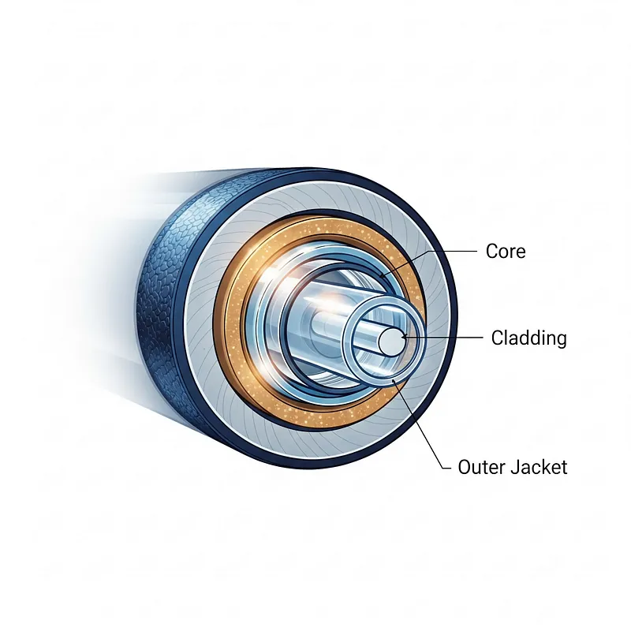

- **Fiber Optik Kablo:** Elektriksel sinyal yerine ışık darbeleri iletir. Elektromanyetik parazitlerden tamamen etkilenmez, dinlenmesi (eavesdropping/wiretapping) son derece zordur ve onlarca kilometrelik mesafelerde sıfır kayıpla terabit düzeyinde hız sunar.
  - **Single-Mode Fiber (SMF):** Dar çekirdek çapı (~9 µm). Tek bir ışık modunu taşır; lazer ışık kaynağı kullanır. Kampüsler arası ve WAN hatlarında 40-100 km mesafeler için idealdir.
  - **Multi-Mode Fiber (MMF):** Geniş çekirdek çapı (50 veya 62.5 µm). LED veya VCSEL kaynağı kullanır; modal dispersiyon nedeniyle maksimum 300-550 metre veri merkezi içi bağlantılarda (OM3/OM4/OM5) kullanılır.

### 3. RJ-45 Konnektör Pin Dizilimleri: T568A vs. T568B

Bakır Ethernet sonlandırmalarında TIA/EIA-568 standardı iki renk kodlama şeması belirlemiştir:

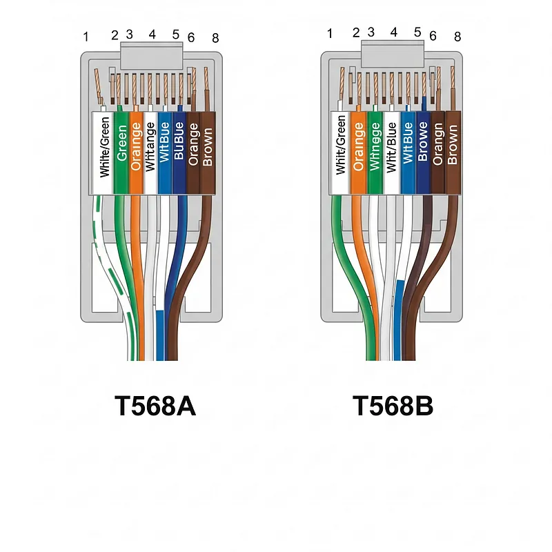

| Pin | T568A Rengi | T568B Rengi | Sinyal (10/100Base-T) | Gigabit Ethernet (1000Base-T) |
| :---: | :--- | :--- | :--- | :--- |
| **1** | Yeşil-Beyaz | Turuncu-Beyaz | Tx+ (İletim +) | Veri Çifti A+ |
| **2** | Yeşil | Turuncu | Tx- (İletim -) | Veri Çifti A- |
| **3** | Turuncu-Beyaz | Yeşil-Beyaz | Rx+ (Alım +) | Veri Çifti B+ |
| **4** | Mavi | Mavi | Kullanılmaz | Veri Çifti C+ |
| **5** | Mavi-Beyaz | Mavi-Beyaz | Kullanılmaz | Veri Çifti C- |
| **6** | Turuncu | Yeşil | Rx- (Alım -) | Veri Çifti B- |
| **7** | Kahverengi-Beyaz | Kahverengi-Beyaz | Kullanılmaz | Veri Çifti D+ |
| **8** | Kahverengi | Kahverengi | Kullanılmaz | Veri Çifti D- |

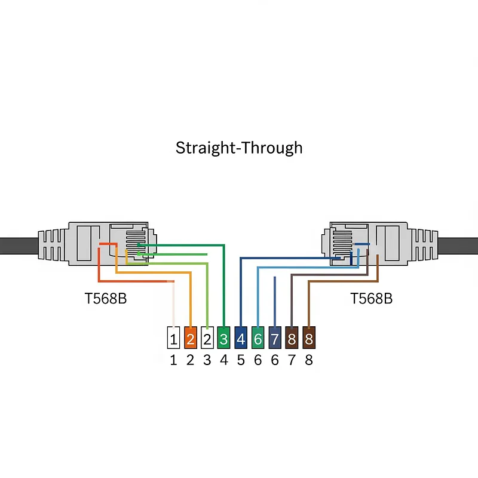

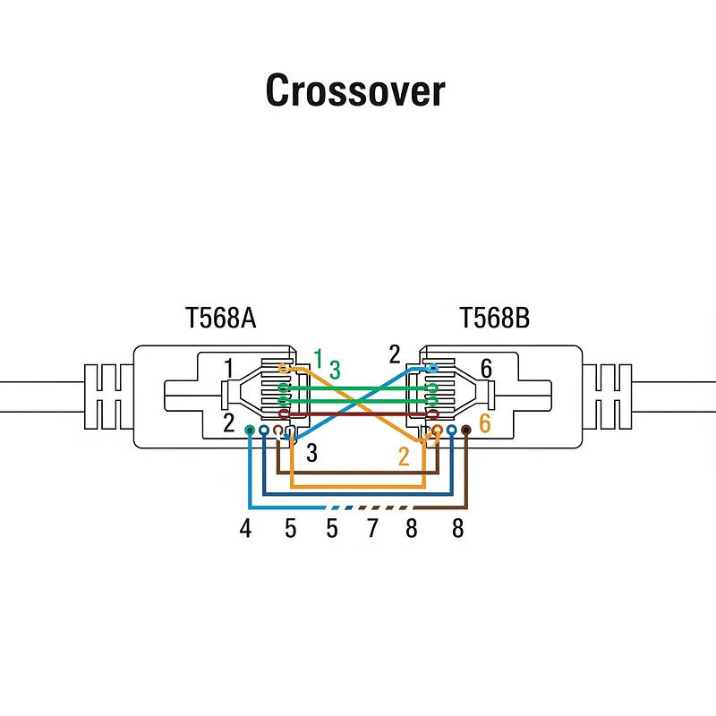

- **Düz Kablo (Straight-Through):** İki ucu da aynı standartta (genelde T568B - T568B) sonlandırılmış kablodur. Farklı türdeki cihazları birbirine bağlar (Örn: PC $\rightarrow$ Switch, Switch $\rightarrow$ Router).
- **Çapraz Kablo (Crossover):** Bir ucu T568A, diğer ucu T568B sonlandırılmıştır. Aynı türdeki cihazların doğrudan haberleşmesi için kullanılır (Örn: PC $\rightarrow$ PC, Switch $\rightarrow$ Switch, Router $\rightarrow$ Router).
- *Modern donanımlarda **Auto-MDIX** (Automatic Medium-Dependent Interface Crossover) teknolojisi sayesinde portlar pin dizilimini otomatik algılayıp çaprazlamayı dahili olarak yapar.*

---

## §1.1.3. Ağ Topolojileri: Fiziksel ve Mantıksal Düzenler

Ağ topolojisi, düğümlerin (nodes) ve bağlantı hatlarının geometrik ve mantıksal yerleşimini tanımlar.

### 1. Geleneksel ve Temel Topolojiler

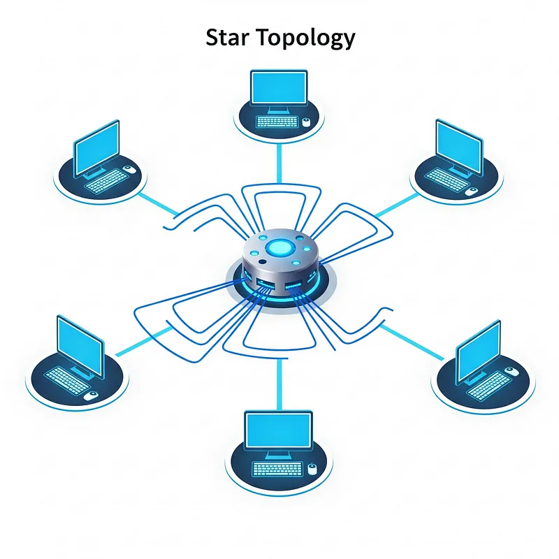

- **Star (Yıldız):** Modern yerel ağların standardıdır. Her uç cihaz merkezi bir anahtara (Switch) bağımsız kabloyla bağlanır. Bir kablonun kopması yalnızca o cihazı etkiler; ağın geri kalanı kesintisiz çalışır.

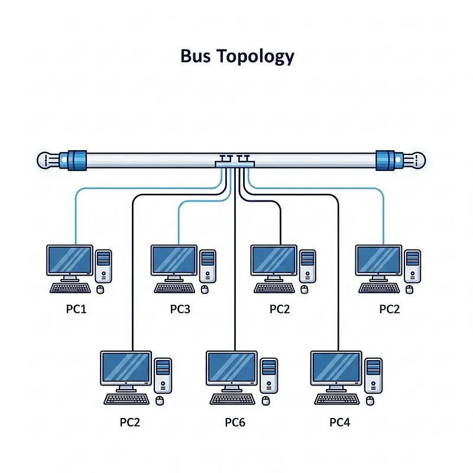

- **Bus (Ortak Yol):** Tüm cihazların tek bir koaksiyel omurga kabloya bağlandığı yapıdır. Az kablo gerektirse de, omurgadaki tek bir kopma (Single Point of Failure) tüm ağı çökertir. Çarpışma alanı (Collision Domain) tektir.

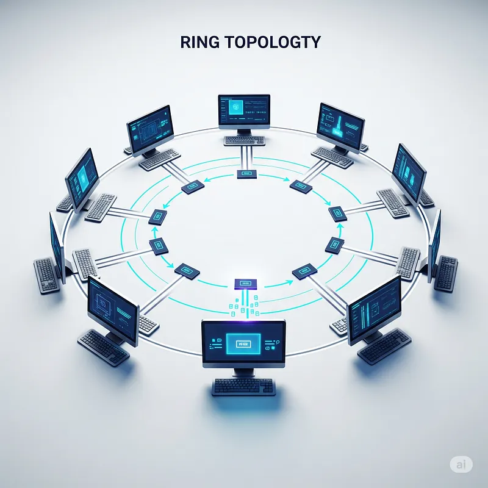

- **Ring (Halka):** Düğümlerin dairesel bir hat üzerinde bağlandığı mimaridir. Jeton (Token) mekanizmasıyla çarpışmalar engellenir. Günümüzde FDDI ve SONET/SDH optik halkalarında çift yönlü hata toleranslı olarak varlığını sürdürür.

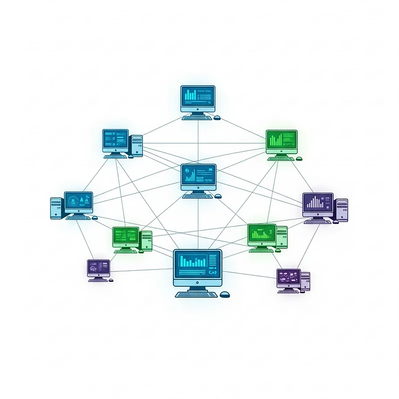

- **Mesh (Örgü):** Cihazlar arasında birden fazla yedekli fiziksel yol bulunur. Tam örgü (*Full Mesh*) formülü $N(N-1)/2$ bağlantı gerektirir. Kritik servis sağlayıcı WAN'larında ve veri merkezi omurgalarında maksimum hata toleransı sunar.

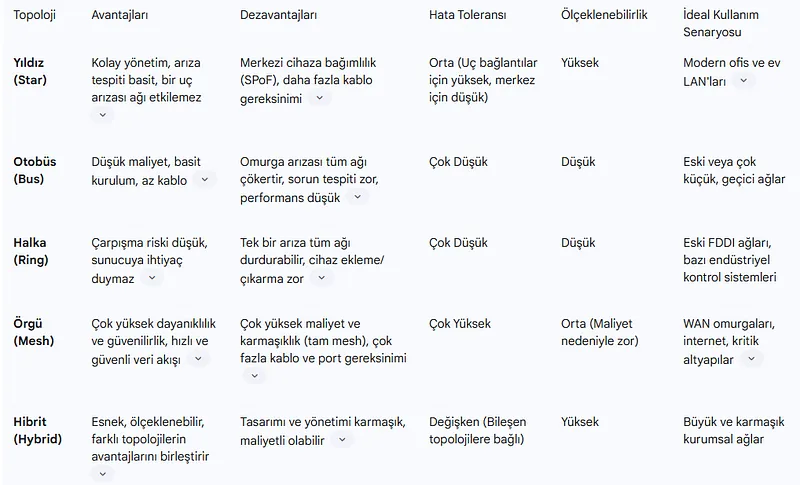

| Topoloji | Kurulum Maliyeti | Hata Toleransı | Sorun Giderme | Tipik Kullanım Alanı |
| :--- | :---: | :---: | :---: | :--- |
| **Bus** | Çok Düşük | Sıfır | Çok Zor | Eski endüstriyel otomasyon sistemleri |
| **Ring** | Orta | Düşük (Tek Halka) / Yüksek (Çift) | Orta | Metro optik omurgalar, FDDI |
| **Star** | Orta | Yüksek (Merkez anahtar hariç) | Kolay | Kurumsal LAN ve ofis ağları |
| **Full Mesh** | Çok Yüksek | Maksimum | Karmaşık | Veri merkezi çekirdeği, ISP omurgaları |

---

## §1.1.4. Temel Ağ Donanımları ve İşlevsel Mimarileri

Ağ iletişiminin gerçekleşmesini sağlayan donanımlar, OSI modelinin belirli katmanlarında uzmanlaşmış donanımsal mantık devreleriyle çalışır:

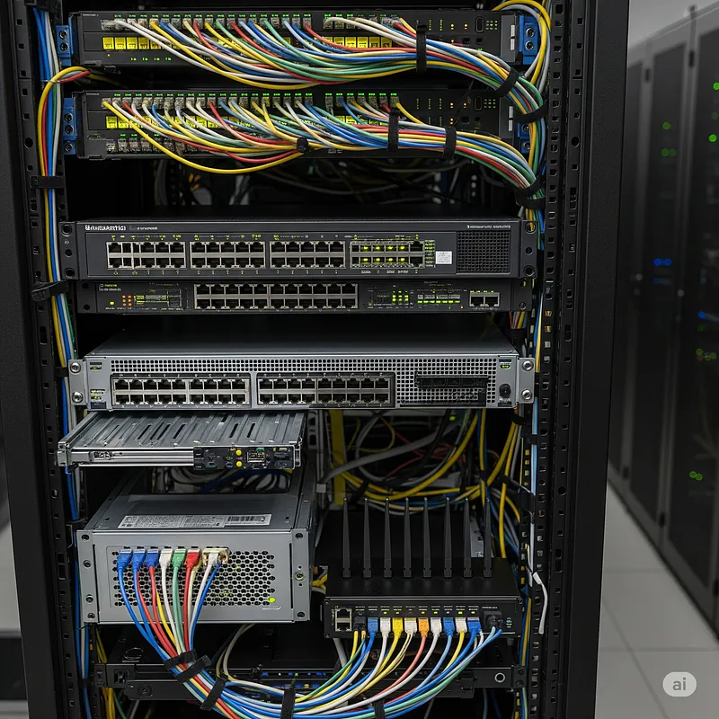

### 1. Yönlendiriciler (Router)

- OSI 3. Katmanda çalışır. Farklı mantıksal IP ağları arasında yönlendirme tablosuna (FIB/RIB) göre paket anahtarlar.
- Yayın alanlarını (*Broadcast Domain*) fiziksel olarak sınırlar ve ağ segmentasyonu sağlar.
- İki temel çalışma düzlemine sahiptir:
  - **Kontrol Düzlemi (Control Plane):** OSPF, BGP gibi protokollerle yönlendirme tablolarını hesaplar.
  - **Veri Düzlemi (Data Plane):** Gelen paketi ASIC yongaları üzerinden nano-saniyeler içinde hedef çıkış arayüzüne iletir.

### 2. Anahtarlar (Switch)

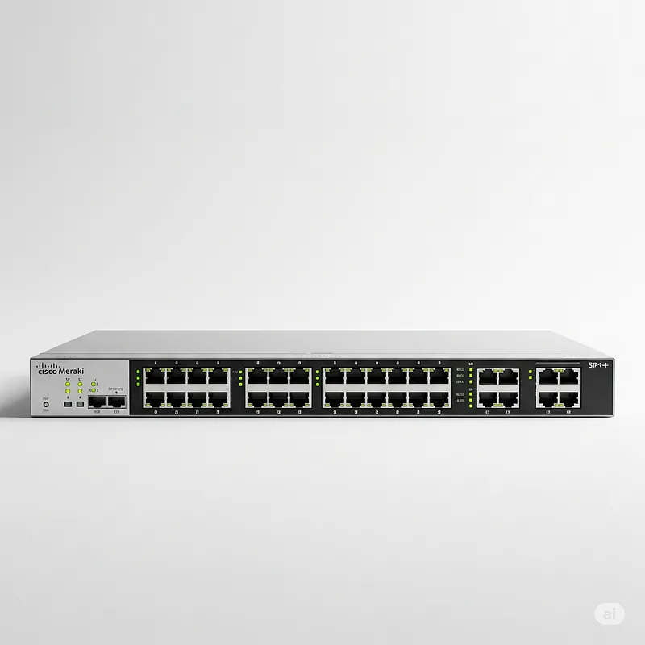

- OSI 2. Katmanda MAC adreslerine bakarak çerçeveleri yönlendirir.
- MAC tablosunu (CAM - Content Addressable Memory) dinamik olarak öğrenir: Gelen çerçevenin kaynak MAC adresini porta kaydeder, hedef MAC adresinin bulunduğu porta çerçeveyi iletir.
- Port bazında çarpışma alanını (*Collision Domain*) yok eder; tam çift yönlü (*Full Duplex*) iletişimi mümkün kılar.

### 3. Güvenlik Duvarları (Firewall)

- Ağ sınırlarında gelen ve giden trafiği güvenlik politikalarına göre denetleyen sistemlerdir.
- Paket Filtreleme (L3/L4), Durum Denetimli (Stateful Inspection) ve Katman 7 Uygulama Seviyesi Denetim (NGFW) yetenekleri barındırır.

### 4. Kablosuz Ağ Donanımları: AP, WLC ve Mesh Mimarisi

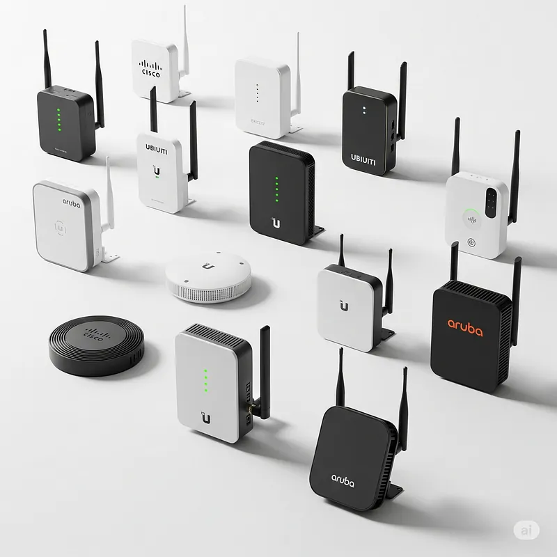

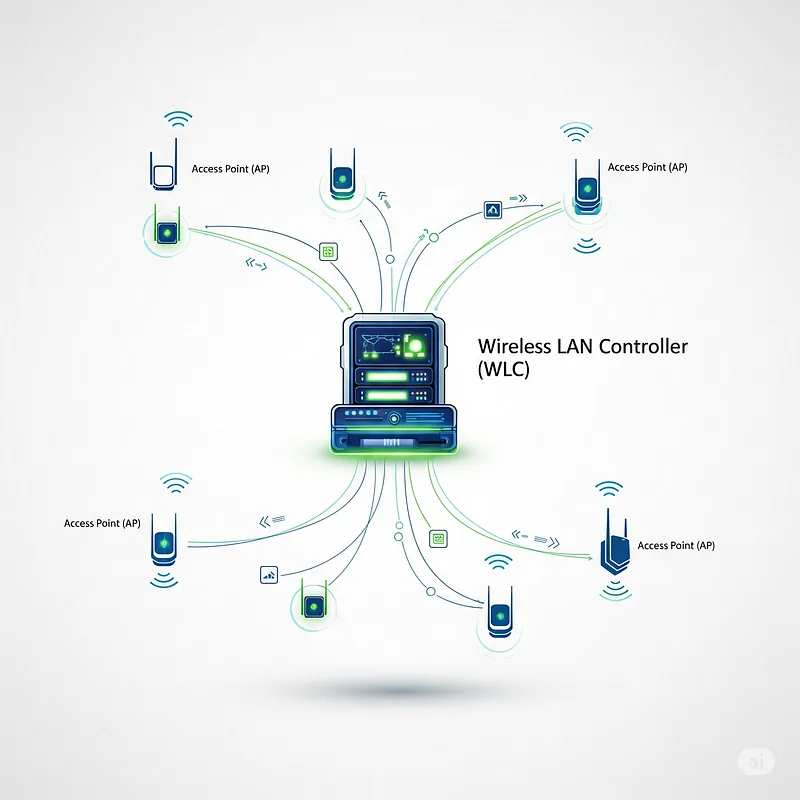

- **Access Point (AP):** 802.11 kablosuz RF sinyallerini 802.3 kablolu Ethernet çerçevelerine dönüştürür.
- **Wireless LAN Controller (WLC):** Dağıtık yüzlerce AP'nin RF gücünü, kanal atamalarını, roaming (dolaşım) süreçlerini ve güvenlik politikalarını CAPWAP tünelleri üzerinden merkezi yönetir.

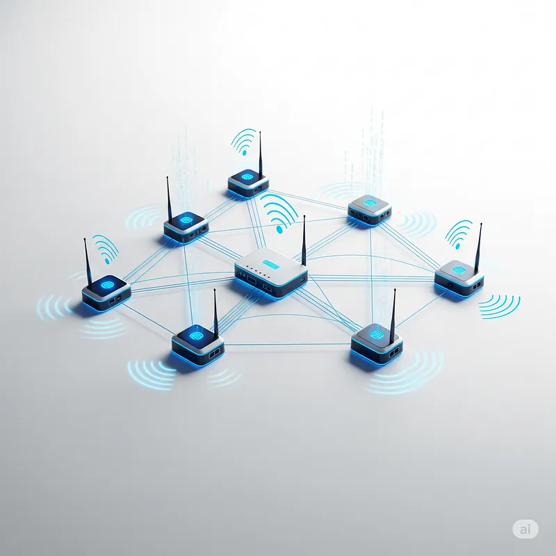

- **Kablosuz Mesh:** Fiziksel kablo çekmenin imkansız olduğu geniş sahalarda AP'lerin birbirleriyle kablosuz omurga (backhaul) frekansları üzerinden kenetlenerek kapsama alanı oluşturduğu yapıdır.

### 5. Wi-Fi Standartları ve Teknolojik Evrimi

| Standart Adı | Pazar Adı | Frekans Bandı | Maksimum Teorik Hız | Temel Yenilik |
| :--- | :--- | :--- | :--- | :--- |
| **802.11b** | - | 2.4 GHz | 11 Mbps | DSSS modülasyonu |
| **802.11a/g** | - | 5 GHz / 2.4 GHz | 54 Mbps | OFDM modülasyonu |
| **802.11n** | **Wi-Fi 4** | 2.4 GHz & 5 GHz | 600 Mbps | MIMO, 40 MHz kanal |
| **802.11ac** | **Wi-Fi 5** | 5 GHz | 6.9 Gbps | MU-MIMO, 80/160 MHz kanal |
| **802.11ax** | **Wi-Fi 6 / 6E** | 2.4, 5 ve 6 GHz | 9.6 Gbps | OFDMA, 1024-QAM, WPA3 Zorunluluğu |
| **802.11be** | **Wi-Fi 7** | 2.4, 5 ve 6 GHz | 46 Gbps | 320 MHz kanal, 4096-QAM, Multi-Link (MLO) |

### 6. Yük Dengeleyiciler (Load Balancer): Katman 4 vs. Katman 7

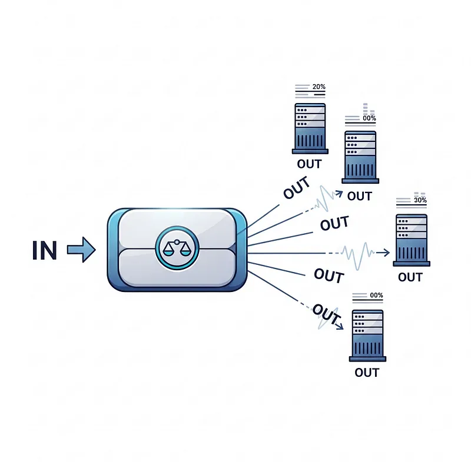

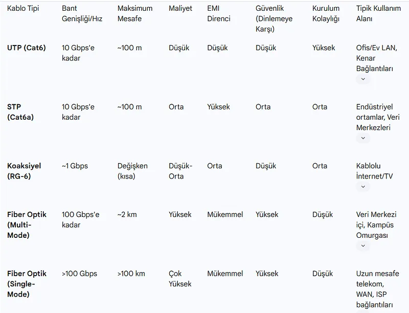

- **L4 Yük Dengeleme:** IP adresi ve TCP/UDP portuna göre paket yönlendirir. Uygulama yükünü incelemez; yüksek verim ve ultra düşük gecikme sunar.
- **L7 Yük Dengeleme:** HTTP URL, Cookie, Header veya SSL sertifika verisine bakarak akıllı yönlendirme yapar. İçerik tabanlı yönlendirme ve WAF koruması sağlar.

---

## §1.1.5. Modern Veri Merkezi Mimarisi: Spine-Leaf

Geleneksel kurumsal ağlar, **3 Katmanlı Hiyerarşik Model** (Core, Distribution, Access) üzerine inşa edilmiştir:

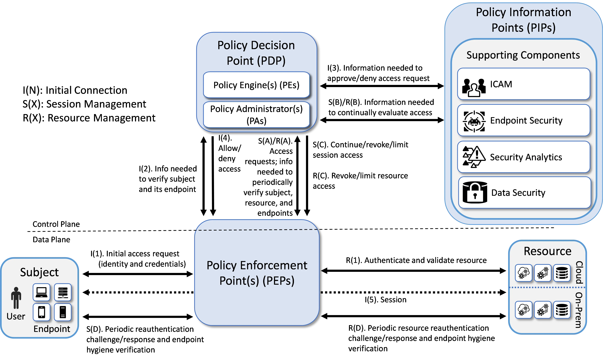

### Doğu-Batı (East-West) Trafiği ve Spine-Leaf Zorunluluğu

Modern bulut altyapılarında, mikroservis mimarilerinde ve sanallaştırmada (Kubernetes, VMware vMotion, Veritabanı Kümeleme) sunucuların kendi aralarındaki iletişim yani **Doğu-Batı (East-West)** trafiği toplam hacmin %80'inden fazlasını oluşturur.

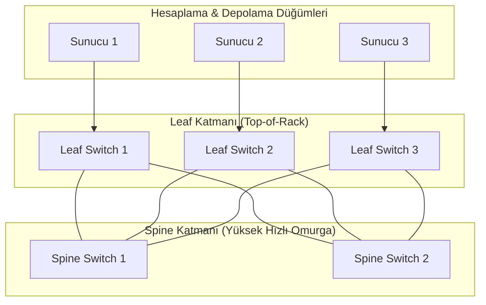

1. **Sabit Gecikme:** Her Leaf anahtarı tüm Spine anahtarlarına doğrudan bağlıdır. İki sunucu arasındaki mesafe istisnasız **tam olarak 2 hop** (Leaf $\rightarrow$ Spine $\rightarrow$ Leaf) sürer.
2. **ECMP (Equal-Cost Multi-Pathing):** Spanning Tree'nin aksine tüm hatlar aynı anda aktiftir. L3 yönlendirme (BGP veya OSPF) ile trafik tüm omurgaya dengeli dağıtılır.
3. **Ölçeklenebilirlik:** Daha fazla sunucu için yeni Leaf, daha fazla bant genişliği için yeni Spine anahtarı eklenir.

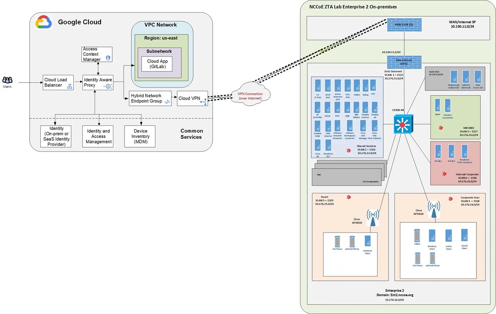

---

## §1.1.6. Referans Modelleri: OSI ve TCP/IP Karşılaştırması

Ağ mimarilerinin birlikte çalışabilirliğini sağlamak için standartlaşmış iki ana model referans alınır:

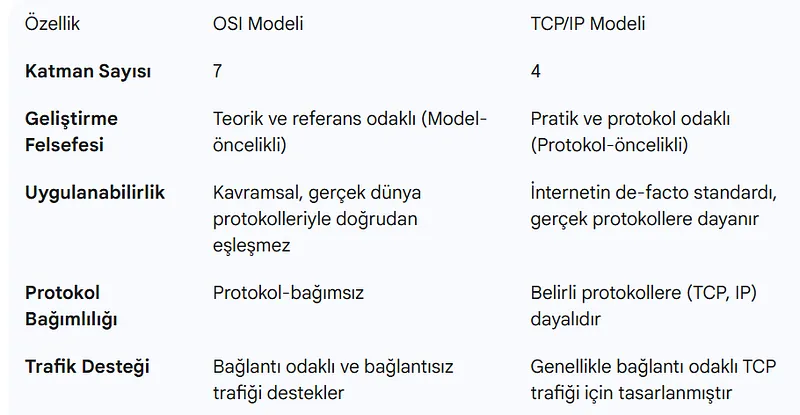

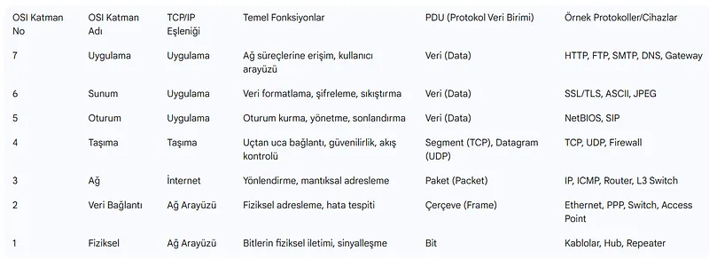

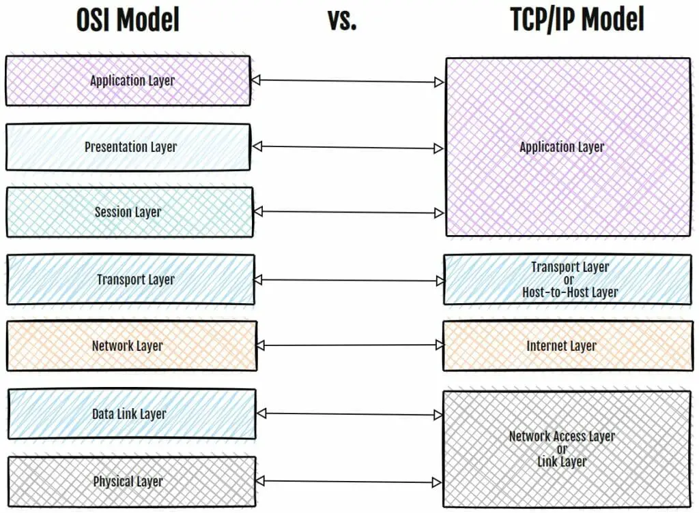

### Protokol Veri Birimleri (PDU) ve Kapsülleme (Encapsulation)

İstemciden çıkan bir veri ağ ortamına iletilirken her katmanda kendi kontrol başlığını (header) alır:

1. **Uygulama Katmanı:** Kullanıcı verisi (Payload) üretilir (Örn: HTTP GET isteği).
2. **Taşıma Katmanı:** Veriye TCP veya UDP başlığı eklenir. Kaynak ve hedef port bilgileri yerleştirilir. **PDU Adı: Segment.**
3. **Ağ / İnternet Katmanı:** Segmente kaynak ve hedef IP adreslerini barındıran IP başlığı eklenir. **PDU Adı: Paket.**
4. **Veri Bağlantı Katmanı:** Pakete kaynak ve hedef MAC adresleri ile hata kontrolü için FCS (Frame Check Sequence) eklenir. **PDU Adı: Çerçeve (Frame).**
5. **Fiziksel Katman:** Çerçeve, bakır kabloda voltaj, fiberde ışık, kablosuzda RF sinyali olarak bitlere (0 ve 1) çevrilir. **PDU Adı: Bit.**

:::caution
Alıcı tarafta bu sürecin tam tersi olan **De-kapsülleme (De-encapsulation)** gerçekleşir. Ağ arayüz kartı (NIC) MAC adresinin kendisine ait olduğunu teyit edip çerçeve başlığını soyar, IP katmanı hedef IP'yi doğrulayıp IP başlığını soyar ve taşıma katmanı port numarasına göre veriyi ilgili sokete teslim eder.
:::