# Wireshark ile Ağ Trafik Akışlarını Anlama ve Paket Analizi

Ağ mimarilerini teorik olarak bilmek bir sistemin nasıl tasarlanması gerektiğini gösterir; ancak ağda gerçekte ne olup bittiğini anlamak, performans darboğazlarını çözmek ve siber saldırıları tespit etmek **paket seviyesinde görünürlük** gerektirir.

Wireshark, ağ arayüz kartından (NIC) geçen ham bit dizilerini yakalayarak yüzlerce protokolü katman katman ayrıştıran (dissecting) dünyanın en yaygın paket analiz aracıdır. Bu bölümde, bir istemcinin ağda bir servise bağlanırken attığı adımları, yönlendirici ve anahtarların paket iletim mekanizmalarını ve Wireshark istatistik araçlarıyla canlı PCAP analiz tekniklerini inceleyeceğiz.

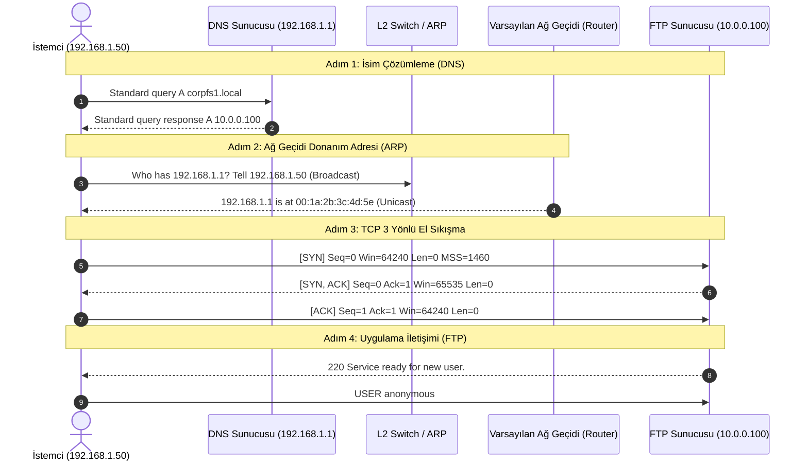

---

## §1.2.1. Yönlendirme ve Anahtarlama Prensipleri

Bir paketin ağ cihazları tarafından iletilmesi, OSI Katman 2 ve Katman 3 donanımlarının karar mekanizmalarına dayanır:

### 1. Anahtarların (Switch) Paket İletim Mantığı

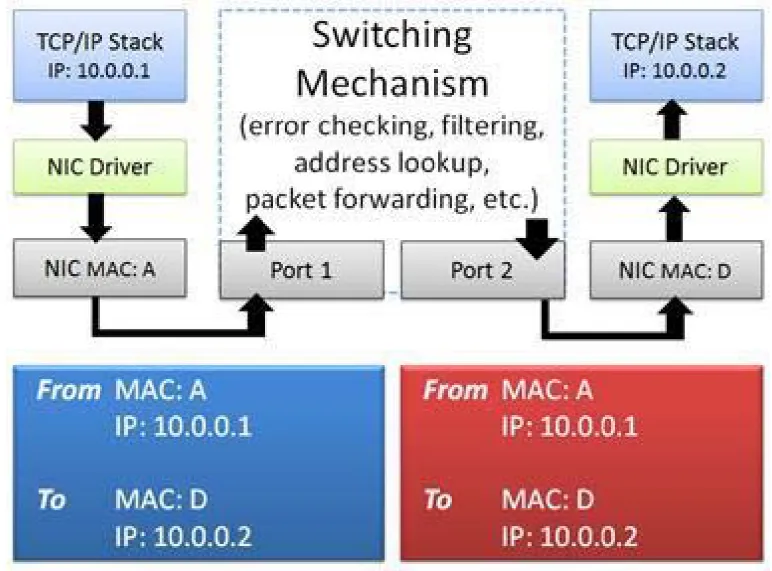

- Katman 2 anahtarlar, gelen Ethernet çerçevesinin **Hedef MAC (Destination MAC)** adresini inceler.
- Kendi hafızasındaki CAM tablosunda (MAC Address Table) bu adresin hangi fiziksel porta karşılık geldiğine bakar.
- Eşleşme varsa çerçeve doğrudan o porta iletilir (*Unicast*).
- Hedef MAC adresi henüz tabloda yoksa, çerçeveyi girdiği port hariç tüm aktif portlara kopyalar (*Flooding*).

### 2. Yönlendiricilerin (Router) Paket İletim Mantığı

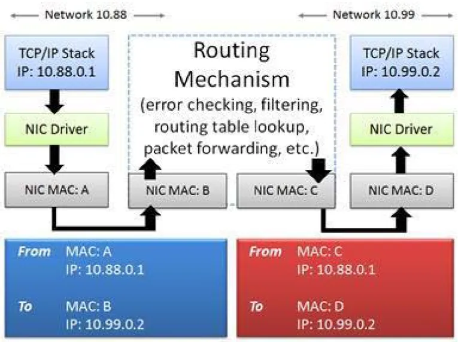

- Yönlendiriciler, gelen paketin **Hedef IP (Destination IP)** adresini yönlendirme tablosuyla (Routing Table / FIB) karşılaştırır.
- En uzun önek eşleşmesi kuralına (*Longest Prefix Match*) göre hedef alt ağa giden çıkış arayüzünü ve bir sonraki atlama (*Next-Hop*) adresini belirler.
- Çerçevenin L2 başlığındaki MAC adreslerini günceller: Kaynak MAC olarak kendi çıkış arayüzünün MAC adresini, hedef MAC olarak ise sıradaki ağ geçidinin MAC adresini yazar. IP başlığındaki TTL değerini 1 azaltır.

### 3. Dinamik Yönlendirme Protokolleri: OSPF vs. BGP

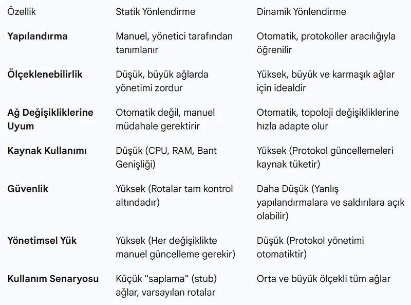

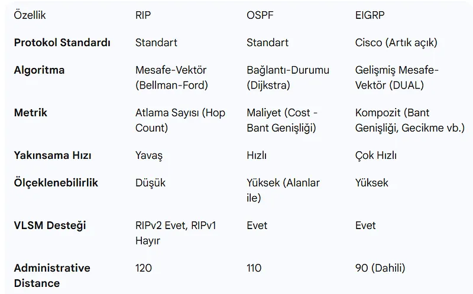

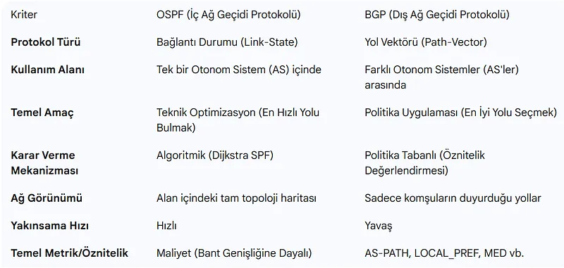

| Kriter | OSPF (Open Shortest Path First) | BGP (Border Gateway Protocol) |
| :--- | :--- | :--- |
| **Kategori** | IGP (İç Ağ Geçidi Protokolü) | EGP (Dış Ağ Geçidi Protokolü) |
| **Algoritma** | Link-State (Dijkstra SPF) | Path-Vector |
| **Ölçek** | Kurumsal LAN ve Otonom Sistem (AS) içi | Küresel İnternet Omurgası ve AS'ler arası |
| **Metrik** | Maliyet (Bant Genişliği - Cost) | BGP Nitelikleri (AS-Path, Local Pref, MED) |
| **Yakınsama (Convergence)** | Çok Hızlı (Saniyeler içinde) | Yavaş (Politika tabanlı, dakikalar sürebilir) |
| **Protokol / Port** | IP Protokol 89 | TCP Port 179 |

---

## §1.2.2. Wireshark Arayüz Anatomisi ve Paket Yakalama Mekaniği

Bir ağ analiz aracının trafiği inceleyebilmesi için işletim sisteminin çekirdeğindeki paket filtreleme sürücüleriyle (Windows'ta `Npcap`, Linux'ta `libpcap`) haberleşmesi gerekir.

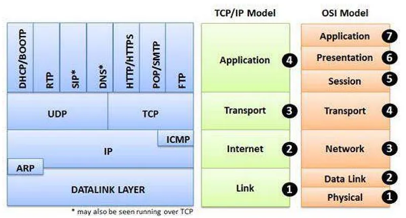

### Arayüz Modları
- **Normal Mod:** Ağ kartı yalnızca hedefi kendi MAC adresi olan veya genel yayın (Broadcast/Multicast) çerçevelerini kabul eder; diğerlerini donanım seviyesinde atar.
- **Promiscuous (Karma) Mod:** Ağ kartı donanımsal MAC filtrelemesini kapatır. Fiziksel ortama düşen tüm çerçeveleri hedef MAC adresine bakılmaksızın yakalayıp Wireshark'a iletir. Switched ağlarda diğer sunucuları dinlemek için **Port Mirroring / SPAN** gerekir.

---

## §1.2.3. Canlı Trafik Akış Senaryosu: İstemci — FTP Sunucu İletişimi

Bir kullanıcının komut satırından `ftp CORPFS1` yazdığı anda arka planda çalışan çözümleme süreçleri şöyledir:

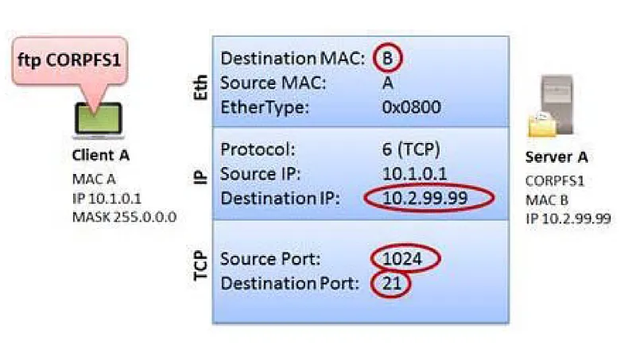

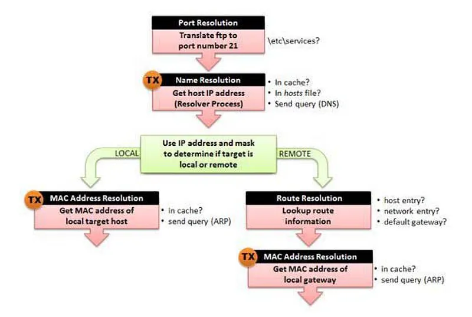

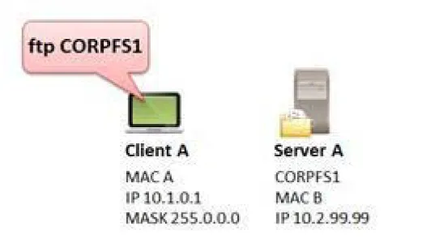

### Adım 1: Port Numarası Çözümleme
İstemci işletim sistemi, `ftp` uygulamasının hangi port üzerinden haberleşeceğini öğrenmek için yerel servis veritabanını (`/etc/services` veya `C:\Windows\System32\drivers\etc\services`) kontrol eder. FTP kontrol oturumunun hedef portunun `TCP 21` olduğunu belirler. İstemci, giden paket için işletim sisteminden geçici (ephemeral) dinamik bir kaynak port (Örn: `49152`) tahsis eder.

### Adım 2: Ağ Adı Çözümlemesi (DNS)
Kullanıcı bir IP adresi yerine isim (`CORPFS1`) belirttiği için istemci DNS sorgusu üretir:
1. Yerel DNS önbelleğini kontrol eder (`ipconfig /displaydns`).
2. Yerel `hosts` dosyasını inceler.
3. Ağdaki yapılandırılmış DNS sunucusuna `Standard Query A CORPFS1` paketi yollar.
4. Gelen yanıtta sunucunun IP adresi (Örn: `192.168.1.100`) elde edilir.

### Adım 3: Yerel Donanım Adresi Çözümlemesi (ARP)
İstemci, hedef IP adresinin kendi yerel ağında olduğunu tespit ettiğinde L2 çerçevesini oluşturmak için hedef MAC adresine ihtiyaç duyar:
- İstemci ARP tablosuna (`arp -a`) bakar.
- Eşleşme yoksa ağa genel yayın (*Broadcast - FF:FF:FF:FF:FF:FF*) olarak `ARP Request` paketi yollar.
- Hedef sunucu istemciye doğrudan (*Unicast*) olarak `ARP Reply` cevabını verir.

### Adım 4: Rota Çözümlemesi (Uzak Ağlar İçin)
Hedef sunucu farklı bir alt ağda veya internette yer alıyorsa, istemci yönlendirme tablosuna bakarak varsayılan ağ geçidini (*Default Gateway*) seçer. Paketin hedef IP adresine sunucunun IP adresini yazar; ancak çerçevenin hedef MAC adresine **yönlendiricinin arayüz MAC adresini** yerleştirir.

### Adım 5: TCP 3 Yönlü El Sıkışma
IP ve MAC adresleri çözüldükten sonra güvenilir taşıma oturumu başlatılır:
- **SYN:** İstemci rastgele bir Sequence Number (Seq=0) ve MSS gibi TCP opsiyonları içeren SYN paketi gönderir.
- **SYN-ACK:** Sunucu bağlantıyı kabul ettiğini belirten kendi Seq numarasını ve istemcinin Seq değerini 1 artırarak (Ack=1) yanıt verir.
- **ACK:** İstemci onayı tamamlar; oturum **ESTABLISHED** durumuna geçer.

### Adım 6: Uygulama İletişimi
Bağlantı kurulur kurulmaz sunucu `220 Microsoft FTP Service` hoşgeldiniz mesajını iletir ve istemci kimlik doğrulama komutlarını (`USER`, `PASS`) aktarır.

---

## §1.2.4. PCAP Paket Dosyası Analizi ve Wireshark İstatistik Araçları

Bir ağ uzmanının yüzbinlerce paketlik bir PCAP yakalama dosyasını incelerken ilk başvuracağı yöntemler Wireshark istatistik menüleridir:

### 1. Başlangıç DNS Sorguları ve DNS Önbellek Davranışı

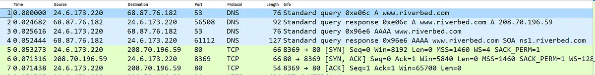

- İlk kez ziyaret edilen bir hedef için pcap dosyasının başında muhakkak DNS `A` ve `AAAA` sorguları görülür (`http-riverbed-one.pcapng`).

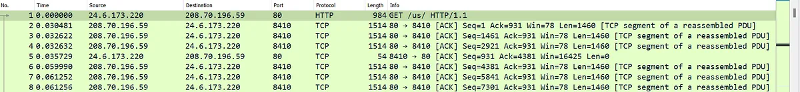

- İkinci bağlantı denemesinde (`http-riverbed-two.pcapng`) DNS sorguları yer almaz; çünkü istemci işletim sistemi IP adresini önbelleğe almıştır.

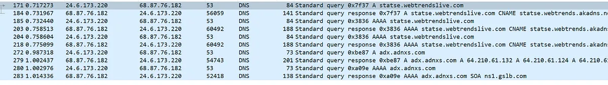

- DNS yanıtındaki TTL (Time To Live) süresi dolduğunda, tarayıcı veya istemci servisi ismi yeniden çözümlemek için ağa yeni bir DNS sorgusu yollar.

### 2. Protokol Hiyerarşisi (Protocol Hierarchy)

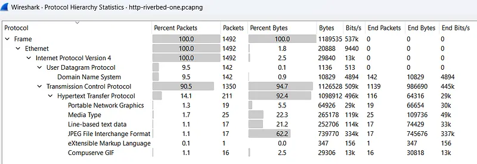

- **Statistics $\rightarrow$ Protocol Hierarchy** menüsü, yakalanan tüm trafiğin protokol bazlı dağılımını yüzde ve paket sayısı olarak verir.
- Ağdaki anormal yayın fırtınaları (Broadcast Storms), beklenmedik UDP taşmaları veya şüpheli tüneller saniyeler içinde bu ekranda fark edilir.

### 3. Konuşmalar (Conversations) ve Uç Noktalar (Endpoints)

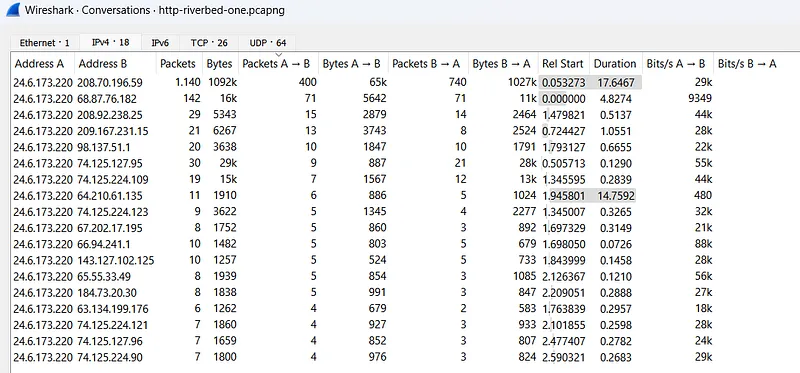

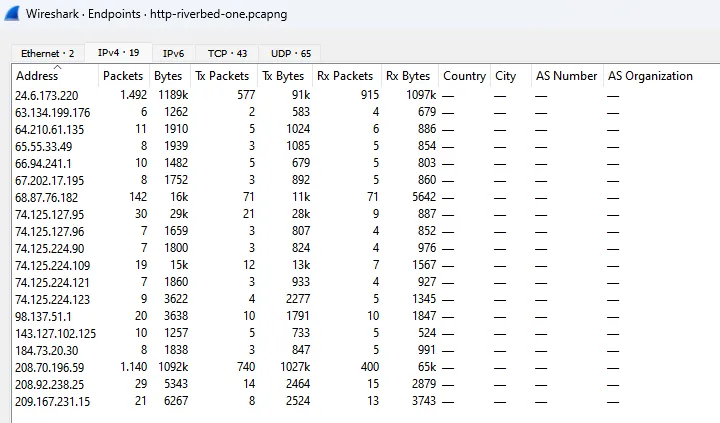

- **Statistics $\rightarrow$ Conversations:** Hangi iki cihaz arasında en çok veri aktarıldığını (Bayt ve Paket cinsinden) listeler. En çok konuşan (Top Talker) saldırgan veya arızalı sunucuyu tespit etmek için birincil ekrandır.
- **Statistics $\rightarrow$ Endpoints:** Trafiğe katılan tüm tekil IP, MAC ve TCP/UDP portlarını coğrafi ve sayısal olarak döker.

### 4. HTTP İstekleri ve Akış Takibi (Follow Stream)

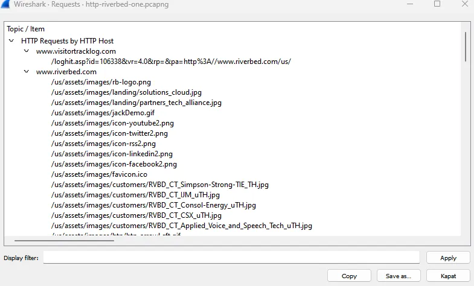

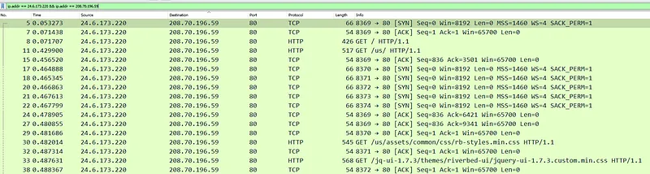

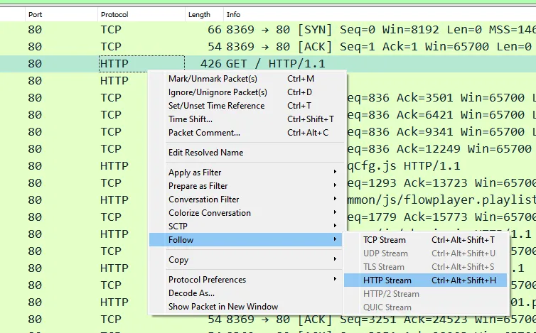

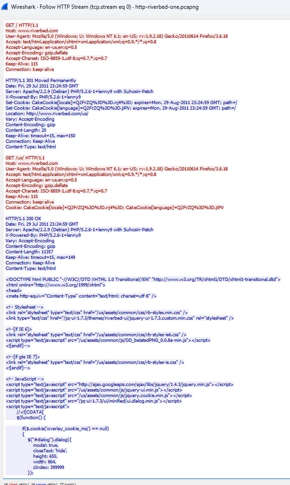

- **Statistics $\rightarrow$ HTTP $\rightarrow$ Requests:** PCAP içindeki tüm web isteklerinin URL ve host dökümünü çıkarır.
- Bir pakete sağ tıklayıp **Follow $\rightarrow$ HTTP Stream** (veya TCP Stream) dendiğinde, Wireshark tüm TCP segmentlerini sıralı olarak birleştirir ve istemci (kırmızı) ile sunucu (mavi) arasındaki tüm konuşmayı ham metin olarak ekrana getirir.

---

## §1.2.5. Güvenlik Duvarı ve NAT Etkisi

Paket analizi yaparken paketlerin geçtiği ara cihazların başlıkları nasıl değiştirdiğini bilmek hayati önem taşır:

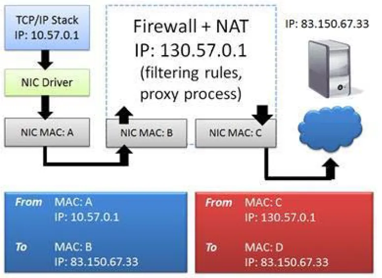

- **Ağ Adresi Dönüştürme (NAT):** Özel IP (RFC 1918) bloklarındaki istemcilerin internete çıkışında, kaynak IP genel (Public) IP ile değiştirilir. Bir analist, NAT cihazının iç bacağında `192.168.1.50` gördüğü trafiği, dış bacakta `203.0.113.5` olarak görür. Bu iki akışı eşleştirmek için TCP portları ve zaman damgaları korele edilmelidir.
- **Port Adresi Dönüştürme (PAT):** Tek bir genel IP üzerinden binlerce istemcinin çıkışını sağlamak için kaynak port numaraları da dinamik olarak yeniden yazılır.

---

## §1.2.6. Temel Wireshark Ekran Filtreleri (Display Filters)

Wireshark'ta binlerce paket arasından kritik bilgiyi çekmek için ekran filtreleri kullanılır:

| Filtre Sözdizimi | Açıklama |
| :--- | :--- |
| `ip.addr == 192.168.1.100` | Kaynağı veya hedefi belirtilen IP olan tüm paketler |
| `ip.src == 192.168.1.50 && ip.dst == 192.168.1.100` | İki uç nokta arasındaki belirli yönlü trafik |
| `tcp.port == 21 || tcp.port == 20` | FTP kontrol ve veri aktarım paketleri |
| `arp` | Yalnızca ARP istek ve yanıtları |
| `dns` | Yalnızca DNS sorgu ve cevapları |
| `tcp.flags.syn == 1 && tcp.flags.ack == 0` | Yalnızca yeni bağlantı başlatma (SYN) paketleri |
| `http.request.method == "POST"` | Yalnızca HTTP POST istekleri |
| `frame contains "USER"` | Paket yükünde (payload) "USER" ifadesi geçenler |

> [!TIP]
> Paket analizi yaparken şüpheli bir oturumu incelemenin en hızlı yolu `tcp.stream eq X` filtresidir. İlgili akışa sağ tıklayıp "Follow $\rightarrow$ TCP Stream" seçildiğinde bu filtre otomatik uygulanır.
