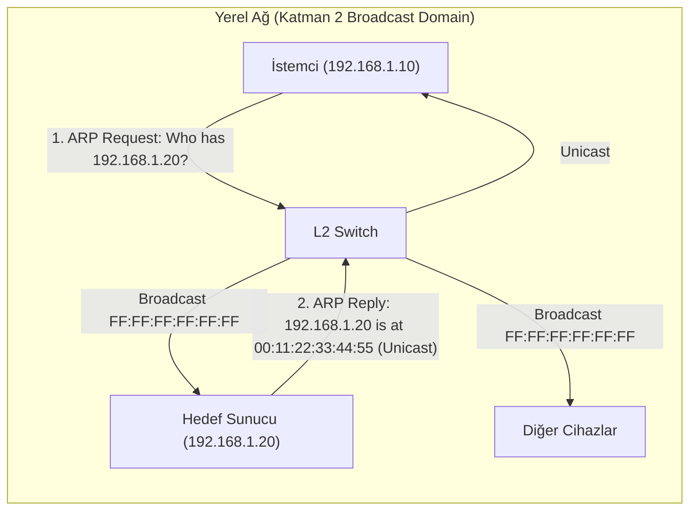
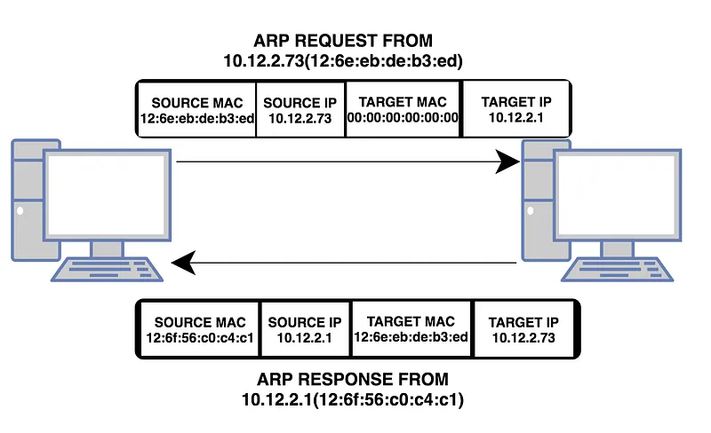
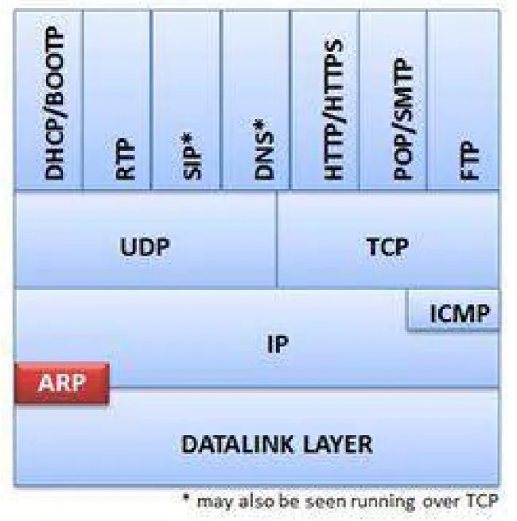
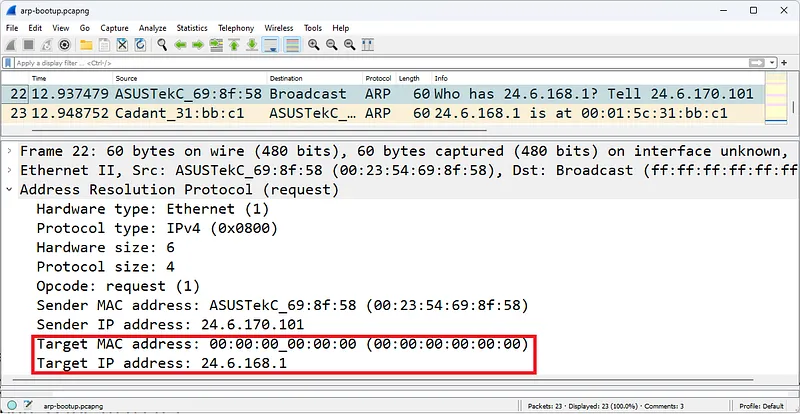
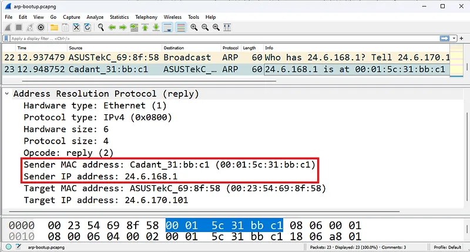
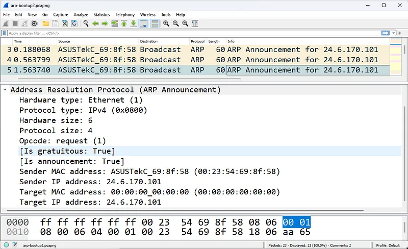
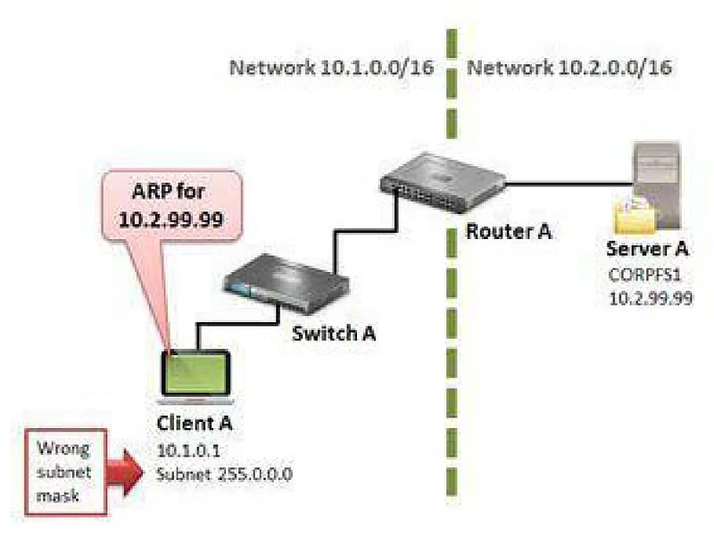
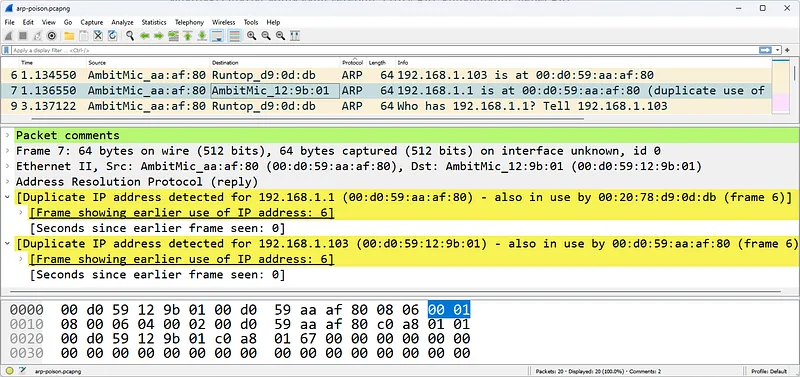

# ARP Protokolü Mimarisi, Paket Anatomisi ve Sorun Tespiti

Adres Çözümleme Protokolü (Address Resolution Protocol - ARP), mantıksal Katman 3 IP adresleri ile fiziksel Katman 2 MAC adresleri arasındaki köprüyü kuran, yerel alan ağlarının (LAN) en kritik çekirdek protokollerinden biridir.

RFC 826 ile tanımlanan ARP, ne kadar basit bir mekanizmaya sahip olursa olsun, ağdaki yanlış yapılandırmaların, IP çakışmalarının ve Ortadaki Adam (MitM / ARP Spoofing) saldırılarının ilk işaret fişeğidir. Bu bölümde ARP protokolünün iç işleyişini, Wireshark paket başlık yapısını, cevapsız ARP mekanizmasını ve trafik filtreleme yöntemlerini inceleyeceğiz.

---

## §2.1.1. ARP Nasıl Çalışır?

ARP, yerel bir ağdaki bir IP adresinin hangi donanım (MAC) adresine ait olduğunu belirlemek ve IP adres çakışmalarını tespit etmek için kullanılır.

:::caution[Altın Kural]
ARP protokolü yalnızca yerel ağda (Broadcast Domain) çalışır! ARP paketleri Katman 3 yönlendiriciler (Router) tarafından başka ağlara yönlendirilmez (*non-routable*). Dolayısıyla ARP trafiğini Wireshark ile yakalayabilmek için analistin doğrudan o yerel ağ segmentine bağlı olması veya switch üzerinde SPAN/Mirroring portuna bağlanması gerekir.
:::

---

## §2.1.2. ARP İstek ve Yanıtlarının Paket Analizi

Normal bir ARP iletişimi iki adımdan oluşur:

### 1. ARP İsteği (ARP Request)
Hedef IP adresine sahip cihazın MAC adresi bilinmediğinde, kaynak cihaz çerçeveyi genel yayın MAC adresine (`FF:FF:FF:FF:FF:FF`) yollar. Ağdaki tüm switch'ler bu paketi gelen port haricindeki tüm portlara çoğaltarak iletir.

Wireshark paket detayında:
- **Hardware type:** `Ethernet (1)`
- **Protocol type:** `IPv4 (0x0800)`
- **Hardware size:** `6` (MAC adresi 6 bayttır)
- **Protocol size:** `4` (IPv4 adresi 4 bayttır)
- **Opcode:** `request (1)`
- **Sender MAC address:** Gönderenin fiziksel adresi
- **Sender IP address:** Gönderenin IP adresi
- **Target MAC address:** `00:00:00:00:00:00` (Bilinmediği için sıfırlanmıştır)
- **Target IP address:** Aranan hedef IP adresi

### 2. ARP Yanıtı (ARP Reply)
Aranan IP adresinin gerçek sahibi paketi aldığında, yalnızca isteği yapan cihaza hitaben tek noktaya yayın (**Unicast**) bir ARP Yanıtı gönderir.

- **Opcode:** `reply (2)`
- **Sender MAC address:** Hedef cihazın gerçek MAC adresi
- **Target MAC address:** İsteği yapan istemcinin MAC adresi

İstemci bu cevabı alır almaz yerel **ARP Önbelleğine (ARP Cache)** yazar (`arp -a` komutuyla görüntülenebilir) ve sonraki veri paketlerini doğrudan bu MAC adresine iletir.

---

## §2.1.3. ARP Sorunlarının Analizi ve Cevapsız ARP (Gratuitous ARP)

Wireshark ile ağ incelenirken ARP paketleri şu durumlara işaret eder:

### 1. Yinelenen IP Tespiti (Duplicate IP Address Detection)
Bir işletim sistemi (Windows/Linux) ağ kartını etkinleştirdiğinde veya DHCP'den yeni bir IP aldığında, ağa **Gratuitous ARP (G-ARP)** veya cevapsız ARP isteği gönderir:
- Gönderen IP: Kendi IP'si
- Hedef IP: Kendi IP'si
- Hedef MAC: `FF:FF:FF:FF:FF:FF`

Eğer bu isteğe ağdan herhangi bir cihaz ARP Reply dönerse, ağda aynı IP adresini kullanan başka bir cihaz var demektir. İşletim sistemi kullanıcıya "IP Adresi Çakışması" uyarısı vererek arayüzü kapatır.

### 2. Yanlış Alt Ağ Maskesi Yapılandırması (Subnet Misconfiguration)
İstemci yanlış bir subnet maskesiyle (örneğin `/24` yerine `/8`) yapılandırıldığında, aslında uzakta olan ve yönlendiriciye gitmesi gereken sunucuların yerel ağda olduğunu varsayar ve uzak IP'ler için doğrudan ARP yayınları göndermeye başlar.

### 3. Proxy ARP
Bazı yönlendiriciler, istemcinin varsayılan ağ geçidi yapılandırılmadığı durumlarda, istemcinin uzak IP için yaptığı ARP isteklerine kendi MAC adresini vererek yanıt döner. Bu geçici bir iletişim sağlasa da ağ trafiğini gizler ve sorun tespitini zorlaştırır.

---

## §2.1.4. ARP Zehirlenmesi (ARP Spoofing / Poisoning) ve Paket Seviyesinde Tespiti

ARP protokolünde kimlik doğrulama mekanizması bulunmaz. Cihazlar talep etmedikleri (unsolicited) ARP yanıtlarını dahi kabul ederek yerel önbelleklerini güncellerler.

Saldırganlar bu zafiyeti kullanarak kurbana `Ağ Geçidinin IP'si benim MAC adresimdedir`, ağ geçidine ise `Kurbanın IP'si benim MAC adresimdedir` şeklinde sahte ARP paketleri fırlatır.

Wireshark ile ARP zehirlenmesi trafiği şu belirtilerle derhal yakalanır:
1. **Çift MAC Eşleşmesi:** Farklı iki IP adresinin (Örn: `192.168.1.1` ve `192.168.1.150`) aynı kaynak MAC adresini beyan etmesi.
2. **Yüksek Frekanslı İstenmeyen ARP Yanıtları:** İstemci tarafında hiçbir ARP isteği üretilmediği halde art arda gelen `arp.opcode == 2` paketleri.
3. **Wireshark Expert Info Uyarıları:** `Duplicate IP address detected for 192.168.1.1` uyarısının tetiklenmesi.

---

## §2.1.5. Wireshark ARP Filtreleme Kütüphanesi

Ağ analizinde ve olay müdahale operasyonlarında ARP trafiğini filtrelemek için aşağıdaki sözdizimleri kullanılır:

| Filtre | Amacı |
| :--- | :--- |
| `arp` | Tüm ARP istek ve yanıtlarını listeler |
| `arp.opcode == 1` | Yalnızca ARP İstekleri (Requests) |
| `arp.opcode == 2` | Yalnızca ARP Yanıtları (Replies) |
| `arp.duplicate-address-frame` | Wireshark'ın tespit ettiği IP çakışma paketleri |
| `arp.src.hw_mac == 00:11:22:33:44:55` | Belirli bir fiziksel cihazın ürettiği tüm ARP'ler |
| `arp.dst.proto_ipv4 == 192.168.1.1` | Ağ geçidi için gönderilen tüm ARP sorguları |

:::tip
Ağda aşırı sayıda `arp.opcode == 1` paketi görüyor ancak yanıt göremiyorsanız, ağda aktif bir IP taraması (Host Discovery / Nmap ARP scan) yapılıyor olabilir.
:::