# IPv4 ve IPv6 Mimarisi, Alt Ağ Yönetimi ve Başlık Analizi

İnternet Protokolü (IP), modern ağların temel taşıyıcı kolonudur. OSI modelinin 3. Katmanında (Ağ Katmanı) ve TCP/IP modelinin İnternet Katmanında çalışan IP; paketlerin kaynak düğümden hedef düğüme farklı ağlar ve otonom sistemler (AS) üzerinden uçtan uca yönlendirilmesini sağlar.

IP protokolü doğası gereği **bağlantısız (connectionless)** ve **güvensizdir (best-effort delivery)**. IP'nin kendisi paketin hedefe ulaşıp ulaşmadığını doğrulamaz; bu görev gerekiyorsa Katman 4'te çalışan TCP'ye bırakılır.

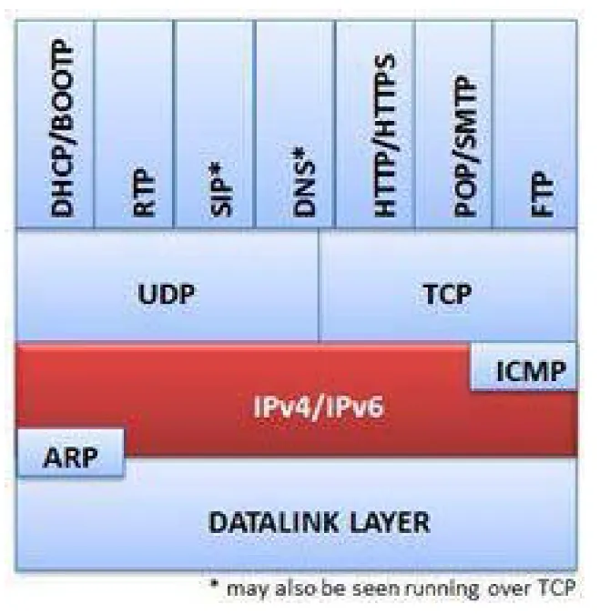

---

## §2.2.1. IPv4 Paket Anatomisi ve Başlık Alanları

Standart bir IPv4 başlığı opsiyonlar hariç **20 bayt (160 bit)** uzunluğundadır:

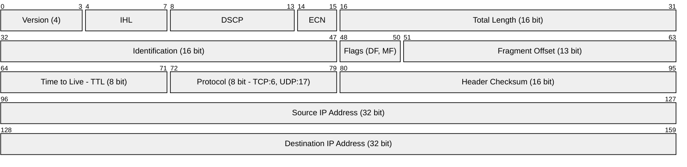

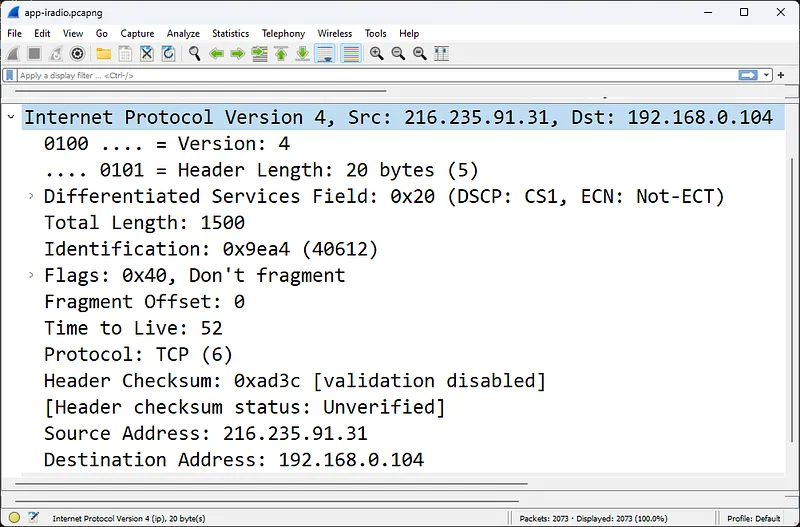

### Kritik Başlık Alanlarının Fonksiyonları:

1. **Version (4 bit):** Protokol sürümünü gösterir (`4` = IPv4).
2. **IHL (Internet Header Length - 4 bit):** Başlığın 32-bitlik kelime cinsinden uzunluğudur. Opsiyonsuz başlık için değer `5`'tir ($5 \times 4 = 20\text{ bayt}$).
3. **DSCP / ECN (8 bit):** Hizmet Kalitesi (QoS) ve ağ tıkanıklığı bildirimi için kullanılır.
4. **Total Length (16 bit):** Başlık ve veriyi (payload) kapsayan tüm paketin bayt cinsinden boyutudur (Maksimum 65.535 bayt).
5. **Identification, Flags ve Fragment Offset:** Paket parçalama (fragmentation) mekanizması için kullanılır.
   - **DF (Don't Fragment):** `1` ise yönlendiriciler paketi bölemez; MTU aşılırsa paket atılır.
   - **MF (More Fragments):** `1` ise arkadan gelen parçalar olduğunu, `0` ise son parça olduğunu belirtir.
6. **Time to Live (TTL - 8 bit):** Yönlendirme döngülerini (routing loops) engellemek için her yönlendirici geçişinde (hop) 1 azaltılır. Değer `0`'a ulaştığında yönlendirici paketi düşürür ve kaynağa `ICMP Time Exceeded (Type 11)` döner.
7. **Protocol (8 bit):** Üst katmanda hangi protokolün taşındığını belirtir:
   - `0x01` (1): **ICMP**
   - `0x06` (6): **TCP**
   - `0x11` (17): **UDP**

---

## §2.2.2. MTU ve Parçalanma (Fragmentation) Analizi

Maksimum İletim Birimi (MTU), bir ağ arayüzünün tek bir çerçevede taşıyabileceği en büyük paket boyutudur (Standart Ethernet için **1500 bayt**).

Bir paket yoldaki daha düşük MTU'ya sahip bir bağlantıya ulaştığında:
1. **DF Biti 0 İse:** Yönlendirici paketi parçalara böler, her parçaya orijinal IP başlığını ve ilgili `Fragment Offset` değerini yazar.
2. **DF Biti 1 İse:** Paket parçalanamaz. Yönlendirici paketi düşürür ve kaynağa `ICMP Type 3 Code 4 (Fragmentation Needed and DF set)` mesajı döner. İstemci bu bilgiyle **Path MTU Discovery (PMTUD)** yaparak paket boyutunu küçültür.

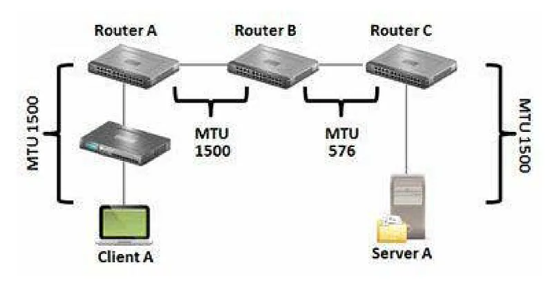

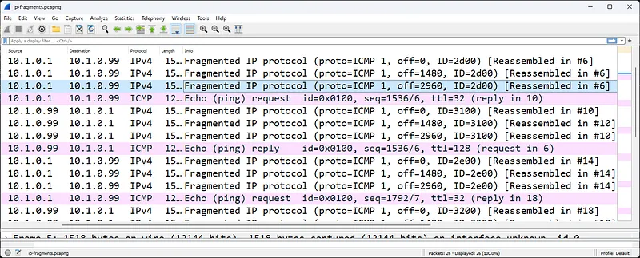

:::caution
Güvenlik duvarları ICMP Type 3 Code 4 paketlerini gereksiz yere engellerse, "PMTU Black Hole" oluşur. Web sayfaları küçük isteklerle açılırken büyük veri transferlerinde (örneğin dosya indirme veya TLS el sıkışmasında) bağlantı aniden kilitlenir.
:::
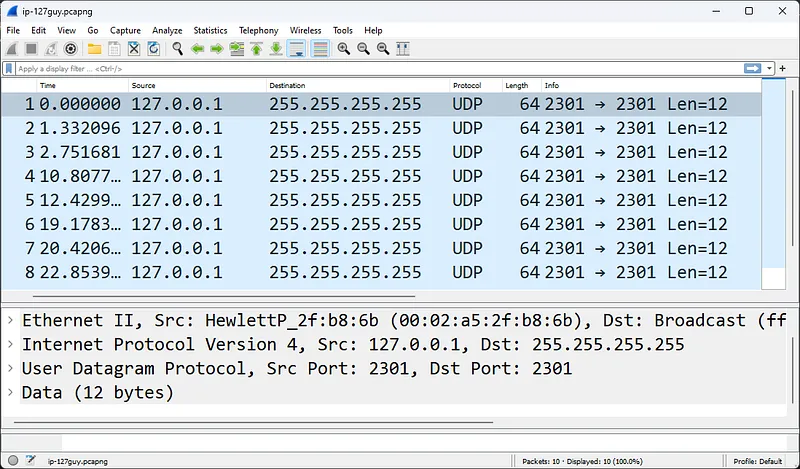

---

## §2.2.3. IPv6 Mimarisi: Yeni Nesil İnternet Protokolü

IPv4'ün 32-bitlik adres alanının (yaklaşık 4.3 milyar adres) tükenmesi üzerine geliştirilen IPv6, **128-bit adresleme** ($3.4 \times 10^{38}$ adres) sunar.


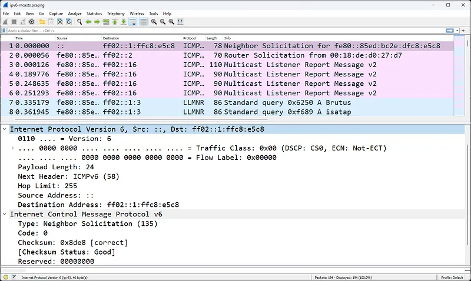

### IPv4 ve IPv6 Karşılaştırması

| Özellik | IPv4 | IPv6 |
| :--- | :--- | :--- |
| **Adres Uzunluğu** | 32 bit (4 bayt) | 128 bit (16 bayt - 8 grup 16-bit hex) |
| **Başlık Boyutu** | Değişken (Min 20 bayt) | **Sabit 40 bayt** (Hızlı ASIC işleme) |
| **Yönlendiricide Parçalama** | Var | **Yok** (Yalnızca kaynak düğüm parçalayabilir) |
| **Broadcast (Yayın)** | Var (Ağı yoran ARP yayınları) | **Yok** (Multicast ve Anycast kullanılır) |
| **Adres Çözümleme** | ARP (RFC 826) | **ICMPv6 NDP (Neighbor Discovery Protocol)** |
| **Otomatik Yapılandırma** | DHCPv4 veya Statik | **SLAAC (Stateless Address Autoconfiguration)** & DHCPv6 |

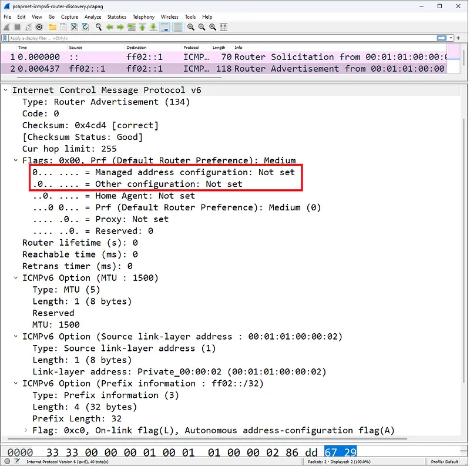

---

## §2.2.4. IPv6 Geçiş ve Tünelleme Mekanizmaları

IPv4 altyapısından IPv6'ya küresel geçiş sürecinde iki protokolün birlikte çalışabilmesi için geçiş mekanizmaları tasarlanmıştır:

### 1. 6to4 Tünelleme (IPv6 over IPv4)

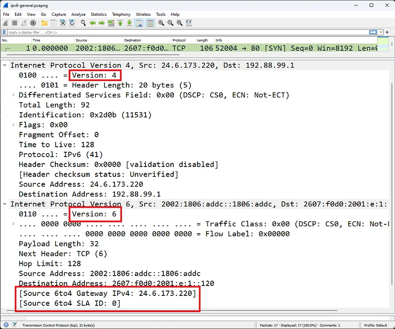

- IPv6 paketlerini doğrudan bir IPv4 başlığı içine (IP Protokol 41) kapsülleyerek saf IPv4 omurgaları üzerinden taşır.
- `2002::/16` özel adres bloğunu kullanır.

### 2. Teredo Tünelleme (IPv6 over UDP)

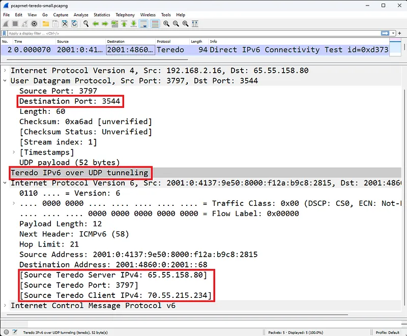

- 6to4 tünellemesi klasik NAT cihazlarının arkasında çalışamaz çünkü NAT cihazları IP Protokol 41 paketlerini yönlendiremez.
- **Teredo**, IPv6 paketini **UDP Port 3544** paketi içine kapsülleyerek en katı NAT arkasından bile IPv6 bağlantısı kurulabilmesini sağlar.

---

## §2.2.5. Wireshark ile IP Trafiğini Filtreleme

Wireshark ekranında IP düzeyinde analiz yaparken şu filtreler en sık kullanılan araçlardır:

| Filtre Sözdizimi | Açıklama |
| :--- | :--- |
| `ip.addr == 10.0.0.1` | Belirtilen IPv4 adresi kaynak veya hedef olan paketler |
| `ipv6.addr == 2001:db8::1` | Belirtilen IPv6 adresi geçen paketler |
| `ip.flags.df == 1` | Don't Fragment biti işaretli paketler |
| `ip.flags.mf == 1 || ip.frag_offset > 0` | Parçalanmış (fragmented) IP paketleri |
| `ip.ttl <= 2` | TTL değeri tükenmek üzere olan veya yakın yönlendirici paketleri |
| `icmp.type == 3 && icmp.code == 4` | MTU aşımı ve parçalanma engeli bildiren paketler |
| `ipv6` | Saf veya tünellenmiş tüm IPv6 paketleri |
| `udp.port == 3544` | Teredo IPv6 tünelleme trafiği |
| `ip.proto == 41` | 6to4 IPv6 tünelleme trafiği |

---

## §2.2.6. Küresel Yönlendirme ve BGP Güvenliği: RPKI ve BGP Hijacking

İnternet, on binlerce Otonom Sistem (Autonomous System - AS) arasında IP bloklarının anons edildiği **BGP (Border Gateway Protocol - RFC 4271)** ile birbirine bağlanır. BGP, 1980'lerde tasarlanırken "tüm operatörlerin güvenilir olduğu" varsayılmıştır; bu nedenle varsayılan olarak BGP anonslarında kriptografik bir doğrulama yoktur.

### 1. BGP Hijacking ve Route Leakage
Bir saldırgan veya hatalı yapılandırılmış bir operatör, kendisine ait olmayan bir IP bloğunu (örneğin Google'a ait `8.8.8.0/24`) kendi ASN'i üzerinden anons ederse:
- BGP'nin en temel yönlendirme kuralı olan **En Uzun Eşleşen Prefix (Longest Prefix Match)** ilkesi devreye girer.
- Orijinal sahip `8.8.0.0/16` anons ederken, saldırgan `8.8.8.0/24` anons ederse, dünya genelindeki yönlendiriciler trafiği daha spesifik olan saldırganın yoluna yönlendirir.
- **Tarihi Vaka (2018 MyEtherWallet):** Saldırganlar Amazon Route 53'e ait IP bloklarını BGP üzerinden kaçırarak DNS trafiğini sahte sunuculara yönlendirmiş ve kullanıcıların kripto cüzdanlarını boşaltmıştır.

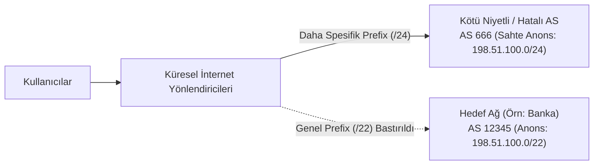

### 2. RPKI (Resource Public Key Infrastructure) ve ROA Çözümü
BGP anonslarını kriptografik olarak güvence altına almak için IETF tarafından **RPKI (RFC 6480)** standardı geliştirilmiştir:
- Bölgesel İnternet Kayıt Kuruluşları (RIR - RIPE NCC, ARIN, APNIC), IP bloğunun yasal sahibine bir dijital sertifika verir.
- IP sahibi, **ROA (Route Origin Authorization)** kaydı oluşturarak: *"198.51.100.0/24 bloğunu YALNIZCA AS 12345 anons edebilir, maksimum uzunluk /24'tür"* taahhüdünde bulunur.
- İnternet servis sağlayıcılar RPKI doğrulayıcıları (Routinator, StayRTR) çalıştırarak gelen BGP anonslarını doğrular.

### BGP Anonsunun RPKI Durumları:
- **Valid (Geçerli):** Anons edilen ASN ve prefix, imzalı ROA kaydıyla tam eşleşir.
- **Invalid (Geçersiz):** ROA kaydı mevcuttur ancak anons farklı bir ASN'den gelmektedir veya prefix boyutu aşılmıştır. Modern yönlendiriciler bu anonsları **otomatik olarak düşürür (Drop)**.
- **NotFound (Bilinmiyor):** İlgili IP bloğu için henüz bir ROA kaydı oluşturulmamıştır.

### Cisco IOS-XE üzerinde BGP RPKI Yapılandırması:
```cisco
! RPKI Doğrulayıcı Sunucu Bağlantısı (Routinator)
router bgp 65001
 bgp rpki server tcp 192.168.1.100 port 3323 refresh 300
!
! RPKI Invalid anonsları filtreleyen rota haritası
route-map RPKI-FILTER permit 10
 match rpki valid
!
route-map RPKI-FILTER permit 20
 match rpki not-found
!
route-map RPKI-FILTER deny 30
 match rpki invalid
!
router bgp 65001
 neighbor 203.0.113.1 route-map RPKI-FILTER in
```

---

## §2.2.7. Çapraz Referans ve Entegrasyon
- ARP protokolü ve L2 paket anatomisi için [§2.1 ARP Protokolü ve Paket Anatomisi](./01-arp-protokolu-ve-paket-anatomisi.md) bölümüne bakın.
- Ağ katmanı DoS saldırıları ve paket analizi için [§6.3 Ağ ve Uygulama Katmanı DoS Saldırıları](../06-ag-saldirilari-dos-ddos-ve-paket-tespiti/03-ag-ve-uygulama-katmani-dos-saldirilari.md) bölümüne bakın.
- Siber Güvenlik Operasyonları Kitabı'nda gelişmiş ağ saldırıları için [Ağ Saldırıları ve Savunma](../../../siber-guvenlik-operasyonlari/06-ag-guvenligi/03-ag-saldirilari-ve-savunma.md) bölümünü inceleyin.

