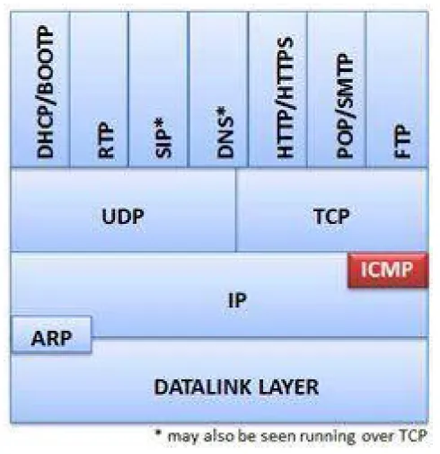
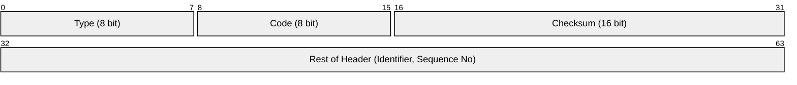
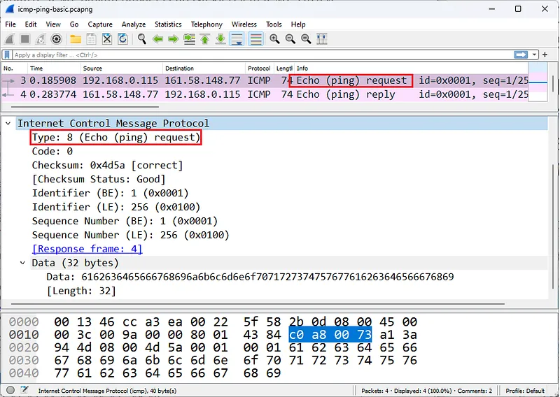
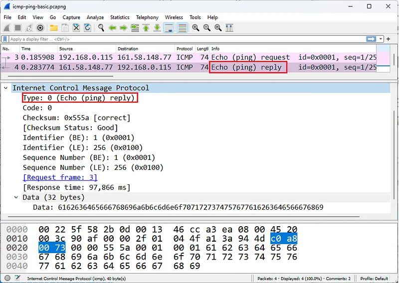
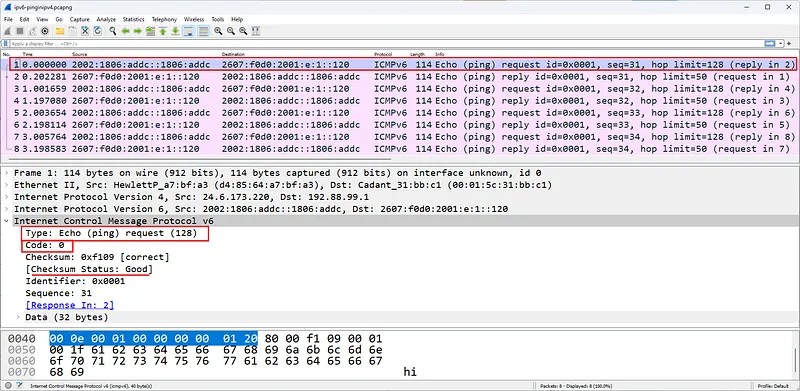
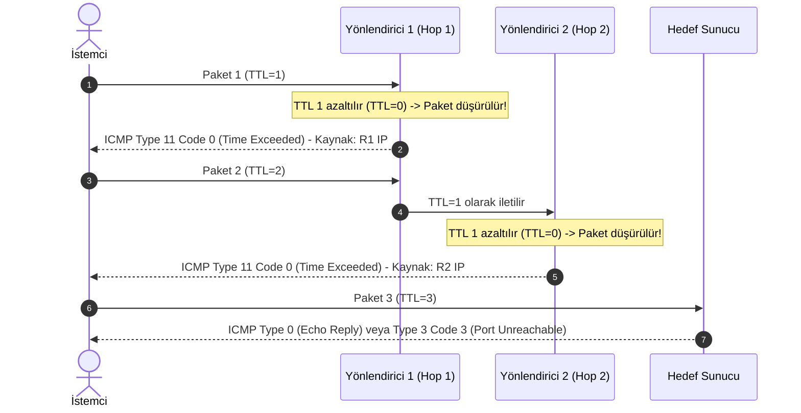
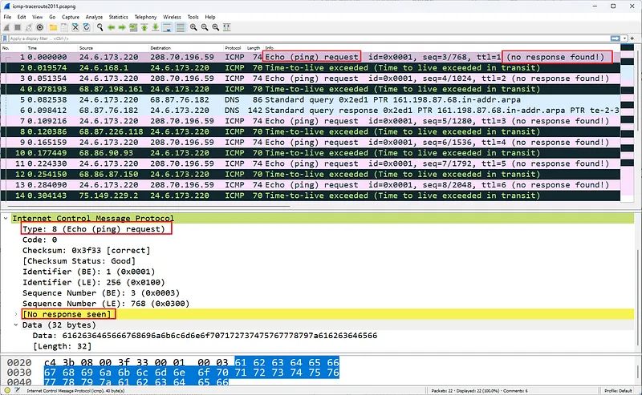
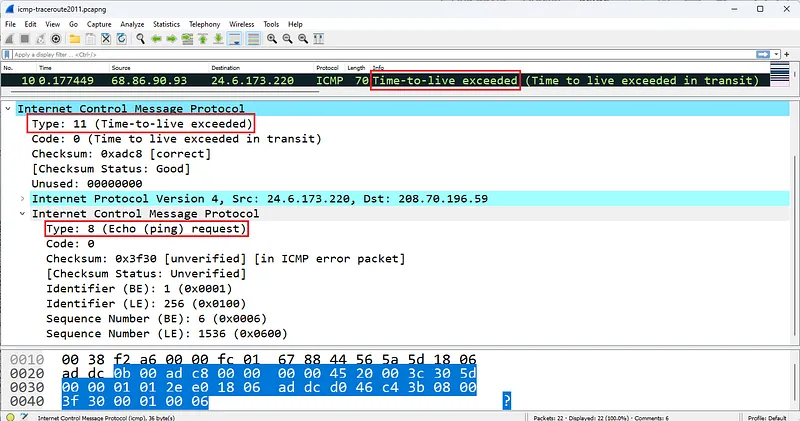
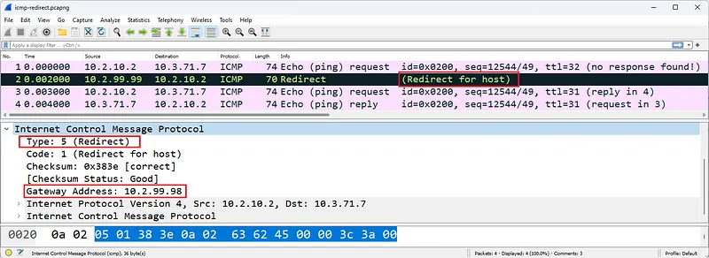

# ICMPv4 ve ICMPv6 Protokolleri, Tanılama Araçları ve Paket Analizi

İnternet Denetim Mesajı Protokolü (Internet Control Message Protocol - ICMP), IP ağlarında teşhis, hata bildirimi ve operasyonel geri bildirim mekanizmasını sağlayan temel yardımcı protokoldür.

Bir IP paketi hedefine ulaşamadığında, ara yönlendiricilerde TTL değeri tükendiğinde veya ağ tıkanıklığı yaşandığında işletim sistemlerini ve ağ yöneticilerini bilgilendiren mekanizma ICMP'dir.

---

## §2.3.1. ICMP Mesaj Yapısı ve Temel Türler (Type / Code)

ICMP mesajları doğrudan bir IP paketi içerisinde (Protokol No = 1) taşınır. İlk 4 bayt evrensel başlık alanlarıdır:

### Kritik ICMPv4 Tür ve Kod Tablosu:

| Tip (Type) | Kod (Code) | Anlamı | Açıklama & Operasyonel Önemi |
| :---: | :---: | :--- | :--- |
| **0** | 0 | **Echo Reply** | Ping isteğine verilen başarılı yanıt |
| **8** | 0 | **Echo Request** | Uçtan uca erişilebilirlik testi (Ping) |
| **3** | 0 | Net Unreachable | Hedef ağa yönlendirme tablosunda rota yok |
| **3** | 1 | Host Unreachable | Hedef cihaz ağda açık değil veya ARP yanıtı yok |
| **3** | 3 | **Port Unreachable** | Hedef portta dinleyen bir servis yok (UDP tarama kanıtı) |
| **3** | 4 | **Fragmentation Needed** | Paket MTU'dan büyük ama DF biti işaretli |
| **11** | 0 | **Time Exceeded (TTL=0)** | Paket yönlendiricide öldü (Traceroute temel mekanizması) |
| **5** | 0-3 | **Redirect** | Yönlendirici kaynağa daha iyi bir çıkış rotası bildirir |

---

## §2.3.2. Wireshark ile Echo İstek ve Yanıtlarının Analizi

Normal bir `ping` komutu çalıştırıldığında istemci ile sunucu arasında çift yönlü bir akış oluşur:

İstemcinin gönderdiği **Echo Request (Tip 8)** paketinde:
- **Identifier:** İstek gönderen oturumu tanımlayan benzersiz kimlik.
- **Sequence Number:** Her pakette 1 artan sıra numarası.
- **Data (Payload):** İşletim sistemine göre değişen dolgu verisi (Windows varsayılan olarak 32 bayt `abcdefghijklmnopqrstuvwabcdefghi...` alfabesini gönderir).

Sunucu isteği aldığında, aynı `Identifier`, aynı `Sequence Number` ve aynı veri yükünü içeren **Echo Reply (Tip 0)** paketini geri yollar. İstemci iki paket arasındaki zaman farkından **Gidiş-Dönüş Süresini (RTT - Round Trip Time)** hesaplar.

---

## §2.3.3. Traceroute Aracının Paket Düzeyinde İşleyişi

Traceroute, kaynak ile hedef arasındaki tüm ara yönlendiricilerin IP adreslerini ortaya çıkarmak için IP başlığındaki **TTL (Time to Live)** alanının matematiksel manipülasyonunu kullanır:

1. İstemci ilk paketi `TTL=1` ile gönderir. İlk yönlendirici TTL'i 0 yapar, paketi atar ve istemciye `ICMP Type 11` döner. Böylece Hop 1'in IP'si öğrenilir.
2. İstemci ikinci paketi `TTL=2` ile gönderir. İkinci yönlendirici paketi düşürür ve kendi IP'siyle `ICMP Type 11` döner.
3. Bu döngü hedefe ulaşılana kadar devam eder. Eğer bir yönlendirici ICMP üretmeyecek şekilde sıkılaştırılmışsa ekranda `* * * Request timed out` görünür.

---

## §2.3.4. ICMP Yeniden Yönlendirmeleri (Redirect) ve Güvenlik Riskleri

Bir yönlendirici, aldığı paketin çıkış arayüzünün paketin geldiği arayüzle aynı alt ağda olduğunu fark ettiğinde, kaynağa **ICMP Redirect (Type 5)** paketi gönderir.

- Bu mesaj kaynağa *"Bu hedef için beni değil, doğrudan şu ağ geçidini kullan"* der.
- **Güvenlik Tehlikesi (ICMP Redirect Attack):** Saldırganlar sahte ICMP Redirect mesajları göndererek istemcinin varsayılan ağ geçidi rotasını kendi kötü niyetli makinelerine çevirebilir (Man-in-the-Middle). Bu nedenle modern güvenlik standartlarında ana bilgisayarlarda `net.ipv4.conf.all.accept_redirects = 0` yapılandırılarak ICMP Redirect kabulü kapatılmalıdır.

---

## §2.3.5. Güvenlik Açısından Şüpheli ICMP Trafiği

SOC analistleri için ICMP paketleri önemli tehdit göstergeleri sunar:

- **Ağ Haritalama (Reconnaissance):** Ağdaki aktif cihazları keşfetmek için tüm alt ağa yayılan ardışık Echo Request dalgaları.
- **UDP Port Taraması:** Nmap veya benzeri bir araç kapalı UDP portlarına paket yolladığında, işletim sistemi `ICMP Type 3 Code 3 (Port Unreachable)` yanıtı üretir. Wireshark'ta kısa sürede binlerce bu paketten görülmesi aktif bir UDP port taramasının kanıtıdır.
- **ICMP Tünelleme (Covert Channel):** ICMP Echo yükü standartta anlamsız alfabetik dolgudur. Eğer veri yükünde şifreli metin, Base64 dizileri veya dosya başlıkları (MZ, PK) görülüyorsa, saldırgan güvenlik duvarını atlatmak için ICMP tüneli kurmuştur.

---

## §2.3.6. Wireshark ICMP Filtreleri

| Filtre | Kullanım Amacı |
| :--- | :--- |
| `icmp` | Tüm IPv4 ICMP paketleri |
| `icmpv6` | Tüm IPv6 ICMP paketleri |
| `icmp.type == 8` | Yalnızca Ping istekleri (Echo Request) |
| `icmp.type == 0` | Yalnızca Ping yanıtları (Echo Reply) |
| `icmp.type == 11` | Traceroute paketleri ve yönlendirme döngüleri (Time Exceeded) |
| `icmp.type == 5` | Ağ yönlendirme güncelleme mesajları (Redirect) |
| `icmp.type == 3 && icmp.code == 3` | Kapalı port bildirimleri (UDP Port tarama tespiti) |
| `icmp.resptime > 100` | Yanıt süresi 100 milisaniyeden uzun süren gecikmeli pingler |
