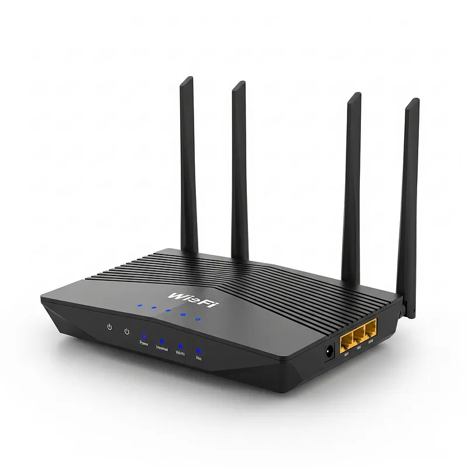
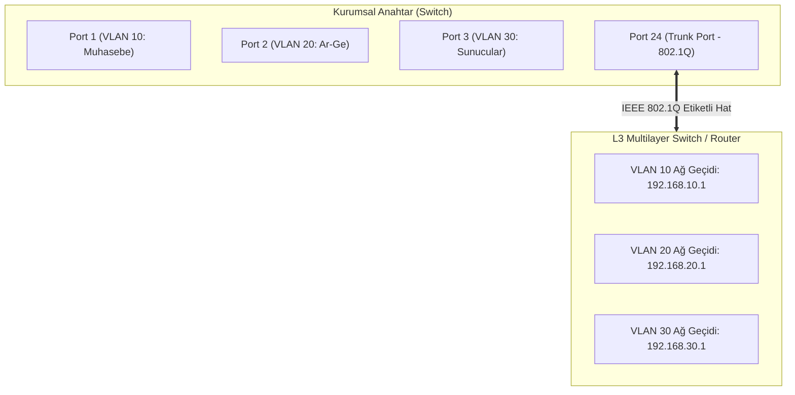
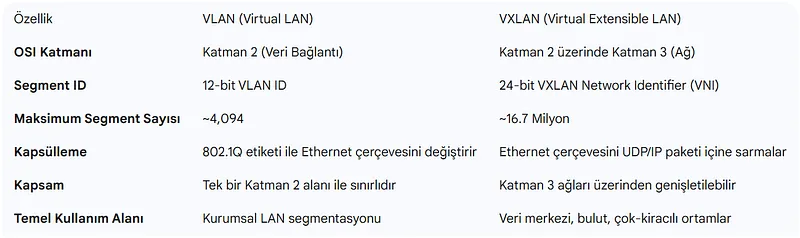
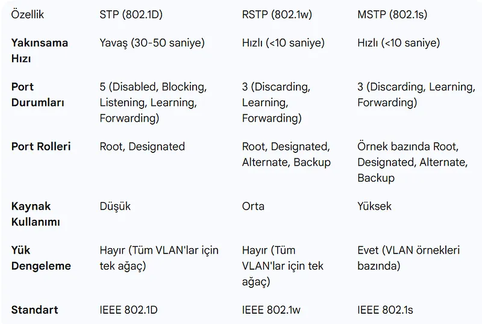
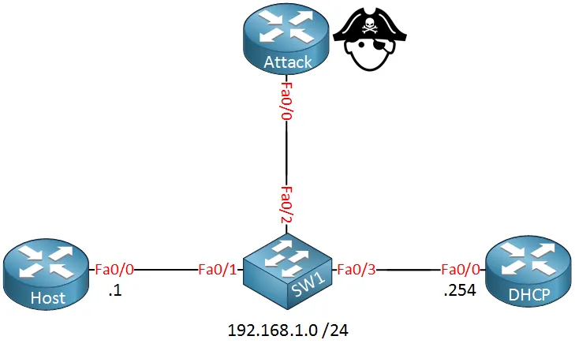
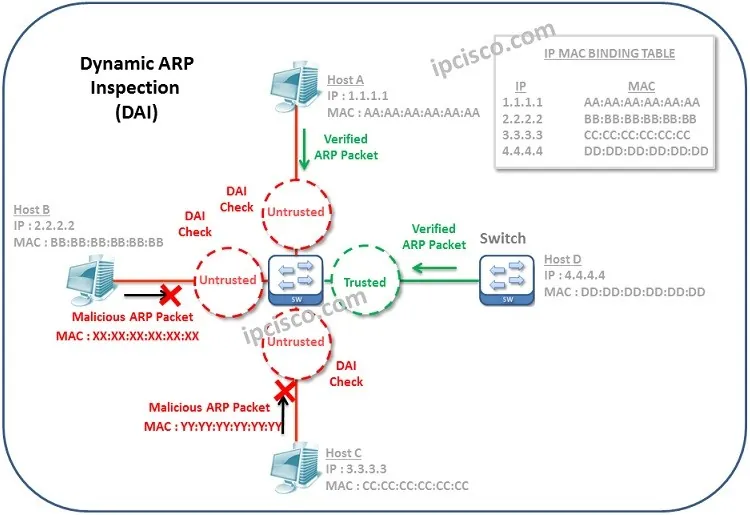

# Katman 2 Anahtarlama, VLAN, Trunking ve Yerel Ağ Güvenliği

Yerel Alan Ağlarının (LAN) kalbini oluşturan Katman 2 anahtarlama (Switching) teknolojisi, cihazların donanımsal MAC adreslerine göre mikro-segmentasyon sağlayarak veriyi hedefe iletir.

Geleneksel hub'ların yarattığı ortak çarpışma alanlarını (Collision Domain) ortadan kaldıran modern switch'ler; sanal ağ izolasyonu (VLAN), hat birleştirme (Trunking), döngü engelleme (STP) ve gelişmiş donanımsal güvenlik mekanizmaları (Port Security, DAI, DHCP Snooping) ile donatılmıştır.

---

## §2.4.1. Katman 2 Anahtarların Çalışma Mekanizması

Bir switch, gelen Ethernet çerçevesini şu beş temel işlem kuralına göre işler:

1. **Learning (Öğrenme):** Switch, gelen çerçevenin **kaynak MAC adresini** ve bu çerçevenin girdiği **fiziksel portu** okur. Bu bilgiyi **CAM (Content Addressable Memory) Tablosuna** kaydeder.
2. **Flooding (Taşırma):** Eğer çerçevenin **hedef MAC adresi** henüz CAM tablosunda kayıtlı değilse (Unknown Unicast) veya çerçeve bir Broadcast/Multicast ise, switch paketi geldiği port hariç o VLAN'a ait tüm aktif portlara çoğaltarak iletir.
3. **Forwarding (İletme):** Hedef MAC adresi tabloda mevcutsa, çerçeve yalnızca ilgili porta yönlendirilir.
4. **Filtering (Filtreleme):** Hedef port ile kaynak port aynıysa veya güvenlik kuralları engelliyorsa çerçeve iletilmez.
5. **Aging (Yaşlandırma):** Belirli bir süre (varsayılan 300 saniye) boyunca trafik göndermeyen cihazların kayıtları CAM tablosundan silinir.

---

## §2.4.2. VLAN Mimarisi ve IEEE 802.1Q Trunking

Fiziksel bir anahtarı mantıksal olarak birden fazla bağımsız ağa bölme işlemine **VLAN (Virtual Local Area Network)** denir. VLAN'lar yayın alanlarını (Broadcast Domain) sınırlandırarak hem ağ performansını artırır hem de departmanlar arası yatay hareketi (lateral movement) engeller.

### Port Türleri:
- **Erişim Portu (Access Port):** Tek bir VLAN'a atanmış porttur. Uç cihazlar (PC, yazıcı, IP telefon) bu porta bağlanır. İletilen çerçevelerde VLAN etiketi bulunmaz (Untagged).
- **Gövde Portu (Trunk Port):** Birden fazla VLAN'ın trafiğini switch'ler veya switch-router arasında tek bir fiziksel kablo üzerinden taşır.

### IEEE 802.1Q Etiketleme (Tagging):
Trunk hattından geçen her Ethernet çerçevesinin kaynak MAC adresinden hemen sonra **4 baytlık 802.1Q etiketi** eklenir. Bu etiketin içinde 12 bitlik **VLAN ID (1 - 4094)** yer alır.

---

## §2.4.3. VLAN ve VXLAN Teknolojilerinin Karşılaştırması

Modern bulut veri merkezlerinde geleneksel 802.1Q VLAN mimarisinin 4096 ağ sınırı yetersiz kaldığında **VXLAN (Virtual Extensible LAN)** devreye girer:

| Ölçüt | IEEE 802.1Q VLAN | VXLAN (RFC 7348) |
| :--- | :--- | :--- |
| **Ağ Kimliği Boyutu** | 12 bit ($4.096$ Ağ ID) | **24 bit (VNI - 16.777.216 Ağ ID)** |
| **Kapsülleme Türü** | L2 Ethernet Başlığına 4 bayt etiket | **MAC-in-UDP Kapsülleme (UDP Port 4789)** |
| **Altyapı Bağımlılığı** | Tüm omurgada L2 Trunking gerektirir | **Standart IP/Katman 3 omurga üzerinde çalışır (Overlay)** |
| **Döngü Yönetimi** | STP (Spanning Tree Protocol) | **ECMP (Equal-Cost Multi-Pathing)** |
| **Hedef Alan** | Klasik Kurumsal Kampüs Ağları | Çok Kiracılı (Multi-Tenant) Bulut ve Veri Merkezleri |

---

## §2.4.4. Spanning Tree Protocol (STP) ve Döngü Engelleme (Loop Prevention)

Yedeklilik sağlamak amacıyla switch'ler arasında birden fazla kablo çekildiğinde, Katman 2 Ethernet çerçevelerinde TTL (Time-To-Live) mekanizması bulunmadığı için yayın paketleri sonsuz döngüye girer (**Broadcast Storm**). Bu durum saniyeler içinde tüm ağ bant genişliğini ve switch CPU'sunu tüketerek ağı çökertir.

**STP (Spanning Tree Protocol - IEEE 802.1D / RSTP 802.1w)**, döngüleri engellemek için yedekli hatları mantıksal olarak kapatır (Blocking moduna alır). Aktif hatta arıza olduğunda saniyeler içinde yedek hattı devreye sokar:

- **Root Bridge Seçimi:** En düşük Bridge ID'ye (Öncelik + MAC adresi) sahip switch ağın kökü seçilir.
- **Port Rolleri:**
  - *Root Port:* Switch'in Root Bridge'e en düşük maliyetle ulaşan portu.
  - *Designated Port:* İlgili LAN segmentinde trafiği iletmekle görevli port.
  - *Alternate / Blocking Port:* Döngüyü engellemek için trafiğe kapatılmış yedek port.

---

## §2.4.5. Katman 2 Güvenlik ve Sıkılaştırma Mekanizmaları

Yerel ağın güvenliğini sağlamak için switch portlarında donanımsal savunma mekanizmaları aktif edilmelidir:

### 1. Port Security (MAC Kısıtlaması)
Bir fiziksel switch portuna bağlanabilecek maksimum MAC adresi sayısını sınırlandırır ve izinli MAC adreslerini kaydeder:
- İzin verilmeyen yabancı bir cihaz takıldığında veya MAC taşması denendiğinde **Violation** modu devreye girer:
  - `Protect`: Yabancı paketi sessizce düşürür.
  - `Restrict`: Paketi düşürür, Syslog/SNMP alarmı üretir.
  - `Shutdown`: Portu derhal elektriksel olarak kapatır (`err-disable` durumu).

### 2. DHCP Snooping
Ağa sahte bir DHCP sunucusu takılarak istemcilere yanlış ağ geçidi ve DNS dağıtılmasını (Rogue DHCP / MitM) engeller:
- Portlar **Trusted (Güvenilir)** ve **Untrusted (Güvenilmez)** olarak ayrılır.
- Yalnızca sistem yöneticisinin belirlediği Trusted portlardan DHCP Offer ve DHCP ACK paketleri geçebilir. İstemci portlarından gelen sahte sunucu paketleri switch tarafından anında düşürülür.
- Switch, meşru IP ve MAC eşleşmelerini kaydederek bir **DHCP Snooping Binding Table** oluşturur.

### 3. Dynamic ARP Inspection (DAI)
ARP Zehirlenmesi (ARP Cache Poisoning / Spoofing) saldırılarını engellemek için DHCP Snooping tablosunu referans alır.

- Untrusted portlardan gelen her ARP paketi incelenir.
- Gönderen IP ile MAC adresi DHCP Snooping veritabanındaki kayıtla eşleşmiyorsa, paket sahtecilik olarak değerlendirilir ve düşürülür.

### 4. BPDU Guard ve Root Guard
Yetkisiz bir switch ağa takılarak Root Bridge rolünü çalmaya çalıştığında, ilgili uç kullanıcı portu BPDU Guard tarafından anında kapatılır.
