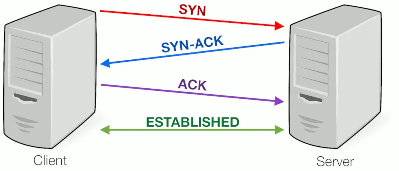
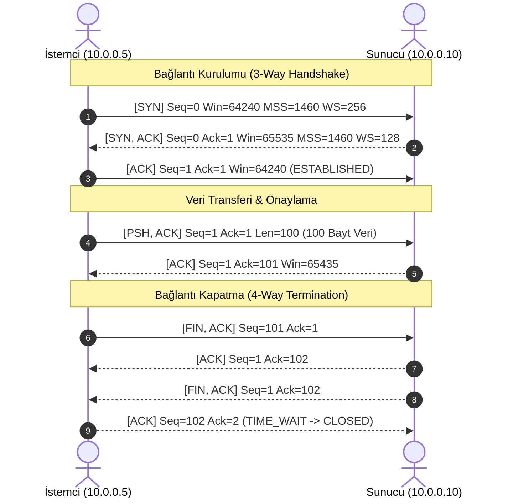
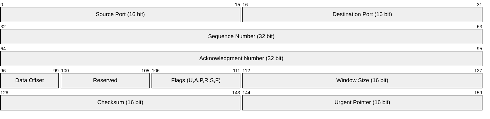
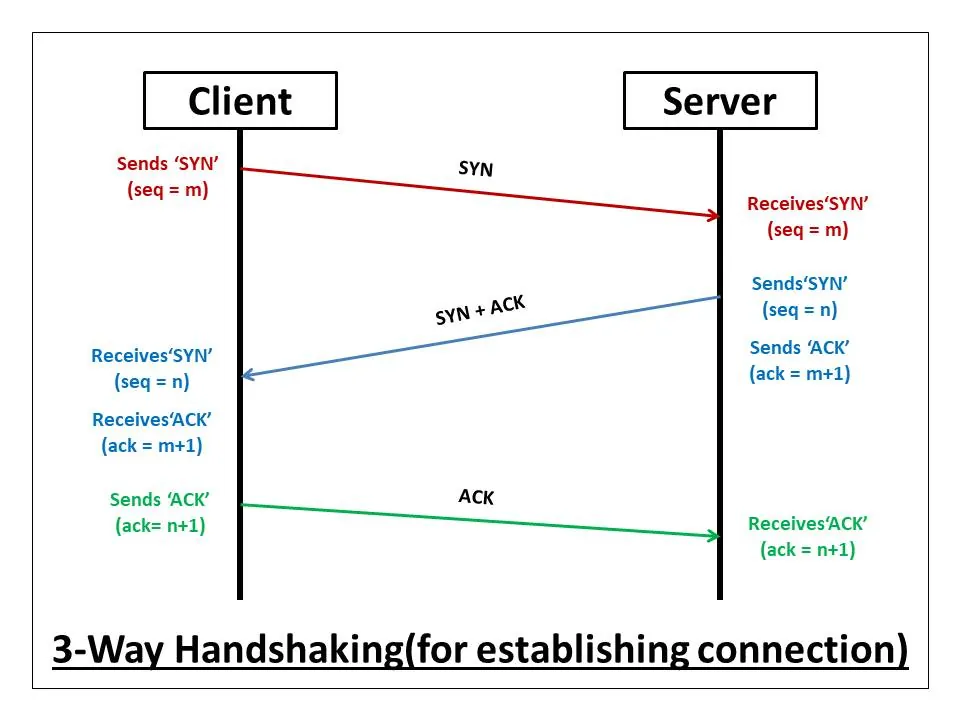
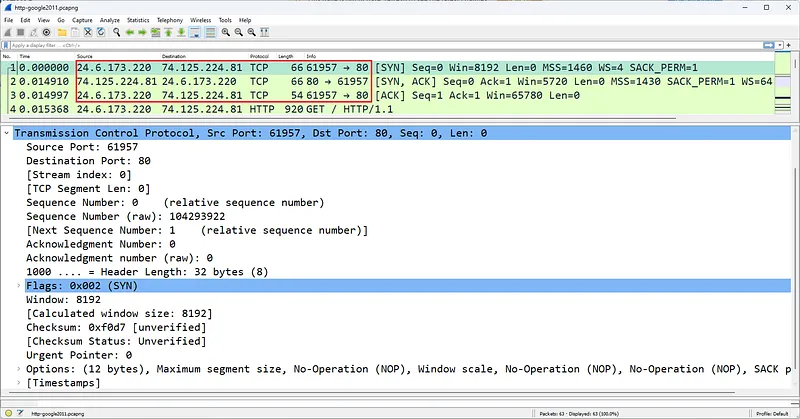
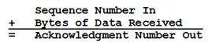
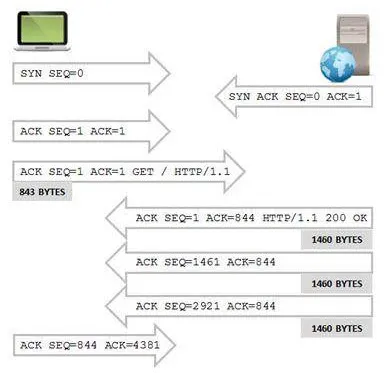
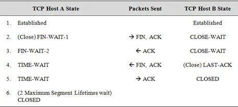
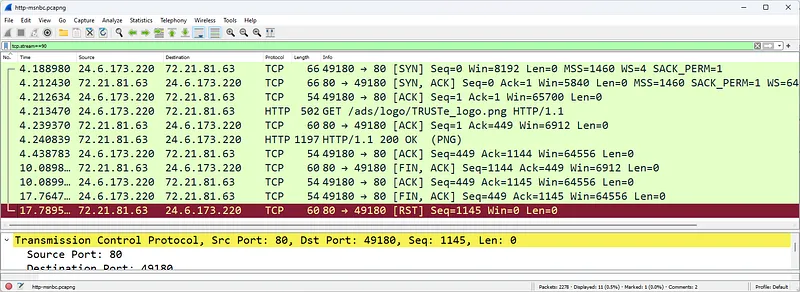

# TCP Protokol Anatomisi, Bayraklar ve Oturum Yönetimi

İletim Denetim Protokolü (Transmission Control Protocol - TCP), OSI referans modelinin 4. Katmanında (Taşıma Katmanı) ve TCP/IP modelinde çalışan, internetin en kritik ve güvenilir taşıma protokolüdür.

IP protokolünün sunduğu "elinden gelenin en iyisi" (best-effort) güvensiz zemin üzerinde çalışan TCP; verilerin kayıpsız, sıralı ve akış kontrollü bir şekilde uçtan uca iletilmesini garanti eder. Web gezintisi (HTTP/HTTPS), dosya transferi (SFTP, SMB), uzaktan yönetim (SSH) ve kurumsal e-posta (SMTP/IMAP) TCP'nin sağladığı bu güvenilir altyapı üzerinde çalışır.

---

## §3.1.1. TCP Başlık Yapısı (Header Anatomy)

Standart bir TCP başlığı opsiyonlar hariç **20 bayt (160 bit)** uzunluğundadır:

### Başlık Alanlarının Fonksiyonları:
1. **Source & Destination Port (16'şar bit):** Verinin kaynak ve hedef uygulamadaki hangi sokete (port numarasına) teslim edileceğini belirler (Örn: HTTP için 80, HTTPS için 443).
2. **Sequence Number (32 bit):** Segmentin taşıdığı verinin ilk baytının sıra numarasıdır. Her bağlantı rastgele bir **ISN (Initial Sequence Number)** ile başlar.
3. **Acknowledgment Number (32 bit):** Alıcının karşı taraftan beklediği bir sonraki baytın sıra numarasıdır. Alınan bayt miktarının onaylandığını gösterir.
4. **Data Offset (4 bit):** TCP başlığının 32-bitlik kelime cinsinden uzunluğudur (Opsiyonsuz durumda değer `5`'tir, yani 20 bayt).
5. **Window Size (16 bit):** Alıcının yeni bir onay (ACK) göndermeden önce kabul edebileceği maksimum bayt miktarını belirten akış kontrolü tampon boyutudur.

---

## §3.1.2. TCP Bayrakları (Flags) ve Görevleri

TCP başlığındaki kontrol bitleri, oturumun durumunu ve segmentin amacını belirler:

| Bayrak | Kısaltma | Fonksiyonu ve Anlamı |
| :--- | :---: | :--- |
| **SYN** *(Synchronize)* | `S` | Yeni bir bağlantı oturumu başlatmak ve ISN sıra numaralarını senkronize etmek için kullanılır. |
| **ACK** *(Acknowledgment)* | `A` | Onay bayrağı. Acknowledgment Number alanının geçerli olduğunu ve karşıdan gelen verinin alındığını belirtir. |
| **FIN** *(Finish)* | `F` | Göndericinin iletecek başka verisi kalmadığını ve bağlantıyı zarif bir şekilde kapatmak istediğini bildirir. |
| **RST** *(Reset)* | `R` | Bağlantıyı anında ve tek taraflı olarak sıfırlar/koparır. Kapalı bir porta paket geldiğinde veya anomali anında üretilir. |
| **PSH** *(Push)* | `P` | Alıcının tampon bellekte (buffer) beklemeden veriyi doğrudan uygulama katmanına iletmesini emreder. |
| **URG** *(Urgent)* | `U` | Segment içinde acil işlenmesi gereken veri olduğunu belirtir (Urgent Pointer alanı geçerli kılınır). |

---

## §3.1.3. 3 Yönlü El Sıkışma (Three-Way Handshake) ve ISN Hesaplaması

TCP bağlantısı kurulurken iki uç nokta birbirlerinin sıra numaralarını şu adımlarla eşleştirir:

1. **Paket 1 [SYN]:** İstemci sunucuya bağlantı açmak istediğini bildirir. Rastgele bir ISN (Örn: `Seq = 28401928`) belirler. MSS (Maximum Segment Size) ve Window Scale gibi TCP opsiyonlarını teklif eder.
2. **Paket 2 [SYN, ACK]:** Sunucu bağlantıyı kabul eder. Kendi rastgele ISN değerini (`Seq = 83921049`) üretir ve istemcinin sıra numarasını 1 artırarak onaylar (`Ack = 28401929`).
3. **Paket 3 [ACK]:** İstemci sunucunun sıra numarasını 1 artırarak onaylar (`Ack = 83921050`). Bu andan itibaren oturum **ESTABLISHED** durumundadır.

:::note
Wireshark, analiz kolaylığı sağlamak için paket inceleme ekranında 32-bitlik devasa gerçek ISN numaraları yerine varsayılan olarak **Relative Sequence Number (Göreceli Sıra Numarası)** kullanır; ilk SYN paketini `Seq = 0` olarak gösterir.
:::
---

## §3.1.4. Oturum Kapatma ve Bağlantı Durumları

TCP bağlantıları iki farklı yöntemle sonlandırılır:

### 1. Zarif Kapatma (Graceful Termination - FIN Handshake)
Taraflardan biri veri göndermeyi bitirdiğinde `FIN` bayraklı paket iletir. Karşı taraf bunu `ACK` ile onaylar. Ardından karşı taraf da kendi `FIN` paketini gönderir ve son `ACK` ile bağlantı kapatılır.
- **TIME_WAIT:** Bağlantıyı ilk kapatan taraf, ağda gecikmiş paketlerin yeni kurulacak başka bir oturumla karışmasını önlemek için belirli bir süre (genellikle 2 $\times$ MSL - 60 ila 120 saniye) TIME_WAIT durumunda bekler.

### 2. Açık Sonlandırma (Abrupt Termination - TCP Reset)

Eğer bir istemci kapalı bir portta çalışan servise bağlanmaya çalışırsa veya güvenlik duvarı oturumu kural dışı bularak sonlandırırsa, hedef sistem anında `RST` veya `RST/ACK` paketi yollar. Bağlantı hiçbir bekleme süresi olmaksızın derhal hafızadan silinir.
