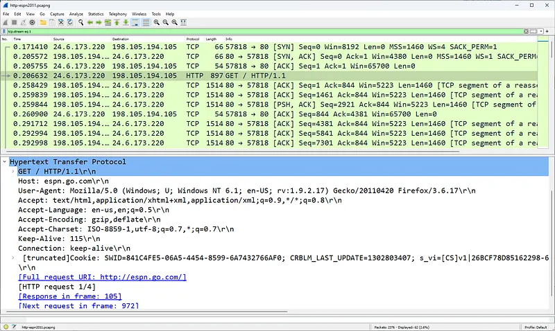
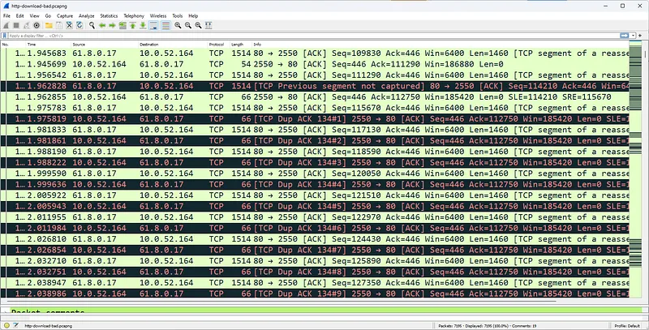
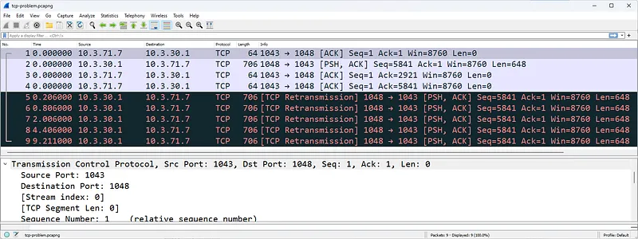
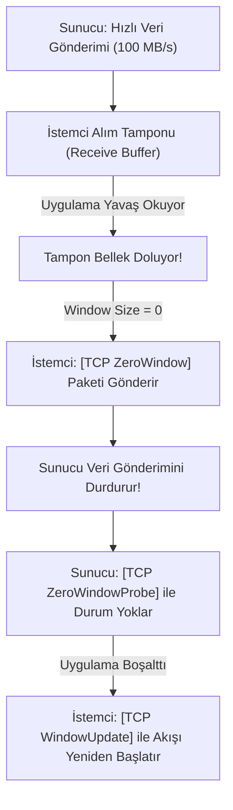
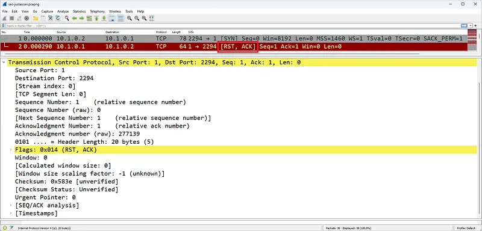
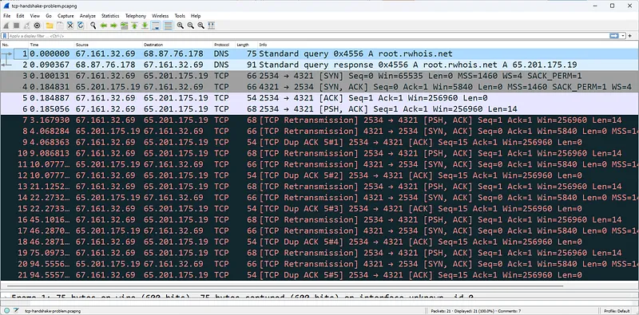

# Wireshark ile TCP Performans Sorunları ve Hata Analizi

Kurumsal ağlarda yavaşlık şikayetlerinin, web uygulamalarının donmasının veya veri tabanı zaman aşımlarının (timeout) büyük çoğunluğu Katman 4 TCP parametrelerindeki tıkanıklıklardan ve paket kayıplarından kaynaklanır.

Wireshark, gelişmiş bir **TCP Analiz Motoruna (TCP Analysis Engine)** sahiptir. Her bir TCP akışını bağımsız olarak takip eder; beklenen sıra numaralarını, onay gecikmelerini ve pencere boyutlarını hesaplayarak performansı düşüren anomalileri grafiksel ve metinsel olarak etiketler.

---

## §3.2.1. Yeniden İletimler (Retransmissions) ve Paket Kayıpları

Bir TCP segmenti ağda kaybolduğunda veya alıcının gönderdiği ACK paketi göndericiye ulaşmadığında iki farklı kurtarma mekanizması devreye girer:

### 1. Zaman Aşımı Tabanlı Yeniden İletim (RTO - Retransmission Timeout)

Gönderici bir segment yolladığında bir zamanlayıcı (**RTO Timer**) başlatır. Bu süre dolana kadar onay (ACK) gelmezse, paketin ağda düştüğü varsayılır ve aynı segment tekrar iletilir (`[TCP Retransmission]`). Bu durum ağda hissedilir bir gecikmeye neden olur çünkü RTO süresi genellikle saniyeler mertebesindedir.

### 2. Hızlı Yeniden İletim (Fast Retransmission) ve Duplicate ACK
Eğer alıcı aradaki bir paketi kaçırıp sonrasındaki paketleri alırsa (örneğin Paket 1, 3, 4 gelip Paket 2 kaybolduysa), alıcı her gelen yeni paket için eksik olan paketi talep eden yinelenen onay paketleri (**Duplicate ACK**) üretir.
- Gönderici arka arkaya **3 adet Duplicate ACK** aldığında, RTO zamanlayıcısının dolmasını beklemeden eksik olan segmenti derhal tekrar iletir (`[TCP Fast Retransmission]`).

---

## §3.2.2. TCP Pencereleme (Windowing) ve Akış Kontrolü Sorunları

TCP pencere mekanizması, hızlı bir sunucunun yavaş bir istemciyi veriye boğmasını engelleyen koruyucu bir sübaptır:

### 1. TCP Zero Window
İstemcinin işletim sistemi gelen veriyi ağ tamponuna (Socket Receive Buffer) alır; ancak istemcideki uygulama (örneğin CPU'su %100 olmuş bir tarayıcı veya ağır bir sorgu çalıştıran SQL sunucusu) bu veriyi yeterince hızlı okuyamaz.
- Alıcı, tamponu tamamen dolduğunda sunucuya `Win=0` içeren **[TCP ZeroWindow]** paketi yollar.
- Sunucu veri göndermeyi derhal durdurur. İstemci tamponunu boşaltana kadar dosya aktarımı tamamen donar.

### 2. TCP Window Probe ve Window Update
Sunucu belirli aralıklarla istemciye 1 baytlık **[TCP ZeroWindowProbe]** yollayarak tamponun açılıp açılmadığını sorgular. İstemci tamponu boşalttığında `Win=65535` içeren bir **[TCP WindowUpdate]** paketi yollayarak veri akışını tekrar başlatır.

---

## §3.2.3. Başarısız Bağlantılar ve Reddedilen Oturumlar

Bağlantı denemelerinin başarısızlıkla sonuçlanması, güvenlik analistleri ve ağ mühendisleri için iki farklı senaryoyu işaret eder:

1. **Bağlantı Reddi (Connection Refused):** İstemci bir `[SYN]` paketi yollar, ancak hedef sunucu anında `[RST, ACK]` ile yanıt verir. Bu durum hedef makinenin açık olduğunu, ancak hedeflenen portta dinleyen herhangi bir servis olmadığını (veya host tabanlı güvenlik duvarının portu kapattığını) gösterir.
2. **Bağlantı Zaman Aşımı (Connection Timeout):** İstemci arka arkaya `[SYN]` paketleri yollar (Retransmission) ancak hedeften hiçbir yanıt gelmez. Bu durum hedef sunucunun kapalı olduğunu veya aradaki bir ağ güvenlik duvarının (Firewall) trafiği **Drop/Deny** kuralıyla sessizce düşürdüğünü gösterir.

---

## §3.2.4. Wireshark TCP Hata Filtreleme Kütüphanesi

Ağdaki performans problemlerini izole etmek için Wireshark arama çubuğuna şu filtreler yazılabilir:

| Ekran Filtresi | Anlamı ve Tespit Edilen Problem |
| :--- | :--- |
| `tcp.analysis.flags` | Wireshark'ın tespit ettiği tüm TCP anomali ve performans uyarıları |
| `tcp.analysis.retransmission` | Ağdaki paket kayıpları ve yeniden iletimler |
| `tcp.analysis.fast_retransmission` | 3 kopya ACK sonrası tetiklenen hızlı iletimler |
| `tcp.analysis.duplicate_ack` | Kayıp paket nedeniyle istemcinin ürettiği yinelenen onaylar |
| `tcp.analysis.zero_window` | Alıcı tamponunun kilitlendiğini ve transferin durduğunu gösteren paketler |
| `tcp.flags.reset == 1` | Sıfırlanan (kopan) tüm bağlantılar |
| `tcp.analysis.rto > 0.5` | RTT gecikmesi yarım saniyeyi aşan yüksek gecikmeli bağlantılar |
