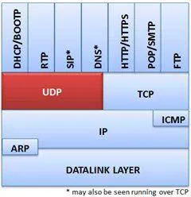
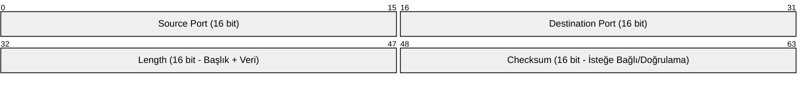
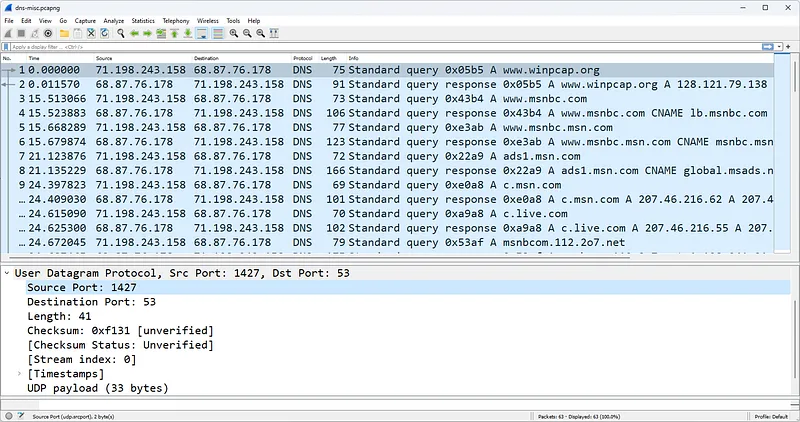
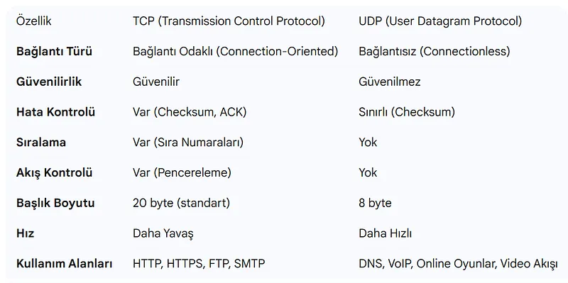
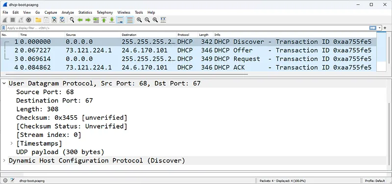
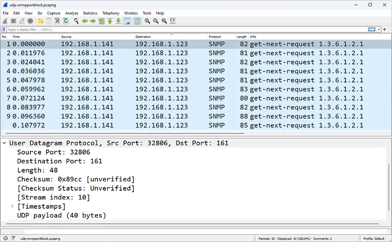
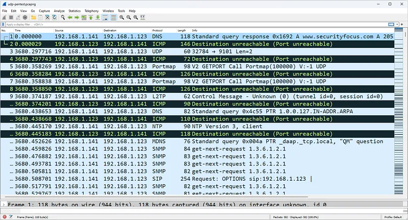

# UDP Protokolü Mimarisi, Başlık Yapısı ve Akış Analitiği

Kullanıcı Datagram Protokolü (User Datagram Protocol - UDP), RFC 768 standardıyla tanımlanmış, Taşıma Katmanının (Katman 4) en yalın ve en hızlı protokolüdür.

TCP'nin el sıkışma, sıralama ve onaylama gibi güvenilirlik mekanizmalarının getirdiği gecikmeyi (latency) ve başlık ek yükünü (overhead) reddeden UDP; **"ateşle ve unut" (fire-and-forget)** prensibiyle çalışır. Gerçek zamanlı ses/video iletişimi (VoIP, WebRTC), ağ altyapı servisleri (DNS, DHCP, NTP, SNMP) ve modern web standardı QUIC (HTTP/3) UDP'nin sunduğu bu hız ve hafiflik üzerine kuruludur.

---

## §3.3.1. 8 Baytlık Minimal Başlık Anatomisi

TCP başlığı en az 20 bayt iken ve karmaşık durum makineleri barındırırken, UDP başlığı yalnızca **8 bayt (64 bit)** uzunluğundadır ve 4 sabit alandan oluşur:

1. **Source Port (16 bit):** Gönderici cihazın dinamik geçici port numarası veya yanıt beklediği dinleme portu.
2. **Destination Port (16 bit):** Hedef servisin standart port numarası (Örn: DNS için 53, DHCP Sunucu için 67, NTP için 123).
3. **Length (16 bit):** UDP başlığı ve veri yükünün (payload) toplam bayt uzunluğu (En az 8 bayt).
4. **Checksum (16 bit):** Başlık ve verinin iletim sırasında bozulup bozulmadığını denetleyen matematiksel sağlama toplamı.

---

## §3.3.2. TCP ve UDP Karşılaştırmalı Analizi

| Parametre | TCP (İletim Denetim Protokolü) | UDP (Kullanıcı Datagram Protokolü) |
| :--- | :--- | :--- |
| **Bağlantı Tipi** | Bağlantı yönelimli (3-Way Handshake) | Bağlantısız (Handshake yok) |
| **Güvenilirlik** | Garantili (ACK ve Retransmission ile) | Garantisiz (En iyi çaba - Best effort) |
| **Sıralı İletim** | Var (Sequence Numbers ile yeniden dizer) | Yok (Gelen sıra neyse öyle işlenir) |
| **Akış Kontrolü** | Var (Windowing ve Congestion Avoidance) | Yok (Alıcı tamponu taşsa bile gönderir) |
| **Başlık Boyutu** | 20 – 60 Bayt | **Sabit 8 Bayt** |
| **Yayın Yeteneği** | Yalnızca Unicast (Tek noktaya) | **Unicast, Broadcast ve Multicast** |
| **Kritik Kullanım** | Web (HTTP/HTTPS), SSH, SFTP, E-Posta | **DNS, DHCP, NTP, VoIP, SNMP, Syslog, QUIC** |

---

## §3.3.3. Wireshark ile UDP Trafiği ve Analiz Senaryoları

UDP bağlantısız olduğu için çoğu yayın (Broadcast) ve çok noktaya yayın (Multicast) trafiği UDP üzerinden akar:

### 1. DHCP Başlatma Trafiği (DORA Süreci)
Bir istemci ağa bağlandığında henüz bir IP adresine sahip değildir. İstemci kaynak IP olarak `0.0.0.0`, hedef IP olarak genel yayın `255.255.255.255`, kaynak UDP portu `68` ve hedef UDP portu `67` olan bir **DHCP Discover** paketi yollar. TCP bu aşamada kullanılamaz çünkü henüz IP adresi atanmamış bir cihazla TCP el sıkışması yapılamaz.

### 2. Güvenlik Duvarı Tarafından Sessizce Düşürülen UDP Paketleri

UDP'de bağlantı onayı olmadığı için, bir istemci bir sunucuya UDP isteği (örneğin SNMP `UDP 161` veya Syslog `UDP 514`) yolladığında aradaki güvenlik duvarı portu engelliyorsa iki durum oluşabilir:
- Güvenlik duvarı `ICMP Type 3 Code 3 (Port Unreachable)` yanıtı dönebilir.
- Güvenlik duvarı paketi sessizce düşürebilir (Drop). Bu durumda Wireshark PCAP dosyasında istemcinin sürekli tek taraflı UDP paketleri gönderdiği ancak hiçbir yanıt gelmediği görülür.

### 3. UDP Port Taraması Tespiti (Reconnaissance)

Bir saldırgan Nmap ile `-sU` parametresi kullanarak bir sunucunun UDP portlarını taradığında:
- Kapalı portlara gönderilen her UDP paketi işletim sistemi çekirdeğinden bir `ICMP Destination Unreachable / Port Unreachable (Type 3 / Code 3)` yanıtı tetikler.
- Wireshark'ta kısa bir zaman diliminde ardışık port numaralarına gönderilen UDP paketleri ve ardından gelen ICMP Type 3 Code 3 selini görmek, aktif bir siber keşif faaliyetinin doğrudan kanıtıdır.

---

## §3.3.4. Geleceğin Taşıma Mimarisi: QUIC ve HTTP/3

TCP'nin 3 yönlü el sıkışması ve TLS el sıkışmasının getirdiği çoklu gidiş-dönüş süreleri (RTT) modern web için darboğaz oluşturmaktadır. Ayrıca TCP'de tek bir paketin kaybolması arkadaki tüm veri akışını durdurur (**Head-of-Line Blocking**).

Google tarafından geliştirilen ve IETF standardı (RFC 9000) haline gelen **QUIC**, taşıma katmanında **UDP** kullanır:
- TLS 1.3 şifrelemesini doğrudan protokolün içine gömer (**0-RTT bağlantı kurulumu**).
- UDP üzerinden bağımsız çoklu akışlar (Multiplexing) oluşturarak Head-of-Line Blocking sorununu tamamen ortadan kaldırır.
- Günümüzde YouTube, Google servisleri ve Cloudflare üzerindeki web trafiğinin %50'sinden fazlası UDP/443 üzerinden QUIC ile akmaktadır.

---

## §3.3.5. Wireshark UDP Ekran Filtreleri

| Filtre | Kullanım Amacı |
| :--- | :--- |
| `udp` | Tüm UDP trafiğini gösterir |
| `udp.port == 53` | DNS sorgu ve cevapları |
| `udp.port == 67 || udp.port == 68` | DHCP kira ve yapılandırma paketleri |
| `udp.port == 123` | NTP zaman senkronizasyon trafiği |
| `udp.port == 161` | SNMP cihaz izleme ve sorgulama paketleri |
| `udp.length > 512` | Standart DNS boyutunu aşan şüpheli büyük UDP paketleri |
| `icmp.type == 3 && icmp.code == 3` | Kapalı UDP portlarına verilen yanıtlar (Tarama tespiti) |
