# DNS Protokolü Mimarisi, Sorgu/Yanıt Analizi ve DNS Hataları

Alan Adı Sistemi (Domain Name System - DNS), internetin telefon rehberidir. İnsanların okuyabildiği alan adlarını (`www.ornek.com`) bilgisayarların ve yönlendiricilerin anlayabildiği 32-bitlik IPv4 veya 128-bitlik IPv6 adreslerine dönüştürür.

DNS çalışmadığında, alt ağlar ve yönlendiriciler kusursuz çalışsa dahi kullanıcılar servisleri isimle bulamayacağı için tüm internet durmuş gibi algılanır. Bu bölümde DNS mimarisini, özyinelemeli (recursive) çözümleme adımlarını, Wireshark ile DNS başlık anatomisini ve en yaygın DNS hata kodlarının analizini inceleyeceğiz.

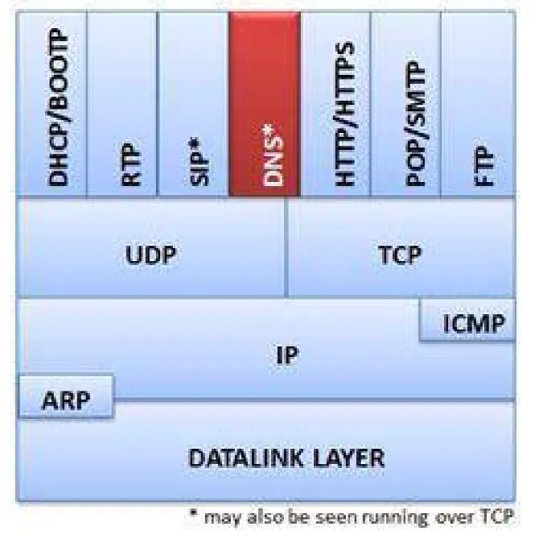

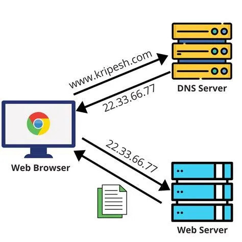

---

## §4.1.1. DNS Mimarisi ve İsim Çözümleme Hiyerarşisi

DNS, dağıtık ve hiyerarşik bir veritabanı yapısına sahiptir:

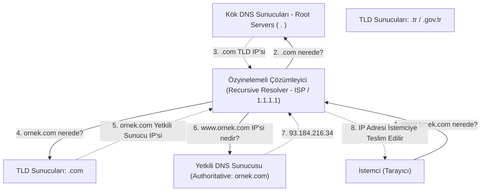

### DNS Taşıma Protokolü: UDP 53 vs. TCP 53

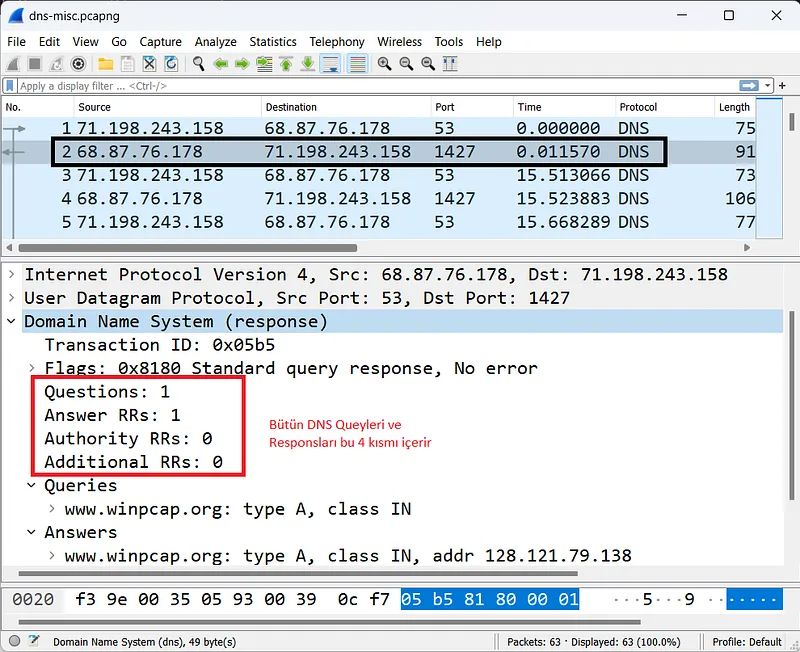

- Standart DNS sorgu ve yanıtları hız ve hafiflik için **UDP 53** üzerinden iletilir. RFC 1035 uyarınca UDP paket yükü sınırı geleneksel olarak **512 bayttır**.
- Yanıt 512 baytı aştığında (örneğin çok sayıda IP dönüyorsa veya DNSSEC imzaları varsa) yanıtta **TC (Truncation - Kesilme)** bayrağı `1` olarak ayarlanır.
- İstemci TC bayrağını görünce sorguyu derhal **TCP 53** üzerinden yeniden gönderir.
- Bölge transferleri (**Zone Transfer - AXFR/IXFR**) sunucular arasında veri bütünlüğünü garanti etmek için daima **TCP 53** kullanır.

---

## §4.1.2. Kritik DNS Kayıt Türleri ve İşlevleri

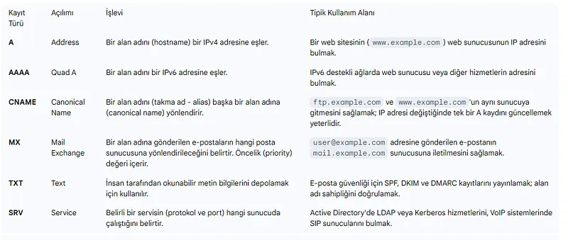

| Kayıt Türü | Tam Adı | Kullanım Amacı |
| :--- | :--- | :--- |
| **A** | Address | Alan adını 32-bit IPv4 adresine eşler |
| **AAAA** | IPv6 Address | Alan adını 128-bit IPv6 adresine eşler |
| **CNAME** | Canonical Name | Bir alan adını başka bir alan adına takma ad (alias) olarak yönlendirir |
| **MX** | Mail Exchange | İlgili domain için e-postaları kabul eden posta sunucularını ve önceliklerini belirtir |
| **PTR** | Pointer | Ters DNS (rDNS); IP adresini alan adına çözümler (`in-addr.arpa`) |
| **TXT** | Text | Metin verisi; SPF, DKIM ve DMARC gibi e-posta güvenlik kayıtlarını tutar |
| **SRV** | Service | Servis lokasyonu; Active Directory etki alanı denetleyicilerini (DC) bulmak için kullanılır (`_ldap._tcp.dc._msdcs`) |
| **NS** | Name Server | İlgili bölgeden sorumlu yetkili DNS sunucularını listeler |
| **SOA** | Start of Authority | Bölgenin seri numarası, yenileme ve TTL parametrelerini içeren ana kayıt |

---

## §4.1.3. DNS Güvenliği: Saldırı Vektörleri, DoT ve DoH

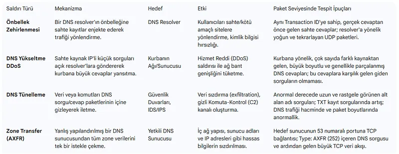

Geleneksel DNS şifresiz düz metin (plaintext) iletildiği için ciddi güvenlik riskleri barındırır:
1. **DNS Zehirlenmesi (DNS Cache Poisoning):** Kaminsky saldırısı ile önbelleğe sahte IP kayıtlarının enjekte edilmesi.
2. **DNS Amplification:** UDP kaynak IP spoofing yapılarak hedef kurbana devasa DNS yanıtları yönlendirilmesi (DDoS).
3. **DNS Tünelleme (DNS Tunneling):** TXT ve CNAME sorguları üzerinden güvenlik duvarını atlayarak veri kaçırma veya C2 iletişimi.

### DoT (DNS over TLS) vs. DoH (DNS over HTTPS)

Geleneksel DNS sorgularının ISS veya ağ dinleyicileri tarafından izlenmesini engellemek için şifreli DNS protokolleri geliştirilmiştir:

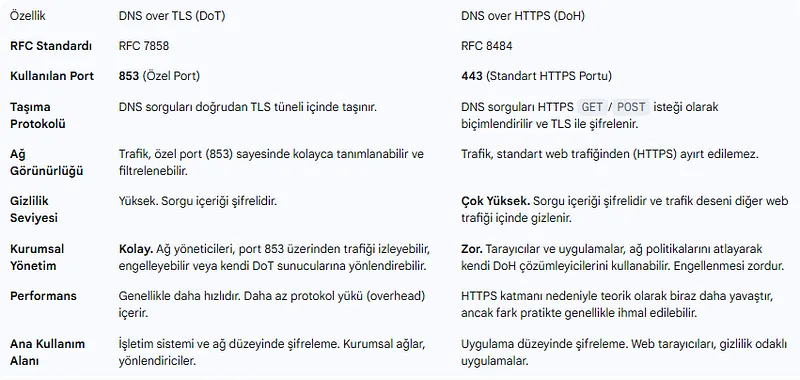

- **DNS over TLS (DoT - RFC 7858):** DNS sorgularını doğrudan TLS ile şifreleyerek **TCP 853** portundan iletir. Ağ yöneticileri tarafından kolayca denetlenebilir veya engellenebilir.
- **DNS over HTTPS (DoH - RFC 8484):** DNS sorgularını HTTP/2 veya HTTP/3 GET/POST yükü içine gömerek standart **TCP 443** üzerinden taşır. Normal web trafiğinden ayırt edilmesi imkansıza yakındır; kurumsal DLP ve DNS güvenlik filtrelerini aşabilir.

---

## §4.1.4. Wireshark ile DNS Sorgu ve Yanıt Anatomisi

Bir DNS paketi yakalandığında Katman 7 Application katmanında şu başlık yapısı açılır:

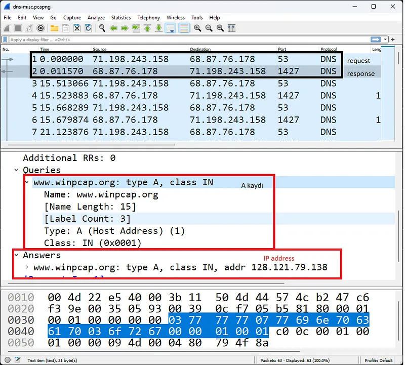

- **Transaction ID (16 bit):** Her sorguya rastgele atanan bir kimliktir. Sunucunun döndüğü yanıtta aynı Transaction ID yer alır; istemci hangi yanıtın hangi soruya ait olduğunu bu numarayla eşleştirir.
- **Flags (Bayraklar):**
  - `QR (Query/Response):` `0` ise Sorgu, `1` ise Yanıt.
  - `AA (Authoritative Answer):` `1` ise yanıtı veren sunucu o alan adının resmi yetkili sunucusudur.
  - `TC (Truncated):` `1` ise paket boyutu kesilmiştir, TCP'ye geçilmelidir.
  - `RD (Recursion Desired):` İstemci sunucudan özyinelemeli çözümleme yapmasını ister.
  - `RA (Recursion Available):` Sunucu özyinelemeyi desteklediğini bildirir.
  - `RCODE (Reply Code):` İşlemin sonucunu bildiren 4 bitlik durum kodu.

---

## §4.1.5. DNS Hatalarının Wireshark ile Analizi

SOC analistleri ve sistem yöneticileri Wireshark'ta en sık şu DNS hatalarıyla karşılaşır:

### 1. RCODE 3: Name Error / No Such Name (NXDOMAIN)

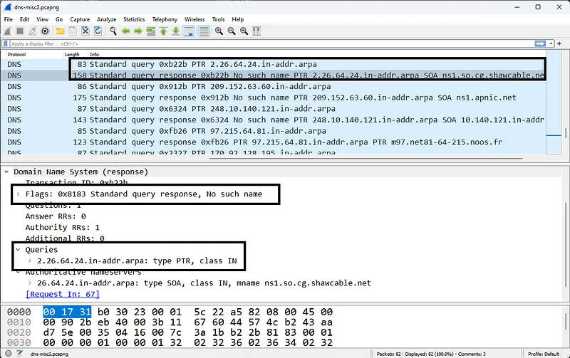

İstemcinin talep ettiği alan adının DNS sunucusunda ve internet kayıtlarında bulunmadığını belirtir.
- Bir kullanıcının harf hatası yapmasından kaynaklanabileceği gibi;
- Zararlı yazılımların C2 (Komuta Kontrol) sunucusunu bulmak için kullandığı **DGA (Domain Generation Algorithm)** algoritmalarının da en belirgin göstergesidir. Kısa sürede yüzlerce farklı anlamsız domain için `NXDOMAIN` dönmesi aktif zararlı yazılım alarmıdır.

### 2. RCODE 2: Server Failure (SERVFAIL)

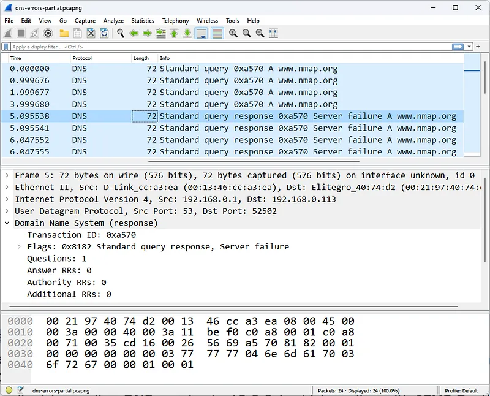

Yetkili sunucunun yanıt vermemesi, DNSSEC imza doğrulama hatası veya yerel çözümleyicinin dış sunuculara erişememesi durumunda istemciye `SERVFAIL` döner. İstemci DNS sorgularını üst üste tekrar eder (Retransmission) ve site açılamaz.

### 3. Port 53 Kapalı Hatası (ICMP Port Unreachable)

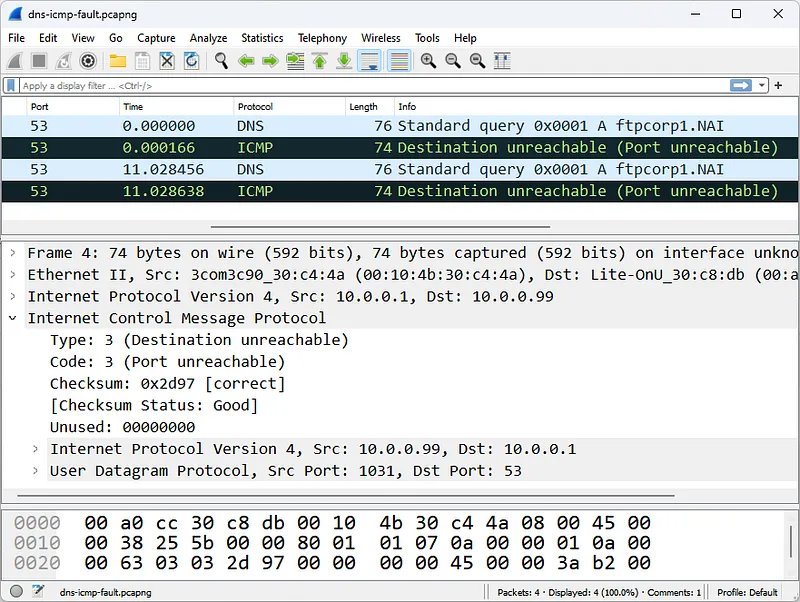

İstemci DNS sorgusu yollar, ancak hedef IP'den bir DNS yanıtı yerine `ICMP Destination Unreachable / Port Unreachable (Type 3 / Code 3)` paketi gelir. Bu durum hedef sunucuda DNS servisinin (Bind9, Windows DNS, Unbound) çöktüğünü veya yanlış IP adresinin DNS olarak yapılandırıldığını belgeler.

---

## §4.1.6. Wireshark DNS Ekran Filtreleri

| Ekran Filtresi | Açıklama |
| :--- | :--- |
| `dns` | Tüm DNS trafiğini listeler |
| `dns.flags.response == 0` | Yalnızca DNS istekleri (Queries) |
| `dns.flags.response == 1` | Yalnızca DNS yanıtları (Responses) |
| `dns.flags.rcode == 3` | Var olmayan alan adı hataları (**NXDOMAIN** - DGA analizi için kritik) |
| `dns.flags.rcode == 2` | Sunucu çözümleme hataları (**SERVFAIL**) |
| `dns.qry.name contains "malicious"` | Belirli bir anahtar kelimeyi içeren sorgular |
| `dns.qry.type == 1` | Yalnızca A kaydı sorguları |
| `dns.qry.type == 16` | Yalnızca TXT kaydı sorguları (Tünelleme tespiti) |
| `dns.qry.type == 33` | Yalnızca SRV kaydı sorguları (Active Directory keşfi) |
