# HTTP Protokolü, İstek/Yanıt Modeli ve Web Nesnelerinin Dışa Aktarımı

Hiper Metin Aktarım Protokolü (Hypertext Transfer Protocol - HTTP), modern internetin ve World Wide Web'in temel uygulama protokolüdür. İstemcilerin (web tarayıcıları, mobil uygulamalar, API istemcileri) sunuculardan HTML sayfaları, görseller, videolar ve JSON/XML verileri talep etmesini sağlar.

HTTP durumsuz (stateless) bir protokoldür; yani sunucu iki ardışık istek arasında varsayılan olarak herhangi bir durum bilgisi saklamaz. Oturum yönetimi çerezler (Cookies) ve yetkilendirme belirteçleri (Bearer Tokens / JWT) ile sağlanır.

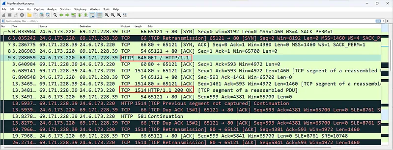

---

## §4.2.1. HTTP İstek Metotları ve Güvenlik Nitelikleri

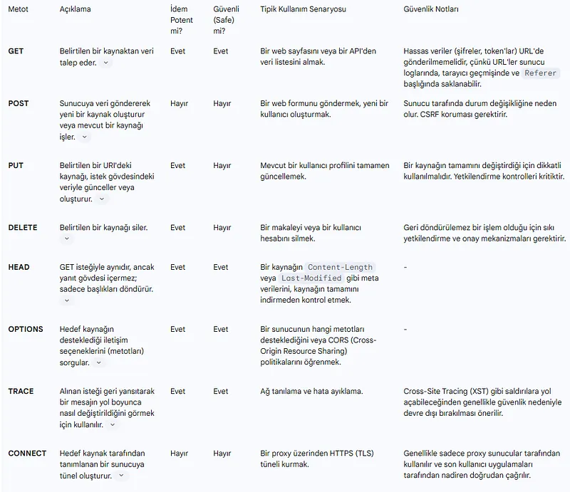

İstemci bir sunucuya istek gönderirken hedeflenen eylemi belirtmek için standart fiiller (metodlar) kullanır:

- **GET:** Belirtilen URL'deki kaynağın (sayfa, görsel, veri) bir kopyasını talep eder. Sunucu durumunu değiştirmez (*Safe / Idempotent*).
- **POST:** Sunucuya işlenmek üzere veri gönderir (Form gönderimi, kullanıcı girişi, dosya yükleme). Güvenli veya idempotent değildir.
- **PUT:** Belirtilen URL'deki kaynağı tamamen günceller veya yoksa sıfırdan oluşturur.
- **PATCH:** Kaynak üzerinde kısmi güncelleme yapar.
- **DELETE:** Belirtilen kaynağı sunucudan siler.
- **HEAD:** GET ile aynı başlıkları döner ancak gövde (body) verisini iletmez.
- **OPTIONS:** Sunucunun ilgili URL için hangi metodları ve CORS politikalarını desteklediğini sorgular.

---

## §4.2.2. HTTP Durum Kodları (Status Codes)

Sunucular istemcinin isteğine 3 haneli sayısal bir durum kodu ve açıklama mesajıyla yanıt verir:

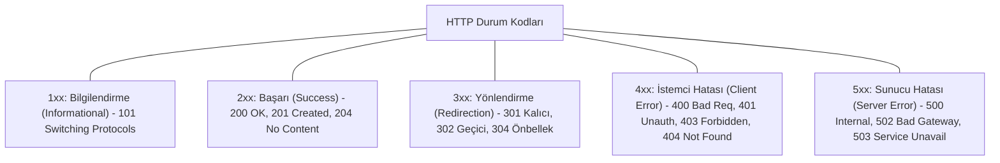

### Operasyonel Açıdan En Kritik Kodlar:
- **200 OK:** İstek başarıyla işlendi ve içerik yanıt gövdesinde gönderildi.
- **301 Moved Permanently:** Kaynak kalıcı olarak yeni bir URL'ye taşındı (SEO ve HTTPS yönlendirmeleri için kullanılır).
- **304 Not Modified:** İstemcinin yerel önbelleğindeki (cache) dosya hala güncel, sunucu gereksiz veri aktarımı yapmaz.
- **401 Unauthorized:** Kaynağa erişmek için geçerli kimlik doğrulama gereklidir.
- **403 Forbidden:** Kimlik doğrulansa bile istemcinin bu kaynağa erişim yetkisi yoktur.
- **404 Not Found:** İstenen URL sunucuda mevcut değildir.
- **500 Internal Server Error:** Sunucu tarafındaki kodda beklenmedik bir istisna/çökme yaşandı.
- **502 Bad Gateway & 504 Gateway Timeout:** Ters vekil sunucunun (Nginx, Cloudflare) arkadaki uygulama sunucusuna erişemediğini gösterir.

---

## §4.2.3. Wireshark ile Web Trafik İstatistikleri ve Yük Dağılımı

Wireshark, web uygulamalarının performans ve bağımlılık haritasını çıkarmak için özelleşmiş araçlar sunar:

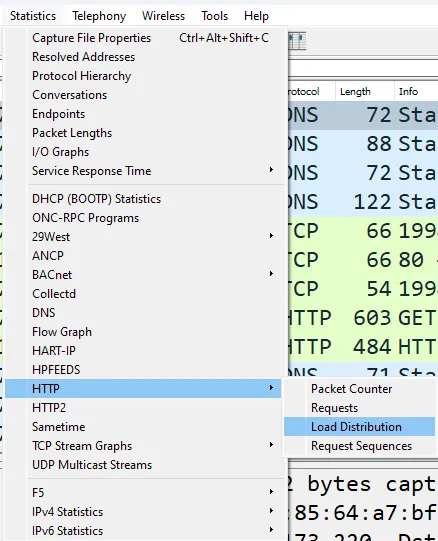

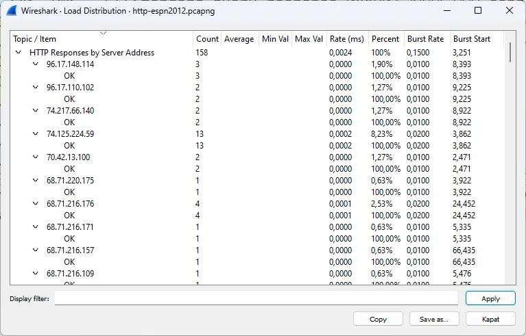

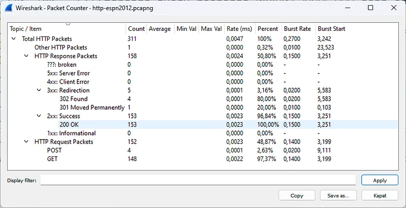

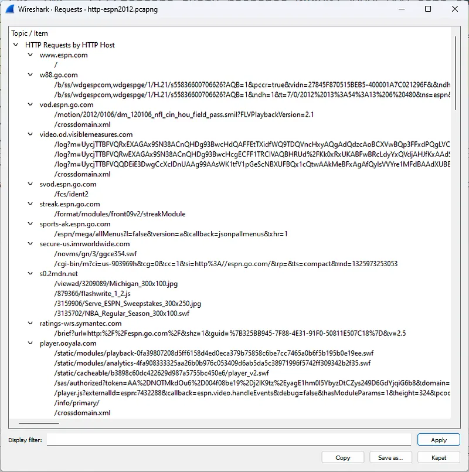

- **HTTP Load Distribution:** Sunucuya gelen isteklerin zaman içindeki frekansını ve yük dağılımını gösterir.
- **Redirection Mapping:** İstemcinin ana sayfadan hangi CDN ve üçüncü taraf API'lara yönlendirildiğini (301, 302) ve hangi isteklerin 404 ile sonuçlandığını ortaya koyar.

---

## §4.2.4. HTTP Bağlantı Hataları ve Paket Zamanlama Analizi

Web sunucusu arka plan programı (backend daemon) çöktüğünde veya aşırı yüklendiğinde Wireshark paketlerinde tipik semptomlar oluşur:

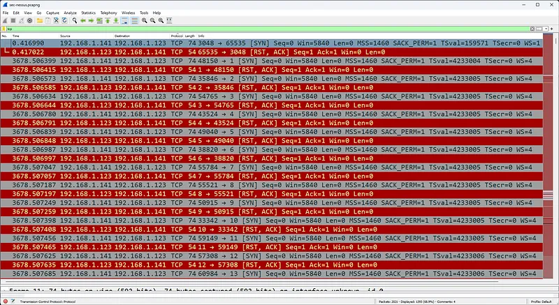

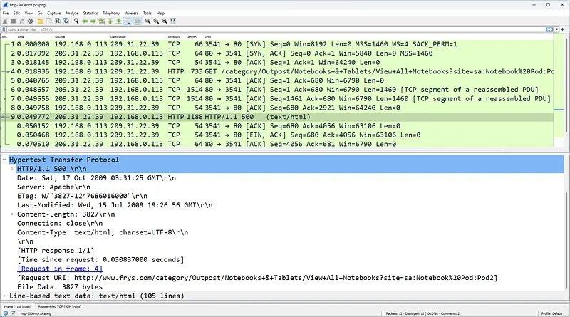

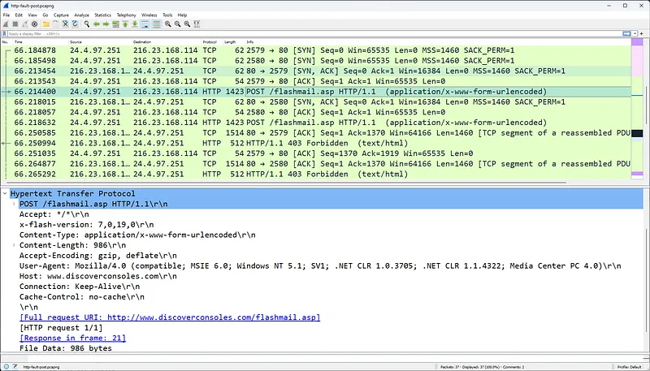

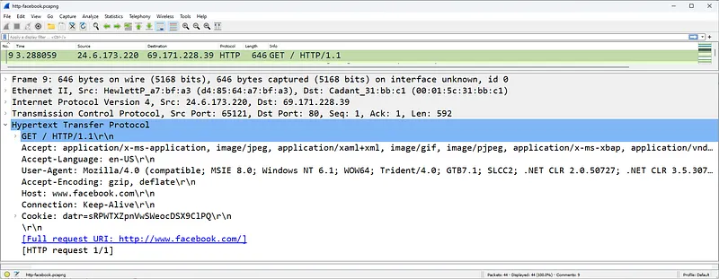

> [!TIP]
> Web sunucu gecikmelerini analiz ederken Wireshark'ta **Time** sütununu **Seconds Since Previous Displayed Packet** (Önceki paketten bu yana geçen saniye) olarak ayarlamak, sunucunun HTTP yanıtını üretirken ne kadar süre düşündüğünü (Server Processing Time) doğrudan ortaya çıkarır.

---

## §4.2.5. Web Uygulama Güvenliği: XSS Savunması ve HTTP Güvenlik Başlıkları

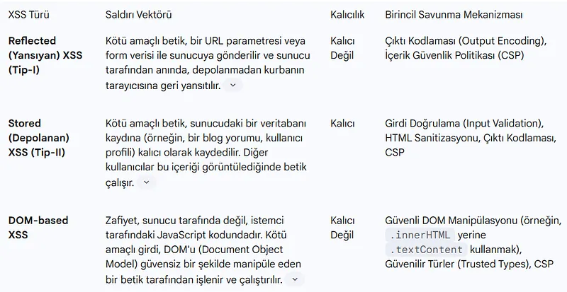

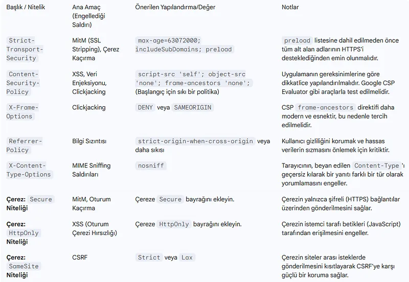

Modern web güvenliğinde sunucu yanıtlarına eklenen HTTP başlıkları istemci tarayıcısını sıkılaştırır:
1. **HSTS (HTTP Strict Transport Security):** Tarayıcının siteye yalnızca HTTPS üzerinden bağlanmasını zorunlu kılar (`Strict-Transport-Security: max-age=31536000; includeSubDomains; preload`).
2. **Content Security Policy (CSP):** XSS ve veri enjeksiyonu saldırılarına karşı tarayıcının yalnızca izin verilen kaynaklardan betik ve stil yüklemesine izin verir (`Content-Security-Policy: default-src 'self'`).
3. **X-Frame-Options:** Sitenin `<iframe>` içine alınarak Clickjacking yapılmasını engeller (`X-Frame-Options: DENY` veya `SAMEORIGIN`).
4. **Referrer-Policy:** İstek yönlendirildiğinde hassas URL parametrelerinin sızmasını önler (`Referrer-Policy: strict-origin-when-cross-origin`).
5. **X-Content-Type-Options:** Tarayıcının MIME türü tahminini (MIME sniffing) engeller (`nosniff`).

---

## §4.2.6. Wireshark ile HTTP Nesnelerini Dışa Aktarma (Export Objects)

Adli bilişim (DFIR) ve siber tehdit avcılığı incelemelerinde, ağ üzerinden indirilen bir dosyanın orijinal halini elde etmek gerekir. Wireshark, şifresiz HTTP oturumlarındaki parçalanmış tüm TCP paketlerini otomatik olarak birleştirerek dosyaları tek parça halinde dışa aktarabilir:

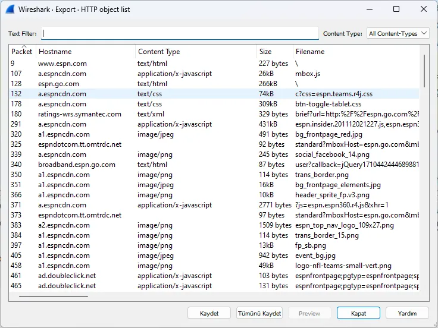

### Adım Adım Nesne Dışa Aktarımı:
1. Wireshark üst menüsünden **File $\rightarrow$ Export Objects $\rightarrow$ HTTP...** yolunu izleyin.
2. Açılan pencerede akıştan geçen tüm dosyalar (HTML, JPEG, PNG, JS, EXE, ZIP) dosya adı, boyutu ve MIME türüyle listelenir.
3. Şüpheli dosyayı seçip **Save** butonuna basarak izole bir analiz dizinine kaydedebilir ve zararlı yazılım analizine tabi tutabilirsiniz.

---

## §4.2.7. Wireshark HTTP Ekran Filtreleri

| Ekran Filtresi | Kullanım Amacı |
| :--- | :--- |
| `http` | Tüm HTTP istek ve yanıtlarını listeler |
| `http.request` | Yalnızca giden HTTP istekleri |
| `http.response` | Yalnızca sunucudan dönen yanıtlar |
| `http.request.method == "POST"` | Parola, kimlik veya veri gönderen tüm POST istekleri |
| `http.response.code >= 400` | Tüm hata döndüren web oturumları |
| `http.request.full_uri contains "admin"` | URL'sinde "admin" ifadesi geçen tüm istekler |
| `http.user_agent contains "sqlmap"` | Otomatize tarama aracı kullanan saldırgan istekleri |
| `http.host == "www.hedefsite.com"` | Belirli bir alan adına giden tüm web trafiği |
