# HTTPS, TLS 1.3 El Sıkışması ve Şifreli Trafik Görünürlüğü

Güvenli Hiper Metin Aktarım Protokolü (HTTPS), standart HTTP trafiğinin Taşıma Katmanı Güvenliği (Transport Layer Security - TLS) kriptografik protokolü ile sarmalanmış halidir.

Düz metin HTTP ile iletilen parolalar, oturum çerezleri ve gizli veriler yerel ağdaki herhangi bir dinleyici (Sniffer / MitM saldırganı) tarafından okunabilirken; HTTPS **Gizlilik (Confidentiality)**, **Bütünlük (Integrity)** ve **Kimlik Doğrulama (Authentication)** garantisi sunar. Günümüzde internet trafiğinin %90'ından fazlası TLS ile şifrelenmiştir.

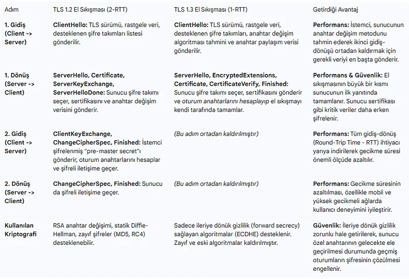

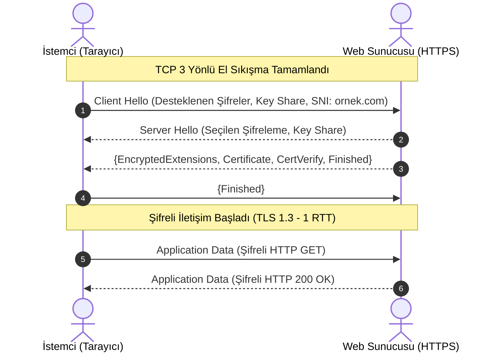

---

## §4.3.1. TLS El Sıkışması (Handshake) Paket Düzeyinde Adım Adım Analiz

HTTPS oturumu standart TCP 3 yönlü el sıkışmasıyla başlar:

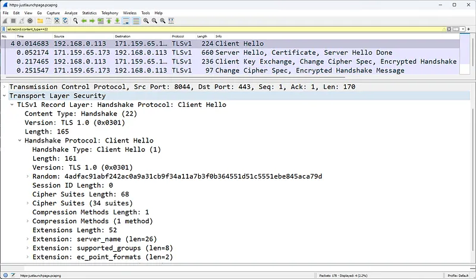

TCP bağlantısı kurulduktan sonra TLS oturumu devreye girer:

### 1. Client Hello ve SNI (Server Name Indication)
İstemci desteklediği TLS sürümlerini, şifreleme süitlerini (Cipher Suites) ve rastgele sayısını (Client Random) gönderir:

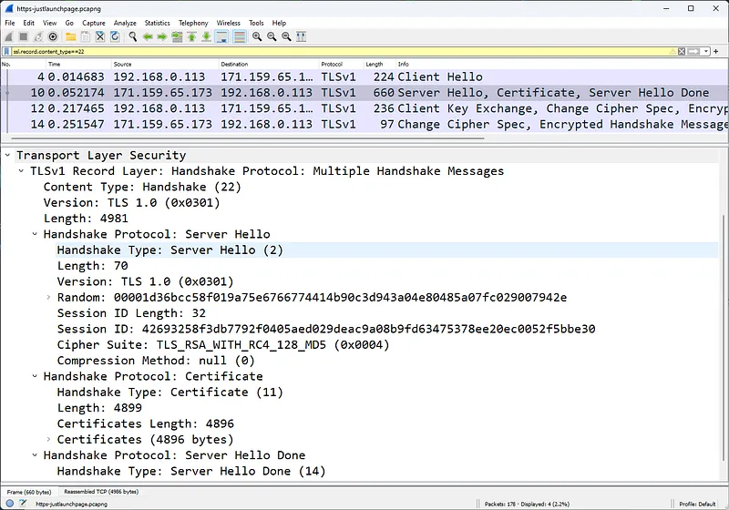

- **SNI Uzantısı:** İstemcinin hangi web sitesine bağlanmak istediğini düz metin olarak sunucuya bildirir (Örn: `www.bankofamerica.com`). Bu alan henüz şifrelenmediği için SOC analistleri ve yeni nesil güvenlik duvarları tarafından alan adı denetimi için kullanılır.

### 2. Server Hello, Sertifika ve Anahtar Değişimi
Sunucu seçtiği şifre paketini onaylar ve dijital kimliğini kanıtlayan X.509 sertifikasını gönderir:

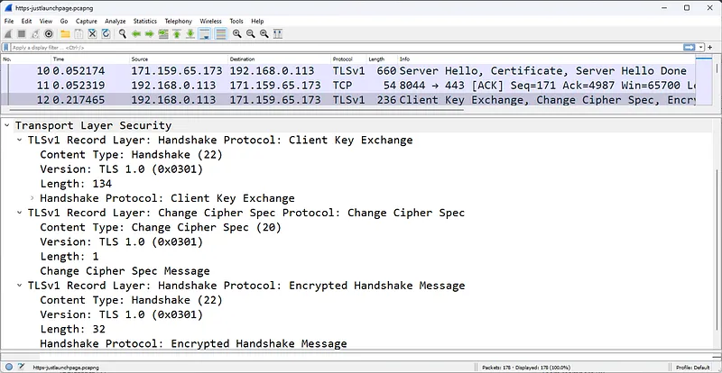

### 3. Client Key Exchange ve Master Secret Türetimi
İstemci, sunucunun açık anahtarıyla şifrelenmiş Pre-Master Secret bilgisini gönderir veya Diffie-Hellman anahtar paylaşımını tamamlar:

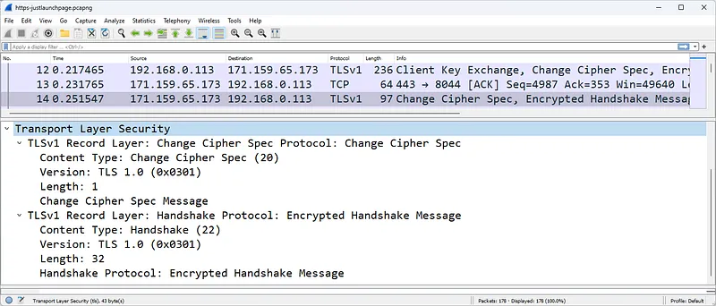

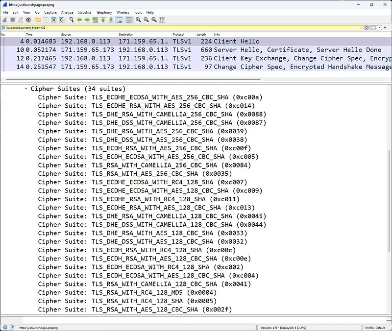

- **Master Secret:** İstemci ve sunucu arasında paylaşılan 48 baytlık bu simetrik sır, oturum boyunca kullanılacak olan şifreleme ve MAC anahtarlarını üretmek için kullanılır.

---

## §4.3.2. TLS 1.2 vs TLS 1.3 Mimarisi

| Güvenlik ve Performans Özelliği | TLS 1.2 | TLS 1.3 |
| :--- | :--- | :--- |
| **El Sıkışma Gecikmesi** | 2 RTT (İki tam gidiş-dönüş) | **1 RTT** (Önceden bilinen oturumlarda 0-RTT) |
| **Zayıf Kriptografik Algoritmalar** | RSA anahtar değişimi, CBC mod, SHA-1, RC4 (Mevcut) | **Tamamen kaldırıldı** (Yalnızca güvenli AEAD şifreleri) |
| **Sertifika Gizliliği** | Sunucu sertifikası düz metin gönderilir | **Sertifika tamamen şifrelenir** |
| **İleriye Dönük Gizlilik (Forward Secrecy)** | İsteğe bağlı (Zorunlu değil) | **Zorunlu** (Yalnızca Ephemeral Diffie-Hellman - ECDHE) |

---

## §4.3.3. Wireshark ile TLS Şifre Çözme Yöntemleri

Bir laboratuvar veya sızma testi analizinde TLS ile şifrelenmiş trafiğin içini görmek için iki yöntem kullanılır:

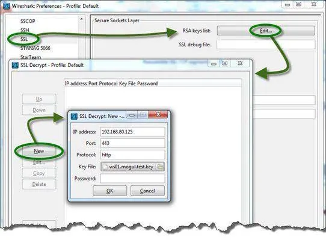

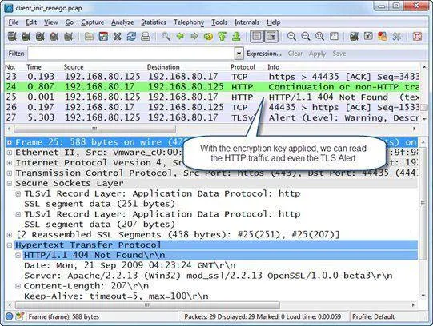

### 1. SSLKEYLOGFILE Yöntemi (Modern TLS 1.3 Standardı)
Tarayıcıların (Chrome, Firefox) oturum anahtarlarını dışarı aktarması sağlanır:
1. İşletim sisteminde bir çevre değişkeni tanımlayın:
   - Değişken Adı: `SSLKEYLOGFILE`
   - Değer: `C:\temp\sslkeys.log`
2. Tarayıcıyı başlattığınızda oturum anahtarları bu metin dosyasına yazılır.
3. Wireshark'ta **Edit $\rightarrow$ Preferences $\rightarrow$ Protocols $\rightarrow$ TLS** menüsüne gidin.
4. **(Pre)-Master-Secret log filename** alanına bu dosya yolunu verin. Wireshark şifreyi otomatik çözer.

### 2. RSA Özel Anahtarı (Private Key) Yöntemi (Yalnızca Eski TLS 1.2)
Sunucunun özel anahtarı (`.pem` veya `.key`) Wireshark'a yüklenerek şifre çözülür. Ancak modern Forward Secrecy (ECDHE) algoritmalarında özel anahtar bilinse dahi geçmiş trafik çözülemez.

---

## §4.3.4. Kurumsal Ağlarda SSL İleri Vekil Sunucu (SSL Forward Proxy / Decryption)

Kurumsal ağlarda kullanıcıların internete çıkışı TLS ile şifrelendiğinde, geleneksel IDS/IPS ve DLP sistemleri trafiğin içindeki zararlı yazılımları veya veri sızıntılarını göremez (kör nokta oluşur).

Yeni Nesil Güvenlik Duvarları (Palo Alto, Fortinet) **SSL Forward Proxy** mimarisini kullanır:

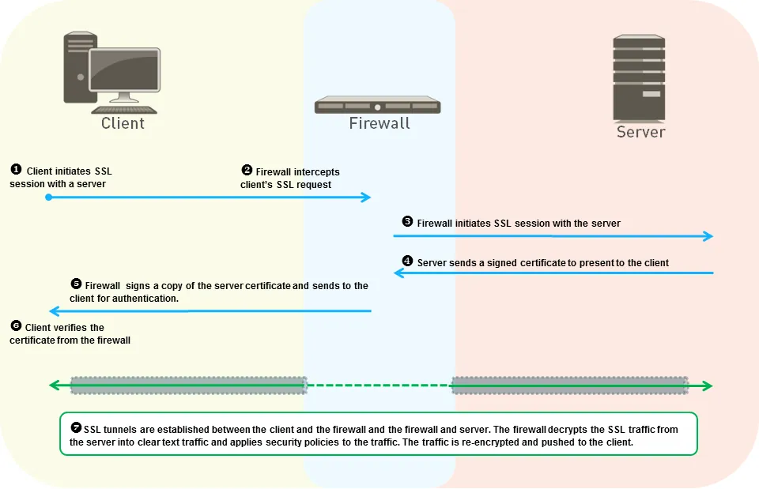

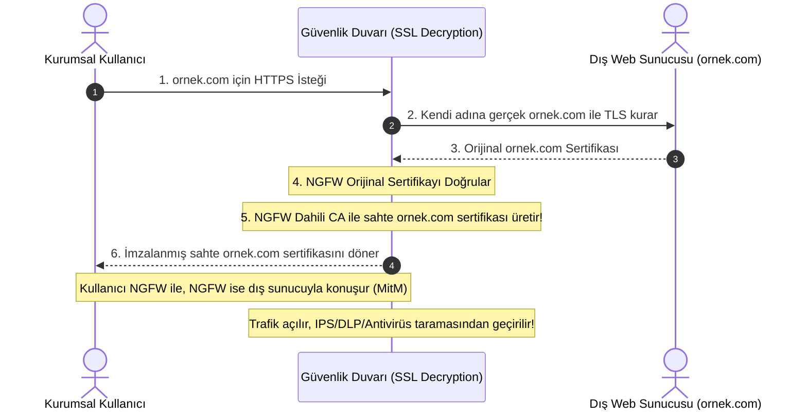

1. Güvenlik duvarı istemci ile dış sunucu arasına meşru bir **Ortadaki Adam (MitM)** olarak girer.
2. Dış sunucunun sertifikasını kendisi doğrular.
3. Kurumsal Kök Sertifika Yetkilisi (Root CA) kullanılarak istemci için anlık olarak sahte bir sertifika üretilir.
4. Kurumsal makinelerde bu Root CA önceden yüklü olduğu için kullanıcı herhangi bir sertifika hatası görmez.
5. Güvenlik duvarı trafiği çözer, derin paket incelemesinden (DPI) geçirir, zararlı yazılım ve DLP taraması yapar ve tekrar şifreleyerek iletir.
