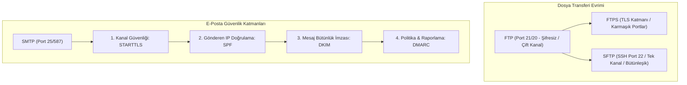
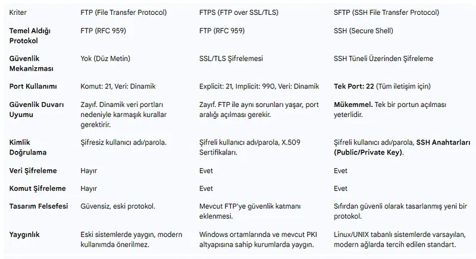
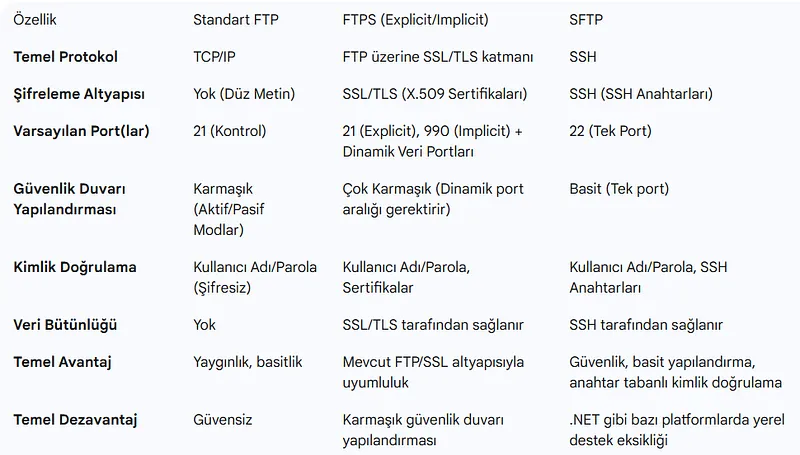
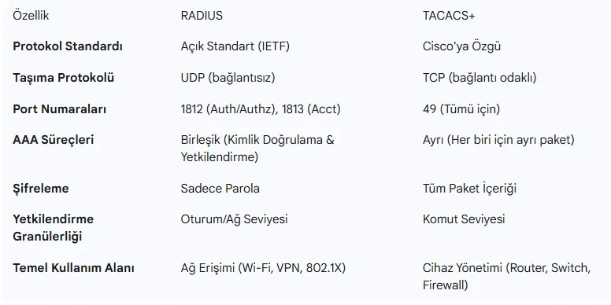
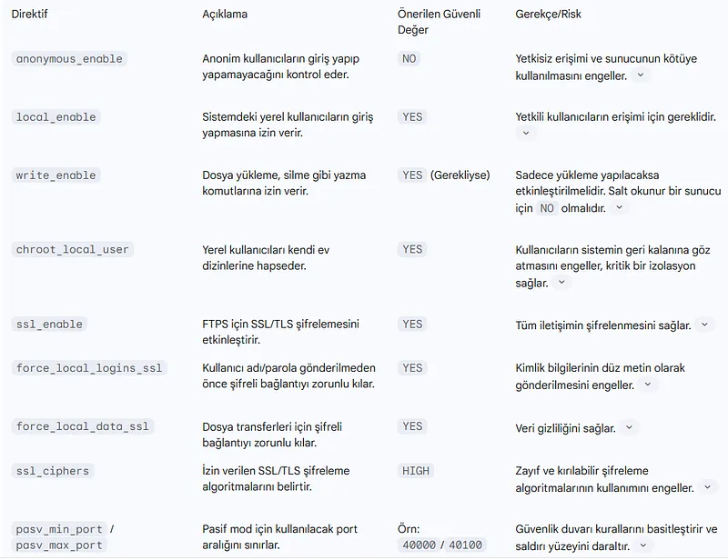
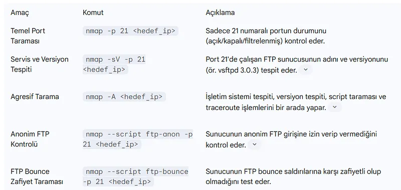
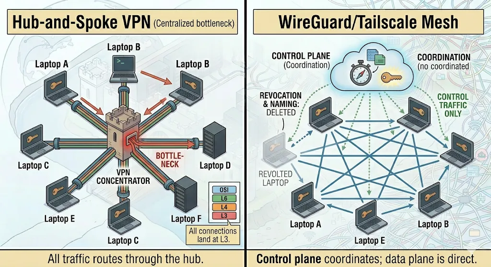
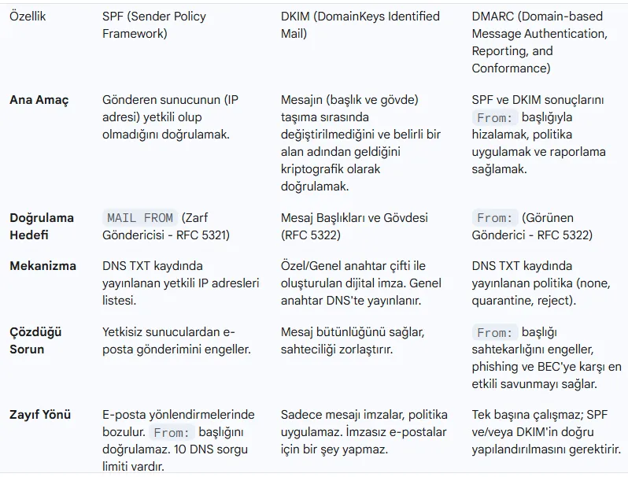
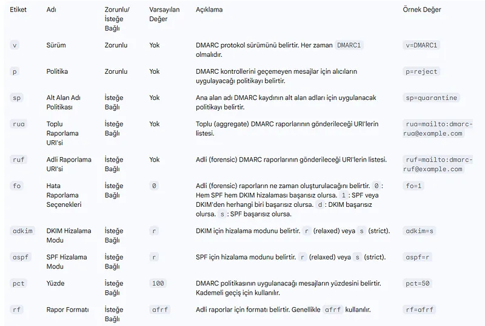
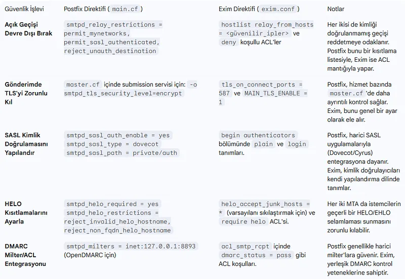

# FTP ve SMTP Güvenliği, FTPS/SFTP Dönüşümü ve E-Posta Savunması (SPF, DKIM, DMARC)

Uygulama katmanında dosya aktarımı ve elektronik posta iletişimi, modern kurumsal operasyonların bel kemiğini oluşturur. Ancak 1980'lerde tasarlanan orijinal FTP (RFC 959) ve SMTP (RFC 821) protokolleri, güvenlik ve şifreleme kavramlarının henüz internet mimarisinde yer almadığı bir dönemde geliştirilmiştir.

Düz metin iletim, zayıf kimlik doğrulama, spoofing (sahtecilik) ve güvenlik duvarı uyumsuzlukları gibi yapısal zaaflar; dosya transferinde **FTPS** ve **SFTP**, e-posta iletişiminde ise **STARTTLS**, **SPF**, **DKIM** ve **DMARC** gibi modern kriptografik savunma katmanlarının geliştirilmesini zorunlu kılmıştır.



---

## §4.4.1. FTP Protokolünün Anatomisi: Aktif vs. Pasif Mod

FTP, diğer birçok uygulama protokolünden farklı olarak iletişim için iki ayrı TCP bağlantısı kullanır:

1. **Komut (Kontrol) Kanalı (Port 21):** İstemcinin sunucuya bağlandığı, kimlik bilgilerini (`USER`, `PASS`) ve dosya komutlarını (`LIST`, `RETR`, `STOR`) düz metin ilettiği kalıcı kanaldır.
2. **Veri Kanalı (Dinamik Portlar):** Dosya transferi veya dizin listesi çekildiğinde geçici olarak açılan ve aktarım bitince kapanan kanaldır.



### Aktif Mod (PORT Komutu) ve Güvenlik Duvarı Krizi
- İstemci sunucunun port 21'ine bağlanır.
- Veri aktarımı gerektiğinde istemci kendi üzerinde bir port (N) dinlemeye başlar ve `PORT` komutuyla sunucuya *"Benim N portuma bağlan"* der.
- Sunucu kendi port 20'sinden **istemciye doğru yeni bir bağlantı başlatır**.
- **Kriz:** İstemci tarafındaki modern bir güvenlik duvarı veya NAT cihazı, dışarıdan gelen bu beklenmedik bağlantı isteğini anında engeller!

### Pasif Mod (PASV Komutu)
- İstemci sunucuya `PASV` komutu gönderir.
- Sunucu dinamik bir yüksek port (Örn: 40000-40100) açar ve istemciye bildirir.
- İstemci sunucunun bu dinamik portuna doğru veri bağlantısını başlatır.
- Bu yöntem istemci güvenlik duvarını aşsa da, sunucu yöneticisinin güvenlik duvarında geniş bir port bloğu açmasını gerektirerek sunucunun saldırı yüzeyini genişletir.

---

## §4.4.2. Güvenli Dosya Transferi: FTPS vs. SFTP





| Kriter | Standart FTP | FTPS (FTP over SSL/TLS) | SFTP (SSH File Transfer Protocol) |
| :--- | :--- | :--- | :--- |
| **IETF Standardı** | RFC 959 | RFC 4217 | RFC 4251 (SSH uzantısı) |
| **Bağlantı Türü** | Çift Kanal (Port 21 + Dinamik) | Çift Kanal (Port 21 + Dinamik) | **Tek Bir TCP Bağlantısı (Port 22)** |
| **Şifreleme** | Yok (Düz Metin) | TLS 1.2 / TLS 1.3 | **SSH Kriptografisi (ChaCha20, AES)** |
| **Güvenlik Duvarı / NAT** | Çok Sorunlu | Sorunlu (Dinamik port aralığı gerektirir) | **Kusursuz (Yalnızca port 22)** |
| **Kimlik Doğrulama** | Düz Parola | Parola veya X.509 İstemci Sertifikası | **Parola, SSH Anahtar Çifti (Ed25519, RSA)** |
| **Öneri** | **ASLA KULLANMAYIN** | Eski sistem entegrasyonlarında | **Modern Kurumsal Standart** |

---

## §4.4.3. vsftpd Sunucu Sıkılaştırma (Hardening) Kılavuzu

Eğer FTPS kullanılması zorunluysa, Linux üzerindeki en güvenli sunucu olan **vsftpd** (`/etc/vsftpd.conf`) şu direktiflerle sıkılaştırılmalıdır:



```ini
# /etc/vsftpd.conf - Güvenli FTPS Yapılandırması
anonymous_enable=NO
local_enable=YES
write_enable=YES
chroot_local_user=YES
allow_writeable_chroot=NO

# TLS / SSL Şifreleme Zorunluluğu
ssl_enable=YES
allow_anon_ssl=NO
force_local_data_ssl=YES
force_local_logins_ssl=YES
ssl_tlsv1_2=YES
ssl_tlsv1_3=YES
ssl_sslv2=NO
ssl_sslv3=NO
rsa_cert_file=/etc/ssl/certs/vsftpd.pem
rsa_private_key_file=/etc/ssl/private/vsftpd.key

# Pasif Port Aralığını Sınırlandırma (Firewall ile Eşleştirin)
pasv_enable=YES
pasv_min_port=40000
pasv_max_port=40100
```

---

## §4.4.4. Nmap ile FTP Güvenlik Denetimi

Ağ yöneticileri kendi FTP sunucularını proaktif denetlemek için Nmap Scripting Engine (NSE) kullanır:



```bash
# 1. Anonim giriş kontrolü
nmap -sV --script ftp-anon -p 21 192.168.1.100

# 2. FTP bounce saldırısı zafiyet testi
nmap --script ftp-bounce -p 21 192.168.1.100

# 3. Kaba kuvvet parola denemesi tespiti
nmap -p 21 --script ftp-brute --script-args userdb=users.txt,passdb=passwords.txt 192.168.1.100
```

---

## §4.4.5. E-Posta İletişiminin Güvenlik Mimarisi (SMTP)



E-posta protokolünde gönderici sunucu (MTA), alıcı sunucuya bağlanırken standart komut akışı yürütür:
1. `EHLO mail.ornek.com`: Gönderici sunucu kendini tanıtır.
2. `STARTTLS`: İletişimin açık metinden TLS şifrelemesine yükseltilmesi talep edilir.
3. `MAIL FROM: <yonetici@ornek.com>`: Gönderen adresi beyan edilir.
4. `RCPT TO: <hedef@alici.com>`: Alıcı adresi belirtilir.
5. `DATA`: Mesaj başlıkları ve gövdesi iletilir.

:::danger
Klasik SMTP'de `MAIL FROM` alanında herhangi bir alan adı beyan edilebilir. Protokol düzeyinde hiçbir doğrulama olmadığı için saldırganlar kendilerini `ceo@sirketiniz.com` veya `destek@banka.com` olarak göstererek oltalama (Phishing / CEO Fraud) e-postaları gönderebilir.
:::
---

## §4.4.6. E-Posta Kimlik Doğrulama Üçlüsü: SPF, DKIM ve DMARC



Kurumsal alan adlarının sahteciliğe karşı korunması üçlü federasyon ile sağlanır:

### 1. SPF (Sender Policy Framework - RFC 7208)
Alan adı sahibinin, kendi adına e-posta göndermeye yetkili IP adreslerini DNS `TXT` kaydında beyan etmesidir.
```text
v=spf1 ip4:198.51.100.10 include:_spf.google.com ~all
```
- Alıcı sunucu, gelen e-postanın kaynak IP'sinin bu listede olup olmadığını kontrol eder.

### 2. DKIM (DomainKeys Identified Mail - RFC 6376)
Gönderici sunucu, giden e-postanın gövdesini ve kritik başlıklarını kendi **özel anahtarıyla (Private Key)** dijital olarak imzalar (`DKIM-Signature` başlığı).
- Açık anahtar (Public Key) DNS'te `TXT` kaydı olarak yayınlanır.
- Alıcı sunucu açık anahtarla imzayı doğrular; böylece e-postanın yolda tahrif edilmediği (**Bütünlük**) garanti edilir.

### 3. DMARC (Domain-based Message Authentication - RFC 7489)
SPF ve DKIM doğrulamaları başarısız olduğunda alıcı sunucunun ne yapması gerektiğini (`none`, `quarantine`, `reject`) dikte eden üst politika katmanıdır.



```text
v=DMARC1; p=reject; rua=mailto:dmarc-reports@ornek.com; pct=100; aspf=r; adkim=r
```
- `p=reject`: SPF veya DKIM tutmayan sahte e-postaları doğrudan çöpe at.
- `rua`: Sahtecilik girişimlerini günlük XML raporları halinde belirtilen adrese bildir.

---

## §4.4.7. Postfix ve Exim Sunucu Sıkılaştırma Kılavuzu



Bir Linux posta sunucusunun açık geçiş (Open Relay) olmasını ve spam kaynağına dönüşmesini engellemek için `/etc/postfix/main.cf` yapılandırması:

```ini
# /etc/postfix/main.cf - Güvenli Postfix Yapılandırması
smtpd_banner = $myhostname ESMTP NO UCE
biff = no
append_dot_mydomain = no

# Açık Geçiş (Open Relay) Engelleme
smtpd_relay_restrictions = permit_mynetworks, permit_sasl_authenticated, reject_unauth_destination

# Zorunlu TLS Şifreleme
smtpd_tls_security_level = may
smtpd_tls_cert_file = /etc/letsencrypt/live/mail.ornek.com/fullchain.pem
smtpd_tls_key_file = /etc/letsencrypt/live/mail.ornek.com/privkey.pem
smtpd_tls_protocols = !SSLv2, !SSLv3, !TLSv1, !TLSv1.1
smtpd_tls_ciphers = high

# Sahte Zombi ve Bot Engelleme
smtpd_helo_required = yes
smtpd_helo_restrictions = permit_mynetworks, permit_sasl_authenticated, reject_invalid_helo_hostname, reject_non_fqdn_helo_hostname
smtpd_sender_restrictions = reject_non_fqdn_sender, reject_unknown_sender_domain
```

