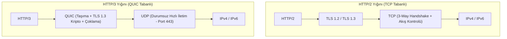
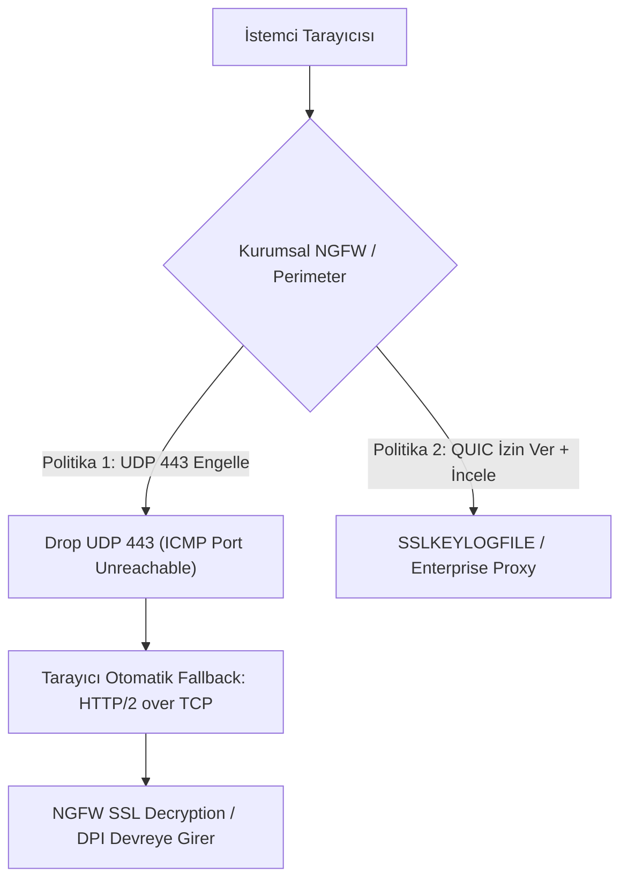

# QUIC ve HTTP/3 Protokol Anatomisi, Şifreli Trafik ve Ağ Güvenliği

İnternet trafiğinin ezici çoğunluğu son otuz yıldır TCP ve TLS protokolleri üzerinde taşınmıştır. Ancak modern web uygulamalarının yüksek bant genişliği, mobil cihazlar arası ağ geçişleri (Wi-Fi ↔ 4G/5G) ve sıfır gecikme (zero-latency) beklentileri, TCP'nin 1970'lerden kalma mimarisini zorlamıştır.

Bu gereksinimlere yanıt olarak Google tarafından deneysel olarak geliştirilen ve 2021 yılında IETF tarafından **RFC 9000 (QUIC)** ve **RFC 9114 (HTTP/3)** standartlarıyla resmileştirilen QUIC protokolü, web iletişiminde devrimsel bir paradigma değişikliği yaratmıştır.

QUIC, taşıma katmanında **UDP** (varsayılan olarak Port 443) üzerinde çalışır ve TLS 1.3 şifrelemesini doğrudan protokol çekirdeğine entegre eder.



---

## §4.5.1. TCP / TLS Sorunları ve QUIC'in Çözümleri

Klasik HTTP/2 over TCP mimarisinin getirdiği üç temel darboğaz şunlardır:

### 1. Bağlantı Kurma Gecikmesi (Connection Latency)
- **TCP + TLS 1.3:** İstemci önce TCP 3-Way Handshake (1 RTT) tamamlar, ardından TLS 1.3 el sıkışmasını (1 RTT) gerçekleştirir. Toplamda verinin akması için **2 RTT (Round Trip Time)** süre geçer.
- **QUIC Çözümü (1-RTT ve 0-RTT):** QUIC el sıkışması, taşıma parametrelerini ve TLS 1.3 anahtar değişimini tek bir aşamada birleştirir. İlk bağlantı **1 RTT** sürer. Daha önce ziyaret edilmiş sunucularda ise oturum biletleri (Session Resumption) ile **0-RTT** sürede (istemcinin ilk paketinde HTTP isteğiyle birlikte) veri iletilir.

### 2. Satır Başı Tıkanması (Head-of-Line - HoL Blocking)
HTTP/2 protokolü tek bir TCP bağlantısı üzerinde birden çok sanal akışı (stream) çoklar. Ancak TCP katmanı tüm akışları tek bir byte dizisi olarak görür. Bir akışa ait tek bir paket bile kaybolsa, TCP alıcı tamponunda tüm akışları durdurur ve kayıp paketin yeniden iletimini (retransmission) bekler.

- **QUIC Çözümü:** QUIC, akışları (streams) çekirdek seviyesinde bağımsız yapılar olarak tanır. 5. akıştaki bir paketin kaybolması, 1, 2, 3 ve 4. akışların kesintisiz olarak iletilmesini engellemez. Paket kaybı yalnızca ilgili akışı yavaşlatır; diğer akışlar akmaya devam eder.

### 3. Bağlantı Göçü (Connection Migration & IP Roaming)
Geleneksel TCP bağlantıları 4'lü demete (Kaynak IP, Kaynak Port, Hedef IP, Hedef Port) sıkı sıkıya bağlıdır. Kullanıcı ofisteki Wi-Fi ağından çıkıp 5G hücresel hatta geçtiğinde IP adresi değişir; mevcut TCP oturumu düşer ve bağlantı sıfırdan kurulmak zorundadır.

- **QUIC Çözümü (Connection ID - CID):** QUIC oturumları IP adresiyle değil, 64-bitlik rastgele bir **Connection ID (CID)** değeriyle takip edilir. İstemcinin IP adresi veya portu değişse bile CID korunur; video yayını veya dosya indirme işlemi kopmadan, sıfır gecikmeyle devam eder.

---

## §4.5.2. QUIC Paket Anatomisi ve Başlık Tipleri

QUIC paketleri temel olarak iki kategoriye ayrılır:

| Paket Türü | Kullanım Amacı | Güvenlik / Şifreleme Durumu |
| :--- | :--- | :--- |
| **Long Header (Uzun Başlık)** | Bağlantı kurulumu (Initial, Handshake, 0-RTT, Retry) | Başlık bilgileri açık, yük kısmen şifrelidir |
| **Short Header (Kısa Başlık)** | Veri aktarımı (1-RTT Data) | Başlık baytları ve paket yükü tamamen şifrelidir |

```
QUIC Long Header Formatı (Initial Packet):
 0                   1                   2                   3
 0 1 2 3 4 5 6 7 8 9 0 1 2 3 4 5 6 7 8 9 0 1 2 3 4 5 6 7 8 9 0 1
+-+-+-+-+-+-+-+-+
|1|1| Type (2)  | Reserved (2)  | Packet Number Length (2)      |
+-+-+-+-+-+-+-+-+-+-+-+-+-+-+-+-+-+-+-+-+-+-+-+-+-+-+-+-+-+-+-+-+
|                         Version (32)                          |
+-+-+-+-+-+-+-+-+-+-+-+-+-+-+-+-+-+-+-+-+-+-+-+-+-+-+-+-+-+-+-+-+
| DCID Len (8)  | Destination Connection ID (0..160)            |
+-+-+-+-+-+-+-+-+-+-+-+-+-+-+-+-+-+-+-+-+-+-+-+-+-+-+-+-+-+-+-+-+
| SCID Len (8)  | Source Connection ID (0..160)                 |
+-+-+-+-+-+-+-+-+-+-+-+-+-+-+-+-+-+-+-+-+-+-+-+-+-+-+-+-+-+-+-+-+
| Token Length (i) ...                                          |
+-+-+-+-+-+-+-+-+-+-+-+-+-+-+-+-+-+-+-+-+-+-+-+-+-+-+-+-+-+-+-+-+
| Length (i)    | Packet Number (8..32)                         |
+-+-+-+-+-+-+-+-+-+-+-+-+-+-+-+-+-+-+-+-+-+-+-+-+-+-+-+-+-+-+-+-+
|                        Payload (şifreli)                      |
+-+-+-+-+-+-+-+-+-+-+-+-+-+-+-+-+-+-+-+-+-+-+-+-+-+-+-+-+-+-+-+-+
```

---

## §4.5.3. Ağ Güvenliği Perspektifinden QUIC Zorlukları ve Çözümleri

QUIC protokolü performans ve kullanıcı gizliliği açısından dev bir adım olsa da kurumsal ağ yöneticileri ve güvenlik operasyonları (SOC) için ciddi kör noktalar yaratır:

### 1. Derin Paket İncelemesi (DPI) ve NGFW Körlüğü
Geleneksel Yeni Nesil Güvenlik Duvarları (NGFW - Palo Alto, Fortinet, Check Point), TLS el sıkışmasındaki SNI (Server Name Indication) alanını okuyarak URL filtreleme yapar. QUIC'te ise TLS mesajları ve hatta paket sıra numaraları (Packet Numbers) dahi şifrelenmiştir. Güvenlik duvarları UDP 443 trafiğini yalnızca rastgele bayt akışı olarak görür.

### 2. Şifreli Trafik Analizi ve C2 İletişimi
Saldırganlar, C2 (Komuta Kontrol) araçlarını HTTP/3 üzerinden yapılandırarak geleneksel proxy ve IDS/IPS cihazlarının denetim mekanizmalarını atlatabilirler. UDP tabanlı olduğu için proxy zincirleri üzerinden yönlendirilmesi zordur.

### Kurumsal Savunma Stratejileri:



#### A. Kurumsal Ağlarda QUIC Engelleme (HTTP/2 Fallback Zorlama)
En yaygın kurumsal pratik, sınır güvenlik duvarında dışarıya giden UDP 443 trafiğini engellemektir. Tarayıcılar (Chrome, Edge, Firefox), QUIC bağlantısı kurulamadığında şeffaf bir şekilde **TCP 443 (HTTP/2 veya TLS 1.3)** standardına geri döner (Fallback). Bu sayede kurumun mevcut SSL İnceleme (SSL/TLS Forward Proxy) ve URL filtreleme altyapısı çalışmaya devam eder.

```bash
# Linux iptables ile QUIC trafiğini engelleme ve fallback zorlama
iptables -A FORWARD -p udp --dport 443 -j REJECT --reject-with icmp-port-unreachable

# Cisco IOS-XE / ASA Access-List örneği
access-list 101 deny udp any any eq 443
access-list 101 permit ip any any
```

---

## §4.5.4. Wireshark ile QUIC ve HTTP/3 Trafik Analizi

Wireshark, modern sürümlerinde (v3.4+) QUIC ve HTTP/3 desteğine sahiptir.

### Temel Wireshark Filtreleri:
- `quic`: Tüm QUIC paketlerini gösterir.
- `quic.version == 0x00000001`: IETF QUIC v1 paketlerini listeler.
- `quic.header_form == 1`: Long header paketleri filtreler (Bağlantı başlangıçları).
- `quic.scid == <hex>`: Belirli bir kaynak bağlantı kimliğine göre akışı takip eder.
- `udp.port == 443`: QUIC olasılığı yüksek tüm UDP trafiğini yakalar.

### Wireshark'ta QUIC Şifre Çözümü (Decryption):
QUIC trafiğinin içeriğini (HTTP/3 GET/POST istekleri, başlıklar) incelemek için TLS Pre-Master Secret anahtarlarına ihtiyaç vardır:
1. İstemci makinede ortam değişkeni tanımlanır:
   ```bash
   export SSLKEYLOGFILE=/tmp/sslkeys.log
   google-chrome --enable-quic &
   ```
2. Wireshark arayüzünde:
   - `Edit` → `Preferences` → `Protocols` → `TLS`
   - `(Pre)-Master-Secret log filename` alanına `/tmp/sslkeys.log` dosyası gösterilir.
3. Wireshark otomatik olarak QUIC paketlerini deşifre eder ve protokolu `HTTP3` olarak gösterir.

---

## §4.5.5. Çapraz Referans ve Entegrasyon
- Taşıma katmanı temelleri ve UDP akış analitiği için [§3.3 UDP Protokolü ve Akış Analitiği](../03-tasima-katmani-tcp-ve-udp-analizi/03-udp-protokolu-ve-akis-analitigi.md) bölümüne bakın.
- Şifreli trafik görünürlüğü ve SSL/TLS denetimi için [§4.3 HTTPS, TLS ve Şifreli Trafik Görünürlüğü](./03-https-tls-ve-sifreli-trafik-gorunurlugu.md) bölümüne bakın.
- Siber Güvenlik Operasyonları Kitabı'nda web ve API güvenliği için [OWASP Top 10 ve API Güvenliği](../../../siber-guvenlik-operasyonlari/10-uygulama-guvenligi/02-web-ve-api-guvenligi.md) bölümünü inceleyebilirsiniz.

