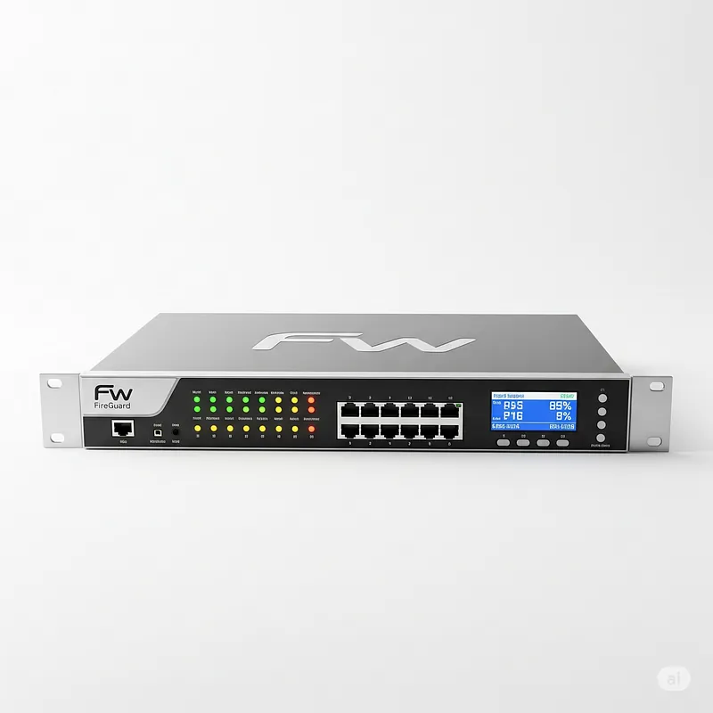
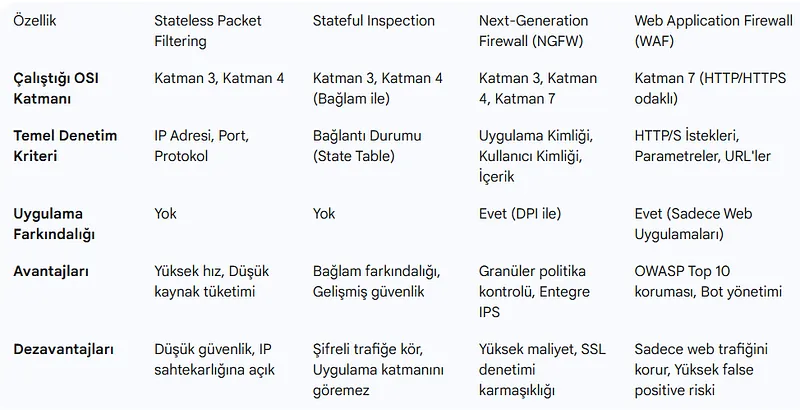
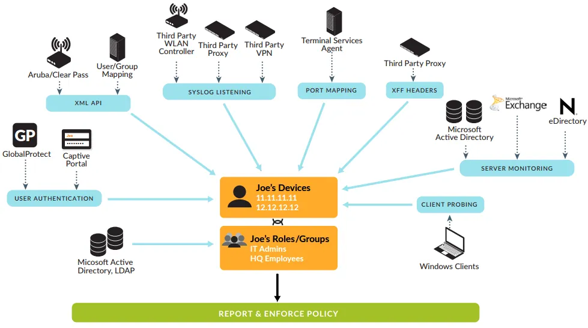
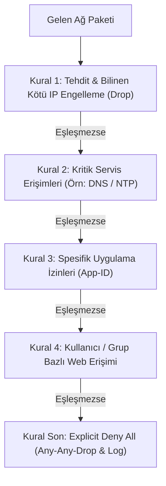

# Güvenlik Duvarları (Stateful vs NGFW) ve Kural Mimarisi

Güvenlik Duvarları (Firewall), farklı güvenlik seviyelerine sahip ağlar (Örn: Güvensiz İnternet ile Güvenilir İç Ağ) arasına konumlandırılan, tanımlanmış güvenlik kurallarına göre gelen ve giden ağ trafiğini denetleyen temel sınır savunma sistemleridir.

Geleneksel port tabanlı paket filtrelemeden, uygulama ve kullanıcı seviyesinde denetim yapan Yeni Nesil Güvenlik Duvarlarına (NGFW) uzanan bu mimari; savunma derinliğinin (Defense in Depth) ilk savunma hattıdır.

---

## §5.1.1. Güvenlik Duvarı Teknolojilerinin Evrimi

### 1. Durumsuz Paket Filtreleme (Stateless / Packet Filtering)
İlk nesil güvenlik duvarlarıdır. Her paketi diğer paketlerden bağımsız olarak ele alır. Yalnızca Katman 3 ve Katman 4 başlıklarına (Kaynak/Hedef IP, Kaynak/Hedef Port, Protokol) bakar.
- **Zafiyeti:** Bir TCP oturumunun durumunu bilmez. Dışarıdan gelen bir paketin içerideki bir kullanıcının başlattığı oturuma ait bir yanıt mı yoksa saldırganın başlattığı yeni bir bağlantı mı olduğunu ayırt edemez. Bu nedenle dönüş trafiği için yüksek portların (`1024-65535`) açık bırakılması gerekirdi.

### 2. Durum Bilgili Denetim (Stateful Inspection)
İkinci nesil güvenlik duvarlarıdır. Paketlerin ait olduğu TCP/UDP oturumlarını bir **Durum Tablosunda (State Table / Connection Table)** hafızasında tutar:
- İstemci içeriden internete doğru bir TCP bağlantısı başlattığında (`SYN`), güvenlik duvarı bu oturumu dinamik olarak tablosuna yazar.
- Dışarıdan gelen yanıt paketleri (`SYN/ACK`, `ACK`), tablodaki aktif oturumla eşleştiği sürece otomatik olarak kabul edilir.
- Dışarıdan doğrudan iç ağa doğru gelen ve içeriden başlatılmamış istekler **varsayılan olarak engellenir (Default Deny)**.

### 3. Yeni Nesil Güvenlik Duvarları (NGFW)
Modern kurumsal ağların standardıdır. Saldırganların ve modern uygulamaların standart portları (TCP 80 ve 443) kullanmaya başlamasıyla port tabanlı filtreleme yetersiz hale gelmiştir. Bir NGFW port numarasına değil, paketin içeriğine bakar:

- **Uygulama Tanıma (App-ID):** Trafiğin hangi porttan aktığına bakılmaksızın (örneğin port 80 üzerinden akan BitTorrent veya port 443 üzerinden akan SSH tüneli) Katman 7 uygulama protokolünü imzalar ve davranışsal analizle tespit eder.
- **Kullanıcı Kimliği Eşleştirme (User-ID):** IP adresleri dinamiktir ve tek başına bir anlam ifade etmez. NGFW, Active Directory (Kerberos/NTLM/LDAP) ve 802.1X ile entegre olarak kural tanımlarını doğrudan kullanıcı ve grup bazında yapar (Örn: *"Muhasebe grubu harici hiç kimse internet bankacılığı kategorisine erişemez"*).
- **İçerik İnceleme (Content-ID):** SSL şifresini çözerek paket yükünde IPS (zafiyet sömürüsü engelleme), Antivirüs ve DLP taraması yapar.

---

## §5.1.2. Kural Tasarımı ve Optimizasyon İlkeleri

Bir güvenlik duvarının etkinliği kurallarının doğru mimariyle yazılmasına bağlıdır:

1. **İlk Eşleşen Kural Kazanır (First Match Wins):** Kurallar yukarıdan aşağıya doğru sırayla işlenir. Bir kural eşleştiğinde paket iletilir ve alttaki kurallara bakılmaz. Bu nedenle en spesifik ve en sık kullanılan kurallar en üste konmalıdır.
2. **Altın İlke: Varsayılan Olarak Engelle (Default Deny):** Güvenlik duvarının en altında daima açıkça tanımlanmış bir `DENY ALL ANY ANY (LOG)` kuralı bulunmalıdır. Açıkça izin verilmeyen her trafik engellenmeli ve SOC analizi için loglanmalıdır.
3. **Any-Any Kural Yasağı:** Kaynak veya hedefin "Any" olarak bırakıldığı geniş kurallar ciddi güvenlik açıkları doğurur. Kurallar daima belirli IP alt ağları, belirli portlar ve belirli uygulama kimlikleriyle sınırlandırılmalıdır.
