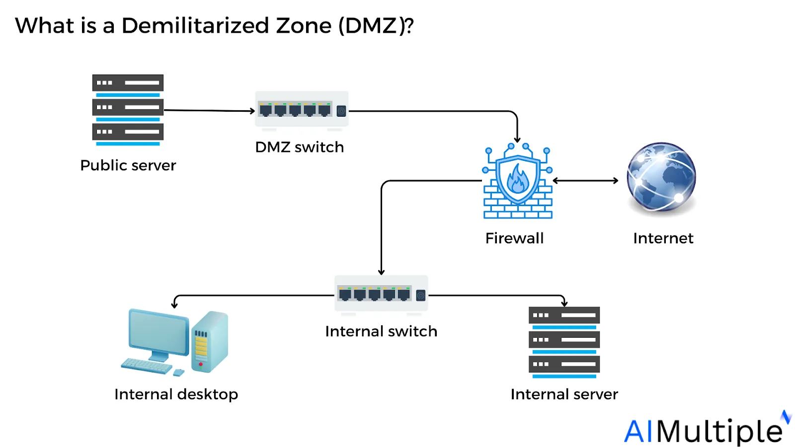
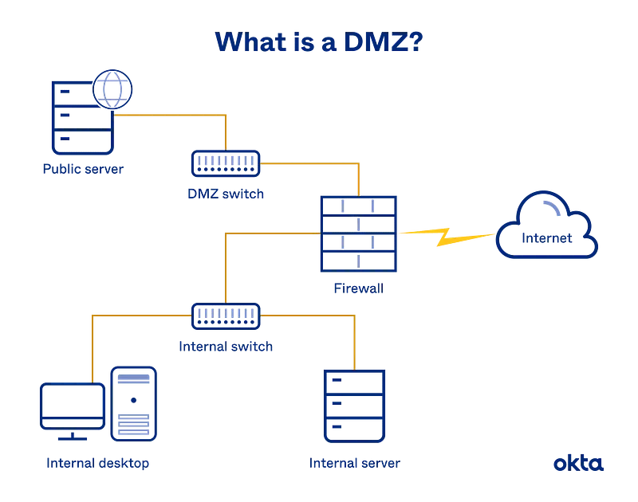
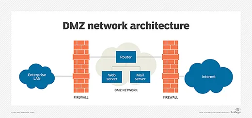
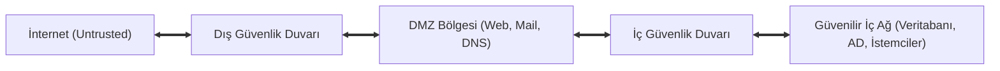
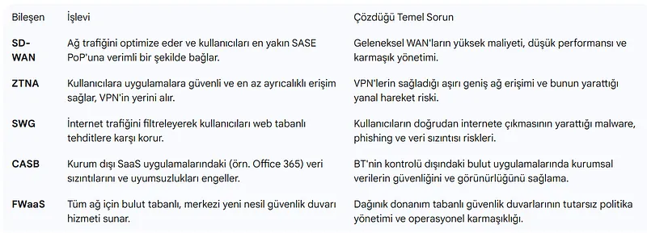

# DMZ Mimarisi, Mikro-Segmentasyon ve Sıfır Güven (ZTNA)

Geleneksel ağ güvenliği, kurumsal ofisi dış dünyadan ayıran kalın bir "kale ve hendek" (castle-and-moat) felsefesine dayanıyordu. Ancak internete açık servislerin (Web, Mail, VPN) varlığı ve uzaktan çalışanların artması, güvenli iç ağ ile tehlikeli dış dünya arasında tampon bir bölge kurulmasını zorunlu kılmıştır.

Bu tampon bölgeye **Arındırılmış Bölge (DMZ - Demilitarized Zone)** adı verilir. Günümüzde ise bu çevre savunması anlayışı, hiçbir cihaz veya kullanıcıya doğrudan güvenilmemesini emreden **Sıfır Güven (Zero Trust)**, **ZTNA (Zero Trust Network Access)** ve **SASE (Secure Access Service Edge)** mimarilerine evrilmiştir.

---

## §5.3.1. Klasik DMZ Tasarım Modelleri

### 1. Üç Bacaklı Tek Güvenlik Duvarı Modeli (Three-Legged DMZ)

Tek bir fiziksel güvenlik duvarının 3 bağımsız arayüzü (İnternet/Untrusted, DMZ/Semi-Trusted, İç Ağ/Trusted) bulunur. Maliyet açısından ekonomik ve yönetimi kolaydır; ancak güvenlik duvarı ele geçirilirse tüm iç ağ tehlikeye girer.

### 2. Çift Güvenlik Duvarlı Sırt Sırta Model (Dual-Firewall DMZ)

En yüksek kurumsal güvenlik standardıdır. DMZ'nin önünde dış güvenlik duvarı (Örn: Üretici A), arkasında ise iç güvenlik duvarı (Örn: Üretici B) bulunur:
- Dış güvenlik duvarındaki bir sıfırıncı gün zafiyeti sömürülse dahi, saldırgan farklı bir işletim sistemine ve mimariye sahip iç güvenlik duvarını aşmak zorundadır.

---

## §5.3.2. DMZ Trafik Kuralları ve Altın İlke

Bir DMZ mimarisinde yatay hareketi (lateral movement) engellemek için şu kurallar katı bir şekilde uygulanmalıdır:

| Trafik Akış Yönü | Varsayılan Politika | İzin Verilen Tipik Trafik | Güvenlik Rasyoneli |
| :--- | :---: | :--- | :--- |
| **İnternet $\rightarrow$ DMZ** | Kısıtlı İZİN | TCP/443 (HTTPS), TCP/25 (SMTP) | Yalnızca halka açık sunulan servislere izin verilir. |
| **DMZ $\rightarrow$ İç Ağ** | **KESİNLİKLE DENY** | Yalnızca spesifik SQL portu (1433/5432) | DMZ sunucusu ele geçirilse bile iç ağa sızamaz. |
| **İç Ağ $\rightarrow$ DMZ** | Kısıtlı İZİN | SSH (Port 22), RDP (Port 3389) | Yalnızca yönetim iş istasyonlarından yönetimsel erişim. |
| **DMZ $\rightarrow$ İnternet** | Kısıtlı DENY | Yalnızca belirli NTP ve OS güncelleme IP'leri | DMZ sunucusunun C2 sunucularına çıkması engellenir. |

:::caution[DMZ'nin Altın Kuralı]
Bir DMZ sunucusunun iç ağa doğru yeni bir bağlantı oturumu (TCP SYN) başlatmasına ASLA izin verilmemelidir. Bağlantı daima iç ağdan DMZ'ye doğru başlatılmalıdır.
:::
---

## §5.3.3. Sıfır Güven (Zero Trust), ZTNA ve SASE Mimarisi

Geleneksel VPN yaklaşımında kullanıcı bir kez kimlik doğruladığında tüm iç ağa erişim hakkı kazanır ("Ağa girdikten sonra her yere güven"). Saldırgan tek bir çalışanın parolasını ele geçirdiğinde tüm kurumsal sunuculara yatay hareket edebilir.

NIST SP 800-207 standardıyla tanımlanan **Sıfır Güven (Zero Trust)** yaklaşımı üç ana ilkeye dayanır:
1. **Asla Güvenme, Daima Doğrula:** Kullanıcının ağın içinde veya dışında olması fark etmeksizin her istek anlık olarak doğrulanır.
2. **En Düşük Ayrıcalıklı Erişim (Least Privilege):** Kullanıcıya yalnızca o an işini yapması için gereken en dar yetki tanımlanır.
3. **İhlal Edildiğini Varsay (Assume Breach):** Ağın halihazırda ele geçirildiği varsayılarak her segment izole edilir.

### Ağ ve Güvenliğin Yakınsaması: SASE (Secure Access Service Edge)

Gartner tarafından tanımlanan **SASE**, geniş alan ağı (SD-WAN) yetenekleri ile bulut tabanlı güvenlik servislerini (Security Service Edge - SSE) tek bir çatı altında birleştirir:
- **FWaaS (Firewall as a Service):** Bulut tabanlı ölçeklenebilir yeni nesil güvenlik duvarı.
- **CASB (Cloud Access Security Broker):** Şirket çalışanlarının SaaS uygulamalarına (Office 365, Salesforce) erişimini denetleme ve veri sızıntısını önleme.
- **SWG (Secure Web Gateway):** URL filtreleme ve zararlı yazılım engelleme.
- **ZTNA (Zero Trust Network Access):** Kullanıcıyı ağa değil, doğrudan kimliği doğrulanmış mikro uygulamalara bağlama.
