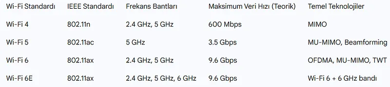
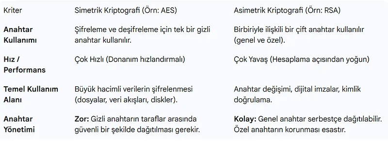
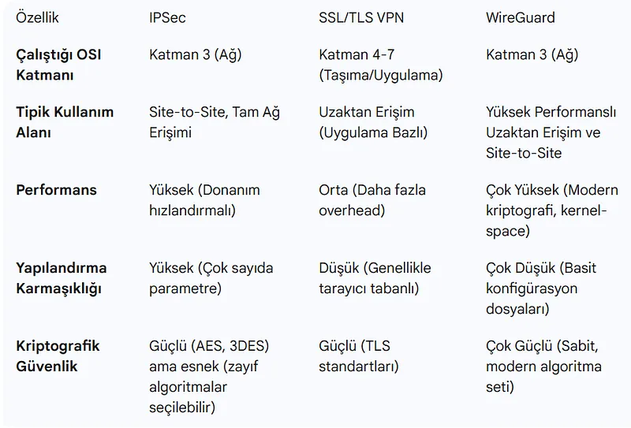
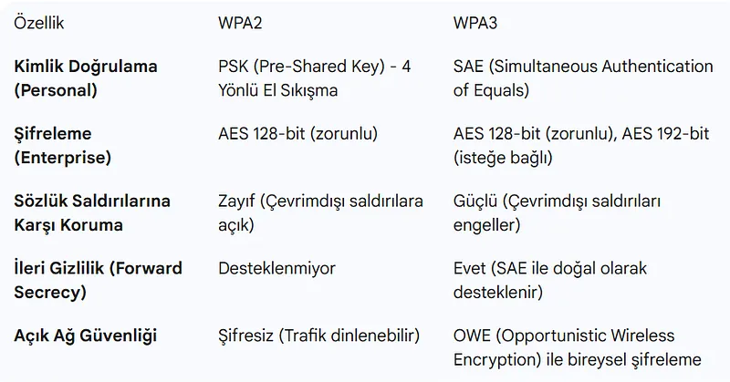
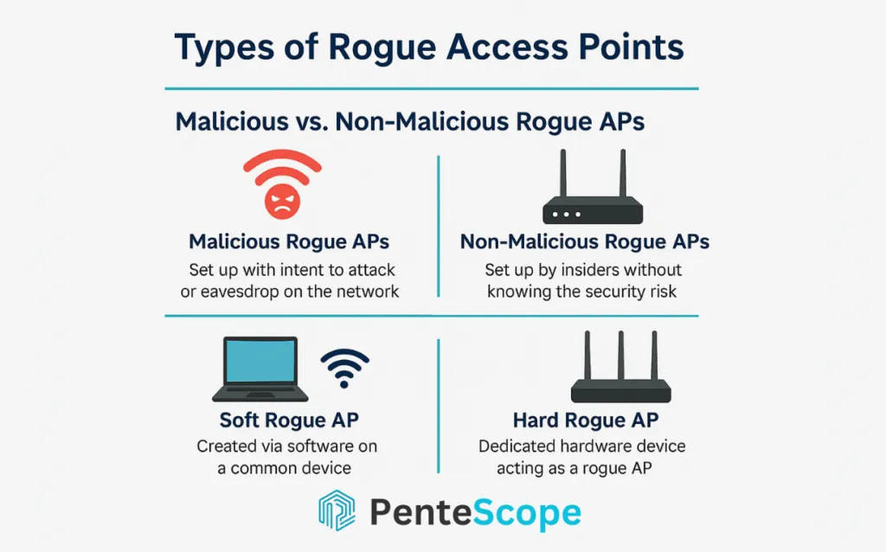

# Güvenli Uzaktan Erişim (VPN) ve Kurumsal Kablosuz Ağlar (802.1X / WPA3)

Fiziksel ofis sınırlarının kalktığı modern iş dünyasında; uzak çalışanların ve şubelerin merkeze güvenle bağlanması (VPN) ve yerleşke içindeki mobil cihazların güvenli kimlik doğrulaması (WPA3 Enterprise / 802.1X) kritik bir zorunluluktur.

Bu bölümde IPsec ve SSL VPN mimarilerini, kriptografik şifreleme yöntemlerini, kablosuz şifreleme protokollerinin evrimini, 802.1X EAP-TLS çerçevesini ve sahte erişim noktası (Rogue AP) tehditlerini inceleyeceğiz.

---

## §5.4.1. Kriptografik Şifreleme Yöntemlerinin Karşılaştırması

Güvenli tünelleme ve şifreli ağ iletişiminde üç temel kriptografik yöntem harmanlanır:

1. **Simetrik Şifreleme (AES, ChaCha20):** Hızlıdır, büyük hacimli veri transferini (VPN tünelleri) şifreler. Tek bir paylaşılan anahtar kullanılır.
2. **Asimetrik Şifreleme (RSA, ECC, Diffie-Hellman):** Yavaştır ancak anahtar paylaşımını ve kimlik doğrulamasını (X.509 dijital sertifikalar) güvenle çözer.
3. **Kriptografik Özetleme (SHA-256, HMAC):** Tek yönlüdür, paketin yolda bozulmadığını (Bütünlük) ve göndericinin meşruiyetini doğrular.

---

## §5.4.2. Sanal Özel Ağlar (VPN): IPsec, SSL ve WireGuard

VPN, güvensiz bir genel ağ (İnternet) üzerinde iki nokta arasında şifrelenmiş sanal bir tünel kurar.

### 1. IPsec (Internet Protocol Security)
Katman 3'te çalışan, şubeler arası (Site-to-Site) bağlantıların küresel standardıdır:
- **IKE (Internet Key Exchange - IKEv2):** Tünel kurulurken tarafların birbirini tanımasını (Pre-Shared Key veya Dijital Sertifika) ve Diffie-Hellman ile simetrik şifreleme anahtarlarının türetilmesini sağlar.
- **ESP (Encapsulating Security Payload - Protokol 50):** Veri yükünü şifreler (Gizlilik) ve HMAC ile bütünlük doğrulaması yapar.
- **Tünel Modu vs Taşıma Modu:** Kurumsal VPN'lerde daima **Tünel Modu** kullanılır; orijinal IP paketi tamamen şifrelenir ve yeni bir dış IP başlığı eklenir.

### 2. Modern Açık Kaynak Tünelleme: WireGuard
IPsec ve OpenVPN'in yüz binlerce satırlık karmaşık kod tabanına kıyasla, yalnızca 4.000 satır temiz kodla Linux çekirdeğine entegre edilen WireGuard; ChaCha20 şifrelemesi ve Curve25519 anahtar değişimiyle çok daha yüksek bant genişliği ve düşük gecikme sunar.

---

## §5.4.3. Kablosuz Ağ Güvenliği: WPA2'den WPA3'e Geçiş

| Protokol | Şifreleme Algoritması | Kimlik Doğrulama | Güvenlik Durumu ve Zafiyetler |
| :--- | :--- | :--- | :--- |
| **WEP** | RC4 (40 / 104 bit) | Sabit IV, CRC32 | **Tamamen kırıldı** (Dakikalar içinde kırılabilir) |
| **WPA** | TKIP (RC4 tabanlı) | PSK / 802.1X | **Güvensiz** (Eski donanımlar için geçici çözümdü) |
| **WPA2** | CCMP (AES-128) | PSK / 802.1X | **KRACK (Key Reinstallation Attack)** ve çevrimdışı sözlük saldırılarına açık |
| **WPA3** | GCMP (AES-192 / AES-256) | **SAE (Dragonfly) / 802.1X Suite-B** | **En Yüksek Standart.** Sözlük saldırılarına karşı tam koruma ve Forward Secrecy |

---

## §5.4.4. Kurumsal Wi-Fi Güvenliği: 802.1X ve EAP-TLS

Ev kullanıcılarının paylaştığı sabit parola (Pre-Shared Key - PSK) kurumsal ağlar için kabul edilemez bir risktir; bir çalışan işten ayrıldığında tüm şirketin Wi-Fi şifresini değiştirmek imkansızdır.

Kurumsal Wi-Fi ağlarında **IEEE 802.1X Port Tabanlı Ağ Erişim Denetimi** ve **RADIUS** sunucusu (Cisco ISE, Microsoft NPS, FreeRADIUS) kullanılır:

1. **Supplicant (İstemci):** Wi-Fi'a bağlanmak isteyen dizüstü veya mobil cihaz.
2. **Authenticator (Erişim Noktası - AP / WLC):** İstemci kimliğini doğrulamadan önce ağ trafiğini tamamen bloke eder; yalnızca EAP paketlerini RADIUS sunucusuna iletir.
3. **Authentication Server (RADIUS):** İstemcinin kurumsal dijital sertifikasını (EAP-TLS) veya kullanıcı bilgilerini Active Directory üzerinden doğrular.

:::caution
**EAP-TLS**, kurumsal kablosuz ağlar için altın standarttır. Hem istemci sunucunun sertifikasını hem de sunucu istemcinin sertifikasını karşılıklı doğrular (Mutual Authentication). Parola kullanılmadığı için kimlik avı (phishing) saldırılarına karşı tam bağışıklık sağlar.
:::
---

## §5.4.5. Sahte Erişim Noktaları (Rogue AP ve Evil Twin)

Kablosuz ağların en sinsi tehdidi, saldırganın fiziksel şirket yakınında meşru kurumsal ağın SSID adını taklit eden sahte bir anten açmasıdır (**Evil Twin**).

- Saldırgan sahte AP'nin sinyal gücünü artırır ve meşru AP'ye **Deauthentication (Bağlantı Kesme)** paketleri yollar.
- İstemciler otomatik olarak daha güçlü sinyale sahip sahte AP'ye bağlanır.
- Tüm trafik saldırganın üzerinden akar (MitM).
- **Savunma:** Kurumsal WLC ve AP'lerde yerleşik **WIPS (Wireless Intrusion Prevention System)** aktif edilerek sahte AP'ler anında tespit edilmeli ve radyo frekans seviyesinde bastırılmalıdır (Containment).
