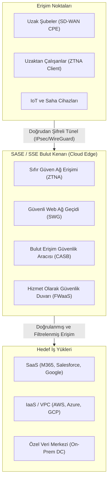

# Yazılım Tanımlı Geniş Alan Ağları (SD-WAN) ve Güvenli Erişim Hizmet Ucu (SASE / SSE)

Geleneksel kurumsal geniş alan ağı (WAN) mimarileri, tüm şube ve uzak ofis trafiğinin pahalı MPLS hatları üzerinden merkezi veri merkezine taşınması ("tromboning" veya "hairpinning") ilkesine dayanıyordu. Ancak iş yüklerinin buluta (SaaS: M365, Salesforce; IaaS: AWS, Azure) taşınması ve uzaktan/hibrit çalışma modelinin kalıcı hale gelmesi, merkezi güvenlik duvarı üzerinden geçen bu hantal trafiği sürdürülemez kılmıştır.

Bu dönüşüm, ağ dünyasında iki temel mimari devrimi tetiklemiştir:
1. **SD-WAN (Software-Defined WAN):** Taşıma bağımsız, dinamik ve yazılımla yönetilen geniş alan ağı.
2. **SASE (Secure Access Service Edge) & SSE (Security Service Edge):** Ağ (SD-WAN) ile güvenlik hizmetlerinin (ZTNA, CASB, SWG, FWaaS) bulut tabanlı tek bir hizmet kenarında birleştirilmesi.



---

## §5.5.1. SD-WAN Mimarisi ve Düzlem Ayrımı

Geleneksel yönlendiricilerde kontrol ve veri düzlemi aynı cihaz üzerindedir. SD-WAN, Yazılım Tanımlı Ağ (SDN) prensiplerini WAN ölçeğine taşır ve dört katmanlı bir mimari sunar:

| Düzlem (Plane) | SD-WAN Bileşeni | Görev ve İşlev |
| :--- | :--- | :--- |
| **Orkestrasyon (Orchestration)** | vBond / ZTP (Zero-Touch Provisioning) | Cihazların kimlik doğrulamasını yapar ve ağa güvenli ilk katılımı sağlar |
| **Yönetim (Management)** | vManage / Merkezi Dashboard | Tek ekrandan merkezi konfigürasyon, yazılım güncelleme ve telemetri izleme |
| **Kontrol (Control)** | vSmart / Route Reflector | Yönlendirme, şifreleme anahtarları ve güvenlik politikalarını dağıtır (OMP Protokolü) |
| **Veri (Data)** | vEdge / cEdge / Sanal Cihazlar | Şubelerde trafiği yönlendiren ve IPsec tünellerini sonlandıran fiziksel/sanal cihazlar |

### OMP (Overlay Management Protocol):
SD-WAN mimarisinde cihazlar arasında BGP veya OSPF doğrudan konuşmaz; bunun yerine kontrol düzlemiyle **OMP** üzerinden haberleşir. OMP; yönlendirme bilgileri (vRoute), TLOC (Transport Location - tünel uç noktaları) ve IPsec oturum anahtarlarını güvenli biçimde taşır.

### Taşıma Bağımsızlığı (Underlay vs. Overlay):
- **Underlay:** Fiziksel hatlardır (MPLS, Metro Ethernet, 5G, Ticari Genişbant İnternet).
- **Overlay:** Fiziksel hatların üzerine kurulan dinamik, tam şifreli IPsec tünel örgüsüdür. SD-WAN kontrolcüsü paket gecikmesi (latency), jitter ve paket kaybı (packet loss) değerlerini her an ölçer; VoIP gibi kritik bir trafiği gecikme anında otomatik olarak MPLS'ten internete veya 5G'ye aktarır.

---

## §5.5.2. SASE ve SSE: Ağ ve Güvenliğin Birleşimi

Gartner tarafından tanımlanan **SASE (Secure Access Service Edge)**, SD-WAN yetenekleri ile bulut-yerlisi güvenlik servislerinin tek bir mimaride konsolide edilmesidir. Ağ altyapısını ayrıştırıp yalnızca güvenlik bileşenlerine odaklanan yaklaşıma ise **SSE (Security Service Edge)** denir.

```
       [ SD-WAN ]  +  [ Güvenlik Servisleri (SSE) ]  =  [ SASE ]
```

### SSE'nin 4 Temel Sütunu:
1. **ZTNA (Zero Trust Network Access):** Kullanıcıyı ağa değil, yalnızca yetkilendirildiği spesifik uygulamaya bağlar. Ağ seviyesinde görünürlüğü ortadan kaldırarak yanal hareketi (lateral movement) imkansız kılar.
2. **SWG (Secure Web Gateway):** Şubelerden ve evden internete çıkan trafiği URL filtreleme, kötü amaçlı yazılım taraması ve SSL/TLS denetiminden geçirir.
3. **CASB (Cloud Access Security Broker):** Kurumsal bulut uygulamalarında (M365, Google Workspace, AWS) veri sızıntısını (DLP) önler, gölge BT (Shadow IT) kullanımını tespit eder.
4. **FWaaS (Firewall as a Service):** Sınır güvenlik duvarı yeteneklerini bulut kenarına taşır; merkezi NGFW kutularına ihtiyaç bırakmaz.

---

## §5.5.3. SD-WAN ve SASE Güvenlik Tehdit Modeli ve Mavi Takım Perspektifi

SD-WAN ve SASE ortamları, geleneksel perimeter (çevre) güvenliğinin yerini aldığı için güvenlik operasyonları (SOC) açısından yeni tehdit vektörleri barındırır:

| Tehdit Vektörü | Risk Açıklaması | Mavi Takım / SOC Tespiti |
| :--- | :--- | :--- |
| **Kontrol Düzlemi Ele Geçirme** | vManage veya SD-WAN orkestratörünün ele geçirilmesi tüm WAN trafiğinin yönünü değiştirebilir | MFA zorunluluğu, API erişim logları, yetkisiz OMP route güncellemeleri alarmı |
| **Doğrudan İnternet Çıkışı (DIA) Riskleri** | Şubelerin merkezi güvenlik duvarını atlayarak internete doğrudan çıkması | SASE SWG / FWaaS loglarının merkezi SIEM'e anlık akışı |
| **Gizli Tünel ve C2 İletişimi** | Saldırganların SD-WAN IPsec tünelleri arasına gizlenerek yanal yayılım yapması | Flow telemetrisi (IPFIX) ile şubeler arası anormal port/protokol analizi |

### Cisco SD-WAN CLI ile Örnek Güvenlik Politikası:
```cisco
! vSmart üzerinde merkezi trafik politikası: Şubeler arası doğrudan internet erişimini denetleme
policy
 data-policy DP-DIA-SECURITY
  vpn-list CORP-VPNS
   sequence 10
    match
     destination-port 80 443
    action accept
     nat use-vpn 0
   sequence 20
    match
     destination-port 22 3389
    action drop
!
```

---

## §5.5.4. Çapraz Referans ve Entegrasyon
- Geleneksel güvenlik duvarı mimarileri ve NGFW karşılaştırması için [§5.1 Güvenlik Duvarları ve NGFW Mimarisi](./01-guvenlik-duvarlari-ve-ngfw-mimarisi.md) bölümüne bakın.
- Sıfır Güven ilkeleri ve ZTNA mikrosegmentasyonu için [§5.3 DMZ Tasarımı ve Sıfır Güven (ZTNA)](./03-dmz-tasarimi-ve-sifir-guven-ztna.md) bölümünü inceleyin.
- Siber Güvenlik Operasyonları Kitabı'nda kurumsal Sıfır Güven mimarisi için [Sıfır Güven (Zero Trust) Mimarisi](../../../siber-guvenlik-operasyonlari/04-kimlik-guvenligi/03-sifir-guven-mimarisi.md) bölümüne bakın.

