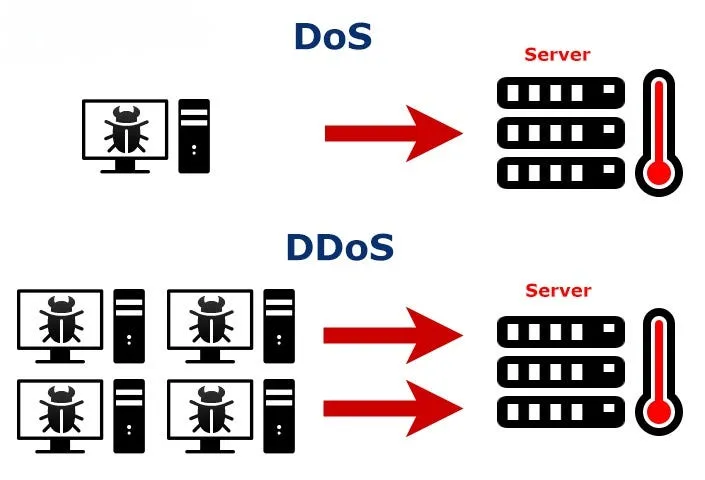
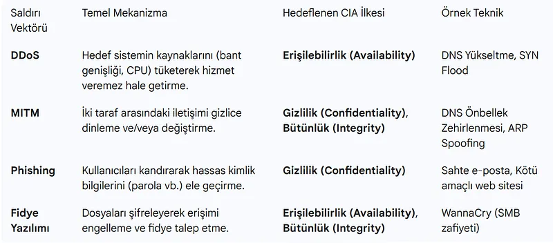
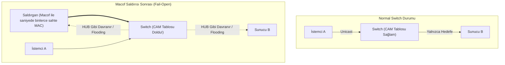
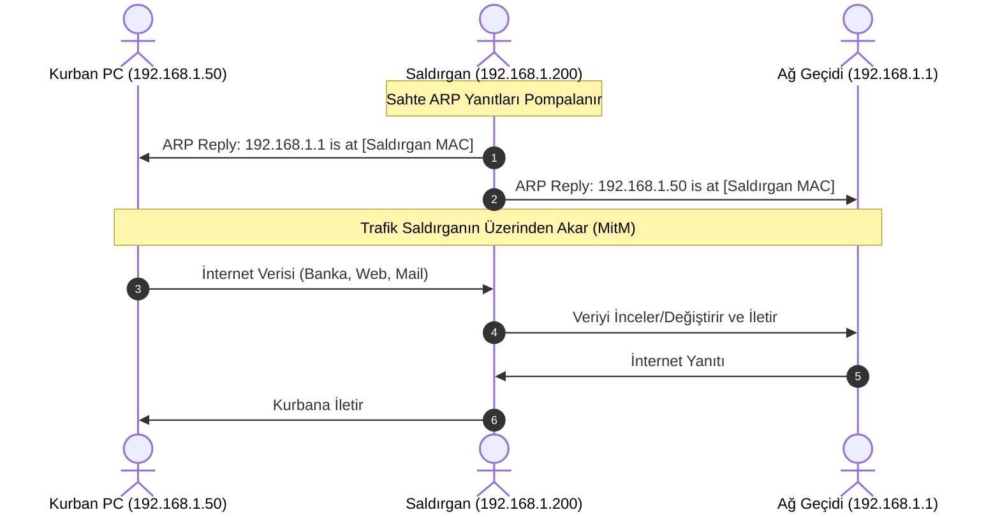

# Katman 2 Saldırıları, CAM Tablosu Taşması (Macof) ve ARP Zehirlenmesi

Siber güvenlik savunmasında en çok göz ardı edilen, ancak en ölümcül saldırıların başında Katman 2 (Veri Bağlantı Katmanı) ve yerel ağ segmenti saldırıları gelir.

Yerel ağın (LAN) varsayılan olarak "güvenilir" kabul edildiği geleneksel tasarımlarda; saldırgan aynı ağ segmentine fiziksel veya kablosuz olarak eriştiğinde, switch donanımının zaaflarını sömürerek trafiği yönlendirebilir, oturumları çalabilir ve tüm ağ iletişimini dinleyebilir.

---

## §6.1.1. Macof Saldırısı (CAM Tablosu Taşması)

Katman 2 anahtarların (Switch) gelen çerçeveleri hedefe yönlendirmek için donanımsal bir **CAM (Content Addressable Memory) Tablosu** kullandığını görmüştük. Ancak her switch'in CAM tablosu sınırlı sayıda MAC adresi (örneğin 8.000 ila 128.000 kayıt) tutabilir.

### Saldırı Mekaniği:
- Saldırgan `macof` (dsniff paketi) gibi bir araç kullanarak switch portuna saniyede on binlerce **rastgele üretilmiş sahte kaynak MAC adresi** içeren Ethernet çerçeveleri basar.
- Switch'in CAM tablosu saniyeler içinde tamamen dolar ve yeni meşru adresleri öğrenemez hale gelir.
- Birçok switch, CAM tablosu dolduğunda ağı tamamen kilitlemek yerine iletişimin sürmesi için **"Fail-Open"** moduna geçer; yani **akıllı bir switch olmaktan çıkıp ilkel bir HUB gibi davranmaya başlar**.
- Gelen her unicast çerçeveyi tüm portlara taşır (flooding). Saldırgan kendi portuna akan tüm şirket içi gizli trafiği (parolalar, e-postalar) Wireshark ile pasif olarak dinler.

Wireshark paket detayında:
- Mikrosaniyeler içinde binlerce farklı sahte MAC adresinden (`da:71:0d:...`, `66:9e:31:...`) gelen çerçeveler görülür.
- Tüm paketler aynı fiziksel switch portundan akmaktadır.

### Savunma:
Switch portlarında **Port Security** aktif edilmeli, bir porta bağlanabilecek maksimum MAC adresi sayısı (örneğin 2) sınırlandırılmalı ve ihlal durumunda port derhal kapatılmalıdır (`switchport port-security violation shutdown`).

---

## §6.1.2. ARP Zehirlenmesi ve Ortadaki Adam (MitM) Saldırısı

ARP protokolü durumsuz ve doğrulamadan yoksundur; bir cihaz kendisine sorulmadan gelen bir ARP cevabını (Gratuitous ARP) dahi sorgulamadan kabul eder ve önbelleğine yazar.

### Wireshark ile ARP Zehirlenmesi Tespiti:
1. `arp.duplicate-address-frame` filtresi uygulandığında Wireshark, aynı IP adresi için iki farklı MAC adresinin hak iddia ettiğini kırmızı/sarı renkle vurgular.
2. `arp.opcode == 2` ile kısa sürede istemciye gelen çok sayıda tek taraflı ARP Yanıtı (Reply) MitM saldırısının açık kanıtıdır.

### Savunma:
Switch üzerinde **DHCP Snooping** ve **Dynamic ARP Inspection (DAI)** etkinleştirilmelidir. Switch, DHCP tablosundaki meşru IP-MAC bağı ile uyuşmayan sahte ARP yanıtlarını donanım seviyesinde düşürür.

---

## §6.1.3. DHCP Starvation ve Rogue DHCP Saldırıları

Saldırgan sahte MAC adresleriyle DHCP sunucusuna binlerce `DHCP Discover` paketi göndererek sunucunun IP havuzundaki tüm boş adresleri tüketir (**DHCP Starvation**).

Ardından ağa kendi kontrolündeki sahte bir DHCP sunucusunu bağlar (**Rogue DHCP**). Ağa yeni bağlanan kullanıcılara kendi IP adresini varsayılan ağ geçidi (Default Gateway) ve kendi DNS sunucusunu dağıtarak tüm ağ trafiğini üzerine çeker.
- **Savunma:** Switch portlarında **DHCP Snooping** açılarak yalnızca sistem yöneticisinin uplink portları `trusted` yapılmalı, diğer tüm portlar `untrusted` tutulmalıdır.
