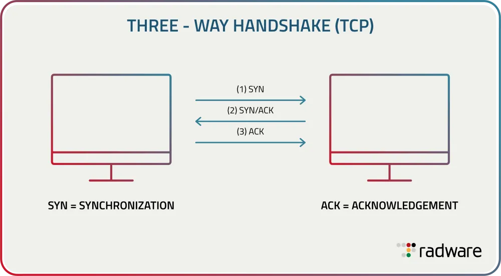
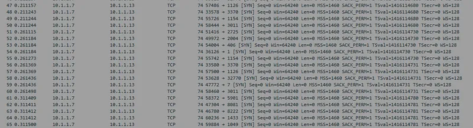
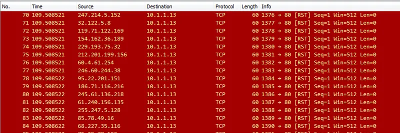
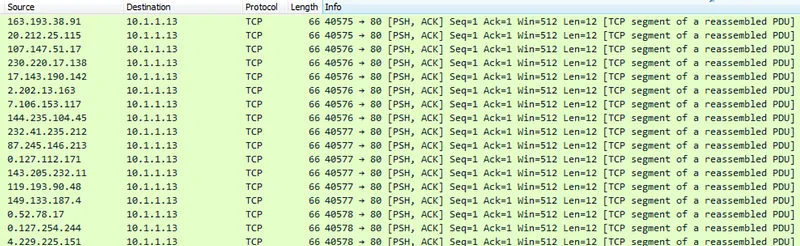
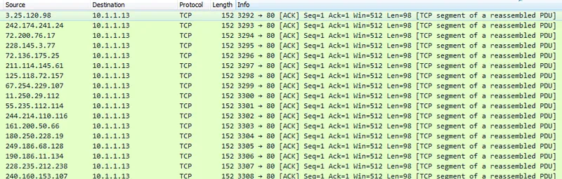
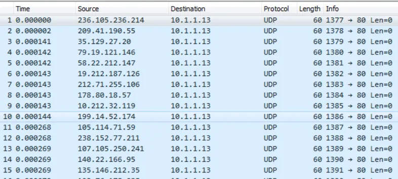

# Taşıma Katmanı DoS/DDoS Saldırıları (SYN, RST, ACK, UDP Flood)

Hizmet Engelleme (Denial of Service - DoS) ve Dağıtık Hizmet Engelleme (Distributed Denial of Service - DDoS) saldırıları, hedef sunucuların veya ağ donanımlarının işlem kapasitesini, durum tablolarını (State Tables) veya bant genişliğini tüketerek meşru kullanıcılara hizmet veremez hale getirmeyi amaçlar.

Taşıma Katmanında (Katman 4) gerçekleşen saldırılar, TCP ve UDP protokollerinin yapısal çalışma mekanizmalarını hedefe karşı bir silaha dönüştürür.

---

## §6.2.1. TCP SYN Flood Saldırısı ve Yarım Açık Bağlantılar

TCP el sıkışmasında sunucu, istemciden bir `SYN` paketi aldığında oturumu hafızasındaki **SYN Kuyruğuna (SYN Backlog Queue)** yazar, bir `SYN/ACK` yanıtı döner ve istemciden gelecek son `ACK` paketini beklemeye başlar (**Yarım Açık Bağlantı - Half-Open Connection**).

### Saldırı Mekaniği:
Saldırgan sahte kaynak IP adresleriyle saniyede yüz binlerce `SYN` paketi yollar; ancak asla son `ACK` paketini göndermez:
- Sunucunun bellek havuzundaki SYN kuyruğu saniyeler içinde tamamen dolar.
- Sunucu yeni meşru kullanıcıların bağlantı isteklerini kabul edemez hale gelir ve web sitesi kilitlenir.

### Wireshark ile Tespit:
- Paket listesinde mikrosaniyeler içinde binlerce ardışık `[SYN]` bayraklı paket görülür.
- Kaynak IP adresleri genellikle sahte (spoofed) veya rastgeledir; hedef port aynıdır (Örn: 80 veya 443).
- Hiçbir akışta 3. el sıkışma paketi olan `[ACK]` görülmez.

### Savunma:
1. **SYN Cookies (RFC 4987):** Sunucu gelen SYN için bellekte yer ayırmaz. Gerekli durum bilgilerini matematiksel olarak `Initial Sequence Number (ISN)` içine kriptografik özet (hash) olarak gömer. Yalnızca geçerli son `ACK` geldiğinde oturumu açar.
2. **Firewall SYN Proxy:** Güvenlik duvarı istemciyle el sıkışmayı kendisi tamamlar; meşru olduğunu doğruladıktan sonra sunucuya yeni bir oturum açar.

---

## §6.2.2. TCP RST Flood Saldırısı

TCP RST bayrağının bir bağlantıyı zorla ve anında kapatmak için kullanıldığını görmüştük.

Saldırgan, hedef sunucu ile meşru kullanıcılar arasındaki aktif TCP oturumlarını hedef alarak sahte `[RST]` veya `[RST, ACK]` paketleri basar:
- Meşru oturumlar anında sunucu tarafından hafızadan silinir.
- Kullanıcıların devam eden dosya indirmeleri, oturumları veya veri tabanı sorguları sürekli kopar.

---

## §6.2.3. TCP ACK ve ACK-PSH Flood Saldırıları

SYN Flood sunucunun RAM belleğindeki kuyrukları hedeflerken; **ACK Flood** ve **ACK-PSH Flood** doğrudan aradaki **Durum Bilgili Güvenlik Duvarlarının (Stateful Firewall)** durum tablosunu ve işlemcisini hedef alır.

- Saldırgan hiçbir el sıkışma başlatmadan, rastgele Sequence/Ack numaralarıyla milyonlarca `[ACK]` veya `[PSH, ACK]` paketi yollar.
- Güvenlik duvarı her gelen paketi durum tablosunda aramak (State Lookup) zorunda kalır. Eşleşme bulamadığı için paketleri düşürse dahi, saniyedeki paket sayısı (PPS - Packets Per Second) o kadar yüksektir ki güvenlik duvarının CPU'su %100'e vurarak kilitlenir.

---

## §6.2.4. UDP Flood Saldırısı

UDP bağlantısız bir protokol olduğu için kaynak IP doğrulaması yapmaz ve el sıkışma gerektirmez. Bu durum saldırganların minimum CPU maliyetiyle devasa trafik üretmesini sağlar.

- Saldırgan hedef sunucunun rastgele yüksek UDP portlarına (örneğin 10.000 ile 65.000 arası) devasa hacimli UDP datagramları yollar.
- Hedef sunucu her gelen portu kontrol eder; açık servis bulamadıkça işletim sistemi çekirdeğinden `ICMP Port Unreachable (Type 3 Code 3)` yanıtı üretmeye çalışır.
- Hem sunucu işlemcisi bu yanıtları üretirken tükenir hem de sunucunun internet çıkış bant genişliği tamamen tıkanır.

---

## §6.2.5. Taşıma Katmanı Saldırıları Ekran Filtreleri

| Filtre Sözdizimi | Tespit Edilen Saldırı Türü |
| :--- | :--- |
| `tcp.flags.syn == 1 && tcp.flags.ack == 0` | Aşırı yoğunluk durumunda **SYN Flood** saldırısı |
| `tcp.flags.reset == 1` | Anormal sıklıkta görüldüğünde **RST Flood** saldırısı |
| `tcp.flags == 0x018` | Push ve Ack bayraklarının birlikte işaretli olduğu **ACK-PSH Flood** |
| `tcp.flags == 0x010` | Yalnızca Ack bayrağının işaretli olduğu **ACK Flood** |
| `udp && !dns && !dhcp && !ntp` | Standart servisler dışındaki rastgele portlara akan şüpheli **UDP Flood** |
