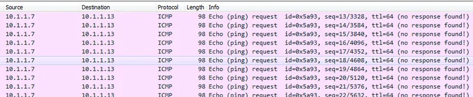
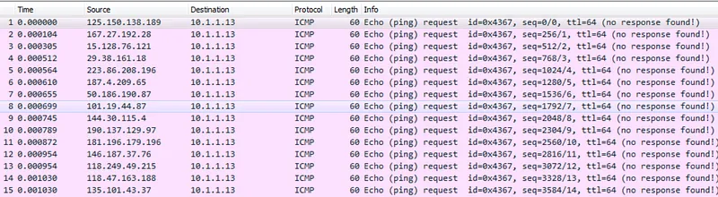
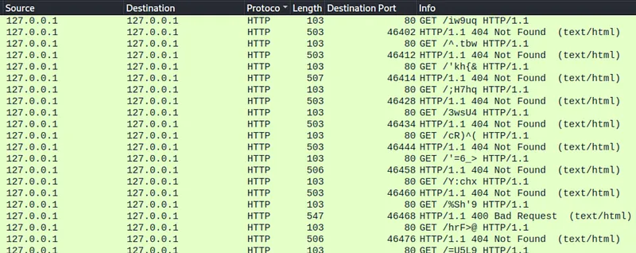
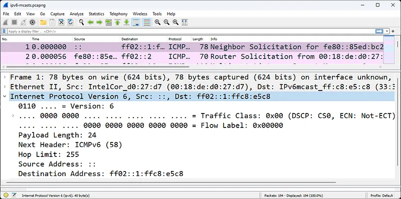
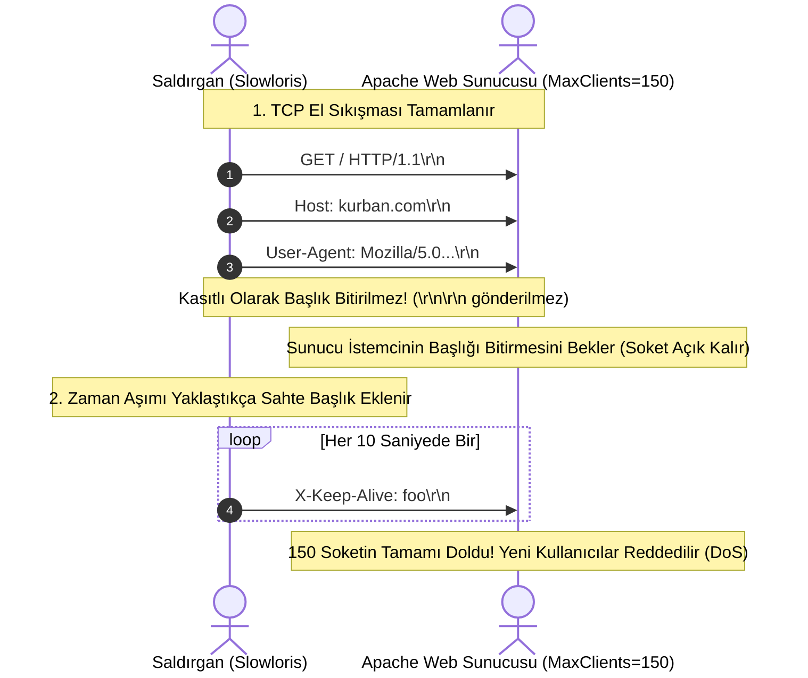

# Ağ ve Uygulama Katmanı DoS Saldırıları (ICMP Smurf, HTTP Flood, Slowloris)

Hizmet engelleme saldırıları her zaman devasa ağ bant genişliği gerektirmez. Katman 7 (Uygulama Katmanı) hedef alındığında, tek bir ev bilgisayarından gönderilen birkaç kilobaytlık son derece akıllıca hazırlanmış bir trafik dahi çok çekirdekli kurumsal bir web sunucusunu dakikalar içinde çökertebilir.

Bu bölümde Katman 3 ICMP tabanlı yükseltme saldırılarını (Smurf), yüksek hacimli HTTP Flood ve asimetrik kaynak tüketen **Slowloris** saldırısını Wireshark paket yakalamalarıyla analiz edeceğiz.

---

## §6.3.1. ICMP Flood ve Smurf Saldırısı

ICMP protokolünün ağ tanılaması için tasarlandığını görmüştük; ancak kötü niyetli kullanımda hedefi veriye boğabilir:

### 1. ICMP Echo Flood
Saldırgan hedef sunucuya saniyede on binlerce `ICMP Type 8 (Echo Request)` paketi yollar. Sunucu her pakete yanıt vermek için işlemcisini harcar ve internet hattı dolar.

### 2. Smurf Saldırısı (Klasik Amplification)
Saldırgan, kaynağını **kurbanın IP adresi** olarak sahtelediği (spoofed) bir ICMP Echo Request paketini, ara bir ağın **Genel Yayın (Broadcast) adresine** (Örn: `192.168.1.255`) yollar.
- O alt ağdaki 200 bilgisayar bu paketi alır ve hepsi aynı anda yanıtı kurbanın IP adresine gönderir.
- 1 paketlik saldırı kurbana 200 kat büyüyerek geri döner.
- **Savunma:** Modern yönlendiricilerde dışarıdan gelen yönlendirilmiş yayınlar engellenmelidir (`no ip directed-broadcast`).

---

## §6.3.2. HTTP GET ve POST Flood Saldırıları

Katman 7 saldırıları meşru kullanıcı davranışını taklit ettiği için geleneksel Katman 3/4 güvenlik duvarları tarafından fark edilemez.

### Saldırı Mekaniği:
Saldırgan botnet ağındaki binlerce zombi bilgisayardan web sunucusunun en ağır sorgular çalıştıran sayfalarına (örneğin arama motoru, veritabanı filtreleme veya PDF oluşturma uç noktaları) sürekli `HTTP GET` veya `HTTP POST` istekleri yollar:
- Web sunucusunun Apache/Nginx iş parçacıkları (worker threads) ve arkadaki SQL veritabanı bağlantı havuzu tükenir.
- Sunucu meşru kullanıcılara `502 Bad Gateway` veya `504 Gateway Timeout` hataları dönmeye başlar.

---

## §6.3.3. Slowloris: Düşük Bant Genişlikli Asimetrik Tehdit

Slowloris, Robert "RSnake" Hansen tarafından geliştirilen, devasa bant genişliği üretmeden tek bir bilgisayarla Apache web sunucularını kilitleyen dahi bir saldırı vektörüdür.

### Wireshark ile Slowloris İncelemesi:
1. İstemci geçerli bir HTTP isteği başlatır (`GET / HTTP/1.1\r\n`).
2. Ancak standart bir HTTP isteğinin bittiğini gösteren boş satır (`\r\n\r\n` - çift CRLF) **asla gönderilmez**.
3. Sunucu istemcinin başlıkları göndermeye devam ettiğini varsayarak bağlantıyı açık tutar.
4. Saldırgan zaman aşımı süresi dolmadan önce her 10-15 saniyede bir sahte bir başlık (`X-a: b\r\n`) ekler.
5. Birkaç yüz soket açıldığında sunucunun tüm bağlantı havuzu (`MaxRequestWorkers`) tükenir ve sunucu yeni hiçbir kullanıcıyı kabul edemez.

### Savunma:
- Web sunucusunda başlık okuma zaman aşımı süreleri daraltılmalıdır (Nginx `client_header_timeout 5s;` veya Apache `mod_reqtimeout`).
- Web Uygulama Güvenlik Duvarı (WAF) kullanılarak minimum transfer hızını karşılamayan yavaş bağlantılar otomatik kesilmelidir.
