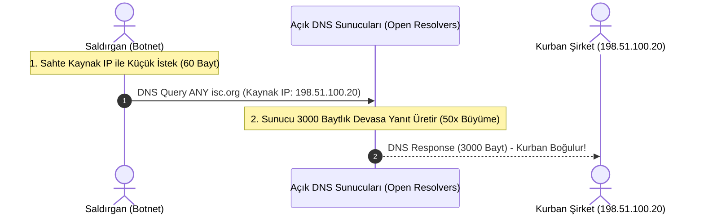
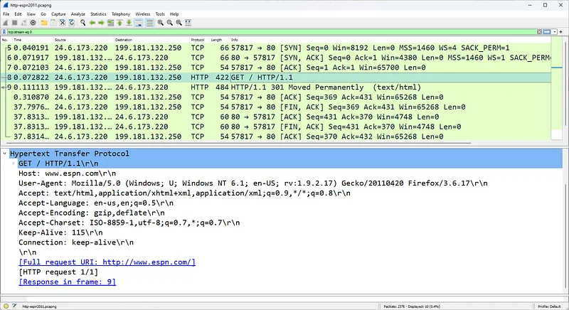

# Dağıtık DDoS Savunması ve DNS Amplification Saldırıları

Modern DDoS saldırılarının en yıkıcı olanları, UDP protokolünün durumsuz yapısını ve internet üzerindeki savunmasız açık sunucuları (Open Resolvers) kaldıraç olarak kullanan **Yansıtma ve Yükseltme (Reflection & Amplification)** saldırılarıdır.

Saldırganlar terabaytlarca (Tbps) büyüklüğünde trafik oluşturmak için botnet makinelerinin sınırlı bant genişliğini değil, kurumsal açık DNS veya NTP sunucularının devasa yanıt kapasitesini kurbana yönlendirir.

---

## §6.4.1. DNS Amplification Mekaniği ve Yükseltme Faktörü

Saldırının gerçekleşebilmesi için üç temel koşul gerekir:

1. **UDP Kaynak IP Sahteciliği (IP Spoofing):** UDP'de el sıkışma olmadığı için saldırgan gönderdiği paketin kaynak IP adresine doğrudan **kurbanın IP adresini** yazar.
2. **Açık DNS Çözümleyicileri (Open Resolvers):** İnternette yanlış yapılandırılmış, herkese açık sorgu kabul eden milyonlarca DNS sunucusu bulunur.
3. **Yüksek Yükseltme Faktörü (Amplification Factor):** Saldırgan `EDNS0 (Extension Mechanisms for DNS)` kullanarak sunucudan `ANY` sorgusu talep eder. 60 baytlık küçücük bir DNS isteğine karşılık sunucu tüm DNSSEC anahtarlarını, TXT kayıtlarını içeren **3.000 ila 4.000 baytlık** devasa bir paket döner.

Wireshark paket incelemesinde:
- Hedef IP kurbandır.
- Gelen tüm paketler `UDP 53` kaynaklıdır.
- Paket boyutları MTU sınırına (1500 bayt) dayanmış ve parçalanmıştır (Fragmented IP).

### Popüler Protokollerin Yükseltme Faktörleri:
- **DNS:** $50\times - 70\times$
- **NTP (`monlist` komutu):** $556\times$
- **SNMPv2:** $6\times - 10\times$
- **Memcached (UDP 11211):** $10.000\times - 51.000\times$ (Tarihin en büyük terabitlik saldırılarını üretmiştir)

---

## §6.4.2. Dağıtık DDoS Savunma Stratejileri

Terabaytlarca hacme ulaşan bir DDoS saldırısını tek bir güvenlik duvarı veya veri merkezi internet hattıyla durdurmak imkansızdır; saldırı boru hattına girmeden önce küresel düzeyde karşılanmalıdır:

### 1. BCP 38 ve uRPF (Unicast Reverse Path Forwarding)
İnternet Servis Sağlayıcıları (ISS), müşterilerinden gelen paketlerin kaynak IP'sini doğrulamalıdır. Eğer bir müşteri kendi IP bloğuna ait olmayan sahte bir kaynak IP ile paket yolluyorsa yönlendirici paketi derhal düşürmelidir.

### 2. BGP Anycast Yönlendirme
Tek bir IP adresi (Örn: Cloudflare `1.1.1.1` veya Google `8.8.8.8`), dünya çapındaki yüzlerce veri merkezinden aynı anda BGP ile anons edilir. Gelen saldırı trafiği tek bir noktaya yığılmak yerine en yakın 100 farklı şehre paylaştırılarak yerinde eritilir.

### 3. BGP Remotely Triggered Black Hole (RTBH)
Kurban IP'ye gelen saldırı tüm omurgayı tehdit ediyorsa, ISS'e BGP üzerinden `/32` maskeli özel bir topluluk (Community) anonsu geçilerek o IP'ye gelen tüm trafik sınır yönlendiricilerde `Null0` arayüzüne (kara deliğe) atılır. Kurban feda edilir ancak veri merkezinin geri kalanı kurtarılır.

### 4. Bulut Temizleme Merkezleri (Scrubbing Centers)
Trafik BGP veya DNS ile Cloudflare/Akamai gibi koruma merkezlerine yönlendirilir. Temizleme merkezleri terabaytlık L3/L4/L7 saldırı paketlerini filtreler; yalnızca meşru kullanıcı trafiğini GRE veya IPsec tüneliyle şirketin gerçek sunucularına iletir.
