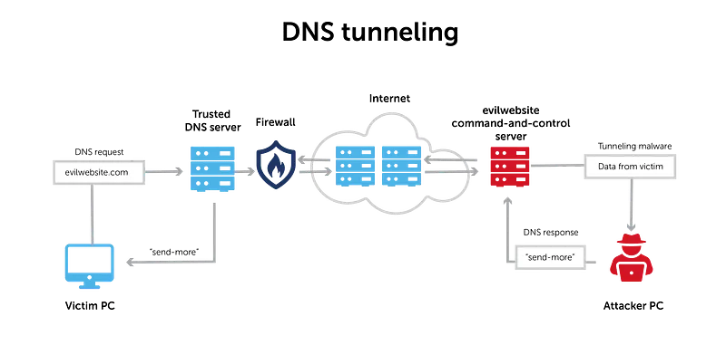
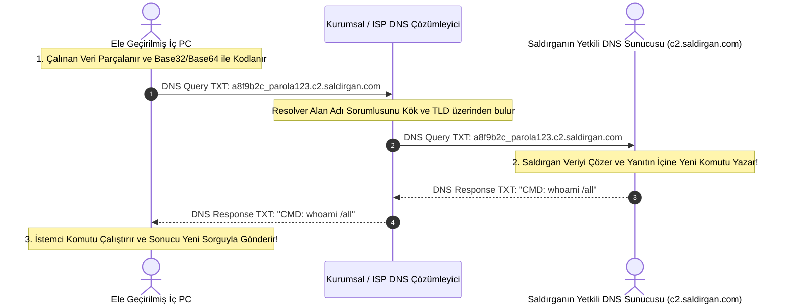
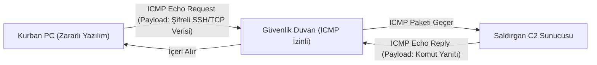

# DNS ve ICMP Gizli Tünelleri (Covert Channels) ile Veri Sızdırma

Gelişmiş kalıcı tehdit (APT) aktörleri ve siber saldırganlar, kurumsal bir ağa sızdıktan sonra tespit edilmeden veri sızdırmak (Exfiltration) ve dışarıdaki Komuta ve Kontrol (C2 / C&C) sunucularıyla haberleşmek için geleneksel portları kullanamazlar.

Güvenlik duvarları dışarıya doğru çoğu portu engellerken; internet erişiminin doğası gereği **DNS (UDP 53)** ve ağ tanılaması için **ICMP (Ping)** paketlerinin geçişine neredeyse her zaman izin verilir. Saldırganlar bu meşru protokol paketlerinin içine kendi şifreli komutlarını ve çalınan verilerini gömerek **Gizli Kanallar (Covert Channels)** oluştururlar.

---

## §7.1.1. DNS Tünelleme (DNS Tunneling) Nasıl Çalışır?

DNS tünelleme, veri aktarımı için tasarlanmamış olan DNS protokolünü çift yönlü bir iletişim boru hattına dönüştürür (`iodine`, `dnscat2` gibi araçlar):

1. Saldırgan kendine ait `saldirgan.com` alan adını kaydeder ve bu alan adının Yetkili DNS Sunucusunu (Authoritative Name Server) kendi C2 sunucusuna yönlendirir.
2. İç ağdaki zararlı yazılım çalmak istediği dosyayı Base32/Base64 ile kodlayarak bir subdomain etiketi haline getirir (`kullanicilar-sifreler.c2.saldirgan.com`).
3. Şirketin yerel DNS sunucusuna standart bir sorgu atar. Şirket güvenlik duvarı DNS sorgusuna izin verir.
4. Yerel DNS sunucusu bu domainin sorumlusunun saldırgan olduğunu bularak paketi saldırganın C2 sunucusuna iletir.
5. Saldırgan ile kurban arasında **hiçbir doğrudan TCP/IP bağlantısı kurulmadan**, tamamen meşru DNS sunucuları üzerinden çift yönlü bir komut kabuğu (shell) açılmış olur!

### Wireshark ile DNS Tünel Tespiti Kriterleri:
- **Anormal Sorgu Türleri:** Normal kullanıcılar %95 oranında `A` ve `AAAA` sorgusu atar. DNS tünel araçları ise daha fazla veri taşımak için **TXT (`dns.qry.type == 16`)**, `NULL` veya `CNAME` kayıtlarını kullanır.
- **Yüksek Entropi ve Uzun Subdomain:** Alan adı etiketleri anlamsız rastgele karakterlerden oluşur ve standart dışı uzundur (`dns.qry.name.len > 50`).
- **Devasa Sorgu Sayısı ve NXDOMAIN Patlaması:** Birkaç megabaytlık bir dosyayı sızdırmak için saniyeler içinde binlerce DNS sorgusu atılır; parçalanan paketler sık sık `NXDOMAIN (RCODE 3)` üretir.

---

## §7.1.2. ICMP Tünelleme (Ping Tunneling / Covert Channel)

ICMP Echo Request (Ping) mesajları, ağ tanılaması için içinde küçük bir veri dolgusu (Payload) taşır (Windows için 32 bayt, Linux için 56 bayt). Ancak RFC 792 bu veri alanının içeriğini veya maksimum boyutunu sınırlandırmaz.

`ptunnel` veya `icmptunnel` gibi araçlar, TCP/IP trafiğini doğrudan ICMP paketlerinin veri yükü içerisine kapsüller.

### Standart Ping ile ICMP Tünel Arasındaki Farklar:

| Özellik | Normal Meşru Ping | ICMP Tünelleme Trafiği |
| :--- | :--- | :--- |
| **Yük Boyutu** | Sabit (32 veya 56 bayt) | **Değişken ve Devasa (1000 - 1470 bayt)** |
| **Yük İçeriği** | Sabit alfabe (`abcdefg...`) | **Şifreli ikili veri (High Entropy) veya Base64** |
| **İletişim Süresi** | 4-5 paketlik kısa test | **Saatler süren kesintisiz, düzenli paket akışı** |
| **Hedef IP** | Genellikle yerel ağ geçidi veya 8.8.8.8 | **Bilinmeyen şüpheli bir dış genel IP** |

### Wireshark ile ICMP Tüneli Yakalama:
- Standart ping boyutunu aşan paketleri izole etmek için: `icmp.type == 8 && data.len > 64`
- Paket detayındaki `Data` alanına tıklandığında anlamsız şifreli desenlerin veya dosya başlıklarının görülmesi tünelin açık kanıtıdır.
