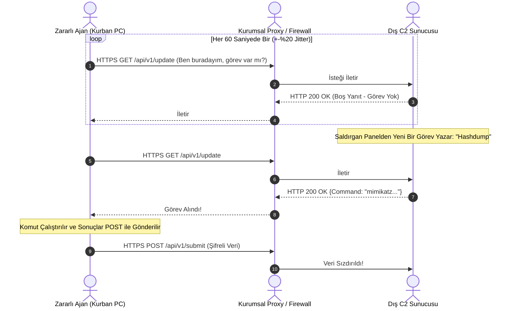

# HTTP/HTTPS Komuta Kontrol (C2) Kanalları ve Beaconing Analizi

Modern hedefli siber saldırılarda (APT) kullanılan zararlı yazılımların ve kırmızı takım araçlarının (Cobalt Strike, Sliver, Havoc, Mythic) ezici çoğunluğu, komuta kontrol (C2 / C&C) iletişimi için standart **HTTP (Port 80)** ve **HTTPS (Port 443)** protokollerini kullanır.

Saldırganlar kurumsal ağın güvenlik duvarı ve vekil sunucu (Proxy) kurallarını aşmak için trafiği meşru bir web gezintisi kılığına sokar. Bu gizli iletişimin en temel karakteristik davranışı **"Beaconing" (İşaret Verme)** mekanizmasıdır.

---

## §7.2.1. Beaconing Davranışı ve "Jitter" Kavramı

Bir kurbana bulaşan ajan (implant), dışarıdaki C2 sunucusuna sürekli açık bir TCP soketi tutmaz; çünkü uzun süreli açık kalan soketler güvenlik analistlerinin dikkatini çeker. Bunun yerine **periyodik olarak uyanır, sunucuya yeni bir emir olup olmadığını sorar ve tekrar uyku moduna geçer (Sleep)**.

### Jitter (Rastgele Sapma) Neden Kullanılır?
- Eğer ajan tam olarak her **60.00 saniyede bir** C2 sunucusuna istek atarsa, SIEM ve ağ izleme araçları matematiksel olarak aradaki zaman farkını ($\Delta t = 60s$) hesaplayarak bunun bir insan değil yazılım olduğunu saniyeler içinde anlar.
- Saldırganlar bu tespiti atlatmak için **Jitter** parametresi tanımlar (Örn: `Sleep = 60s`, `Jitter = %20`).
- Ajan bir sonraki bağlantı süresini 48 ile 72 saniye arasında rastgele seçer. Bu hafif dalgalanma basit zaman korelasyonu algoritmalarını atlatmayı hedefler.

---

## §7.2.2. Ağ Trafiğinde C2 Anomalileri ve Parmak İzleri

Bir SOC analisti veya tehdit avcısı, şifreli web trafiği içinde C2 işaretlerini şu anomalilerle yakalar:

### 1. User-Agent ve Başlık Tutarsızlıkları
Zararlı yazılımlar genellikle işletim sisteminin yerel HTTP kütüphanelerini veya özel kodlanmış soketleri kullanır:
- Windows üzerinde çalışan bir uygulamanın `curl/7.68.0`, `Go-http-client/1.1` veya eski bir `Mozilla/4.0` User-Agent'ı göndermesi şüphelidir.
- Standart tarayıcıların gönderdiği `Accept-Language`, `Sec-Fetch-Dest` gibi modern güvenlik başlıklarının eksik olması.

### 2. URI ve İstek Deseni Anomalileri
- Belirli bir harici IP veya bilinmeyen alan adına günün 24 saati boyunca kesintisiz olarak küçük boyutlu GET ve POST isteklerinin akması.
- Yanıt boyutlarının sabit olması (Örn: Görev olmadığında sürekli aynı 0 veya 4 baytlık yanıtlar).

### 3. JA3 ve JA4 TLS Parmak İzi (Fingerprinting)
Yük şifreli olsa bile, istemcinin TLS el sıkışmasında gönderdiği `Client Hello` paketindeki şifre paketleri (Cipher Suites), uzantılar ve eliptik eğri parametreleri o istemci yazılımının parmak izini çıkarır (**JA3 Hash**).
- Cobalt Strike, Metasploit veya Sliver'ın varsayılan TLS kütüphanelerinin JA3 hash'leri tehdit istihbaratı (CTI) veritabanlarında kayıtlıdır.

---

## §7.2.3. Wireshark ile Beaconing Tespiti Pratikleri

1. **Zaman Delta Grafikleri (I/O Graphs):**
   - Wireshark üst menüsünden **Statistics $\rightarrow$ I/O Graphs** açılır.
   - Şüpheli hedef IP için paket sayısı grafiğe döküldüğünde, düzenli aralıklarla tekrarlanan sütunlar (nabız atışı) açıkça görülür.
2. **Conversation List İncelemesi:**
   - **Statistics $\rightarrow$ Conversations $\rightarrow$ IPv4** sekmesinde, paket sayısı binleri bulmasına rağmen toplam aktarılan bayt miktarının çok düşük kaldığı bağlantılar izole edilir.
