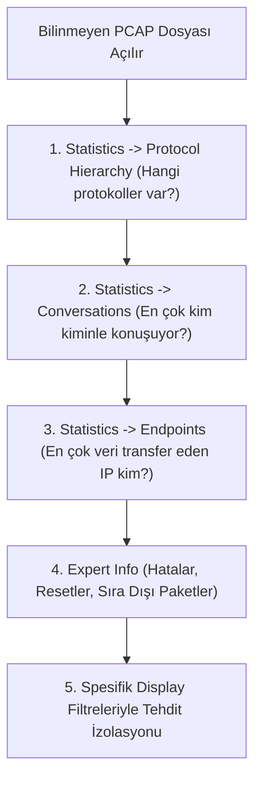

# Wireshark ile Proaktif Tehdit Avcılığı ve PCAP Analiz Rehberi

Geleneksel güvenlik operasyonları reaktiftir; yani bir IDS/IPS veya SIEM alarm ürettiğinde analist inceleme başlatır. Ancak gelişmiş saldırganlar (APT), kurumsal alarmları tetiklemeyecek düşük profilli teknikler (Living off the Land) kullanarak aylarca ağda gizli kalabilir.

**Proaktif Ağ Tehdit Avcılığı (Network Threat Hunting)**; henüz hiçbir güvenlik yazılımının uyarı vermediği durumlarda, ağ paketleri (PCAP) ve akış verileri üzerinde hipotez tabanlı araştırmalar yaparak gizli tehditleri ortaya çıkarma sanatıdır.

---

## §7.3.1. Ağ Profilleme (Baseline) Çıkarmanın Önemi

Bir tehdit avcısının ilk kuralı şudur: **"Neyin normal olduğunu bilmeden, neyin anormal olduğunu asla tespit edemezsiniz."**

Her kurumsal ağın kendine has bir ritmi vardır:
- Şirket içi tipik çalışma saatlerinde en çok hangi protokoller kullanılıyor?
- Günlük ortalama DNS sorgu hacmi nedir ve en çok hangi iç domainler çözümleniyor?
- Hangi sunucular doğrudan internete çıkabilir, hangileri yalnızca DMZ üzerinden konuşmalıdır?

Bu temel profil (Baseline) çıkarılmadığı sürece, analist meşru bir yedekleme sürecini veri sızıntısı sanabilir veya gerçek bir sızıntıyı meşru trafik zannedebilir.

---

## §7.3.2. PCAP Analizinde İlk 5 Dakika Kuralı (Triage Metodolojisi)

Elinize bilinmeyen bir `.pcap` veya `.pcapng` dosyası ulaştığında, milyonlarca paketi tek tek okumak yerine şu adımlarla yukarıdan aşağıya (Top-Down) bir kuşbakışı bakış atılmalıdır:



1. **Protocol Hierarchy (Protokol Hiyerarşisi):** Ağdaki trafiğin yüzde kaçı TCP, yüzde kaçı UDP? Beklenmedik IRC, BitTorrent veya bilinmeyen protokoller var mı?
2. **Conversations (Konuşmalar):** İki IP arasında anormal boyutta (örneğin gigabaytlarca) veri aktarımı var mı?
3. **Expert Information:** Wireshark'ın sağ alttaki renkli dairesine tıklayarak tespit edilen tüm TCP hatalarını, şüpheli bayrakları ve yeniden iletimleri inceleyin.

---

## §7.3.3. Profesyonel Wireshark Tehdit Avı Filtre Kütüphanesi

Aşağıdaki filtreler, SOC ve Blue Team analistlerinin olay müdahale süreçlerinde doğrudan kullanabileceği hazır kalıplardır:

### 1. Keşif ve Ağ Taraması Tespiti
```text
# TCP SYN Taraması (SYN=1, ACK=0 ve aşırı frekans)
tcp.flags.syn == 1 && tcp.flags.ack == 0

# TCP FIN Taraması (Nmap stealth scan)
tcp.flags == 0x001

# TCP Xmas Taraması (FIN, PSH, URG bayrakları birlikte)
tcp.flags == 0x029

# TCP Null Taraması (Hiçbir bayrak işaretli değil)
tcp.flags == 0x000

# UDP Port Taraması Kanıtı (Kapalı port ICMP yanıtları)
icmp.type == 3 && icmp.code == 3
```

### 2. Gizli Kanallar ve Veri Sızdırma (Exfiltration)
```text
# Standart dışı boyutta şüpheli ICMP Echo yükü (ICMP Tünelleme)
icmp.type == 8 && data.len > 64

# DNS TXT sorguları üzerinden tünel tespiti
dns.qry.type == 16

# Anormal derecede uzun subdomain sorguları (Base64 tünel tespiti)
dns.qry.name.len > 50

# Var olmayan domain patlaması (DGA zararlı yazılım tespiti)
dns.flags.rcode == 3
```

### 3. Oturum Çalma ve L2 Anomalileri
```text
# Çift MAC adresi iddia eden IP çakışması (ARP Poisoning / MitM)
arp.duplicate-address-frame

# Saniyede binlerce sahte MAC (Macof CAM Tablosu Saldırısı)
eth.src[0] & 1 == 0
```

### 4. Şüpheli Web ve C2 Davranışları
```text
# URL içinde şüpheli komut çalıştırma izleri
http.request.full_uri contains "cmd.exe" || http.request.full_uri contains "/bin/sh" || http.request.full_uri contains "powershell"

# Standart dışı portlarda çalışan HTTP trafiği
http && !(tcp.port == 80 || tcp.port == 8080 || tcp.port == 3128)

# Parola ve kimlik gönderen POST istekleri
http.request.method == "POST" && (http contains "password" || http contains "passwd" || http contains "token")
```
