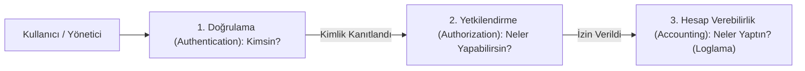
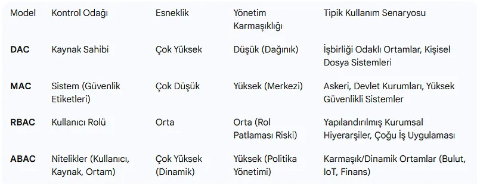
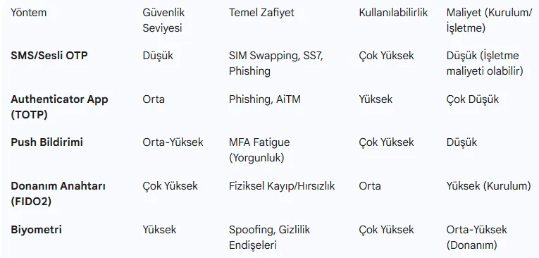

# Kimlik ve Erişim Yönetimi (IAM), AAA Çerçevesi ve Erişim Modelleri

Kurumsal siber güvenliğin yeni çevre sınırı (New Perimeter) artık fiziksel ağ kablosu veya IP adresi değil, **Kullanıcı Kimliğidir**. Bulut bilişimin, mobil cihazların ve uzaktan çalışmanın yaygınlaştığı modern dünyada; bir kullanıcının kim olduğunu doğrulamak ve ağ kaynaklarına yetkili erişimini denetlemek güvenliğin temelidir.

Bu bölümde Kimlik ve Erişim Yönetiminin (IAM - Identity & Access Management) kuramsal temellerini, AAA çerçevesini (Authentication, Authorization, Accounting), RADIUS ve TACACS+ protokollerini ve formel erişim kontrol modellerini inceleyeceğiz.

---

## §8.1.1. AAA Çerçevesi (Authentication, Authorization, Accounting)

Ağ cihazlarına ve kurumsal sistemlere erişim üç aşamalı AAA mimarisiyle denetlenir:

1. **Doğrulama (Authentication):** Kullanıcının iddia ettiği kişi olduğunu kanıtlamasıdır (Parola, biyometrik veri, akıllı kart, TOTP kodu).
2. **Yetkilendirme (Authorization):** Doğrulanmış kullanıcının hangi ağ kaynaklarına, hangi komutlara veya hangi VLAN'lara erişebileceğinin belirlenmesidir.
3. **Hesap Verebilirlik (Accounting):** Kullanıcının ağda ne zaman oturum açtığını, ne kadar süre kaldığını ve hangi komutları çalıştırdığını kayıt altına almaktır (5651 Sayılı Kanun ve KVKK uyumluluğu).

---

## §8.1.2. Merkezi AAA Protokolleri: RADIUS vs TACACS+

Ağ cihazlarının (Switch, Router, Firewall) her birinde yerel kullanıcı açmak yönetilemez bir kaostur. Kurumsal ağlarda merkezi AAA sunucuları (Cisco ISE, Aruba ClearPass, FreeRADIUS) kullanılır:

| Karşılaştırma Kriteri | RADIUS (RFC 2865/2866) | TACACS+ (Cisco Proprietary / RFC 8907) |
| :--- | :--- | :--- |
| **Taşıma Protokolü** | **UDP** (Port 1812 Auth, 1813 Acct) | **TCP** (Port 49 - Güvenilir ve sıralı) |
| **Şifreleme Kapsamı** | **Yalnızca Parola Şifrelenir** (Başlık ve kullanıcı adı düz metindir) | **Tüm Paket Yükü Şifrelenir** (En Yüksek Gizlilik) |
| **İşlev Ayrımı** | Authentication ve Authorization birleşiktir | **Authentication, Authorization ve Accounting tamamen ayrıdır** |
| **Komut Yetkilendirme** | Yok (Yalnızca genel erişim seviyesi verir) | **Var (Her bir Cisco komutu tek tek yetkilendirilebilir)** |
| **Kullanım Alanı** | Ağ Erişimi (802.1X Wi-Fi, VPN, NAC) | **Ağ Cihazı Yönetimi (Router/Switch Yönetici Girişleri)** |

---

## §8.1.3. Formel Erişim Kontrol Modelleri (MAC, DAC, RBAC, ABAC)

Bir sistemde kaynaklara erişim hakları dört ana modelle tanımlanır:

- **DAC (Discretionary Access Control - İsteğe Bağlı):** Kaynağın sahibi (Owner), dosyanın veya kaynağın erişim izinlerini dilediği gibi başkalarına devredebilir (Klasik Windows/Linux dosya izinleri). Esnektir ancak kurumsal güvenlik açısından gevşektir.
- **MAC (Mandatory Access Control - Zorunlu):** Kullanıcının inisiyatifi yoktur. Sistemdeki tüm nesnelere ve kullanıcılara güvenlik etiketleri atanır (Örn: *Gizli, Çok Gizli* - Bell-LaPadula ve Biba modelleri). Askeri ve yüksek güvenlikli sistemlerde (SELinux) kullanılır.
- **RBAC (Role-Based Access Control - Rol Tabanlı):** Yetkiler doğrudan kullanıcılara değil, kurumsal rollere tanımlanır (Örn: *Yardım Masası, Sistem Yöneticisi, Muhasebe*). Kullanıcı o role atanır. En yaygın kurumsal modeldir.
- **ABAC (Attribute-Based Access Control - Öznitelik Tabanlı):** En modern ve dinamik modeldir. Erişimi kullanıcının rolü, saati, coğrafi konumu, cihazının güvenlik durumu ve IP adresi gibi değişkenlerin kombinasyonuna göre anlık değerlendirir.

---

## §8.1.4. Çok Faktörlü Kimlik Doğrulama (MFA) Yöntemleri

MFA, kimlik doğrulamada bilinen üç temel faktörün en az ikisinin birleşimini zorunlu kılar:
1. **Bildiğin bir şey:** Parola, PIN
2. **Sahip olduğun bir şey:** Akıllı telefon (TOTP), SMS, donanımsal güvenlik anahtarı (FIDO2)
3. **Olduğun bir şey:** Parmak izi, yüz tanıma, retina
