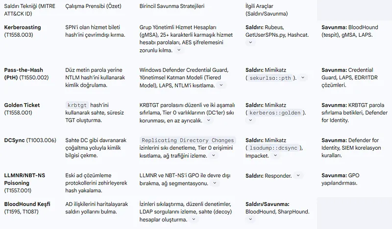
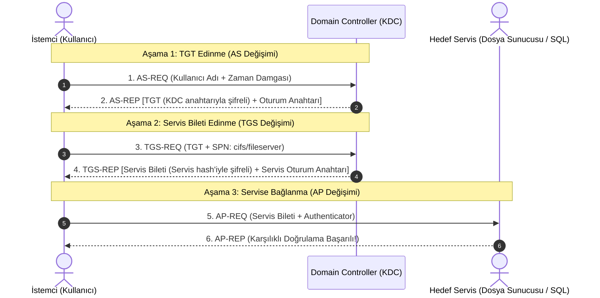

# Active Directory Mimarisi, Kerberos Protokolü ve Ağ Tabanlı Sıkılaştırma

Microsoft Active Directory (AD DS), dünyadaki kurumsal şirketlerin %90'ından fazlasının kullanıcı kimliklerini, bilgisayarlarını, erişim politikalarını (GPO) ve merkezi yetkilendirmelerini yönettiği omurga sistemdir.

Saldırganlar kurumsal bir ağa sızdığında ilk hedefleri daima Active Directory ortamında yatay hareket etmek (lateral movement) ve nihai hedef olan Domain Controller (DC) üzerinde **Domain Admin** yetkisi kazanmaktır. Bu bölümde AD kimlik doğrulama mekanizmalarını, Kerberos v5 bilet yapısını ve ağ tabanlı saldırı vektörlerini inceleyeceğiz.

---

## §8.2.1. Kerberos v5 Kimlik Doğrulama Mimarisi

Kerberos (RFC 4120), güvensiz bir ağ ortamında tarafların parolalarını ağ üzerinden iletmeden, karşılıklı olarak birbirlerinin kimliğini doğrulamalarını sağlayan bilet tabanlı (Ticket-Based) bir protokoldür.

Domain Controller üzerinde çalışan **KDC (Key Distribution Center)** iki alt servisten oluşur: **AS (Authentication Server)** ve **TGS (Ticket Granting Server)**.

1. **AS Değişimi:** Kullanıcı oturum açtığında KDC'ye bir `AS-REQ` yollar. KDC, kullanıcının parolasından türetilen hash ile doğrulamayı yapar ve kullanıcıya bir **TGT (Ticket Granting Ticket)** verir. TGT yalnızca KDC'nin bildiği `krbtgt` parolasıyla şifrelidir; istemci TGT'yi değiştiremez.
2. **TGS Değişimi:** Kullanıcı ağdaki bir dosya sunucusuna (`cifs/fileserver`) erişmek istediğinde, TGT'sini KDC'ye sunarak bir **Servis Bileti (TGS)** talep eder.
3. **AP Değişimi:** Kullanıcı servis biletini doğrudan dosya sunucusuna iletir. Sunucu bileti kendi parolasıyla çözer ve oturumu başlatır. Parola ağ üzerinde asla dolaşmaz.

---

## §8.2.2. NTLMv2 ve Neden Terk Edilmelidir?

Eski sistemlerle uyumluluk için korunan **NTLM (NT LAN Manager)**, Challenge-Response mimarisiyle çalışır. Kerberos gibi karşılıklı doğrulama sunmaz ve ciddi yapısal zafiyetlere sahiptir:

- **Pass-the-Hash (PtH):** Saldırgan bir makinenin RAM belleğinden (LSASS süreci) kullanıcının NTLM hash'ini çaldığında, açık metin parolayı çözmesine gerek kalmadan doğrudan bu hash ile diğer sunucularda oturum açabilir.
- **NTLM Relay Saldırıları:** İstemci ile sunucu arasına giren bir saldırgan, istemcinin NTLM challenge-response trafiğini başka bir kurumsal sunucuya yönlendirerek istemcinin yetkileriyle sisteme sızabilir.
- **Savunma:** Ağda **SMB İmzalaması (SMB Signing)** zorunlu kılınmalı, NTLM protokolü Group Policy üzerinden tamamen devre dışı bırakılarak saf Kerberos mimarisine geçilmelidir.

---

## §8.2.3. Yaygın Ağ Tabanlı Active Directory Tehditleri

### 1. Kerberoasting
Bir Active Directory ortamındaki herhangi bir yetkisiz etki alanı kullanıcısı, SPN (Service Principal Name) kaydı bulunan herhangi bir servis hesabı (Örn: `MSSQLSvc`) için KDC'den TGS servis bileti talep edebilir.
- Bu bilet servis hesabının NTLM parolasıyla şifrelenmiştir.
- Saldırgan bileti hafızadan dışarı aktarır (`Rubeus` veya `Mimikatz` ile) ve kendi GPU sisteminde Hashcat ile çevrimdışı kırarak servis hesabının açık parolasını elde eder.
- **Savunma:** Servis hesaplarında karmaşık, tahmin edilemez en az 25 karakterlik şifreler kullanılmalı veya **gMSA (Group Managed Service Accounts)** mimarisine geçilmelidir.

### 2. AS-REP Roasting
Active Directory'de `Do not require Kerberos preauthentication` (Kerberos ön doğrulama gerektirme) bayrağı işaretli olan kullanıcı hesapları için, herhangi bir saldırgan kullanıcı adına `AS-REQ` talep edebilir ve dönen `AS-REP` paketindeki kullanıcı şifresiyle şifrelenmiş veriyi çevrimdışı kırabilir.

### 3. Golden Ticket ve Silver Ticket Saldırıları
- **Golden Ticket:** Saldırgan Domain Controller üzerindeki `krbtgt` hesabının hash'ini ele geçirdiğinde, istediği kullanıcı adına (Örn: Domain Admin) sınırsız geçerlilik süresine sahip sahte TGT biletleri üretebilir.
- **Silver Ticket:** Saldırgan belirli bir sunucunun (örneğin dosya sunucusu veya SQL) servis hesabının hash'ini ele geçirdiğinde, KDC'ye hiç gitmeden doğrudan o servis için sahte TGS biletleri üretir.

---

## §8.2.4. Active Directory İçin Ağ Katmanı Sıkılaştırma Prensipleri

1. **İdari Katmanlama (Tiering Modeli):**
   - **Tier 0:** Domain Controller'lar ve Kimlik sistemleri. Yalnızca PAW (Privileged Access Workstations) makinelerinden yönetilir.
   - **Tier 1:** Kurumsal sunucular ve veritabanları.
   - **Tier 2:** Son kullanıcı iş istasyonları. Bir Tier 2 makinesinde asla Domain Admin oturumu açılmamalıdır!
2. **LDAP Channel Binding ve LDAP Signing:** DC'lere yapılan tüm LDAP sorguları TLS ile şifrelenmeli (LDAPS - Port 636) ve imzalama zorunlu kılınmalıdır.
