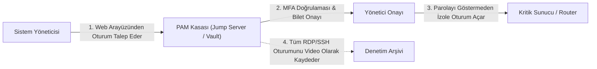
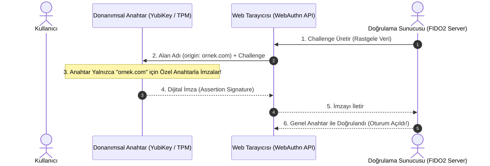
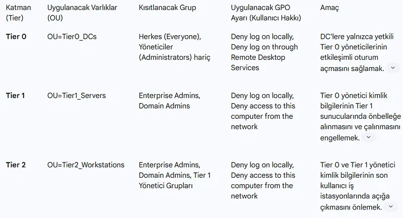
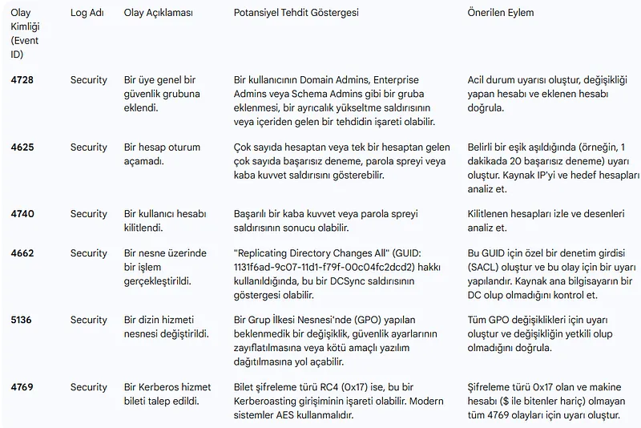

# Ayrıcalıklı Erişim Yönetimi (PAM), MFA ve Parolasız Doğrulama (FIDO2)

Siber saldırılarda ihlal edilen hesapların büyük çoğunluğu zayıf, tekrar kullanılan veya oltalama (phishing) yoluyla çalınan parolalardan kaynaklanır. Özellikle sistem yöneticisi (root/admin) hesaplarının ele geçirilmesi kurumsal ağların tamamen fidye yazılımları (Ransomware) tarafından şifrelenmesiyle sonuçlanır.

Bu riskleri bertaraf etmek için iki kritik mimari benimsenmektedir: **Ayrıcalıklı Erişim Yönetimi (PAM)**, oltalama saldırılarına karşı tam korumalı **FIDO2 / Parolasız Doğrulama** ve **Hibrit Kimlik Güvenliği**.

---

## §8.3.1. Ayrıcalıklı Erişim Yönetimi (PAM) Mimarisi

PAM çözümleri (CyberArk, BeyondTrust, Delinea); kurumsal ağdaki en kritik hesapların (Domain Admin, veritabanı `sa`, Linux `root`, ağ cihazı `enable` parolaları) insan yöneticilerin hafızasında tutulmasını yasaklar:

### Temel PAM Yetenekleri:
1. **Parola Kasası ve Otomatik Döndürme (Credential Rotation):** Yöneticiler sunucuların gerçek şifresini bilmez. PAM kasası her oturum sonrasında şifreyi 30 karakterlik rastgele bir metinle otomatik değiştirir.
2. **Just-in-Time (JIT) Erişim:** Yöneticilere sürekli (standing) admin yetkisi verilmez; yalnızca acil müdahale süresince (örneğin 2 saatliğine) geçici yetki tanımlanır.
3. **Oturum İzolasyonu ve Kaydı:** Yönetici hedef sunucuya doğrudan bağlanamaz; aradaki izole bir Jump Server üzerinden bağlanır. Tüm tuş basımları (keystrokes) ve ekran görüntüleri adli denetim için video olarak kaydedilir.

---

## §8.3.2. Çok Faktörlü Doğrulama (MFA) ve Oltalama Zafiyetleri

MFA, kimlik doğrulamada bilinen üç temel faktörün en az ikisinin birleşimini zorunlu kılar:
- **Bildiğin bir şey:** Parola, PIN
- **Sahip olduğun bir şey:** Akıllı telefon (TOTP), donanımsal güvenlik anahtarı (YubiKey)
- **Olduğun bir şey:** Parmak izi, yüz tanıma

### Klasik MFA'nın Zafiyeti ve MFA Yorgunluğu (MFA Fatigue):
SMS ve e-posta tabanlı MFA'lar SIM-Swap ve ortadaki adam (MitM / Evilginx) saldırılarıyla kolayca çalınabilir. Saldırgan gece yarısı yöneticinin telefonuna yüzlerce bildirim yollayarak (**MFA Prompt Bombing**) kullanıcının uykulu bir anında "Onayla" butonuna basmasını sağlar.
- **Savunma:** Bildirim ekranında rastgele iki basamaklı sayı eşleştirme (**Number Matching**) zorunlu tutulmalıdır.

---

## §8.3.3. FIDO2 / WebAuthn ile Oltalama Karşıtı Gelecek

FIDO Alliance ve W3C standardı olan **FIDO2 / WebAuthn (Passkeys)**, şifreleri tamamen ortadan kaldıran ve oltalama saldırılarına karşı matematiksel olarak bağışık olan tek mimaridir.

### Neden Oltalama Yapılamaz?
Saldırgan sahte bir oltalama sitesi (`www.ornekk-banka.com`) kursa ve kullanıcı bu siteye girse dahi:
- Donanımsal FIDO2 anahtarı veya Windows Hello TPM yongası, imzalamayı tarayıcının adres çubuğundaki **Origin (Alan Adı)** bilgisine göre yapar.
- Sahte domain için geçerli bir özel anahtar bulunamayacağından imzalama işlemi gerçekleşmez; saldırgan hiçbir veri elde edemez.

---

## §8.3.4. Hibrit Kimlik Güvenliği ve Active Directory Kurtarma

Kurumlar şirket içi Active Directory'yi Microsoft Entra ID (Azure AD) ile senkronize ederken hibrit saldırı yüzeyi genişler:
1. **Azure AD Connect Sunucusunun İzolasyonu:** Bu sunucu Tier 0 varlığı kabul edilmeli ve yalnızca yerel yetkili yönetim istasyonlarından yönetilmelidir.
2. **Password Hash Sync (PHS) vs Pass-Through Authentication (PTA):** Şirket içi ortam ihlal edildiğinde bulut hesaplarının ele geçirilmesini önlemek için koşullu erişim (Conditional Access) kuralları uygulanmalıdır.
3. **Active Directory Ormanı Felaket Kurtarma (AD Forest Recovery):** Fidye yazılımı saldırısında tüm DC'ler şifrelendiğinde, temiz ve çevrimdışı (Air-Gapped / Immutable) yedekten hızlı geri dönüş prosedürleri önceden tatbik edilmelidir.
