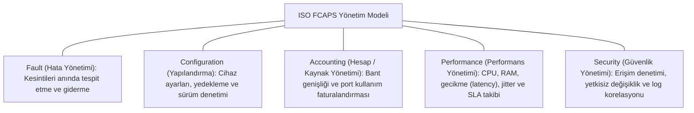
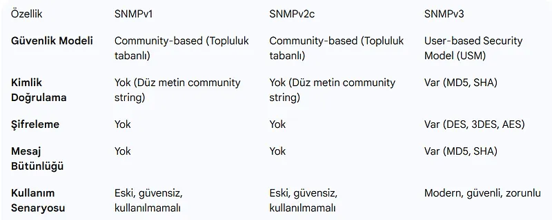
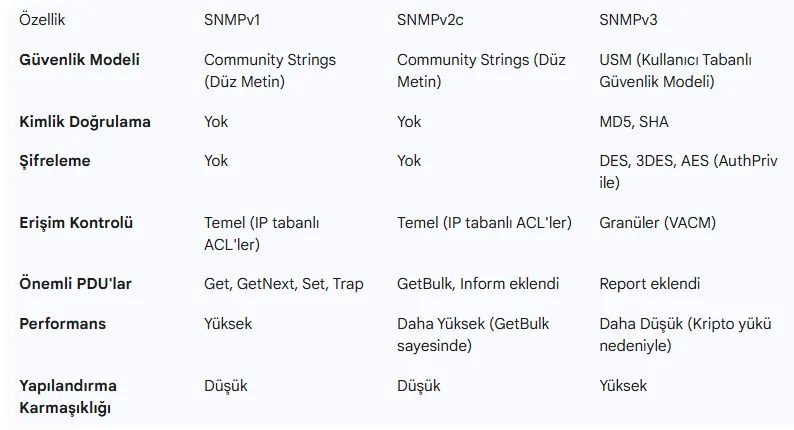
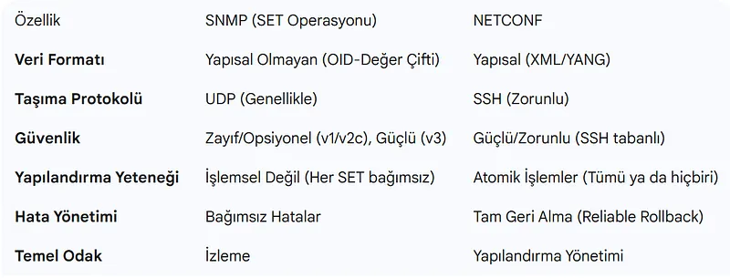

# Ağ Yönetiminin Temeli (FCAPS) ve SNMP Mimarisi

Büyük ölçekli kurumsal ağlarda binlerce anahtar (switch), yönlendirici (router), sunucu ve güvenlik duvarı bulunur. Bu karmaşık sistemlerin kesintisiz, performanslı ve güvenli çalışabilmesi; proaktif bir yönetim ve izleme mimarisi gerektirir.

Uluslararası Telekomünikasyon Birliği (ITU-T) ve ISO tarafından tanımlanan **FCAPS Çerçevesi**, modern Ağ Operasyon Merkezlerinin (NOC) temel yönetim haritasıdır. Bu yönetimi sağlayan en köklü ve yaygın telemetri protokolü ise **SNMP (Simple Network Management Protocol)**'dir.

---

## §9.1.1. ISO FCAPS Yönetim Çerçevesi

FCAPS, ağ yönetimini beş temel fonksiyonel disipline ayırır:



---

## §9.1.2. SNMP Mimarisi: MIB, OID ve Çalışma Modelleri

Basit Ağ Yönetim Protokolü (SNMP - RFC 1157 / RFC 3411), bir ağ yöneticisinin (NMS - Network Management Station) uzaktaki yüzlerce ağ cihazının durumunu sorgulamasını sağlar:

```mermaid
flowchart LR
    NMS["NMS İzleme Sunucusu (Zabbix / PRTG / LibreNMS)"]
    Router["Ağ Cihazı (SNMP Agent)"]

    NMS -->|"1. Polling: GetRequest (OID: 1.3.6.1.2.1.1.3 - Uptime?)"| Router
    Router -->>|2. Response: Uptime = 45 gün| NMS

    Router -.->|3. Push: SNMP Trap (Port 1/0/1 Down oldu!)| NMS

```

### Temel Bileşenler:
1. **SNMP Agent (Ajan):** İzlenen ağ cihazının (Router/Switch) üzerinde çalışan, cihazın sayaçlarını ve durumunu okuyan yerleşik yazılımdır.
2. **NMS (Ağ Yönetim İstasyonu):** Zabbix, Nagios, LibreNMS veya PRTG gibi merkezi izleme yazılımıdır.
3. **MIB (Management Information Base):** Cihazda sorgulanabilecek tüm parametrelerin hiyerarşik sözlüğüdür.
4. **OID (Object Identifier):** MIB ağacındaki belirli bir değişkene işaret eden noktalı sayısal adrestir (Örn: `1.3.6.1.2.1.1.1.0` $\rightarrow$ `sysDescr` cihaz model bilgisi).

### İletişim Modelleri:
- **Yoklama (Polling - Çekme Modeli):** NMS her 5 dakikada bir cihaza `GetRequest` veya `GetBulkRequest` yollayarak CPU ve bant genişliği sayaçlarını sorgular (`UDP 161`).
- **Tuzak (Trap / Inform - İtme Modeli):** Cihazda kritik bir olay olduğunda (örneğin bir fiber kablo koptuğunda veya güç kaynağı arızalandığında), cihaz NMS'in sormasını beklemeden anında NMS'e `SNMP Trap` paketi fırlatır (`UDP 162`).

---

## §9.1.3. SNMP Sürümleri ve Güvenlik Analizi

SNMP'nin tarihsel evrimi, ağ yönetiminde güvenlik bilincinin nasıl değiştiğini gösterir:





| Sürüm | Kimlik Doğrulama | Şifreleme (Gizlilik) | Bütünlük Doğrulama | Güvenlik Durumu |
| :--- | :--- | :--- | :--- | :--- |
| **SNMPv1** | Düz metin Community String | **Yok** (Açık Metin) | Yok | **Kritik Derecede Güvensiz** |
| **SNMPv2c** | Düz metin Community String | **Yok** (Açık Metin) | Yok | **Güvensiz** (Sniffing ile şifre çalınabilir) |
| **SNMPv3** | **USM (Kullanıcı Adı + SHA-256 / MD5)** | **AES-128 / AES-256** | **HMAC Doğrulaması** | **Kurumsal Güvenli Standart** |

### SNMPv3 Güvenlik Seviyeleri (Security Levels):
1. `noAuthNoPriv`: Kimlik doğrulama yok, şifreleme yok (v2c ile aynı zayıflıkta).
2. `authNoPriv`: Kimlik doğrulama var (SHA ile hash doğrulanır) ancak veri şifrelenmez.
3. `authPriv`: **En yüksek seviye.** Hem kullanıcı kimliği doğrulanır hem de iletilen tüm MIB sayaçları güçlü **AES** ile şifrelenir. Kurumsal ağlarda yalnızca `authPriv` kullanılmalıdır.

---

## §9.1.4. Modern Yönetim: SNMP vs. NETCONF

Geleneksel SNMP salt okunur izleme için mükemmel olsa da, ağ konfigürasyonu değiştirmek için yetersiz kalmaktadır:



- **SNMP:** UDP tabanlıdır, işlem güvencesi (Transaction / Rollback) yoktur. Büyük konfigürasyon değişikliklerinde paket kaybolursa cihaz tutarsız durumda kalabilir.
- **NETCONF (RFC 6241):** SSH üzerinden TCP ile çalışır, veri modellemesi için **YANG** kullanır. Atomik işlemler (`candidate`, `commit`, `rollback`) sunarak modern NetDevOps otomasyonunun omurgasını oluşturur.
