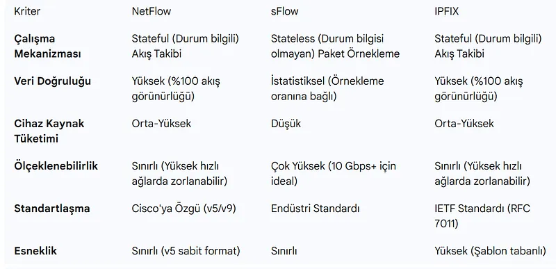
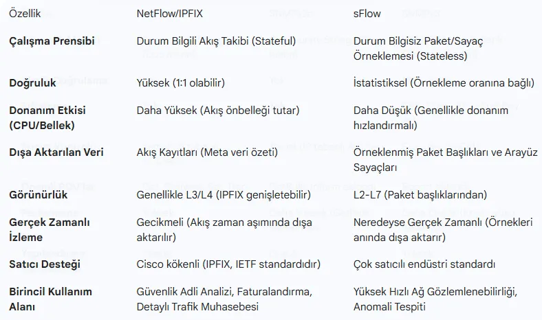
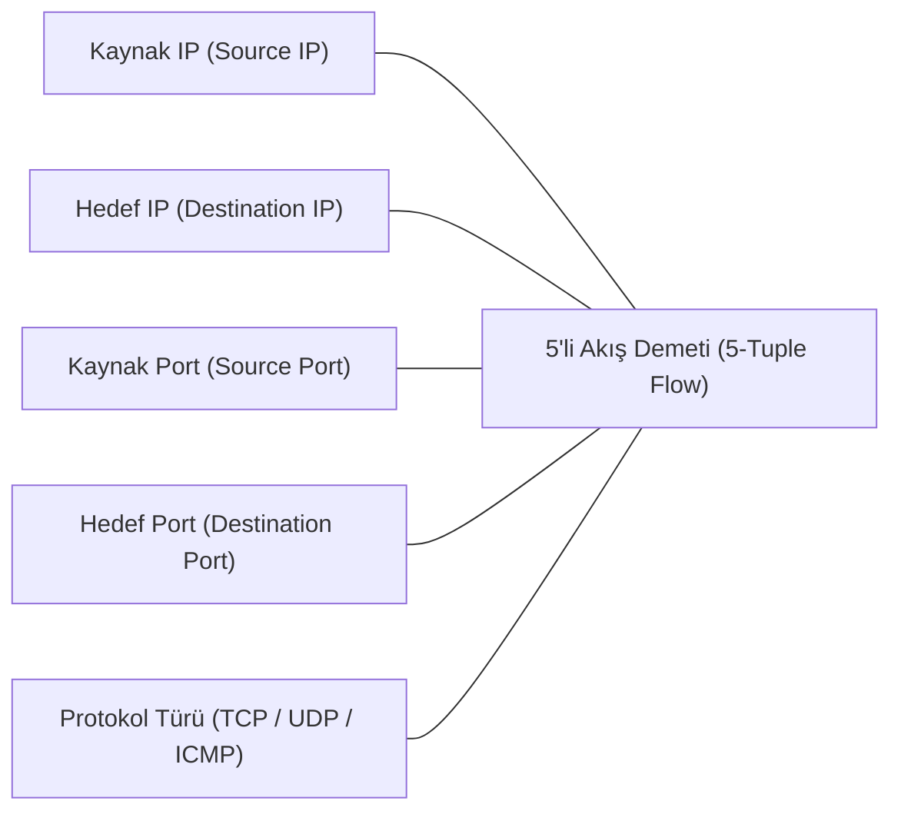

# Ağ Trafik Akış Analitiği (NetFlow, sFlow ve IPFIX)

Ağda akan her bir paketin tamamını (Full Packet Capture - PCAP) kaydetmek, 100 Gbps omurga hatlarına sahip modern veri merkezlerinde petabaytlarca depolama alanı gerektirir ve sürdürülebilir değildir.

Bu noktada devreye giren **Akış Analitiği (Flow Telemetry)**; tıpkı bir telefon faturasının konuşmanın ses kaydını değil de *"kimin kimi ne zaman aradığını ve ne kadar konuştuğunu"* kaydetmesi gibi, ağ paketlerinin yalnızca özet metaverilerini kaydeder.

---

## §9.2.1. Bir "Ağ Akışı" (Network Flow) Nedir?

Ağ mühendisliğinde bir akış, belirli bir zaman aralığında aynı özellikleri paylaşan tek yönlü paket dizisidir. Standart bir akış **5'li Demet (5-Tuple)** ile tanımlanır:

Bir yönlendirici veya anahtar (Exporter), bu 5 özelliği aynı olan paketleri tek tek kaydetmez; bir sayaç tutarak *"Bu iki IP ve port arasında 1.250 adet paket ve toplam 1.8 MB veri aktarıldı, oturum 4.2 saniye sürdü"* şeklinde tek bir akış kaydı oluşturur.

---

## §9.2.2. Akış Teknolojileri: NetFlow, IPFIX ve sFlow

| Özellik | NetFlow v5 | NetFlow v9 | IPFIX (RFC 7011) | sFlow (RFC 3176) |
| :--- | :--- | :--- | :--- | :--- |
| **Geliştirici** | Cisco (Proprietary) | Cisco | **IETF (Açık Standart)** | InMon / Konsorsiyum |
| **Mimari** | Sabit Format | Şablon Tabanlı (Template) | **Şablon Tabanlı (Genişletilebilir)** | **Paket Örnekleme (Sampling)** |
| **IPv6 Desteği** | Yok (Yalnızca IPv4) | Var | **Var** | Var |
| **MPLS / VLAN** | Yok | Var | **Var** | Var |
| **Donanım Yükü** | Orta | Orta | Orta | **Çok Düşük (ASIC Örnekleme)** |
| **Doğruluk** | %100 (Tüm akışlar) | %100 | **%100 (Deterministik)** | İstatistiksel Tahmin ($1/1000$ paket) |

### NetFlow / IPFIX Mimarisi:
1. **Flow Exporter (Ağ Cihazı):** Akış tablosunu tutar ve belirli aralıklarla (Flow Timeout) UDP paketleriyle dışarı aktarır.
2. **Flow Collector (Toplayıcı):** Yüzlerce cihazdan gelen akış paketlerini kabul eden merkezi sunucudur.
3. **Flow Analyzer (Analiz Motoru):** Elastik veya SQL veritabanında bu verileri işleyerek grafiklere döken yazılımdır (ntopng, SolarWinds, Kentik).

---

## §9.2.3. Akış Verisinin Operasyonel ve Güvenlik Kullanım Alanları

- **En Çok Konuşanlar (Top Talkers):** Kurumsal internet hattını o an tüketen kullanıcıların veya sunucuların IP ve uygulama bazında saniyeler içinde tespit edilmesi.
- **DDoS ve Tarama Tespiti:** Saniyede oluşturulan akış sayısındaki (Flows Per Second) ani fırlamalar, SYN Flood veya port taraması saldırılarını anında ortaya çıkarır.
- **Yanal Hareket (Lateral Movement) Tespiti:** Bir muhasebe bilgisayarının veri tabanı sunucusuna SMB (Port 445) üzerinden doğrudan bağlantı açtığı akış analiziyle tespit edilebilir.
