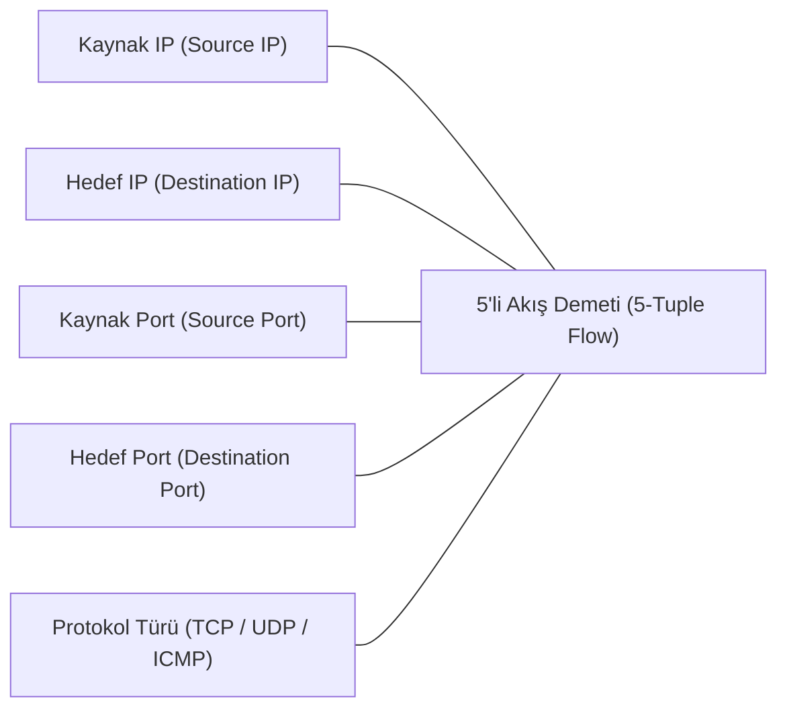
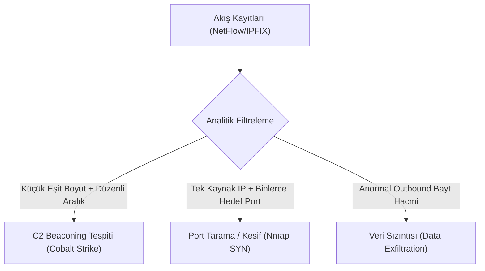

# Ağ Trafik Akış Analitiği (NetFlow, sFlow ve IPFIX)

Ağda akan her bir paketin tamamını (Full Packet Capture - PCAP) kaydetmek, 100 Gbps omurga hatlarına sahip modern veri merkezlerinde petabaytlarca depolama alanı gerektirir ve sürdürülebilir değildir.

Bu noktada devreye giren **Akış Analitiği (Flow Telemetry)**; tıpkı bir telefon faturasının konuşmanın ses kaydını değil de *"kimin kimi ne zaman aradığını ve ne kadar konuştuğunu"* kaydetmesi gibi, ağ paketlerinin yalnızca özet metaverilerini kaydeder.


---

## §9.2.1. Bir "Ağ Akışı" (Network Flow) Nedir?

Ağ mühendisliğinde bir akış, belirli bir zaman aralığında aynı özellikleri paylaşan tek yönlü paket dizisidir. Standart bir akış **5'li Demet (5-Tuple)** ile tanımlanır:



Bir yönlendirici veya anahtar (Exporter), bu 5 özelliği aynı olan paketleri tek tek diske yazmaz; bir sayaç tutarak *"Bu iki IP ve port arasında 1.250 adet paket ve toplam 1.8 MB veri aktarıldı, oturum 4.2 saniye sürdü"* şeklinde tek bir akış kaydı oluşturur.

---

## §9.2.2. Akış Teknolojileri: NetFlow, IPFIX ve sFlow Karşılaştırması

| Özellik | NetFlow v5 | NetFlow v9 | IPFIX (RFC 7011) | sFlow (RFC 3176) |
| :--- | :--- | :--- | :--- | :--- |
| **Geliştirici** | Cisco (Proprietary) | Cisco | **IETF (Açık Standart)** | InMon / Konsorsiyum |
| **Mimari** | Sabit Format | Şablon Tabanlı (Template) | **Şablon Tabanlı (Genişletilebilir)** | **Paket Örnekleme (Sampling)** |
| **IPv6 Desteği** | Yok (Yalnızca IPv4) | Var | **Var** | Var |
| **MPLS / VLAN** | Yok | Var | **Var** | Var |
| **Donanım Yükü** | Orta | Orta | Orta | **Çok Düşük (ASIC Örnekleme)** |
| **Doğruluk** | %100 (Tüm akışlar) | %100 | **%100 (Deterministik)** | İstatistiksel Tahmin ($1/1000$ paket) |

### NetFlow / IPFIX Üçlü Mimarisi:
1. **Flow Exporter (Ağ Cihazı):** Akış tablosunu bellekte tutar ve belirli aralıklarla (Flow Timeout) UDP paketleriyle dışarı aktarır.
2. **Flow Collector (Toplayıcı):** Yüzlerce cihazdan gelen akış paketlerini kabul eden merkezi sunucudur (Logstash, nfdump, Filebeat NetFlow modülü).
3. **Flow Analyzer (Analiz Motoru):** Elasticsearch, ClickHouse veya SQL veritabanında bu verileri işleyerek grafiklere döken yazılımdır (ntopng, Elastiflow, Kentik, SolarWinds).

---

## §9.2.3. Akış Zaman Aşımları: Active vs. Inactive Timeout

Akışların toplayıcıya ne zaman gönderileceğini belirleyen iki kritik zamanlayıcı parametresi vardır:

1. **Active Timeout (Varsayılan: 30-60 dakika, Önerilen: 60 saniye):** Uzun süren bağlantılarda (örneğin saatler süren bir SSH oturumu veya video akışı), akışın sonlanması beklenirse veriler toplayıcıya çok geç ulaşır. Active Timeout süresi dolduğunda sayaç sıfırlanır ve ara bir akış kaydı dışarı aktarılır. Güvenlik operasyonlarında (SOC) hızlı tespit için bu değer **60 saniyeye** çekilmelidir.
2. **Inactive Timeout (Varsayılan: 15-30 saniye):** Belirli bir süre boyunca ilgili 5'li demetten hiçbir yeni paket geçmezse oturumun kapandığı varsayılır ve akış kaydı derhal Exporter'dan Collector'a postalanır.

---

## §9.2.4. Cisco IOS-XE Flexible NetFlow (FnF) Yapılandırma Kılavuzu

Modern Cisco yönlendiricilerinde (Catalyst 9000, ISR 4000, ASR 1000) esnek akış kaydı 4 adımda yapılandırılır:

```cisco
! 1. ADIM: Flow Record (Hangi alanlar kaydedilecek?)
flow record RECORD-SEC-OPERATIONS
 description Guvenlik ve Tehdit Analizi Icin Akis Sablonu
 match ipv4 tos
 match ipv4 protocol
 match ipv4 source address
 match ipv4 destination address
 match transport source-port
 match transport destination-port
 match interface input
 collect routing source as
 collect routing destination as
 collect transport tcp flags
 collect counter bytes long
 collect counter packets long
 collect timestamp sys-uptime first
 collect timestamp sys-uptime last
!
! 2. ADIM: Flow Exporter (Akis nereye gonderilecek?)
flow exporter EXPORTER-SIEM-COLLECTOR
 description SIEM / Toplayici Sunucu Hedefi
 destination 192.168.100.50
 transport udp 2055
 export-protocol ipfix
 template data timeout 60
!
! 3. ADIM: Flow Monitor (Kayit ve gondericiyi birlestirme)
flow monitor MONITOR-CORE-ANALYSIS
 record RECORD-SEC-OPERATIONS
 exporter EXPORTER-SIEM-COLLECTOR
 cache timeout active 60
 cache timeout inactive 15
!
! 4. ADIM: Arayuze Baglama (Interface Binding)
interface GigabitEthernet0/0/1
 description Omurga Baglantisi
 ip flow monitor MONITOR-CORE-ANALYSIS input
 ip flow monitor MONITOR-CORE-ANALYSIS output
```

---

## §9.2.5. Linux Ortamında Akış Üretimi: softflowd ve pmacct

Donanımsal bir ağ cihazı bulunmayan Linux sunucularda veya sanallaştırma hipervizörlerinde arayüz trafiğini NetFlow/IPFIX formatına dönüştürmek için açık kaynaklı araçlar kullanılır:

### softflowd ile IPFIX İhracı:
```bash
# softflowd kurulumu
sudo apt-get install softflowd

# eth0 arayuzunu dinleyip 192.168.100.50:2055 adresine IPFIX aktarma
sudo softflowd -i eth0 -n 192.168.100.50:2055 -v 10 -t maxlife=60 -t expint=60
```

---

## §9.2.6. Wireshark ile NetFlow / IPFIX Paketlerinin İncelenmesi

Wireshark, ağ üzerinden Collector'a taşınan akış paketlerini çözümlemek için yerleşik disektörlere sahiptir.

### Kullanışlı Wireshark Filtreleri:
- `cflow`: Tüm Cisco NetFlow paketlerini filtreler.
- `cflow.version == 9`: NetFlow v9 şablon ve veri paketlerini gösterir.
- `ipfix`: IPFIX protokolüne ait kayıtları listeler.
- `cflow.srcport == 445 || cflow.dstport == 445`: Akış özetlerinde SMB (Port 445) oturumlarını arar.
- `cflow.tcp_flags_reset == 1`: Bağlantısı RST bayrağıyla aniden kesilen akışları bulur (DDoS veya port tarama göstergesi).

---

## §9.2.7. Akış Verisi ile Proaktif Tehdit Avcılığı

Akış verileri, şifreli trafik içeriğini göstermese de saldırganların operasyonel modellerini (TTP) matematiksel olarak ortaya çıkarır:



1. **C2 Beaconing Tespiti:** Bir iç istemci ile bilinmeyen bir dış IP arasında düzenli aralıklarla (örneğin her 30 saniyede bir $\pm$ %10 jitter) 100-200 baytlık akışların oluşması, zararlı yazılım komuta kontrol beacon sinyalinin kanıtıdır.
2. **Yanal Hareket (Lateral Movement):** Kullanıcı bilgisayarları (Client Subnet) birbirleriyle doğrudan iletişim kurmamalıdır. Akış kayıtlarında iki kullanıcı bilgisayarı arasında TCP 135 (RPC) veya TCP 445 (SMB) akışı görülmesi, saldırganın ağda yanal olarak sıçradığını gösterir.
3. **Veri Sızıntısı (Exfiltration):** Bir iş istasyonunun mesai saatleri dışında dış bir IP adresine gigabaytlarca tek yönlü veri akıtması, anormal akış hacmi kurallarıyla anında alarmlaştırılır.

---

## §9.2.8. Çapraz Referans ve Entegrasyon
- SNMP telemetrisi ve FCAPS çerçevesi için [§9.1 FCAPS Modeli ve SNMP Mimarisi](./01-fcaps-modeli-ve-snmp-mimarisi.md) bölümüne bakın.
- Merkezi loglama ve SIEM log iletimi için [§9.3 Merkezi Log Yönetimi ve Syslog Standardı](./03-merkezi-log-yonetimi-ve-syslog.md) bölümüne bakın.
- Siber Güvenlik Operasyonları Kitabı'nda SIEM/SOAR ve Detection Engineering mimarileri için [SOC ve Log Yönetimi](../../../siber-guvenlik-operasyonlari/14-operasyonel-guvenlik/01-soc-ve-log-yonetimi.md) ile [Detection Engineering ve Tehdit Avcılığı](../../../siber-guvenlik-operasyonlari/14-operasyonel-guvenlik/02-detection-engineering.md) bölümlerini inceleyin.
