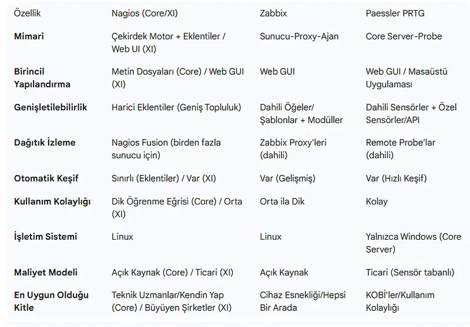
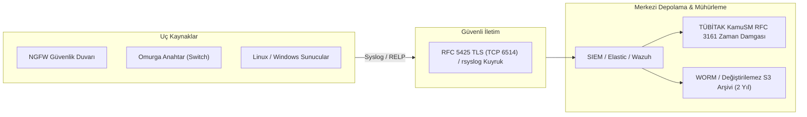
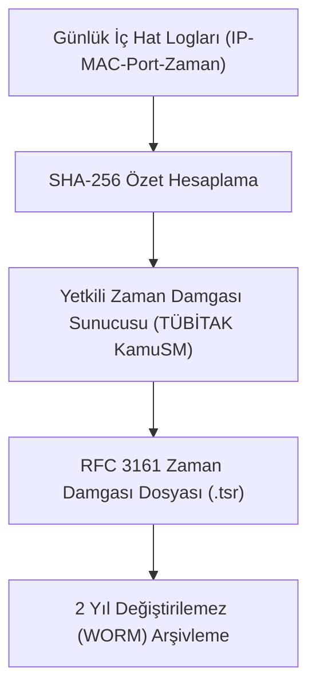

# Merkezi Log Yönetimi, Syslog Standardı ve Yasal Uyumluluk (5651)

Bir siber güvenlik olayında *"Ne zaman oldu, kim yaptı ve hangi sistemler etkilendi?"* sorularının yegane adli delil kaynağı log kayıtlarıdır. Ancak her cihazın logunu kendi yerel diskinde tutması durumunda; saldırgan sisteme sızdığında ilk iş olarak yerel logları siler (`wevtutil cl` komutuyla Windows Event Log temizleme veya `/var/log` silme).

Bu nedenle kurumsal ağlarda tüm ağ donanımları, güvenlik duvarları ve sunucular olay anında loglarını anında merkezi bir **Syslog / SIEM** sunucusuna gönderecek şekilde yapılandırılır.





---

## §9.3.1. RFC 5424 Syslog Standardı ve Ciddiyet Seviyeleri

Syslog mesajları iki temel parametreyle sınıflandırılır: **Facility (Kaynağın Türü)** ve **Severity (Olayın Ciddiyeti)**.

### Syslog Ciddiyet Seviyeleri (Severity Levels 0 - 7):

| Seviye | Adı | Anlamı ve Operasyonel Örnek |
| :---: | :--- | :--- |
| **0** | **Emergency** | Sistem tamamen çöktü, kullanılamaz durumda (Panik hali). |
| **1** | **Alert** | Acil müdahale gerektirir (Örn: Bozulmuş temel veritabanı). |
| **2** | **Critical** | Kritik donanım veya yazılım arızası (Yedekli güç kaynağı yandı). |
| **3** | **Error** | Hata durumu; bir servis veya işlem başarısız oldu. |
| **4** | **Warning** | Uyarı; hata değil ancak düzeltilmezse hataya yol açabilir. |
| **5** | **Notice** | Normal ancak dikkate değer olaylar (Arayüz Up/Down oldu). |
| **6** | **Informational** | Bilgilendirme mesajları (Normal kullanıcı girişi, ACL izni). |
| **7** | **Debug** | Geliştirici seviyesinde son derece detaylı tanılama kayıtları. |

### Standart RFC 5424 Log Formatı:
```text
<PRI>VERSION TIMESTAMP HOSTNAME APP-NAME PROCID MSGID [STRUCTURED-DATA] MSG
```
Örnek:
```text
<34>1 2026-10-15T20:15:30.123Z core-sw01.corp sshd 2145 ID47 [exampleSDID@32473 iut="3" eventSource="Application"] Failed password for root from 192.168.1.50 port 54322 ssh2
```

---

## §9.3.2. Syslog Taşıma Güvenliği: UDP 514 vs TLS (TCP 6514) ve RELP

- **Geleneksel Syslog (RFC 3164 - UDP 514):** Loglar ağ üzerinden açık metin ve UDP ile iletilir. Saldırgan paketleri dinleyerek sistem zafiyetlerini veya kullanıcı adlarını görebilir; ayrıca sahte log enjekte edebilir (Spoofing). Paket kaybı yaşandığında adli delil zinciri kopar.
- **Güvenli Syslog (RFC 5425 - TCP 6514):** Loglar **karşılıklı TLS (mTLS) ile şifrelenir** ve TCP'nin güvenilir teslimat mekanizmasıyla iletilir.
- **RELP (Reliable Event Logging Protocol):** Uygulama katmanında ACK (onay) mekanizması ekleyerek ağ veya SIEM sunucusu anlık kilitlendiğinde dahi sıfır log kaybı garantisi verir.

### Linux rsyslog TLS ve Disk Kuyruğu Yapılandırması:
Ağ kesintisi anında logların kaybolmaması için istemci üzerinde disk destekli kuyruk (Disk-Assisted Memory Queue) tanımlanır:

```ini
# /etc/rsyslog.d/50-remote-tls.conf
# CA ve İstemci Sertifikaları
$DefaultNetstreamDriver gtls
$DefaultNetstreamDriverCAFile /etc/ssl/certs/ca.pem
$DefaultNetstreamDriverCertFile /etc/ssl/certs/client-cert.pem
$DefaultNetstreamDriverKeyFile /etc/ssl/private/client-key.pem

$ActionSendStreamDriverAuthMode x509/name
$ActionSendStreamDriverPermittedPeer siem.corp.local
$ActionSendStreamDriverMode 1 # Yalnızca TLS zorunlu

# Ağ Kesintisine Karşı Disk Kuyruğu Tanımı
$ActionQueueFileName fwdRule1      # Disk dosya öneki
$ActionQueueMaxDiskSpace 2g        # Maksimum 2 GB disk tamponu
$ActionQueueSaveOnShutdown on      # Kapanışta bellekteki logları diske yaz
$ActionQueueType LinkedList        # Dinamik kuyruk
$ActionResumeRetryCount -1         # Bağlantı gelene kadar sonsuz deneme

# Hedef SIEM / Merkezi Syslog Sunucusu (TCP 6514)
*.* @@siem.corp.local:6514
```

---

## §9.3.3. Ağ Cihazlarında Merkezi Log Gönderimi

### Cisco IOS-XE Yapılandırması:
```cisco
! Zaman damgası hassasiyetini milisaniye olarak ayarlama (NTP senkronu)
service timestamps log datetime msec show-timezone
service timestamps debug datetime msec show-timezone

! Kaynak arayüz belirleme (Loopback)
logging source-interface Loopback0

! Merkezi Syslog sunucusu ve seviye belirleme (Informational ve üstü)
logging host 192.168.100.50 transport udp port 514
logging trap informational

! Başarısız ve başarılı oturum açma girişimlerini loglama
login on-failure log
login on-success log
```

---

## §9.3.4. NTP Olmadan Adli Bilişim Yapılamaz

Farklı sunucuların ve güvenlik duvarlarının saatleri arasında 30 saniyelik bir fark bile olsa, bir siber saldırı zincirini (Kill Chain) kronolojik olarak birleştirmek imkansız hale gelir.
- Tüm kurumsal ağ cihazları **NTP (Network Time Protocol - UDP 123)** ile kurumsal yetkili bir zaman sunucusuna kilitlenmelidir.
- Cihazlarda `NTP Authentication` (MD5/SHA1 anahtarları) etkinleştirilerek sahte NTP paketleriyle sistem saatinin manipüle edilmesi (Time Shifting Attack) engellenmelidir.

---

## §9.3.5. Türkiye Yasal Mevzuatı ve 5651 Sayılı Kanun Gereksinimleri

Türkiye'de faaliyet gösteren kurumlar, internet servis sağlayıcıları ve toplu kullanım sağlayıcılar (şirketler, oteller, üniversiteler) **5651 Sayılı Kanun** ve ilgili yönetmeliklere tabidir:



1. **İç Hat Loglama (IP-MAC-Port Eşleştirmesi):** Kurum içi DHCP kira kayıtları, yerel IP adresi, MAC adresi ve NAT cihazındaki kaynak/hedef port eşleşmeleri en az **2 yıl** boyunca saklanmalıdır.
2. **Zaman Damgası (Timestamp) Zorunluluğu:** Log dosyaları günlük olarak **TÜBİTAK KamuSM** veya yetkili bir Zaman Damgası Sağlayıcısı tarafından **RFC 3161** standardına uygun olarak elektronik mühürle mühürlenmelidir.
3. **Değiştirilemezlik (Immutability / WORM):** Mühürlenen log dosyasında tek bir karakter dahi değiştirilirse hash değeri uyuşmayacağından mahkemelerde delil niteliğini kaybeder. Log depoları silinemez (WORM - Write Once Read Many) disklerde arşivlenmelidir.

### OpenSSL ile RFC 3161 Zaman Damgası Sorgusu Oluşturma:
```bash
# 1. Log dosyasının SHA-256 özetini alarak zaman damgası sorgusu (.tsq) üretme
openssl ts -query -data dhcp_20261015.log -sha256 -out dhcp_20261015.tsq

# 2. Yetkili Zaman Damgası Sunucusuna (TSA) HTTP üzerinden sorguyu gönderme
curl -H "Content-Type: application/timestamp-query" --data-binary @dhcp_20261015.tsq http://tsa.kamusm.gov.tr/tsa -o dhcp_20261015.tsr

# 3. İndirilen zaman damgası mührünün (.tsr) doğrulanması
openssl ts -verify -data dhcp_20261015.log -in dhcp_20261015.tsr -CAfile KamuSM_RootCA.pem
```

---

## §9.3.6. Çapraz Referans ve Entegrasyon
- Akış telemetrisi ve NetFlow mimarisi için [§9.2 Akış Analitiği: NetFlow, sFlow ve IPFIX](./02-akis-analitigi-netflow-sflow-ve-ipfix.md) bölümüne bakın.
- Ağ adli bilişimi ve DFIR süreçleri için [§12.3 Ağ Adli Bilişimi ve Olay Müdahale (DFIR)](../12-soc-noc-ve-ag-adli-bilisimi/03-ag-adli-bilisimi-ve-olay-mudahale-dfir.md) bölümüne bakın.
- Siber Güvenlik Operasyonları Kitabı'nda SIEM mimarisi ve merkezi log operasyonları için [SOC/NOC Entegrasyonu ve Yeni Nesil Merkezi Log Yönetimi](../../../siber-guvenlik-operasyonlari/14-operasyonel-guvenlik/01-soc-ve-log-yonetimi.md) bölümünü inceleyin.
