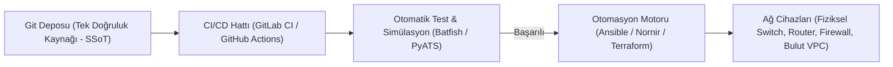

# Kod Olarak Altyapı (IaC) ve NetDevOps Felsefesi

Geleneksel ağ mühendisliğinde bir switch veya router yapılandırmak için mühendis terminali açar, cihaza SSH ile bağlanır ve konsola tek tek `configure terminal` komutları girerdi ("Klavye ve Konsol Çağı").

Ancak yüzlerce şubesi, binlerce switch'i ve bulut sanal ağları olan modern kurumsal ortamlarda bu yaklaşım sürdürülemezdir. Ağ kesintilerinin ve güvenlik açıklarının %80'inden fazlası insan kaynaklı yazım hatalarından (Human Error) ve cihazlar arasındaki yapılandırma kaymalarından (**Configuration Drift**) kaynaklanır.

**NetDevOps**, yazılım geliştirme dünyasındaki DevOps prensiplerini (Sürüm Denetimi, CI/CD, Otomatik Testler) ağ mühendisliğine uyarlayan modern operasyonel kültürdür.



---

## §10.1.1. Kod Olarak Altyapı (Infrastructure as Code - IaC) İlkeleri

Ağ altyapısının manuel komutlarla değil; sürüm kontrolü altında tutulan, incelenebilir (Code Review) ve tekrarlanabilir kod dosyaları (HCL, YAML, Jinja2 şablonları) olarak tanımlanmasıdır.

### Temel IaC Prensipleri:
1. **Tek Doğruluk Kaynağı (Single Source of Truth - SSoT):** Ağın gerçek durumu bir mühendisin aklında veya Excel tablolarında değil; Git deposunda ve IPAM/DCIM sistemlerinde (Örn: **NetBox**) kayıtlıdır. Cihazdaki konfigürasyon koddakinden farklıysa cihaz "hatalı" kabul edilir.
2. **Değişmezlik ve Kendini Tekrarlayabilirlik (Idempotency):** Bir otomasyon betiği 1 kez de çalıştırılsa, 100 kez de çalıştırılsa sistem daima aynı kararlı duruma ulaşır; sistemde gereksiz değişiklik veya kesinti yaratmaz.
3. **Konfigürasyon Kayması (Configuration Drift) Engelleme:** Bir mühendisin konsoldan manuel yaptığı geçici bir ayar, bir sonraki otomatik dağıtımda ezilerek kod tabanındaki standart haline geri döndürülür.

---

## §10.1.2. Terraform ile Bildirimsel Ağ Sağlama: AWS VPC Örneği

Modern hibrit ve bulut ağlarında ağ topolojisini kodla ayağa kaldırmanın en yaygın yolu HashiCorp **Terraform** kullanmaktır. Aşağıda güvenli bir kurumsal sanal özel ağ (VPC) tanımlayan örnek bir Terraform konfigürasyonu yer almaktadır:

```hcl
# main.tf - AWS Üzerinde Güvenli Kurumsal VPC Tanımlama
terraform {
  required_providers {
    aws = {
      source  = "hashicorp/aws"
      version = "~> 5.0"
    }
  }
}

provider "aws" {
  region = var.aws_region
}

# 1. Sanal Özel Ağ (VPC) Kaynağı
resource "aws_vpc" "corporate_vpc" {
  cidr_block           = var.vpc_cidr
  enable_dns_support   = true
  enable_dns_hostnames = true

  tags = {
    Name        = "Corporate-Production-VPC"
    Environment = "Production"
    ManagedBy   = "NetDevOps-Terraform"
  }
}

# 2. Genel (Public) Alt Ağ - Web ve DMZ
resource "aws_subnet" "public_subnet" {
  vpc_id                  = aws_vpc.corporate_vpc.id
  cidr_block              = var.public_subnet_cidr
  map_public_ip_on_launch = true
  availability_zone       = "${var.aws_region}a"

  tags = {
    Name = "DMZ-Public-Subnet"
  }
}

# 3. Özel (Private) Alt Ağ - Uygulama ve Veritabanı
resource "aws_subnet" "private_subnet" {
  vpc_id            = aws_vpc.corporate_vpc.id
  cidr_block        = var.private_subnet_cidr
  availability_zone = "${var.aws_region}b"

  tags = {
    Name = "Internal-Private-Subnet"
  }
}

# 4. İnternet Ağ Geçidi (Internet Gateway)
resource "aws_internet_gateway" "igw" {
  vpc_id = aws_vpc.corporate_vpc.id

  tags = {
    Name = "Corporate-IGW"
  }
}
```

```hcl
# variables.tf - Değişken Tanımları
variable "aws_region" {
  default = "eu-central-1"
}

variable "vpc_cidr" {
  default = "10.0.0.0/16"
}

variable "public_subnet_cidr" {
  default = "10.0.1.0/24"
}

variable "private_subnet_cidr" {
  default = "10.0.2.0/24"
}
```

---

## §10.1.3. NetDevOps CI/CD İş Akışı

Geleneksel ağ değişiklikleri hafta sonu gece yarısı saatler süren stresli manuel operasyonlarken; NetDevOps hattında süreç şöyledir:

1. **Pull Request Açma:** Ağ mühendisi yeni bir VLAN eklemek istediğinde Git deposunda ilgili YAML/HCL dosyasını günceller ve bir Pull Request (PR) açar.
2. **Eş İncelemesi (Peer Review):** Kıdemli ağ mimarı yapılan değişikliği kod diff'i üzerinden inceler ve onaylar.
3. **Statik Analiz ve Simülasyon (Pre-deployment Validation):** CI hattı devreye girer. **Batfish** veya **Cisco pyATS** araçlarıyla sanal olarak konfigürasyon test edilir: *"Bu değişiklik yönlendirme döngüsü yaratıyor mu? Güvenlik duvarı kurallarında zafiyet açıyor mu?"*
4. **Otomatik Dağıtım:** Testler yeşil yandığında Ansible veya Terraform değişikliği ilgili 50 switch'e hatasız olarak saniyeler içinde dağıtır.
5. **Geri Alma (Rollback) Güvencesi:** Beklenmedik bir hata olursa tek bir `git revert` komutuyla tüm ağ 30 saniye önceki kusursuz durumuna geri döner.
