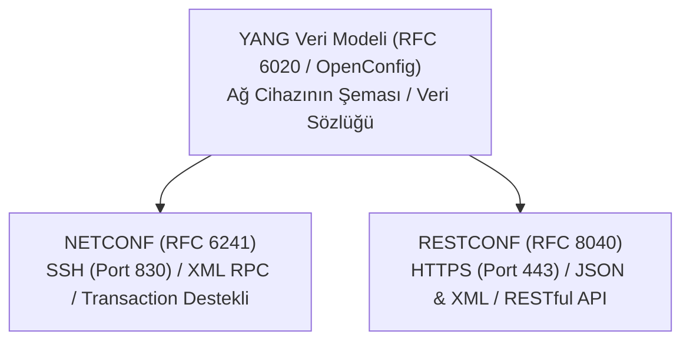

# Programlanabilir Ağ Protokolleri (YANG, NETCONF ve RESTCONF)

İlk nesil ağ otomasyonu, bir Python betiğinin cihaza SSH ile bağlanıp terminal komutları girmesi ve dönen düz metin çıktıyı düzenli ifadelerle (Regex) ayrıştırması (**CLI Screen Scraping**) temeline dayanıyordu.

Ancak üretici bir firmware güncellemesiyle çıktıdaki tek bir boşluk veya kelime sırasını değiştirdiğinde tüm otomasyon betikleri patlıyordu. Ayrıca SNMP protokolünün `Set` komutları işlem bütünlüğü (Transaction) ve geri alma (Rollback) desteğinden yoksundu.

IETF, ağ cihazlarını birer modern yazılım API'si gibi programlanabilir kılmak için üçlü bir standart mimari geliştirmiştir: **YANG**, **NETCONF** ve **RESTCONF**.



---

## §10.2.1. YANG Veri Modelleme Dili (RFC 6020 / RFC 7950)

YANG, ağ cihazlarının yapılandırma ve durum verilerini tanımlamak için kullanılan katı kurallı bir veri modelleme dilidir (XML Schema veya Protobuf benzeri).

- **Veri Tipleri:** IP adresleri, MAC adresleri, port numaraları ve durum sayaçları kesin tip tanımlarına (`container`, `leaf`, `leaf-list`, `list`) sahiptir.
- **OpenConfig:** Google ve büyük telekom operatörlerinin öncülüğünde geliştirilen, Cisco, Juniper ve Arista gibi farklı üreticilerin cihazlarını **aynı evrensel YANG modeliyle** yönetmeyi sağlayan üretici bağımsız (Vendor-Neutral) modeldir.

### Örnek YANG Şeması (Arayüz Tanımı):
```yang
module custom-interface {
  yang-version 1.1;
  namespace "urn:corp:params:xml:ns:yang:custom-interface";
  prefix cintf;

  container interfaces {
    list interface {
      key "name";
      leaf name {
        type string;
        description "Arayuz adi, ornegin GigabitEthernet0/1";
      }
      leaf enabled {
        type boolean;
        default true;
      }
      leaf ipv4-address {
        type string {
          pattern '(([0-9]|[1-9][0-9]|1[0-9][0-9]|2[0-4][0-9]|25[0-5])\.){3}'
                + '([0-9]|[1-9][0-9]|1[0-9][0-9]|2[0-4][0-9]|25[0-5])';
        }
      }
    }
  }
}
```

---

## §10.2.2. NETCONF Protokolü (RFC 6241) ve XML RPC

NETCONF, ağ cihazlarıyla güvenli SSH (Port 830) üzerinden yapılandırılmış XML mesajlarıyla (RPC - Remote Procedure Call) haberleşir:

### NETCONF'un Devrimsel Yetenekleri:
1. **İşlem Bütünlüğü (Atomic Transactions):** Tıpkı bir SQL veritabanı gibi çalışır. Bir konfigürasyon 50 satırdan oluşuyorsa; ya 50 satırın tamamı başarıyla uygulanır ya da tek bir satırda hata olursa tüm işlem iptal edilir (`rollback-on-error`). Cihaz asla yarı yapılandırılmış hatalı durumda kalmaz.
2. **Çoklu Veri Depoları (Datastores):**
   - `<running>`: Cihazda o an aktif çalışan yapılandırma.
   - `<candidate>`: Mühendisin değişiklik yaptığı taslak depo.
   - `<startup>`: Cihaz yeniden başladığında yüklenecek depo.
   Mühendis tüm değişiklikleri `<candidate>` üzerinde yapar; test ettikten sonra tek bir `<commit>` komutuyla `<running>` içine aktarır.
3. **Kilit Mekanizması (`<lock>`):** Bir otomasyon betiği cihazı yapılandırırken başka bir mühendisin aynı anda cihaza girip çakışan ayarlar yapmasını engeller.

### NETCONF XML RPC Mesaj Anatomisi:
```xml
<?xml version="1.0" encoding="UTF-8"?>
<rpc message-id="101" xmlns="urn:ietf:params:xml:ns:netconf:base:1.0">
  <edit-config>
    <target>
      <candidate/>
    </target>
    <default-operation>merge</default-operation>
    <config>
      <interfaces xmlns="urn:ietf:params:xml:ns:yang:ietf-interfaces">
        <interface>
          <name>GigabitEthernet0/0/2</name>
          <description>Uplink to Core SW</description>
          <enabled>true</enabled>
        </interface>
      </interfaces>
    </config>
  </edit-config>
</rpc>
```

Cihazın yanıtı:
```xml
<?xml version="1.0" encoding="UTF-8"?>
<rpc-reply message-id="101" xmlns="urn:ietf:params:xml:ns:netconf:base:1.0">
  <ok/>
</rpc-reply>
```

---

## §10.2.3. Python ncclient ile NETCONF Otomasyonu

Python'ın `ncclient` kütüphanesi, cihazlara SSH Port 830 üzerinden bağlanarak doğrudan NETCONF oturumu açar:

```python
from ncclient import manager
import xml.dom.minidom

# Cisco IOS-XE cihazına NETCONF oturumu açma
device = {
    'host': '192.168.1.1',
    'port': 830,
    'username': 'admin',
    'password': 'SecurePassword123!',
    'hostkey_verify': False,
    'device_params': {'name': 'csr'}
}

with manager.connect(**device) as m:
    # 1. Arayüz konfigürasyonunu XML filtresiyle çekme (Get Config)
    netconf_filter = """
    <filter xmlns="urn:ietf:params:xml:ns:netconf:base:1.0">
      <interfaces xmlns="urn:ietf:params:xml:ns:yang:ietf-interfaces"/>
    </filter>
    """
    response = m.get_config(source='running', filter=netconf_filter)
    
    # XML çıktısını güzel formatlama
    xml_pretty = xml.dom.minidom.parseString(response.xml).toprettyxml()
    print("--- Running Interface Configuration ---")
    print(xml_pretty[:500])  # İlk 500 karakter
```

---

## §10.2.4. RESTCONF Protokolü (RFC 8040)

RESTCONF, NETCONF'un gücünü web dünyasının popüler **RESTful API** standartlarıyla birleştirir:
- Standart **HTTPS (Port 443)** üzerinden çalışır.
- Veri yükü olarak **JSON** veya **XML** destekler.
- Standart HTTP fiilleri kullanılır (`GET`, `POST`, `PUT`, `PATCH`, `DELETE`).

### cURL ile RESTCONF Sorgusu (JSON):
```bash
# Cisco IOS-XE cihazından arayüz listesini JSON olarak çekme
curl -k -u "admin:SecurePassword123!" \
     -H "Accept: application/yang-data+json" \
     https://192.168.1.1/restconf/data/ietf-interfaces:interfaces
```

### Python requests ile RESTCONF Arayüz Güncelleme (PATCH):
```python
import requests
import json

url = "https://192.168.1.1/restconf/data/ietf-interfaces:interfaces/interface=GigabitEthernet0%2F0%2F1"
headers = {
    "Accept": "application/yang-data+json",
    "Content-Type": "application/yang-data+json"
}

payload = {
    "ietf-interfaces:interface": {
        "name": "GigabitEthernet0/0/1",
        "description": "Configured via RESTCONF API",
        "enabled": True
    }
}

response = requests.patch(url, auth=('admin', 'SecurePassword123!'),
                          headers=headers, data=json.dumps(payload), verify=False)

print(f"Status: {response.status_code}") # 204 No Content başarı demektir
```

---

## §10.2.5. Protokollerin Karşılaştırmalı Özeti

| Kriter | CLI (SSH) | SNMP (v2/v3) | NETCONF | RESTCONF |
| :--- | :--- | :--- | :--- | :--- |
| **Veri Biçimi** | Yapılandırılmamış Metin | OID / MIB Ağacı | **XML** | **JSON / XML** |
| **Taşıma** | SSH (Port 22) | UDP (Port 161) | **SSH (Port 830)** | **HTTPS (Port 443)** |
| **Veri Modeli** | Yok | MIB | **YANG** | **YANG** |
| **İşlem Güvencesi (Transaction)** | Yok | Yok | **Var (Candidate & Commit)** | Kısmi |
| **Hata Yönetimi** | Regex ile metin tarama | Sayısal hata kodu | **Yapılandırılmış `<rpc-error>`** | **HTTP Durum Kodları (4xx, 5xx)** |

---

## §10.2.6. Çapraz Referans ve Entegrasyon
- NetDevOps ve Kod Olarak Altyapı prensipleri için [§10.1 Kod Olarak Altyapı (IaC) ve NetDevOps](./01-kod-olarak-altyapi-iac-ve-netdevops.md) bölümüne bakın.
- Python ve Ansible ile somut ağ otomasyonu için [§10.3 Python ve Ansible ile Ağ Otomasyonu](./03-python-ve-ansible-ile-ag-otomasyonu.md) bölümünü inceleyin.
- Siber Güvenlik Operasyonları Kitabı'nda DevSecOps ve CI/CD güvenliği için [SDLC ve DevSecOps](../../../siber-guvenlik-operasyonlari/10-uygulama-guvenligi/01-sdlc-ve-devsecops.md) bölümüne bakın.
