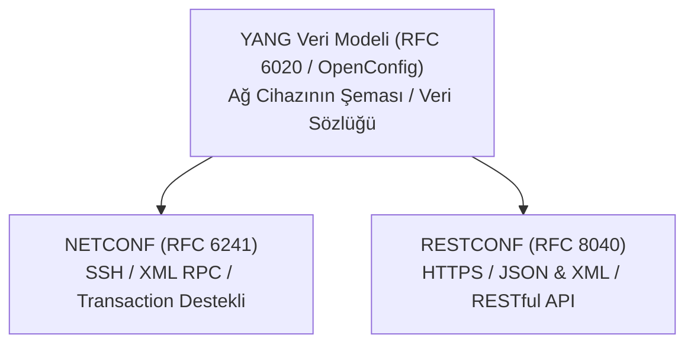

# Programlanabilir Ağ Protokolleri (YANG, NETCONF ve RESTCONF)

İlk nesil ağ otomasyonu, bir Python betiğinin cihaza SSH ile bağlanıp terminal komutları girmesi ve dönen düz metin çıktıyı düzenli ifadelerle (Regex) ayrıştırması (**CLI Screen Scraping**) temeline dayanıyordu.

Ancak üretici bir firmware güncellemesiyle çıktıdaki tek bir boşluk veya kelime sırasını değiştirdiğinde tüm otomasyon betikleri patlıyordu. Ayrıca SNMP protokolünün `Set` komutları işlem bütünlüğü (Transaction) ve geri alma (Rollback) desteğinden yoksundu.

IETF, ağ cihazlarını birer modern yazılım API'si gibi programlanabilir kılmak için üçlü bir standart mimari geliştirmiştir: **YANG**, **NETCONF** ve **RESTCONF**.

---

## §10.2.1. YANG Veri Modelleme Dili (RFC 6020 / RFC 7950)

YANG, ağ cihazlarının yapılandırma ve durum verilerini tanımlamak için kullanılan katı kurallı bir veri modelleme dilidir (XML Schema veya Protobuf benzeri).

- **Veri Tipleri:** IP adresleri, MAC adresleri, port numaraları ve durum sayaçları kesin tip tanımlarına (leaf, container, list) sahiptir.
- **OpenConfig:** Google ve büyük telekom operatörlerinin öncülüğünde geliştirilen, Cisco, Juniper ve Arista gibi farklı üreticilerin cihazlarını **aynı evrensel YANG modeliyle** yönetmeyi sağlayan üretici bağımsız (Vendor-Neutral) modeldir.

---

## §10.2.2. NETCONF Protokolü (RFC 6241)

NETCONF, ağ cihazlarıyla güvenli SSH (Port 830) veya TLS üzerinden yapılandırılmış XML mesajlarıyla (RPC - Remote Procedure Call) haberleşir:

### NETCONF'un Devrimsel Yetenekleri:
1. **İşlem Bütünlüğü (Atomic Transactions):** Tıpkı bir SQL veritabanı gibi çalışır. Bir konfigürasyon 50 satırdan oluşuyorsa; ya 50 satırın tamamı başarıyla uygulanır ya da tek bir satırda hata olursa tüm işlem iptal edilir (`rollback-on-error`). Cihaz asla yarı yapılandırılmış hatalı durumda kalmaz.
2. **Çoklu Veri Depoları (Datastores):**
   - `<running>`: Cihazda o an aktif çalışan yapılandırma.
   - `<candidate>`: Mühendisin değişiklik yaptığı taslak depo.
   - `<startup>`: Cihaz yeniden başladığında yüklenecek depo.
   Mühendis tüm değişiklikleri `<candidate>` üzerinde yapar; test ettikten sonra tek bir `<commit>` komutuyla `<running>` içine aktarır.
3. **Kilit Mekanizması (`<lock>`):** Bir otomasyon betiği cihazı yapılandırırken başka bir mühendisin aynı anda cihaza girip çakışan ayarlar yapmasını engeller.

---

## §10.2.3. RESTCONF Protokolü (RFC 8040)

NETCONF'un gücünü web dünyasının popüler **RESTful API** standartlarıyla birleştiren protokoldür:
- Standart **HTTPS (Port 443)** üzerinden çalışır.
- Veri yükü olarak **JSON** veya **XML** kullanır.
- Standart HTTP fiilleriyle cihaz yönetilir:
  - `GET /restconf/data/ietf-interfaces:interfaces`: Arayüzleri listele
  - `POST /restconf/data/...`: Yeni arayüz veya VLAN oluştur
  - `PATCH /restconf/data/...`: Belirli bir IP adresini güncelle
  - `DELETE /restconf/data/...`: Bir kuralı sil

---

## §10.2.4. Protokollerin Karşılaştırmalı Özeti

| Kriter | CLI (SSH) | SNMP (v2/v3) | NETCONF | RESTCONF |
| :--- | :--- | :--- | :--- | :--- |
| **Veri Biçimi** | Yapılandırılmamış Metin | OID / MIB Ağacı | **XML** | **JSON / XML** |
| **Taşıma** | SSH (Port 22) | UDP (Port 161) | **SSH (Port 830)** | **HTTPS (Port 443)** |
| **Veri Modeli** | Yok | MIB | **YANG** | **YANG** |
| **İşlem Güvencesi (Transaction)** | Yok | Yok | **Var (Candidate & Commit)** | Kısmi |
| **Yapılandırma Yeteneği** | Yüksek (Kırılgan) | Zayıf | **Mükemmel** | **Mükemmel** |
