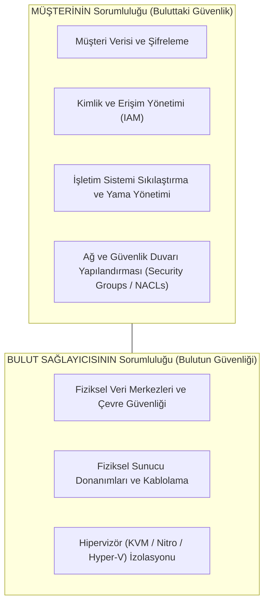
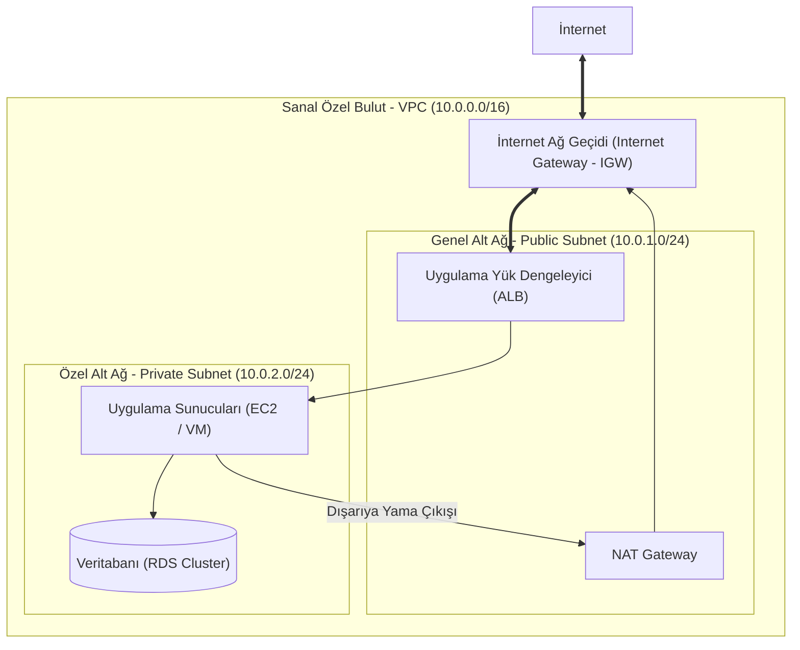

# Bulut Ağ Mimarisi, Sanallaştırma (vSwitch) ve Sanal Özel Bulut (VPC)

Geleneksel veri merkezlerinde sunucular fiziksel kablolarla fiziksel switch portlarına bağlanırken; bulut bilişimde (AWS, Azure, Google Cloud) tüm ağ altyapısı yazılımla tanımlanmış sanal katmanlar (**Software-Defined Networking - SDN**) üzerinde çalışır.

Bir bulut mimarının fiziksel bir kabloya dokunmasına gerek yoktur; ancak sanal yönlendiricilerin, sanal anahtarların (vSwitch) ve alt ağların izolasyon kurallarını bilmek bulut ortamındaki verilerin güvenliği için hayati önem taşır.

---

## §11.1.1. Paylaşılan Sorumluluk Modeli (Shared Responsibility Model)

Bulut güvenliğinde en büyük yanılgı, tüm güvenliğin bulut sağlayıcısı (AWS/Azure) tarafından sağlandığı varsayımıdır.

:::caution
Bulut sağlayıcısı fiziksel altyapıyı korurken; sanal ağınızın mimarisinden, portların açık kalmasından ve firewall kurallarından **tamamen kurumun kendisi sorumludur**.
:::
---

## §11.1.2. Sanallaştırma ve Sanal Anahtar (vSwitch) Mekaniği

Bir fiziksel sunucu (Hipervizör) üzerinde çalışan onlarca sanal makinenin (VM) haberleşmesi yazılımsal **vSwitch (Virtual Switch)** yapılarıyla sağlanır (VMware Distributed Switch, Linux Open vSwitch - OVS).

- **Sanal Ağ Kartı (vNIC):** Sanal makineye atanan sanal ağ arayüzüdür.
- **vSwitch İzolasyonu:** Sanal makineler arasındaki trafik fiziksel kabloya çıkmadan doğrudan hipervizörün RAM belleği üzerinden mikrosaniyeler içinde aktarılır.
- **Güvenlik Riskleri:** Fiziksel bir IDS/IPS cihazı iki sanal makine arasındaki bu Doğu-Batı trafiğini göremez. Bu kör noktayı aşmak için sanal hipervizör seviyesinde çalışan güvenlik eklentileri veya mikro-segmentasyon (VMware NSX) kullanılmalıdır.

---

## §11.1.3. Sanal Özel Bulut (VPC / VNet) Mimarisi

Bir bulut hesabında oluşturulan, tamamen izole edilmiş mantıksal veri merkezine **VPC (Virtual Private Cloud - AWS/GCP)** veya **VNet (Virtual Network - Azure)** denir.

### Kritik VPC Bileşenleri:
1. **Public Subnet (Genel Alt Ağ):** Yönlendirme tablosunda (Route Table) `0.0.0.0/0` hedefi doğrudan **Internet Gateway'e (IGW)** bağlı olan alt ağdır. Dış dünyadan doğrudan erişilebilen bileşenler (Yük dengeleyiciler, WAF, Bastion Host) bu alt ağda yer alır.
2. **Private Subnet (Özel Alt Ağ):** Doğrudan internete çıkışı ve dışarıdan girişi olmayan alt ağdır. Kritik kurumsal uygulamalar ve veritabanları burada tutulur.
3. **NAT Gateway:** Private alt ağdaki bir sunucunun internetten gelen saldırılara açık olmadan, yalnızca kendi işletim sistemi güncellemelerini indirebilmesi için dışarıya tek yönlü çıkış sağlayan yönetilen ağ geçididir.
