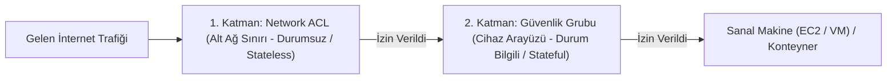

# Bulut Trafik Filtreleme: Güvenlik Grupları (SG) ve Network ACL'ler

Bulut ortamlarında ağ trafiğinin güvenliği, geleneksel fiziksel kablo seviyesinde değil; hipervizör katmanında çalışan mikro-segmentasyon kurallarıyla sağlanır.

AWS, Azure ve Google Cloud gibi platformlar, savunma derinliği (Defense in Depth) sağlamak için iki bağımsız sanal filtreleme katmanı sunar: **Güvenlik Grupları (Security Groups - SG)** ve **Ağ Erişim Denetim Listeleri (Network ACLs - NACL)**.




---

## §11.2.1. Güvenlik Grupları (Security Groups)

Güvenlik Grubu, doğrudan sanal makinenin sanal ağ arayüzüne (**ENI - Elastic Network Interface**) bağlanan sanal bir durum bilgili (stateful) güvenlik duvarıdır.

### Kritik SG Özellikleri:
1. **Durum Bilgilidir (Stateful):** Gelen bir isteğe (Inbound) izin verilmişse, o bağlantının yanıt trafiğine (Outbound) dönüş kurallarına bakılmaksızın **otomatik olarak izin verilir**.
2. **Yalnızca İZİN (Allow) Kuralları:** Standart bir Güvenlik Grubunda açıkça "Engelle (Deny)" kuralı yazılamaz. Listede açıkça izin verilmeyen her trafik varsayılan olarak engellenir (**Implicit Deny**).
3. **Güvenlik Grubunu Kaynak Olarak Gösterme (SG Chaining):** Kural yazarken kaynak olarak sabit bir IP adresi yerine başka bir Güvenlik Grubunun ID'si verilebilir. Örneğin:
   - Veritabanı SG Kuralı: *"Yalnızca `sg-app-servers` grubundaki makinelerden gelen TCP 5432 trafiğine izin ver."*
   - Bu sayede yeni bir uygulama sunucusu eklendiğinde IP adresini kurala tek tek girmeye gerek kalmaz; sunucu o gruba dahil edildiği an otomatik yetkilendirilir.

---

## §11.2.2. Ağ Erişim Denetim Listeleri (Network ACLs - NACL)

Network ACL, tüm bir alt ağın (Subnet) sınırında çalışan ve o alt ağa giren-çıkan tüm trafiği denetleyen ilk savunma hattıdır.

### Kritik NACL Özellikleri:
1. **Durumsuzdur (Stateless):** Gelen trafik ile giden trafik tamamen bağımsızdır. Inbound kuralında HTTP portuna (TCP 80) izin verseniz bile, giden (Outbound) kuralında istemcinin geçici portlarına (**Ephemeral Ports: 1024 - 65535**) açıkça izin vermezseniz bağlantı kurulamaz!
2. **Kural Numaralandırması:** Kurallar küçükten büyüğe (100, 200, 300) doğru sırayla işlenir. İlk eşleşen kural uygulanır.
3. **Açıkça ENGELLE (Explicit Deny) Desteği:** Belirli bir şüpheli IP veya ülkeden gelen saldırıları anında alt ağ sınırında düşürmek için `Deny` kuralları tanımlanabilir.

---

## §11.2.3. Bulut Platformları Filtreleme Matrisi: AWS vs. Azure vs. GCP

| Karşılaştırma Kriteri | AWS (Security Groups & NACLs) | Microsoft Azure (Network Security Groups - NSG) | Google Cloud Platform (VPC Firewall Rules) |
| :--- | :--- | :--- | :--- |
| **Kapsam** | ENI (SG) ve Subnet (NACL) | NIC veya Subnet seviyesi | Tüm VPC genelinde veya Etiket (Tag) bazlı |
| **Durum Takibi** | SG Stateful, NACL Stateless | **Stateful** (Tüm NSG'ler durum takipli) | **Stateful** |
| **Deny Desteği** | Yalnızca NACL seviyesinde | **Var (Priority bazlı Allow / Deny)** | **Var (Priority bazlı Allow / Deny)** |
| **Kural Önceliği** | NACL: 1-32766 arası sıra | **100 - 4096 arası öncelik değeri** | **0 - 65535 arası öncelik değeri** |

---

## §11.2.4. Terraform ile 3 Katmanlı (3-Tier) Güvenlik Grubu Mimarisi

Aşağıdaki Terraform (HCL) kodu; Web, Uygulama ve Veritabanı katmanlarını SG Chaining yöntemiyle izole eden üretim standardında bir mikro-segmentasyon örneğidir:

```hcl
# 1. Web / Load Balancer Katmanı (Yalnızca Dış Dünyadan 443 Kabul Eder)
resource "aws_security_group" "alb_sg" {
  name        = "alb-security-group"
  description = "Public HTTPS trafigini kabul eden ALB SG"
  vpc_id      = var.vpc_id

  ingress {
    description = "Public HTTPS"
    from_port   = 443
    to_port     = 443
    protocol    = "tcp"
    cidr_blocks = ["0.0.0.0/0"]
  }

  egress {
    description = "ALB'den App sunucularina iletim"
    from_port   = 8080
    to_port     = 8080
    protocol    = "tcp"
    cidr_blocks = [var.app_subnet_cidr]
  }
}

# 2. Uygulama Katmanı (YALNIZCA ALB'den Trafik Kabul Eder - SG Chaining)
resource "aws_security_group" "app_sg" {
  name        = "app-security-group"
  description = "Yalnizca ALB SG uzerinden 8080 portunu kabul eder"
  vpc_id      = var.vpc_id

  ingress {
    description     = "Trafik yalnizca ALB SG kimliginden gelebilir"
    from_port       = 8080
    to_port         = 8080
    protocol        = "tcp"
    security_groups = [aws_security_group.alb_sg.id]
  }

  egress {
    from_port   = 0
    to_port     = 0
    protocol    = "-1"
    cidr_blocks = ["0.0.0.0/0"]
  }
}

# 3. Veritabanı Katmanı (YALNIZCA App SG'den PostgreSQL 5432 Kabul Eder)
resource "aws_security_group" "db_sg" {
  name        = "db-security-group"
  description = "Tamamen izole DB - Yalnizca App SG'den 5432 kabul eder"
  vpc_id      = var.vpc_id

  ingress {
    description     = "PostgreSQL erisimi yalnizca uygulama sunucularindan"
    from_port       = 5432
    to_port         = 5432
    protocol        = "tcp"
    security_groups = [aws_security_group.app_sg.id]
  }

  egress {
    description = "DB outbound erisimi kapali (Zero Egress)"
    from_port   = 0
    to_port     = 0
    protocol    = "-1"
    cidr_blocks = ["127.0.0.1/32"]
  }
}
```

---

## §11.2.5. AWS VPC Flow Logs ile Tehdit Avcılığı ve SQL Analizi

VPC Flow Logs, Güvenlik Grubu ve NACL katmanlarında izin verilen (`ACCEPT`) ve engellenen (`REJECT`) tüm IP trafiğinin kaydını tutar.

### Athena ile Engellenen Saldırıları Sorgulama (SQL):
Amazon Athena üzerinden S3'teki flow loglarında en çok reddedilen bağlantıları bulmak için:

```sql
-- Son 24 saatte en cok REJECT alan hedef portlar (Port taramasi analizi)
SELECT 
    dstport,
    protocol,
    count(*) as reject_count
FROM vpc_flow_logs
WHERE action = 'REJECT'
GROUP BY dstport, protocol
ORDER BY reject_count DESC
LIMIT 10;

-- Veritabani subnet'ine yetkisiz erismeye calisan supheli ic IP'ler
SELECT 
    srcaddr, 
    dstaddr, 
    dstport, 
    action, 
    count(*) as attempts
FROM vpc_flow_logs
WHERE dstport = 5432 AND action = 'REJECT'
GROUP BY srcaddr, dstaddr, dstport, action
ORDER BY attempts DESC;
```

---

## §11.2.6. Konteyner ve Kubernetes CNI Ağ Politikaları (NetworkPolicies)

Bulut-yerlisi ortamlarda sanal makinelerin içinde çalışan Pod'lar arasında mikro-segmentasyon sağlamak için **Kubernetes NetworkPolicy** kullanılır (Cilium veya Calico CNI eBPF altyapısıyla çalışır):

```yaml
# Pod seviyesinde mikro-segmentasyon: Yalnizca frontend pod'larindan backend'e erisim
apiVersion: networking.k8s.io/v1
kind: NetworkPolicy
metadata:
  name: backend-isolation-policy
  namespace: production
spec:
  podSelector:
    matchLabels:
      app: backend-api
  policyTypes:
  - Ingress
  ingress:
  - from:
    - podSelector:
        matchLabels:
          app: frontend-web
    ports:
    - protocol: TCP
      port: 8080
```

---

## §11.2.7. Çapraz Referans ve Entegrasyon
- Bulut ağ mimarisi ve VPC topolojisi için [§11.1 Bulut Ağ Mimarisi: VPC ve Sanallaştırma](./01-bulut-ag-mimarisi-vpc-ve-sanallastirma.md) bölümüne bakın.
- Hibrit bulut bağlantıları ve CSPM için [§11.3 Hibrit Ağlar, Transit Gateway ve CSPM](./03-hibrit-baglantilar-ve-durus-yonetimi-cspm.md) bölümünü inceleyin.
- Siber Güvenlik Operasyonları Kitabı'nda konteyner ve bulut güvenliği için [Konteyner ve IaC Güvenliği](../../../siber-guvenlik-operasyonlari/11-bulut-guvenligi/02-konteyner-ve-iac-guvenligi.md) bölümüne bakın.
