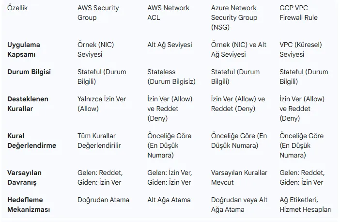
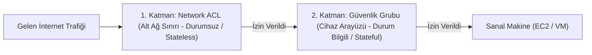

# Bulut Trafik Filtreleme: Güvenlik Grupları (SG) ve Network ACL'ler

Bulut ortamlarında ağ trafiğinin güvenliği, geleneksel fiziksel kablo seviyesinde değil; hipervizör katmanında çalışan mikro-segmentasyon kurallarıyla sağlanır.

AWS, Azure ve Google Cloud gibi platformlar, savunma derinliği (Defense in Depth) sağlamak için iki bağımsız sanal filtreleme katmanı sunar: **Güvenlik Grupları (Security Groups - SG)** ve **Ağ Erişim Denetim Listeleri (Network ACLs - NACL)**.

---

## §11.2.1. Güvenlik Grupları (Security Groups)

Güvenlik Grubu, doğrudan sanal makinenin sanal ağ arayüzüne (**ENI - Elastic Network Interface**) bağlanan sanal bir güvenlik duvarıdır.

### Kritik SG Özellikleri:
1. **Durum Bilgilidir (Stateful):** Gelen bir isteğe (Inbound) izin verilmişse, o bağlantının yanıt trafiğine (Outbound) dönüş kurallarına bakılmaksızın **otomatik olarak izin verilir**.
2. **Yalnızca İZİN (Allow) Kuralları:** Bir Güvenlik Grubunda açıkça "Engelle (Deny)" kuralı yazılamaz. Listede açıkça izin verilmeyen her trafik varsayılan olarak engellenir (**Implicit Deny**).
3. **Güvenlik Grubunu Kaynak Olarak Gösterme (SG Chaining):** Kural yazarken kaynak olarak sabit bir IP adresi yerine başka bir Güvenlik Grubunun ID'si verilebilir. Örneğin:
   - Veritabanı SG Kuralı: *"Yalnızca `sg-app-servers` grubundaki makinelerden gelen TCP 5432 trafiğine izin ver."*
   - Bu sayede yeni bir uygulama sunucusu eklendiğinde IP adresini kurala tek tek girmeye gerek kalmaz; sunucu o gruba dahil edildiği an otomatik yetkilendirilir.

---

## §11.2.2. Ağ Erişim Denetim Listeleri (Network ACLs - NACL)

Network ACL, tüm bir alt ağın (Subnet) sınırında çalışan ve o alt ağa giren-çıkan tüm trafiği denetleyen ilk savunma hattıdır.

### Kritik NACL Özellikleri:
1. **Durumsuzdur (Stateless):** Gelen trafik ile giden trafik tamamen bağımsızdır. Inbound kuralında HTTP portuna (TCP 80) izin verseniz bile, giden (Outbound) kuralında istemcinin geçici portlarına (**Ephemeral Ports: 1024 - 65535**) açıkça izin vermezseniz bağlantı kurulamaz!
2. **Kural Numaralandırması:** Kurallar küçükten büyüğe (100, 200, 300) doğru sırayla işlenir. İlk eşleşen kural uygulanır.
3. **Açıkça ENGELLE (Explicit Deny) Desteği:** Belirli bir şüpheli IP veya ülkeden gelen saldırıları anında alt ağ sınırında düşürmek için `Deny` kuralları tanımlanabilir.

---

## §11.2.3. Bulut Platformları Filtreleme Matrisi: AWS vs. Azure vs. GCP

| Karşılaştırma Kriteri | AWS (Security Groups & NACLs) | Microsoft Azure (Network Security Groups - NSG) | Google Cloud Platform (VPC Firewall Rules) |
| :--- | :--- | :--- | :--- |
| **Kapsam** | ENI (SG) ve Subnet (NACL) | NIC veya Subnet seviyesi | Tüm VPC genelinde veya Etiket (Tag) bazlı |
| **Durum Takibi** | SG Stateful, NACL Stateless | **Stateful** (Tüm NSG'ler durum takipli) | **Stateful** |
| **Deny Desteği** | Yalnızca NACL seviyesinde | **Var (Priority bazlı Allow / Deny)** | **Var (Priority bazlı Allow / Deny)** |
| **Kural Önceliği** | NACL: 1-32766 arası sıra | **100 - 4096 arası öncelik değeri** | **0 - 65535 arası öncelik değeri** |
