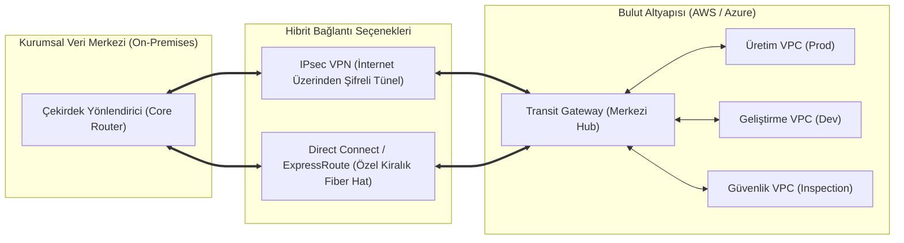
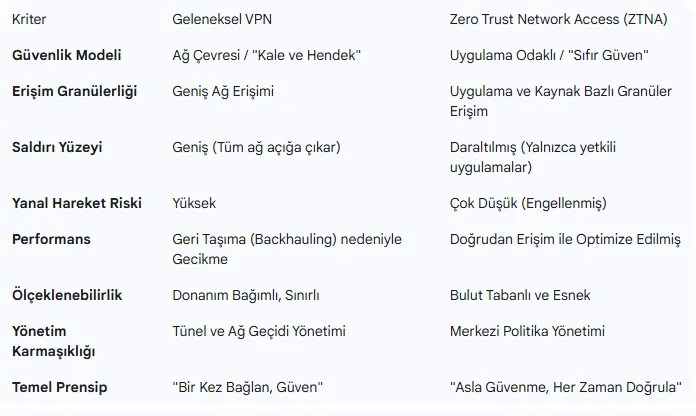

# Hibrit Bulut Ağları (DirectConnect, Transit Gateway) ve CSPM

Çoğu büyük ölçekli kurum altyapısını bir gecede tamamen buluta taşıyamaz; kritik bankacılık/ERP veritabanları şirket içi (on-premises) veri merkezinde kalırken, elastik web ve yapay zeka iş yükleri bulutta (AWS/Azure) konumlandırılır.

Bu iki farklı dünyanın tek bir kurumsal ağ gibi güvenli, kesintisiz ve yüksek performansla konuşmasını sağlayan mimariye **Hibrit Bulut Ağ Mimarisi (Hybrid Cloud Architecture)** denir.

---

## §11.3.1. Hibrit Bağlantı Teknolojileri

### 1. Siteden Siteye IPsec VPN
- Şirket veri merkezindeki güvenlik duvarı ile bulutun Sanal Özel Ağ Geçidi (VGW) arasında genel internet üzerinden IPsec tüneli açılır.
- **Avantajı:** Düşük maliyetlidir ve dakikalar içinde devreye alınabilir.
- **Dezavantajı:** İnternet dalgalanmalarına açıktır; bant genişliği ve gecikme (latency) garantisi yoktur.

### 2. Doğrudan Kiralık Hatlar (AWS Direct Connect / Azure ExpressRoute)
- Şirket veri merkezi ile bulut sağlayıcısının veri merkezi arasına telekom operatörü üzerinden çekilen **özel fiziksel fiber bağlantıdır**.
- Trafik genel internete **asla çıkmaz**.
- Sabit düşük gecikme (1-2 ms), yüksek bant genişliği (1 Gbps - 100 Gbps) ve kurumsal SLA sunar.

### 3. Transit Gateway Mimarisi (Hub-and-Spoke)
Onlarca farklı VPC'nin ve şirket merkezinin birbirine doğrudan (VPC Peering ile) bağlanması bir karmaşaya ($N(N-1)/2$ bağlantı) yol açar.
- **Transit Gateway (TGW)**, buluttaki merkezi bir bulut yönlendiricisi olarak görev yapar. Tüm VPC'ler ve veri merkezi tünelleri TGW'ye bağlanır; tüm yönlendirme ve güvenlik politikaları tek bir noktadan yönetilir.

---

## §11.3.2. Uzaktan Erişim Dönüşümü: Geleneksel VPN vs. ZTNA

| Güvenlik Kriteri | Geleneksel Kurumsal VPN | Sıfır Güven Ağ Erişimi (ZTNA) |
| :--- | :--- | :--- |
| **Güven Çevresi** | Ağ Seviyesi (Kullanıcı IP ağına girer) | **Uygulama Seviyesi (Yalnızca izinli L7 servise)** |
| **Yanal Hareket (Lateral Movement)** | **Yüksek Risk** (Ağ içi port taraması yapabilir) | **Sıfır Risk** (Diğer tüm ağ kullanıcıya görünmezdir) |
| **Cihaz Sağlığı (Device Posture)** | Genellikle sorgulanmaz veya yüzeyseldir | **Sürekli Doğrulama** (EDR, disk şifreleme denetimi) |
| **Kullanıcı Deneyimi** | Yavaş, ağır istemciler ve dar boğazlar | **Doğrudan Bulut Kenarı (Edge)** üzerinden hızlı |

---

## §11.3.3. Bulut Güvenlik Duruşu Yönetimi (CSPM)

Gartner raporlarına göre bulut güvenlik ihlallerinin %95'i bulut sağlayıcısının açığından değil, **müşterinin yaptığı yanlış yapılandırmalardan (Misconfigurations)** kaynaklanmaktadır.

### En Yaygın Kritik Bulut Yanlış Yapılandırmaları:
1. **İnternete Açık Yönetim Portları:** Bir mühendisin hızlıca bağlanmak için bir EC2 sanal makinesinin Güvenlik Grubunda SSH (22) veya RDP (3389) portunu tüm dünyaya (`0.0.0.0/0`) açması.
2. **Halka Açık Depolama Alanları (Public S3 / Blob Buckets):** Şirket içi hassas yedeklerin veya müşteri kimlik belgelerinin yanlışlıkla herkese açık (public) bırakılması.
3. **MFA Olmayan Root / Global Admin Hesapları:** Bulut hesaplarının ana yetkili yöneticilerinde çok faktörlü doğrulamanın aktif edilmemesi.

### CSPM Araçlarının Rolü (Wiz, Prisma Cloud, AWS Security Hub):
CSPM platformları, bulut API'larını 7/24 tarayarak altyapıyı uluslararası standartlarla (**CIS Benchmarks, NIST SP 800-53, ISO 27001**) karşılaştırır:
- Açıkta kalan bir port veya şifresiz bir veritabanı tespit edildiğinde saniyeler içinde SOC ekibine alarm üretir veya otomatik iyileştirme (Auto-Remediation) ile kuralı kendiliğinden kapatır.
