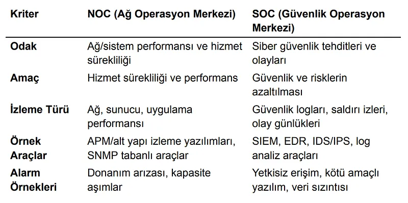
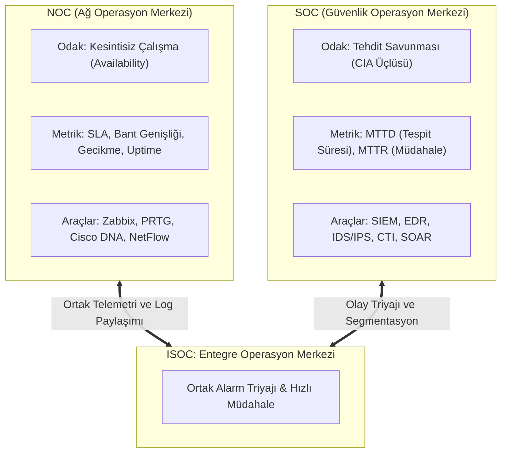
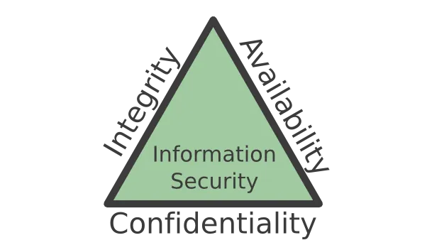
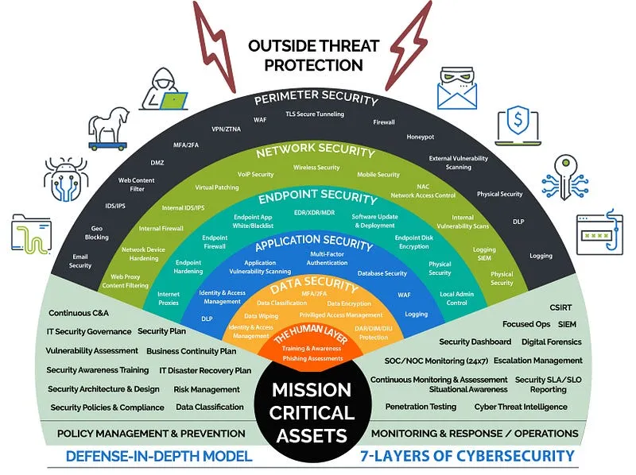
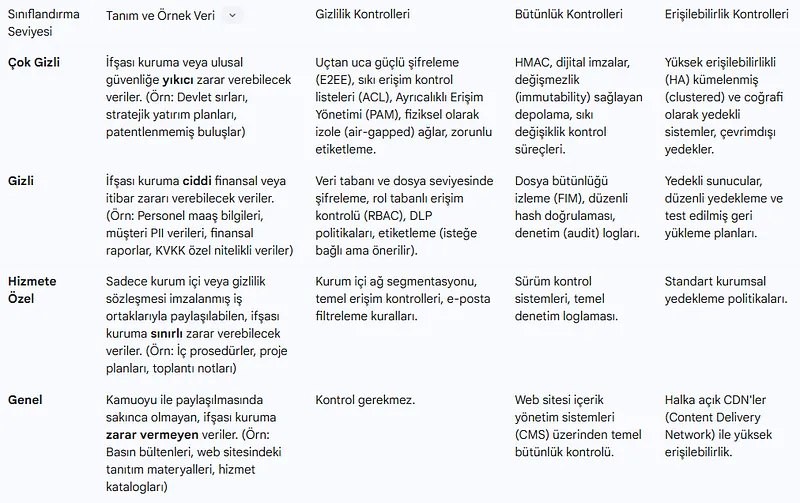

# SOC ve NOC Sinerjisi: Entegre İzleme ve Müdahale (ISOC)

Büyük kurumlarda bilgi teknolojileri altyapısı iki temel operasyonel merkez tarafından izlenir: **Ağ Operasyon Merkezi (NOC - Network Operations Center)** ve **Güvenlik Operasyon Merkezi (SOC - Security Operations Center)**.

Tarihsel olarak bu iki birim birbirinden tamamen izole silolar halinde çalışmıştır. Ancak modern siber saldırılarda bir ağ kesintisi ile bir siber saldırı iç içe geçer. Ağ ve güvenliğin ayrılmaz bir bütün haline geldiği bu çağda, iki merkezi tek bir çatı altında birleştiren **ISOC (Integrated Security and Network Operations Center)** mimarisi zorunlu hale gelmiştir.

---

## §12.1.1. Bilgi Güvenliğinin Temel Felsefesi: CIA Üçgeni

Güvenlik operasyonlarının tüm kararları üç temel niteliğin dengesine dayanır:
1. **Gizlilik (Confidentiality):** Bilginin yalnızca yetkili kişilerce erişilebilir olması (Şifreleme, erişim kontrolü).
2. **Bütünlük (Integrity):** Bilginin yetkisiz biçimde değiştirilmesinin veya tahrif edilmesinin engellenmesi (Kriptografik özetler, imzalama).
3. **Erişilebilirlik (Availability):** Bilginin ve ağ sistemlerinin ihtiyaç duyulduğu her an meşru kullanıcılara açık olması (DDoS koruması, yedeklilik).

---

## §12.1.2. Katmanlı Savunma: Defense in Depth Stratejisi

Saldırganın tek bir güvenlik mekanizmasını (örneğin güvenlik duvarını) aşmasının tüm kurumu ele geçirmesine izin verilemez. Savunma çok katmanlı kurulmalıdır:
- **Fiziksel Güvenlik:** Kilitli sunucu kabinleri, biyometrik geçişler, kamera denetimi.
- **Ağ Güvenliği Çevresi:** Güvenlik duvarları, DMZ segmentasyonu, VPN, DDoS koruması.
- **İç Ağ Güvenliği:** 802.1X, VLAN segmentasyonu, DHCP Snooping, Dynamic ARP Inspection.
- **Sunucu & Uç Nokta Güvenliği:** EDR, Antivirüs, HIDS (Wazuh), Yama Yönetimi.
- **Uygulama & Veri Güvenliği:** WAF, Veritabanı şifreleme, DLP, IAM/MFA.

---

## §12.1.3. NOC ve SOC Arasındaki Felsefi ve Operasyonel Farklar

| Kriter | NOC (Ağ Operasyon Merkezi) | SOC (Güvenlik Operasyon Merkezi) |
| :--- | :--- | :--- |
| **Temel Görev** | Ağın performansını ve kesintisiz çalışmasını sağlamak. | Kurumsal varlıkları siber tehdit ve ihlallere karşı korumak. |
| **Öncelik** | **Erişilebilirlik (Availability)** ve Hız. | **Gizlilik (Confidentiality)** ve Bütünlük (Integrity). |
| **Soru Kalıbı** | *"Ağ ayakta mı, hatlarda tıkanıklık var mı?"* | *"Ağdaki bu trafik meşru mu, kim yetkisiz sızdı?"* |
| **Tipik Olay** | Bir fiber hattın kopması, switch güç kaynağı arızası. | Ransomware bulaşması, veri sızıntısı, brute-force saldırısı. |

---

## §12.1.4. ISOC (Entegre Merkez) Modelinin Faydaları

1. **Tek Telemetri Havuzu:** NetFlow akışları ve SNMP sayaçları hem NOC performans ekranlarına hem de SOC'un Davranışsal Ağ Tehdit Tespiti (NDR) sistemlerine aynı anda akar.
2. **Korele Olay Müdahalesi:** Bir switch portu `Port Security` veya `802.1X` ihlali nedeniyle kapandığında (`err-disable`), sistem hem NOC'a arıza bileti hem de SOC analistine potansiyel yetkisiz cihaz ihlali alarmı açar.
3. **Müdahale Hızı:** SOC bir IP adresinin izole edilmesini istediğinde, NOC ile saatler süren yazışmalar yerine SOAR entegrasyonuyla switch portu saniyeler içinde karantina VLAN'ına alınır.
