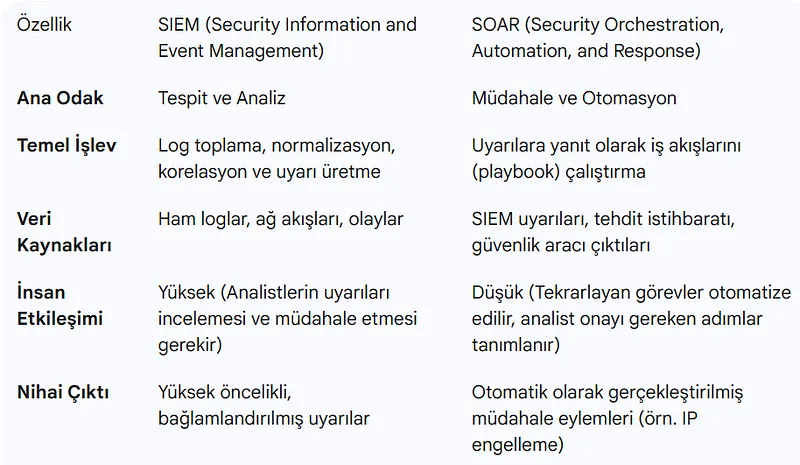
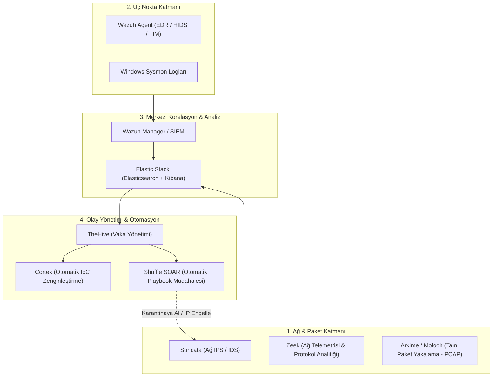

# Açık Kaynak Güvenlik Ekosistemi (Wazuh, Zeek, Suricata, Arkime, TheHive)

Modern bir Güvenlik Operasyon Merkezi (SOC) kurmak, milyonlarca dolarlık lisans maliyetlerine sahip ticari yazılımları zorunlu kılmaz.

Doğru mimari ve entegrasyonla yapılandırılmış açık kaynaklı güvenlik araçları; dünya çapındaki finans kuruluşları, telekom operatörleri ve devlet kurumları tarafından kullanılan, ticari alternatiflerine denk hatta birçok alanda daha esnek kurumsal bir savunma kalesi oluşturabilir.





---

## §12.2.1. Uç Nokta Güvenliği ve SIEM: Wazuh Mimarisi ve Kurulumu

**Wazuh**, açık kaynak dünyasının en kapsamlı SIEM ve Genişletilmiş Tespit ve Yanıt (XDR) platformudur:

- **Ajan Tabanlı İzleme:** Linux, Windows ve macOS sunuculara hafif bir ajan (Wazuh Agent) kurulur.
- **Dosya Bütünlük Denetimi (FIM - File Integrity Monitoring):** Sistemdeki kritik dosyalar (`/etc/passwd`, `C:\Windows\System32`) izlenir. Dosyada tek bir karakter veya hash değiştiğinde gerçek zamanlı alarm üretilir.
- **Kök Kullanıcı ve Zararlı Tespiti (Rootcheck):** Sistemdeki gizli süreçleri, dinleyen yetkisiz portları ve trojan izlerini periyodik olarak tarar.

### Pratik Wazuh Agent Kurulumu:
```bash
# Ubuntu / Debian Ajan Kurulumu ve Yöneticiye Kayıt
curl -s https://packages.wazuh.com/key/GPG-KEY-WAZUH | gpg --no-default-keyring --keyring gnupg-ring:/usr/share/keyrings/wazuh.gpg --import && chmod 644 /usr/share/keyrings/wazuh.gpg
echo "deb [signed-by=/usr/share/keyrings/wazuh.gpg] https://packages.wazuh.com/4.x/apt/ stable main" | tee -a /etc/apt/sources.list.d/wazuh.list
apt-get update

# Yönetici IP adresi belirtilerek ajan servisi başlatılır
WAZUH_MANAGER="10.0.0.10" apt-get install wazuh-agent
systemctl daemon-reload
systemctl enable wazuh-agent
systemctl start wazuh-agent
```

---

## §12.2.2. Ağ Güvenlik Analitiği: Suricata, Zeek ve Arkime

1. **Suricata (Aktif IPS):** Ağ omurgasında hat üzerinde (Inline) çalışarak bilinen imzalara sahip saldırı paketlerini anında düşürür.
2. **Zeek / Bro (Ağ Metaveri Analitiği):** Paketlerin tamamını saklamak yerine, ağdaki tüm TCP oturumlarını (`conn.log`), DNS sorgularını (`dns.log`), HTTP oturumlarını (`http.log`) ve SSL sertifikalarını (`ssl.log`) ayrıştırarak Elasticsearch'e aktarır. Bir tehdit avcısı geriye dönük 6 aylık tüm DNS sorgularını saniyeler içinde arayabilir.
3. **Arkime (Eski Adıyla Moloch):** Büyük ölçekli tam paket yakalama (Full Packet Capture - FPC) sistemidir. Ağdan geçen her baytı indeksler. Bir saldırı tespit edildiğinde analist Arkime web arayüzünden ilgili oturumun orijinal `.pcap` dosyasını tek tıkla indirip Wireshark'a aktarabilir.

---

## §12.2.3. NOC/SOC İzleme: Prometheus ve Grafana Docker Mimarisi

Ağ ve sistem telemetrisini görselleştirmek için sektör standardı olan Prometheus ve Grafana ikilisi konteyner mimarisiyle hızla ayağa kaldırılabilir:

```yaml
# docker-compose.yml - Prometheus ve Grafana Telemetri Stack
version: '3.8'

services:
  prometheus:
    image: prom/prometheus:v2.45.0
    container_name: prometheus
    restart: unless-stopped
    volumes:
      - ./prometheus.yml:/etc/prometheus/prometheus.yml:ro
      - prometheus_data:/prometheus
    command:
      - '--config.file=/etc/prometheus/prometheus.yml'
      - '--storage.tsdb.path=/prometheus'
      - '--web.console.libraries=/etc/prometheus/console_libraries'
      - '--web.console.templates=/etc/prometheus/consoles'
      - '--web.enable-lifecycle'
    ports:
      - "9090:9090"

  grafana:
    image: grafana/grafana:10.0.3
    container_name: grafana
    restart: unless-stopped
    ports:
      - "3000:3000"
    environment:
      - GF_SECURITY_ADMIN_USER=admin
      - GF_SECURITY_ADMIN_PASSWORD=GucluGrafanaSifresi!
    volumes:
      - grafana_data:/var/lib/grafana

volumes:
  prometheus_data:
  grafana_data:
```

---

## §12.2.4. Uç Nokta Savunması: Fail2Ban ile Kaba Kuvvet Engelleme

Sunuculara yönelik SSH ve web brute-force saldırılarını anında engellemek için yerel logları okuyup iptables kuralları yazan Fail2Ban kullanılır:

```ini
# /etc/fail2ban/jail.d/sshd.local
[sshd]
enabled = true
port = ssh
filter = sshd
logpath = /var/log/auth.log
maxretry = 3
findtime = 600
bantime = 86400
action = iptables[name=SSH, port=ssh, protocol=tcp]
```

- Son 10 dakika içinde (`findtime = 600`) 3 kez hatalı parola giren IP adresi (`maxretry = 3`), 24 saat boyunca (`bantime = 86400`) güvenlik duvarı seviyesinde tamamen engellenir.
