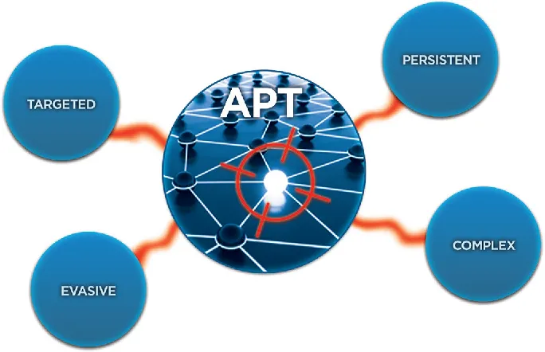
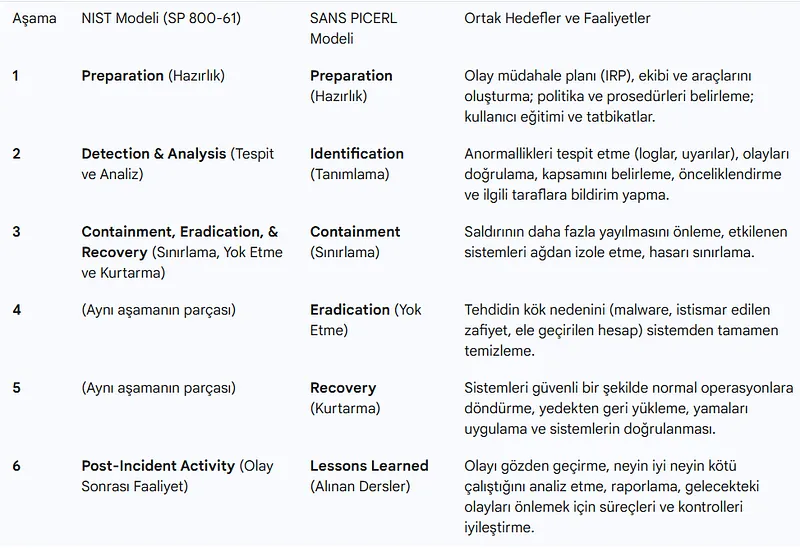
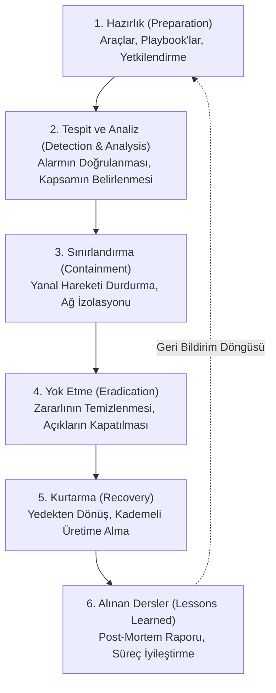
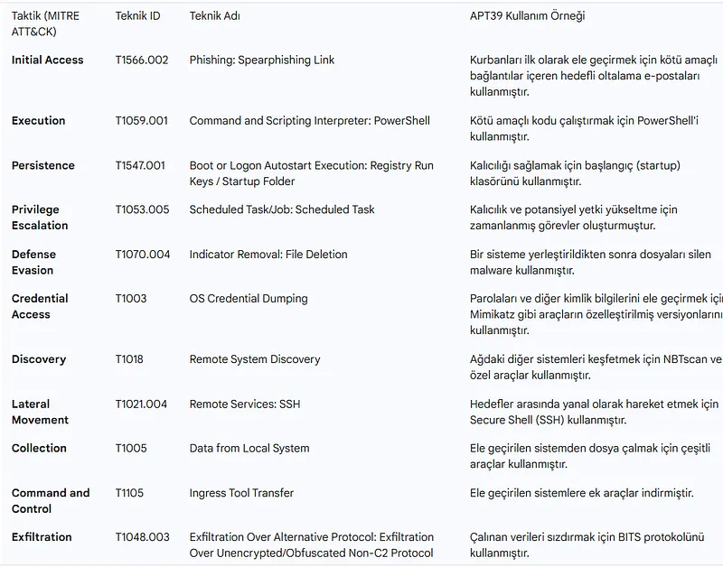

# Ağ Adli Bilişimi (DFIR), Delil Zinciri ve Olay Müdahale

Bir siber güvenlik ihlali gerçekleştiğinde en kritik soru şudur: *"Saldırgan ne zaman girdi, hangi makineleri ele geçirdi ve hangi verileri dışarı çıkardı?"*

Uç noktalardaki (sunucu veya bilgisayar) deliller saldırgan tarafından silinebilir veya disk imha edilebilir; ancak ağdan geçen paketler, saldırganın silme yetkisinin olmadığı harici ağ kayıt cihazlarında (TAP, SPAN, FPC) sessizce kaydedilmiş olabilir. Bu nedenle **Ağ Adli Bilişimi (Network Forensics)**, dijital olay müdahalesinin en tarafsız ve çürütülemez delil kaynağıdır.

---

## §12.3.1. Olay Müdahale Modelleri: NIST SP 800-61 vs. SANS PICERL

Profesyonel bir Mavi Takım (Blue Team) operasyonunda olay müdahalesi katı metodolojilerle yürütülür:

1. **Hazırlık (Preparation):** Olay olmadan önce izleme araçlarının, iletişim kanallarının ve yasal prosedürlerin hazır olmasıdır.
2. **Tespit ve Analiz (Detection & Analysis):** Gelen SIEM/IDS alarmının bir yanlış pozitif mi yoksa gerçek bir ihlal mi olduğunun belirlenmesi (Triage).
3. **Sınırlandırma (Containment):** Enfekte olan makinelerin ağ bağlantısı switch seviyesinde veya EDR üzerinden derhal kesilir. Amaç saldırganın diğer sunuculara yayılmasını önlemektir.
4. **Yok Etme (Eradication):** Zararlı yazılımların, arka kapıların (Web Shell) ve saldırganın açtığı yetkili hesapların tamamen temizlenmesi.
5. **Kurtarma (Recovery):** Sistemlerin temiz ve güvenli yedeklerden geri yüklenerek sıkı denetim altında yeniden devreye alınması.
6. **Alınan Dersler (Lessons Learned):** İhlalin nasıl gerçekleştiği, savunmanın nerede yetersiz kaldığı analiz edilir ve gelecekteki saldırılara karşı kurallar güncellenir.

---

## §12.3.2. Vaka Analizi: APT Grubu (APT39) için MITRE ATT&CK TTP Haritalaması

Ağ adli bilişiminde saldırganların taktik, teknik ve prosedürlerini (TTP) anlamak için küresel **MITRE ATT&CK** çerçevesi kullanılır:

- **Initial Access (İlk Erişim):** Oltalama e-postaları (T1566) veya internete açık servis zafiyetleri (T1190).
- **Execution (Çalıştırma):** PowerShell veya WMI betik çalıştırmaları (T1059).
- **Lateral Movement (Yatay Hareket):** SMB/Windows Admin Shares (T1021.002) ve Pass-the-Hash.
- **Exfiltration (Veri Kaçırma):** DNS Tünelleme veya şifreli web oturumları üzerinden veriyi dışarı aktarma (T1048).

---

## §12.3.3. Ağ Adli Bilişimi ve RFC 3227 Uçuculuk Sırası

Sayısal deliller toplanırken en uçucu (kaybolması en muhtemel) veriden en kalıcı veriye doğru bir sıra izlenmelidir:

1. **İşlemci Kayıtları ve Önbellek (Registers & Cache):** En uçucudur, nanosaniyeler içinde kaybolur.
2. **Yönlendirme Tablosu, ARP Önbelleği, Süreç Tablosu ve Çekirdek Belleği (RAM):** Elektrik kesildiği an silinir.
3. **Geçici Dosya Sistemleri ve Aktif Ağ Bağlantıları (`netstat`, `ss`).**
4. **Kalıcı Depolama (Sabit Diskler, SSD'ler).**
5. **Ağ Paket Kayıtları (PCAP) ve Uzak Log Depoları (SIEM/Syslog):** En az uçucu ve en güvenilir delillerdir.

---

## §12.3.4. Delil Zinciri (Chain of Custody) ve Yasal Geçerlilik

Mahkemelerde veya yasal soruşturmalarda (CMK 134, 5651 Sayılı Kanun) sunulacak bir ağ paket kaydının veya disk imajının delil niteliği taşıyabilmesi için **Delil Zincirinin** bozulmaması şarttır:

- **Kriptografik Bütünlük (Hash):** Ele geçirilen `.pcap` dosyasının ilk anda hesaplanan **SHA-256** hash değeri kayıt altına alınmalıdır.
- **Asla Orijinal Delil Üzerinde Çalışılmaz:** Analiz daima delilin doğrulanmış adli kopyası (Forensic Image / Copy) üzerinde yapılır.
- **Formel Kayıt Tutma:** Delile kimin, hangi tarihte, hangi amaçla eriştiği ıslak imzalı veya dijital imzalı "Delil Takip Tutanağı" ile belgelenir.
- Hash değerinde tek bir bit bile değişirse, delil manipüle edilmiş sayılarak mahkemede geçersiz kılınır.
