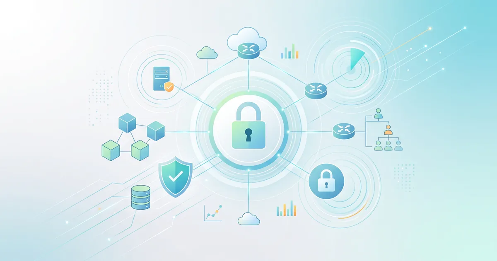
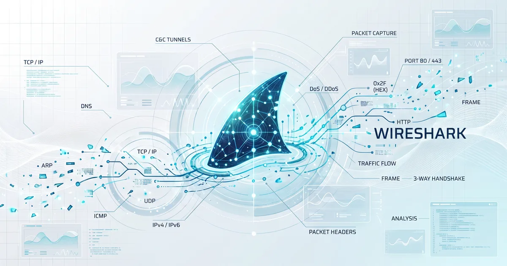

## Kitap Hakkında

Bu teknik web kitabı, kurumsal ağ altyapılarını tasarlayan, yöneten ve koruyan sistem/ağ mimarları, güvenlik mühendisleri, SOC/Blue Team analistleri ve ağ adli bilişim (DFIR) uzmanları için hazırlanmış kapsamlı bir başucu kaynağıdır.

Klasik ağ dokümantasyonlarından farklı olarak bu çalışma, **kuramsal mimariyi doğrudan canlı paket düzeyindeki pratikle** birleştirir. Bir yönlendirme veya anahtarlama protokolü anlatılırken yalnızca teorisiyle kalmaz; **Wireshark PCAP incelemeleri, paket başlık anatomileri, saldırı vektörleri (SYN Flood, ARP Spoofing, DNS Tünelleme, C2 haberleşmesi) ve filtreleme yöntemleri** adım adım sunulur.

---

## İki Temel Mühendislik Sütunu

Bu kitap, iki büyük teknik bilgi birikiminin ve pratik saha deneyiminin sentezlenmesiyle oluşturulmuştur:

| Sütun | Odak Alanı | Kapsanan Temel Konular |
| :--- | :--- | :--- |
| **Ağ Yönetimi ve Güvenliği (NSM)** | Mimari, Altyapı, Savunma ve Operasyon | Omurga (Spine-Leaf), L2/L3/L4/L7 mimarisi, NGFW, IDS/IPS, ZTNA, FCAPS, SNMPv3, NetFlow, NetDevOps, Bulut Ağları (VPC), ISOC |
| **Wireshark ile Paket Analizi (WSH)** | Derin Paket İncelemesi (DPI), DFIR ve Analitik | L2-L7 Paket Anatomisi, TCP 3 Yönlü El Sıkışma, TCP Performans/RTO Hataları, DoS/DDoS Tespiti, DNS/ICMP Tünelleri, TLS Şifre Çözümü |

*Şekil 0.1: Kurumsal Ağ Güvenliği, Yönetim Mimarisi ve Savunma Katmanları.*

*Şekil 0.2: Wireshark ile Paket İnceleme, Ağ Taramaları ve Tehdit Avcılığı.*

---

## Müfredat ve 12 Ana Bölüm

Kitap, savunma derinliği (*defense-in-depth*) ve paket yaşam döngüsü metodolojisiyle yapılandırılmış 12 ana bölüm ve 39 alt bölümden oluşur:

### Katman 1 — Temeller ve Mimari (L1 - L3)
1. **[01. Ağ Mimarileri ve Trafik Akışı](01-ag-mimarileri-ve-trafik-akisi/01-ag-mimarileri-ve-modeller/):** OSI ve TCP/IP modelleri, kablolama standartları (UTP/STP/Fiber), omurga mimarileri (Spine-Leaf) ve Wireshark ile canlı trafik akış analizi.
2. **[02. Bağlantı ve Ağ Katmanı Protokolleri](02-baglanti-ve-ag-katmani-protokolleri/01-arp-protokolu-ve-paket-anatomisi/):** ARP/RARP anatomisi, IPv4 ve IPv6 başlıkları, parçalama/yeniden birleştirme, ICMP tanı araçları ve VLAN/Trunking/STP anahtarlama güvenliği.

### Katman 2 — Taşıma ve Uygulama Katmanı (L4 - L7)
3. **[03. Taşıma Katmanı (TCP/UDP) Analizi](03-tasima-katmani-tcp-ve-udp-analizi/01-tcp-protokol-anatomisi-ve-oturum-yonetimi/):** TCP bayrakları, 3 yönlü el sıkışma ve ISN, Sequence/ACK takibi, TCP performans sorunları (Retransmission, Zero Window, RST analizi) ve UDP akış analitiği.
4. **[04. Uygulama Katmanı Protokolleri](04-uygulama-katmani-protokolleri/01-dns-protokolu-ve-isim-cozumleme-analizi/):** DNS hiyerarşisi/sorgu çözümleme, HTTP/HTTPS metodları ve oturum takibi, TLS 1.2/1.3 el sıkışması ve Wireshark SSLKEYLOGFILE ile şifre çözümü, FTP/FTPS/SFTP ve SMTP e-posta güvenliği (SPF, DKIM, DMARC).

### Katman 3 — Savunma, Saldırı Tespiti ve Tehdit Avcılığı
5. **[05. Ağ Savunma Teknolojileri ve Mimarisi](05-ag-savunma-teknolojileri-ve-mimarisi/01-guvenlik-duvarlari-ve-ngfw-mimarisi/):** Stateful/NGFW güvenlik duvarları, DPI tabanlı IDS/IPS sistemleri (Snort/Suricata), DMZ tasarımı, Sıfır Güven (ZTNA/SASE) ve IPsec/SSL VPN & WPA3 kablosuz güvenlik.
6. **[06. Ağ Saldırıları, DoS/DDoS ve Paket Tespiti](06-ag-saldirilari-dos-ddos-ve-paket-tespiti/01-katman-2-saldirilari-ve-tespiti/):** Katman 2 saldırıları (Macof, CAM Overflow, ARP Poisoning, DHCP Starvation), L4/L7 DoS/DDoS vektörleri (SYN Flood, UDP Amplification, Slowloris) ve paket düzeyinde tespit imzaları.
7. **[07. Gizli Kanallar (C2) ve Tehdit Avcılığı](07-gizli-kanallar-c2-ve-tehdit-avciligi/01-dns-tunelleme-ve-c2-tespiti/):** DNS tünelleme (dnscat2, iodined), ICMP tünelleme (ptunnel), HTTP Beaconing ve Wireshark ile gelişmiş tehdit avı display filtreleri.

### Katman 4 — Kurumsal Yönetim, Otomasyon ve Bulut
8. **[08. Kimlik ve Active Directory Güvenliği](08-kimlik-ve-active-directory-guvenligi/01-kimlik-ve-erisim-yonetimi-iam-ve-aaa/):** IAM/AAA (RADIUS/TACACS+), IEEE 802.1X NAC, Kerberos ve NTLM protokol analizi, Pass-the-Hash/Golden Ticket tespiti ve PAM/FIDO2.
9. **[09. Ağ Yönetimi, İzleme ve Telemetri](09-ag-yonetimi-izleme-ve-telemetri/01-fcaps-modeli-ve-snmp-mimarisi/):** ISO FCAPS modeli, SNMPv3 USM/VACM, NetFlow v5/v9, sFlow, IPFIX akış telemetrisi ve RFC 5424 Syslog merkezi log yönetimi.
10. **[10. Ağ Otomasyonu ve NetDevOps](10-ag-otomasyonu-ve-netdevops/01-kod-olarak-altyapi-iac-ve-netdevops/):** Infrastructure as Code (IaC), NETCONF/RESTCONF ve YANG veri modelleri, Python (Netmiko/Paramiko) ve Ansible ile çok cihazlı ağ orkestrasyonu.
11. **[11. Bulut Ağları ve Hibrit Altyapı Güvenliği](11-bulut-aglari-ve-hibrit-altyapi-guvenligi/01-bulut-ag-mimarisi-vpc-ve-vnet/):** AWS VPC / Azure VNet mimarisi, Güvenlik Grupları (SG) ve Ağ ACL'leri, Transit Gateway, Direct Connect / ExpressRoute ve CSPM/CASB kontrolleri.
12. **[12. SOC/NOC Operasyonları ve Ağ Adli Bilişimi](12-soc-noc-ve-ag-adli-bilisimi/01-soc-ve-noc-sinerjisi-isoc-mimarisi/):** ISOC (Entegre SOC/NOC) operasyon modeli, açık kaynak güvenlik ekosistemi (Wazuh, Zeek, Suricata, Prometheus/Grafana) ve NIST/SANS DFIR adli bilişim süreci.

---

## Standartlar ve Desteklenen Araçlar

Bu kitapta yer alan tüm mimari desenler ve paket analizleri uluslararası mühendislik standartlarına dayanır:

- **Protokol Standartları:** RFC 791 (IPv4), RFC 793 (TCP), RFC 768 (UDP), RFC 1035 (DNS), RFC 8446 (TLS 1.3), RFC 5424 (Syslog), IEEE 802.1Q (VLAN), IEEE 802.1X (NAC).
- **Güvenlik Çerçeveleri:** NIST SP 800-61r2, NIST Cybersecurity Framework, MITRE ATT&CK for Enterprise, CIS Critical Security Controls v8.
- **Analiz ve Otomasyon Araçları:** Wireshark, TShark, tcpdump, Nmap, Scapy, Netmiko, Ansible, Terraform, Wazuh, Zeek, Suricata.

